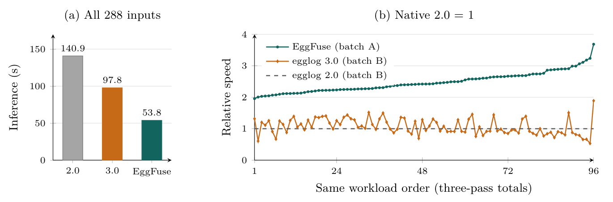

# EggFuse: Exploiting Locality in E-Graphs

EggFuse is an experimental Rust compiler and standalone CPU executor for egglog programs. It explores how related rule applications can share query work, execution state, and storage across scheduled runs.

## Architecture

A **Cell template** describes typed slots, query atoms, and an ordered instruction block (`Copy`, `Let`, `Set`, `Union`, `Hide`, `Panic`). Its instances hold concrete bindings and actual result witnesses. **Shared Entry** projects those existing slots into later queries. **Iterative Bake** uses observed applications and compiler proofs to compose reusable Cells and eliminate covered queries, handoffs, and maintenance.

Original Run boundaries, effect ordering, equality repair, and residual matching remain authoritative. A Cell is not an e-class or an automatic guarantee of conflict-free parallel execution. Full egglog compatibility is still a work in progress.

## This branch

This branch develops **cross-stage Cell completion and structural compression**. Checked application relationships identify completed components whose eligible source frames can share storage while preserving actual fact references and lifecycle metadata. The shared-owner transfer is currently opt-in; unsupported and live boundary cases retain ordinary storage.

The [shared-owner experiment](benchmarks/cell-structural-compression/shared-owner.md) reports a 6.08% reduction in counted Graph bytes on its sum-bits fixture. This is not total heap/RSS, transfer-time peak memory, or evidence of a speedup. See the [experiment index](benchmarks/cell-structural-compression/README.md) for scope and controls.

## Quick start

Requires Rust/Cargo and the vendored dependencies in this repository. From the repository root, use fresh output directories:

```sh
cargo cell-compile --case sum-bits --output out/sum-bits
cargo cell-run --program out/sum-bits/program.json --output out/run
cargo cell-bench --program out/sum-bits/program.json --repeat 5
```

Use `--case raytrace` for the larger example, or `--source app.egg` to compile a supported custom program. See the [compiler documentation](tools/cell-compiler/README.md) for more options.

## eggcc comparison



Figure 7 from the [working paper source](https://github.com/MilkBlock/eggfuse/tree/codex/primitive-compatibility-paper/paper): 96 workloads × 3 captured pass inputs on one Apple M3 Max, one runtime thread. Totals are sums of per-input medians: **140.860 s** (egglog 2.0), **97.805 s** (egglog 3.0), and **53.789 s** (EggFuse). The two same-machine batches repeat the unchanged 2.0 binary as a control; its aggregate time differs by 0.37%.

These are historical frozen-pass execution results for EggFuse `8450e627`, **not current-branch or multithreaded performance**. They exclude 727.05 s of offline preparation; memory use is higher, and suite-wide semantic equivalence has not been established. The image is rendered directly from the paper, without changing its data. The paper is an AI-generated working draft under revision; implementation and experiments are extensively AI-assisted.

## Development

- [Parallel execution](https://github.com/MilkBlock/eggfuse/tree/codex/cell-parallel-admission)
- [Structural compression and cross-stage completion](https://github.com/MilkBlock/eggfuse/tree/codex/cell-structural-compression)

See [AGENTS.md](AGENTS.md) for development and semantic acceptance requirements. The reviewed sum-bits contract uses [choice diagnosis](benchmarks/marker-handoff/choice-diagnosis.md); final-state checks do not replace Run-boundary validation.
