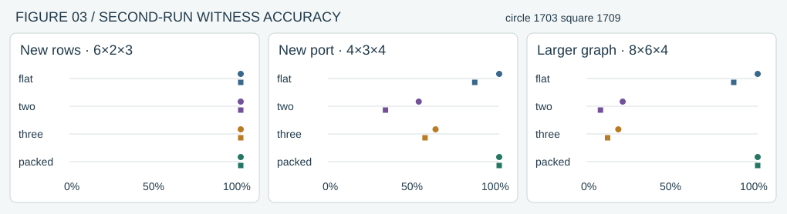

# 图 03：跨 row、位置与端口的旋转寻址

在这个有明确来源地址的两步读取任务上，**只改变 row 或行长时，四种编码都准确。端口数从训练中的 2/3 增至 4 后，把完整三元地址压成一个标量再旋转的 packed 对照最稳定**。逐轴旋转的性能取决于已学到的打分函数，并不会自动获得对新端口的泛化。



## 这次如何选择父

同图每个 Cell 含 P 个可选择的端口。Run 1 的查询在生成位置 q 收到一个原始地址 (r,t,p)，用学习得到的指针打分所有源端口，按自己的 argmax 产生带 origin、payload、48 维 latent 的 Pair。完整 frontier 的物理槽序与来源独立置换。Run 2 收到另一批**原始地址**，直接从生成的 Pair 中选择父槽并返回其值。数据集的真实生成槽只出现在训练损失和事后审计。违反绑定契约的指针即使读到相同值也会失败。一个 Cell 包含多个端口，各 row 属于同图。输出查询位置与数量已给定，这一任务隔离「如何寻址」；自由生成的重复／遗漏仍要回到完整引擎实验。

四种 PyTorch 模型具有完全相同的可学习参数形状、配对初值、端口内容特征和 48 个旋转通道。flat 旋转 rL+t，two 将 48 维分给 r,t，three 分给 r,t,p，packed 旋转 (rL+t)P+p。四支都另获连续的 p 与 p/(P−1) 等共同特征；整数 stride 能覆盖给定的整段地址空间。两次指针都由 GPU attention 得分，实际 gather 使用所选物理下标。finish 对生成 latent 有梯度；在同一批记录上置换父、篡改来源/值的干预测试通过。[前向实现](model.py) · [端口与父血缘审计](data.py) · [冻结协议](PROTOCOL.md)

## 主结果

训练形状为 2×3×2、2×4×3、3×4×2、4×3×3，各 512 图。每个 seed 从头训练 1024 步。每项为两次 Run 都完全正确的图数，分母均为 128，数字顺序为种子 1703 / 1709。

| 编码 | 训练形状的新图 4×3×3 | 同图换为 6×2×3 或 2×6×3 | 新端口 4×3×4 | 扩到 8×6×4（192 个端口） |
|---|---:|---:|---:|---:|
| flat，端口走内容 | 128 / 128 | 128 / 128 | 128 / 0 | 128 / 0 |
| two，row 和位置各一轴 | 128 / 128 | 128 / 128 | 0 / 0 | 0 / 0 |
| three，另设端口旋转轴 | 128 / 128 | 128 / 128 | 0 / 0 | 0 / 0 |
| packed，完整地址一轴 | 128 / 128 | 128 / 128 | **128 / 128** | **128 / 128** |

0 个完整图仍可能有许多合法引用。在 4×3×4 的 6,144 个第二步义务上，flat 为 6,144/5,267，two 为 3,258/2,064，three 为 3,861/3,483，packed 为 6,144/6,144。three 两个种子在 Run 1 对新端口编号 3 的 1,536 个引用均为零个正确。两个 Run 的父就绪、跨行/同行、正确 Cell 错端口及重复、遗漏的分母与计数均保留。[逐项 TSV](results/metrics.tsv)

4×3×3 上所有模型的 3,463 个跨行和 264 个同 Cell 不同端口的第二步义务全部完成。各组单图 MPS 中位数约 1.98–2.10 ms。4×3×4 上 packed 为 3.05/3.02 ms；8×6×4 上为 2.12/2.14 ms。两种输入规模的端到端时间非单调，不能从这些小规模样本推导一般复杂度。计时包含原始动态输入到设备、两阶段、解码、生成 latent 与同步，各臂交替顺序，选定布局的静态坐标常驻。每组热身四次、计时 32 张，下载和 CPU 审计在后。[完整时间样本](results/evaluation.json)

## 位置重排和跨度诊断

1. 在训练见过的端口数 3 上，强制将同一图改为新的行数／行长并且逐 Cell 独立改编端口号，再把两个物理指针映回原图。八个模型全为 128/128。只移动 Cell、保持内部 port ordinal 时，按槽对齐后的连续 Pair latent 也逐位一致；只变内部端口号时，离散结果仍全部正确，但连续 latent 的逐位整图相同数均为 **0/128**。原始端口号参与了内容编码，不能把输出对齐外推成 latent 的强规范性。[逐位检查](results/latent-relayout.json)
2. 事后固定权重和原先 36 个候选，只将公开端口 stride 从 3 改为 4，仍然只出现 p=0,1,2。two 的完整数从 128/128 变为 0/0；three 从 128/128 变为 128/0。仅让共用内容通道恢复原来的分母后，两者均回到 128/128。对这两臂，旋转角本身与 P 无关，因此此项确实测到了公共特征尺度的影响。真正加入端口 3 时，仅恢复分母依然不能使 two 或 three 通过。packed 在所有这组固定权重诊断上均通过。这仅说明本编码器、训练宽度和整数 stride 下的表现。[诊断](results/stride-probe.json)

## 迁移到图 20 的真实生成前沿

另将图 03 **第一步的地址打分头**应用到图 20 已生成的八个候选槽。查询只取原请求中可见的指定来源；保留原始全部候选、失活项、错误项和重复项。采用公开的 2×4×2 布局时，两个前沿上的合法请求均 780/780 命中正确地址，但实际有效父仅 536/780、752/780；否则选到了同地址的失活副本。保留原消费者的激活和 Request 决策，只替换父指针并沿所选父做投影，完整图从 61→136、65→265 /384。此为冻结轨迹上的离线干预，未执行或计时一个新的完整图 20 引擎。[迁移方法、盲测配对与交叉种子](TRACE_TRANSFER.md)

这些证据支持用 packed 作后续寻址基线。在上述冻结前沿上，只在地址最高分并列时优先取生产者已激活的槽，就使两个种子的有效父检索都达到 780/780。倒序枚举八个候选也选到相同物理父。完整图升至 263/384、282/384，剩余错误涉及消费者的发射与请求分配。真正的未知匹配数、union 后旧引用、ownership 与跨规则推导仍有各自判据。

## 复现

使用此前的硬盘环境、PyTorch 2.15.0、Apple M3 Max；关闭 MPS CPU 回退。只依赖 NumPy 的审计可从保存的结果运行。已有最终权重不会在训练 CLI 中被覆盖。比较仅使用最终 checkpoint，输入数据、配对初值和样本顺序均有哈希。

```sh
base=benchmarks/multi-row-generation/address_ablation
run=/Volumes/EggFuseWorkspace/experiments/NEW-address-axes
for arm in flat two three packed; do
  for seed in 1703 1709; do
    ~/.local/bin/eggfuse-job submit --kind compute -- /Volumes/EggFuseWorkspace/bin/run-eggfuse env PYTORCH_ENABLE_MPS_FALLBACK=0 python "$base/fit.py" "$run" "$arm" "$seed"
  done
done
# Fitted models must exist before these commands. Run compute steps via the same queue.
python "$base/evaluate.py" "$run"
python "$base/replay.py" "$run"
python "$base/stride_probe.py" "$run"
python "$base/latent_relayout.py" "$run"
python "$base/report.py" "$run" ./summary
```
