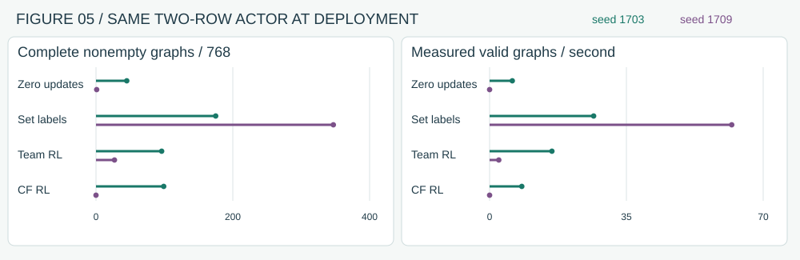

# 图 05 · 单行预训练之后，两行该怎样学习分工？

**同预算下，两行集合监督在两个种子上都取得了最高的完整覆盖与有效吞吐。** 团队奖励 RL 比直接复制单行策略好，但完整图仍少于集合监督。固定另一行当步动作来估计反事实基线，两个种子分别比团队 RL 多 3 张、少 27 张，未显示可复现的覆盖收益。



## 比较口径

用图 04 的两个单行最终检查点作配对初值。每图、每个源 Run 有八个自由输出位置，适配时为两行、每行四步。数值设备、实例和两个规则的输入输出契约沿用图 20/04。前一个 Run 的真实 Pair tensor 直接传入后一个 Run。部署的四支都调用同一个确定性 PyTorch 贪心前向。学习期间 RL 实际采样激活、左指针及给定左选择的右指针，下一步消费采出的 token，空槽也保留采到的左右指针作为历史。[采样与 critic](actor.py) · [奖励](reward.py) · [训练](adapt.py)

新留出集为规则 134、135、143 各 32 个新基础组、每组 8 张反事实图，合计 768 张非空图、1,524 项第二 Run 义务。与原训练图、旧测试和图 04 上一批图均无完全相同的输入；三规则来自原来的两个留出家族，768 张图含相关组。零更新、两行集合监督、团队 RL、反事实 RL 每次面对相同的源义务和实例布局。三种适配都为 1,024 次更新、batch 32（每种子 32,768 个两 Run 图 rollout），图/批次流相同，最终 checkpoint 固定。另列冻结单行在这次新面板的表现。[协议](PROTOCOL.md) · [输入哈希](results/fresh-credit-inputs.json)

| 训练与部署 | 第二 Run 完整 /768 | 错父 | 重复（同轮跨行） | 遗漏 /1524 | 两 Run 中位数 ms | 完整非空图/s |
|---|---:|---:|---:|---:|---:|---:|
| 冻结单行，1×8 | 139 / 296 | 1038 / 615 | 12 / 57（0 / 0） | 925 / 569 | 10.37 / 10.80 | 15.73 / 32.85 |
| 零更新，2×4 | 45 / 1 | 1718 / 1384 | 98 / 343（46 / 197） | 949 / 644 | 8.29 / 8.40 | 5.81 / 0 |
| 集合监督，2×4 | **175 / 347** | **996 / 516** | **24 / 25（4 / 0）** | 852 / 535 | 8.15 / 8.53 | **26.62 / 61.95** |
| 团队 RL，2×4 | 96 / 27 | 1156 / 1673 | 169 / 732（79 / 419） | 751 / 483 | 8.06 / 8.20 | 15.95 / 2.36 |
| 反事实 RL，2×4 | 99 / 0 | 1464 / 1992 | 278 / 734（76 / 344） | 676 / 540 | 8.18 / 8.19 | 8.24 / 0 |

各格依次为种子 1703 和 1709。重复按合法完整绑定身份计，同一父分别服务不同的合法 Request 不计重复。错父和遗漏是不同层级的计数。计时为 batch 1，每个模型 96 张相同的留出图轮换顺序，包含输入上设备、两 Run 推理、解码及 MPS 同步。模板向量已缓存，训练、critic、CPU 事后审计与文件 I/O 单列。有效吞吐由实际计时样本上的通过数除以测量总秒数得出。四种两行模型的推理结构相同，耗时差异不表示增加辅助训练改善了设备内核。[逐项表](results/metrics.tsv)

## RL 的训练信号以及它没有解决的错误

奖励为 `(C1 + 2 C2 + P + E2 − W1 − W2 − 1) / 4`。C 表示唯一正确见证比例，P 表示真正被正确 Result 消费的不同所需父比例，E2 为完全正确的非空图，W 为额外或无效输出占八个槽的比例。奖励有界于 [−0.75, 1]，全空为 −0.25、全对为 1。独立训练/推理的结论适用于这种稠密奖励、探索和预算。

两组 RL 都从同一个状态和同一个 79,393 参数的集中式 critic 初值开始，使用实际终局回报的 policy gradient。critic 估计联合动作值 Q(s,a₀,a₁)。团队基线对两个动作都求期望；反事实基线只对本行动作求期望，另一行动作固定为这次的采样值。两行动作在当轮给定历史后独立，低秩 critic 允许在其自身近似 Q 上精确边缘化；Q 对真实回报的估计仍有误差。actor 不接收 critic 的答案或源规则的合法候选表。每个因子使用 4% 均匀探索，critic 只参加训练；部署时去掉探索和 critic。训练墙钟时间，集合监督约 27 s，团队/反事实 RL 约 31–38 s，GPU 实现和优化开销不相同。

1703 的反事实版本使遗漏从团队 RL 的 751 减到 676，同时重复从 169 增到 278，错父从 1,156 增到 1,464。两组都供齐所需父的 594 张图上，完整图 94→97，其中仅团队正确 29 张、仅反事实正确 32 张。1709 的共同就绪子集有 715 张，完整图从团队的 27 降到 0；反事实模型发出了 3,928 个输出，包含 734 次合法重复和 1,992 次错父。该模型每图平均 R2 覆盖约 66.4%，仍没有一张整图满足全部义务。因此更高的部分覆盖或正的平均奖励不能代替对整图的考核。

另在各自冻结 actor/critic 上，抽取 48 个源图，每图采样 32 次，对同一份采样同时应用两个基线。共享激活 bias 的梯度估计方差（条件于源图，取协方差迹再平均），反事实/团队比值在四份模型上为 0.993–1.009。该分量的解析梯度与 autograd 最大差约 2.1×10⁻⁹。这个诊断涉及一个参数分量和有限样本，没有显示显著的减方差作用，不能据此解释所有训练差异。[冻结 critic 诊断](results/baseline-variance.json)

## 两行训练是否只得益于多做了更新？

主要比较完成后，追加两份等预算的单行集合监督对照。训练数据顺序、初值、Adam、学习率及 1,024 次更新相同。在同一新留出集，分别用 1×8 和 2×4 部署同一 checkpoint：

| 额外集合监督在哪个宽度训练 | 用单行测的完整数 /768 | 用两行测的完整数 /768 |
|---|---:|---:|
| 单行 | 155 / 345 | 53 / 9 |
| 两行 | 165 / 300 | 175 / 347 |

这说明对于本任务，仅追加单行训练再扩大并行度，无法复现两行适配的结果。已有无序真值集合足以训练两行：Hungarian 只对齐模型自己发出的槽位与标签，样本没有预先指定应该由哪一行完成哪个绑定。这里使用了精确的离线源标签；该结论并未覆盖无此类监督的训练设置。[等预算对照](results/supervision-width.json)

## 可复核的证据

- 所有训练目的地在外接工作区。独立 CPU 审计复核 30 份正式贪心轨迹、18 份额外单行保留轨迹，以及 8 个真实采样批共 256 条训练轨迹。训练奖励与独立源语义的最大绝对差小于 8×10⁻⁸。图上对齐祖先后才计入 C2 或 P。前向没有按参考值纠正提案。[复核摘要](results/verification.json)
- 四种两行模型同时在每图读取相同模板、实例、阶段和外部事件。一次 graph 的多个 counterfactual state/variant 不是独立源码家族。CPU 审计保留盲组、阶段、同类换源、共同就绪和逐图配对。[主要报告](results/evaluation.json)
- 模型仍是带可见性门控的两 Run 来源选择实验，采用真实规则重放支持的分区与合成需求。完整 eggcc 引擎的自主饱和及速度没有在本次比较中测量。监督两行仍只通过 175/347 张（每种子分母 768），实际距离完整推理尚远。

## 复现

```sh
base=benchmarks/multi-row-generation/credit_ablation
parent=/Volumes/EggFuseWorkspace/experiments/single-to-multi-width-20261119
run=/Volumes/EggFuseWorkspace/experiments/NEW-two-row-credit
python "$base/evaluate.py" "$run" --width-root "$parent" --freeze-only
for arm in supervised team counterfactual; do
  for seed in 1703 1709; do
    ~/.local/bin/eggfuse-job submit --kind compute -- /Volumes/EggFuseWorkspace/bin/run-eggfuse env PYTORCH_ENABLE_MPS_FALLBACK=0 python "$base/adapt.py" "$run" "$parent" "$arm" "$seed"
  done
done
# 在权重就绪后，经同一队列运行设备端检查
python "$base/evaluate.py" "$run" --width-root "$parent"
python "$base/replay.py" "$run"
python "$base/report.py" "$run/results.json" ./summary
```

可用同一训练入口的 `supervised1` 分支运行单行等预算对照，再运行 `supervision_width.py ROOT`。附加方差分析使用 `variance.py ROOT`。冻结模型、原始计时与可重放的轨迹目录为 `/Volumes/EggFuseWorkspace/experiments/two-row-credit-20261119`。
