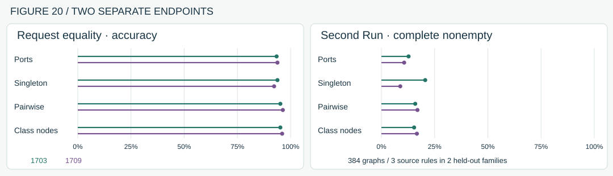

# 图 20：模板局部等价类怎样进入 GNN

**证书提供了有用的信息；在当前留出集上，没有观察到显式类节点优于两两等价边。** 同权重擦除已生效的关系后，两种编码的第二 Run 完整覆盖在两个种子下均下降。即使父已供齐，模型也经常把“允许从同一个类读取”误作“可以任选类中的父”。保留来源身份仍然是实际瓶颈。



## 四个编码、两个种子

在一个 8 位置的单行神经解码器中，比较显式端口图、每端口一个单例类节点、已证端口对之间直接传递消息、端口与匿名类节点之间传递消息。基础模板图均包含源操作、包括 union 在内的效果指令、顺序、绑定及投影。证书臂能在局部操作提交后读取预计算的非平凡分区；模板源码本身对各臂都可见。后续 GNN 输入按两个 owner 各自的阶段及提交 receipt 独立选择。同一批图允许两个 owner 的可见分区不同。真正发生的外部 union 作为每个实例收到的事件输入；跨实例同余后果只进入离线标签和审计。

各组 GNN 均为 11,488 个参数，整个网络均为 39,412。对应种子的初始权重、训练输入、minibatch 顺序相同。每模板 1,024 个训练图，共 7,168 图；每模型 1,536 步、batch 32、最终 checkpoint。两个 Run 间传递原始来源、字段和生成 latent。物理端口索引仅沿实际选择的父携带，用于 GPU 读取共享模板向量；不会给出正确匹配表。附加的请求合法性头在训练时获得是否同类的监督，推理时读取自身 logits。[协议](PROTOCOL.md) · [PyTorch 前向](model.py) · [四种编码](encoder.py) · [训练](fit.py)

留出 3 条规则（134、135、143），分属 2 个完整结构族。每条 128 图，共 384 张非空图、780 项第二 Run 义务、1,536 个请求判断。每个独立基础输入产生 4 状态 × 2 来源变体，总共 48 个基础组。下表每格为种子 **1703 / 1709**。

| 模板编码 | 完整非空图 /384 | 请求合法性正确 /1536 | 错父 | 重复 | 遗漏 /780 | 缓存后两 Run ms | 冷启动两 Run ms |
|---|---:|---:|---:|---:|---:|---:|---:|
| a 显式端口 | 49 / 41 | 1435 / 1441 | 601 / 649 | 13 / 8 | 542 / 586 | 10.20 / 10.73 | 12.53 / 12.77 |
| b 单例类节点 | 79 / 34 | 1441 / 1417 | 501 / 606 | 17 / 3 | 455 / 584 | 10.35 / 10.65 | 12.57 / 12.46 |
| c 已证等价端口对 | 61 / 65 | 1462 / 1480 | 538 / 536 | 12 / 10 | 481 / 505 | 10.50 / 10.93 | 14.60 / 14.74 |
| d 端口—类成员图 | 59 / 64 | 1462 / 1475 | 533 / 555 | 14 / 10 | 478 / 494 | 10.68 / 10.26 | 14.94 / 14.96 |

c 对 a 的完整数增加 12/24，但 d 对单例节点 b 的变化为 −20/+30，依赖种子。c 和 d 的逐图结果也并非同一集合：d 相对 c 在 1703 中增加 33 张、丢失 35 张，在 1709 中增加 32 张、丢失 33 张。对固定模板内的 8 图基础组做配对重采样，d−c 的描述性区间均跨零。这里仅有两个留出家族，没有统计依据判断哪一种表示普遍更优。[完整分层](results/metrics.tsv) · [逐图配对变化](results/paired.tsv)

## 证书是否实际参与决策

独立于主消融，做了一次事后干预。让 finish 继续读取同一个生成的 Pair tensor、真实 receipt、原始 external 事件和当前 phase，只将已生效的局部模板向量替换为同一模板未提交时的向量。c 的完整数从 61/65 降到 44/53；d 从 59/64 降到 34/44。两种无证编码 a/b 的输出没有变化。这个结果说明对应检查点依赖有效关系通道；擦除属于对冻结模型的输入干预。[擦除记录](results/erase-certificate.json)

另用每个 c 的训练权重比较同一逻辑传播距离：直接聚合类内邻居，与经成员矩阵求和再广播、减去自己的贡献。后者没有构造两两 clique。冻结端口向量最大绝对差约 2.38×10⁻⁷，留出图的两个 Run 离散决策均一致。这是等价聚合实现的检查。主消融的 d 则是真实经过独立类节点的两层非线性消息传递，重新训练过。现有公开接口每模板只含一个二元非平凡类，无法据此推断大类上的存储或吞吐优势。

## 会判断同类，仍会选错来源

完整图需要每个请求的指定物理来源恰好被选一次、祖先与字段正确、无额外非法输出。错父按原始身份计；相等类不会吞掉两份不同的见证。四臂在 384 张留出图上都提供了全部所需的正确父，因此这里能隔离消费者错误。

- 盲测中，真正因 pre→post 改变合法性的 30 个探针上，a、c、d 两个种子均在前后两端分类正确 30/30。仅观察这个分类准确率会漏掉消费者失误。
- post 与 external 各有 30 对可检验的同类换源请求：读取端点相同，只换必须使用的原始父。即使正确父皆已存在，每个模型分别只在 **0 或 1 对 /30** 上两次都发出正确来源；盲子集均为 **0/6**。
- c/d 两个种子在生成输出中都没有实际提交前的局部等价误用，也没有在受抑制的本地实例上产生这类误用。但仍有跨实例污染：c 为 22/24，d 为 18/19。完整的 pre、post、nonmerge、external 分层，以及原始关系分类假阳性/假阴性均保留。[成对审计](results/paired-controls.json)

## 材料来源与边界

上轮 Bake 摘要中的表达式等价类计数不能直接用作端口证明。这次从真实 eggcc Pass 3 的 typed recipe 中取显式、同 sort 的 union 操作，记录模板版本、源 slot、可见阶段和 producer 提交条件，并用真实 Cell CPU 重放。上轮 19 个两叶模板中，6 个发布端口连到有效 union 的产物，均来自规则 143。为形成结构留出，模型语料扩为 10 条规则：1 条是先前组合的生产者、3 条曾是 Spine 叶、6 条是同源规则扩展。仅在真实重放已区分两个 owner 各三个同类型端口时才准入。[证书来源](corpus/README.md)

35 个基础程序与 100 个实例事件程序共 135 个通过真实重放。90 个外部 union 中有 9 个还引发第二条构造器同余后果（规则 266、267、580）。实际闭包与独立构造器检查均用于审计。神经任务的两步 publication/provenance 探针使用随机重命名的实例、候选和请求；生产者是否提交是观测到的环境状态，网络没有自行执行真实 workload 中的 union。留出规则不含上述额外同余的正例，而且三元分区模式在训练中出现过。此次检验衡量这些有条件模板的端口表示、跨实例干扰及来源选择，不能推导一般 union 闭包或完整 eggcc 的性能。[冻结数据及局限](data/README.md)

## 时间与复现

同机 Apple M3 Max、PyTorch 2.15 MPS、显式关闭 CPU fallback。每个留出模板计时 32 次 batch-one 调用，从相同基础组抽取 pre/post/nonmerge/external 及两种来源；轮换模型顺序并同步 GPU。 cached 包含原始输入上设备、按实例选视图、两个 Run 生成与解码及同步；cold 额外从已解析模板构造四种状态的去重图、上传并编码。两种计时均在全部前向完成后用 CPU 重新审计，缓存冷热预测相同。原始延迟样本与模型哈希见 [结果记录](results/results.json)。

在硬盘工作树根目录运行以下命令。Rust 重放及证书导出在 corpus/ 中单独复现。所有训练臂使用同一队列。

```sh
base=benchmarks/multi-row-generation/eclass_ablation
run=/Volumes/EggFuseWorkspace/experiments/NEW-eclass-ports
for arm in explicit singleton pairwise incidence; do
  for seed in 1703 1709; do
    ~/.local/bin/eggfuse-job submit --kind compute -- /Volumes/EggFuseWorkspace/bin/run-eggfuse env PYTORCH_ENABLE_MPS_FALLBACK=0 python "$base/fit.py" "$run" "$arm" "$seed"
  done
done
# After fitting, run these compute commands through the same queue.
python "$base/evaluate.py" "$run"
python "$base/erase_certificate.py" "$run"
python "$base/data/replay.py" "$run"
python "$base/summarize.py" "$run/results.json" ./summary
```
