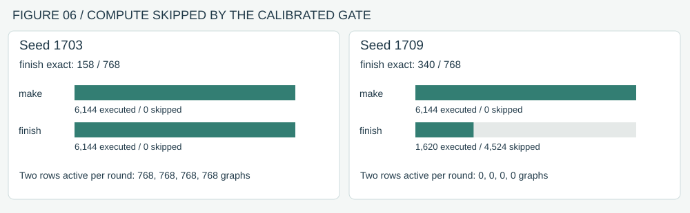

# 图 06 · 根据当前需求启用多少行？

**门控在一个种子上保持了逐图完整性并节省了 73.6% 的消费者行打分。相同掩码、相同 Metal 后端的配对重复计时，没有给出稳定的端到端速度收益。** 另一个种子的校准策略全开。适合把动态门作为实验选项，继续保留融合的全开实现为对照。



## 实验边界

从图 05 两个最终两行集合监督模型出发，冻结全部 actor 与模板 encoder。每个 Run 增加一个 713 参数的门。在每个图的每行每轮，门先看该 Run 已有上下文、位置和同一行上一实际 token，决定是否启用该行。2×4 的物理槽及旧引用保持稳定。开门但 actor 输出 null 时保留原来的 token。关门时该槽和用于后续的 history 置零，之后的轮次仍可开门，关闭一个位置不会跳到饱和或删除前面生成的父记录。[PyTorch 前向](gate_model.py)

门在同一批训练图上学习一次选择对最终轨迹的影响。每次在完整两个 Run 的 16 个门中均匀挑一个，强开和强关各跑一次，后续决策各自按当前策略执行。用图 05 奖励减去 `λ × 打开的槽位数 / 16` 比较两个实际结果；该监督只在轨迹完成后计算。λ=0 与 λ=0.25 从相同初值、同样本/介入位序训练 1024 步。默认阈值 0.5。另外在训练家族的 448 个新实例选择阈值，要求完整非空图数至少等于全开基线，然后最小化开门数。[预定协议](PROTOCOL.md) · [训练](train_gates.py) · [阈值选择](calibrate.py)

768 张新留出非空图来自 3 条规则、2 个家族和 96 个相关基础组，第二 Run 共 1536 个义务。新旧评估集与训练源检查均无重叠。这是有实际规则证书的受控两 Run 任务；“就绪”指所需的真实正确父当前已经可用。就绪统计属于事后审计输入，模型不读取真实义务数量。

## 主结果

两组 learned 使用 λ=0.25。每格依次为种子 1703 / 1709。表内中位数来自正式轮换顺序的 batch-one 试验。

| 路径 | 完整非空图 /768 | make 跳过 /6144 | finish 跳过 /6144 | 第二 Run 重复 | 遗漏 /1536 | 两 Run 毫秒 |
|---|---:|---:|---:|---:|---:|---:|
| 原 PyTorch actor，全开 | 158 / 340 | 0 / 0 | 0 / 0 | 19 / 32 | 886 / 553 | 7.46 / 7.44 |
| 融合 Metal，全开 | 158 / 340 | 0 / 0 | 0 / 0 | 19 / 32 | 886 / 553 | 5.38 / 5.42 |
| 学习门，默认阈值 | 159 / 339 | 0 / 688 | 4340 / 4568 | 48 / 33 | 896 / 559 | 5.37 / 5.37 |
| 学习门，校准阈值 | **158 / 340** | **0 / 0** | **0 / 4524** | 19 / 31 | 886 / 555 | 5.34 / 5.40 |
| 校准开门预算，静态位置 | 158 / 323 | 0 / 0 | 0 / 4608 | 19 / 10 | 886 / 691 | 5.37 / 5.80 |

在 1709 上校准阈值为 0.30。该门与全开在 768 张图上每一项“完整/不完整”的判断都相同；两者的中间绑定有差异。λ=0 的校准版本为 156/340 个完整图，1703 跳过 281 个 make/finish 合计的行、1709 全开。1703 的成本门默认阈值有 5 个图变好、4 个变坏；校准选择的 0.05 在本次留出集全开。在 1703 上使用保守阈值没有产生跨输入的选择。[所有门与阈值](results/lanes.tsv)

## 动态性和对照

1709 的成本门在 finish 中，按所需父实际就绪的义务数 1/2/3/4 分桶，平均每图打开 **1.27/2.14/3.02/3.64** 个槽，固定全开为 8。保持源表和 Request 相同的 112 对可辨别 pre→post 情形，真实就绪义务增加时，99 对多开、13 对持平、0 对少开。按四个轮次计，同时启用两行的图数均为零；恰好启用一行的图数依次为 768、579、226、47，观察到的重开数为零。这个种子学到的是依需求缩短消费者执行，数据没有显示两行同时互补工作。[就绪分桶](results/ready.tsv)

静态校准预算实际比动态门少开 84 个槽。为了隔离预算差异，另把原策略的完整 16 位门掩码在同一模板的不同测试输入之间作一一置换，**每个位置的总开门数与原策略精确相同**，在 GPU 上按捐赠掩码重新生成输出。这是事后干预，不能用作在线调度器。1709 原动态门完成 340 图；打散状态的 16 种置换得到 **271–303**，固定 state、variant 和 blind 标签后再打乱得到 **324–335**。因此在这一冻结模型上，决定把开门预算给哪些具体输入有可测作用。1703 全开控制的全部置换均保持 158 图。[等预算置换](results/shuffle-budget.json)

## 物理跳算与延迟

- 一个 Metal SIMD 组覆盖一个图的一行。稠密核先执行完整主体打分，之后清除已关槽；跳算核在读取 history 和指针权重前就退出对应的 SIMD 组。整段推理使用固定设备派发，CPU 不读取门选择来发起分支。实际跳过的只包括该行的打分主体；门计算、共享数据准备、输出置零和派发仍发生。[内核](metal_stage.py)
- 1709 的校准门实计跳过 4524/12288 个两个 Run 合计的主体行（36.8%），均在 finish。按源码每行 4,256 次乘加估算，节省 19,254,144 次乘加。这是算术路径的估计，独立计数核验证哪些行实际执行。完整前向比较的 48 组 Metal 稠密/跳算输出与 Pair tensor 均一致。
- 正式 96 个配对图，1709 校准门稠密中位数 **5.64 ms**，跳算 **5.40 ms**。另做紧邻计时，48 个相同图各重复三次并轮换先后顺序；稠密 **4.92 ms**，跳算 **4.98 ms**。按每个源图的配对节省取中位数为 **−0.088 ms**，48 图中 22 图更快。当前数据不足以归因一个稳定的 wall-clock 加速。原 PyTorch 与融合 Metal 的差额包含内核融合开销变化。全部关门的控制虽然能跳过所有打分，完整图为零。[重复配对](results/timing-pairs.json)
- 计时为 MPS 单图，包含原始输入上设备、已缓存模板的动态选择、两个 Run 生成、输出与 Pair tensor 同步。每面板预热并轮换顺序，3 个模板合计 96 图；CPU 事后审计和离线阈值校准单列。成本门 1709 的正式跳算计时为 46 个成功 /96、81.90 个完整非空图/秒。相同图完整性对比优先于原始发射量。

## 验证与复现

132 份正式轨迹从 CPU 独立重算来源、完整覆盖、关闭空槽、就绪性、计时子集及硬件路径指示。首末批 256 个真实单槽干预（两支共 512 条轨迹）复核了奖励、成本、效用差、强制位之前的共同前缀和另一行的固定因果边界。λ 项和奖励均由实际输出重算，效用差最大绝对误差低于 8×10⁻⁸。[核验记录](results/verification.json) · [结果及原始样本](results/primary.json)

```sh
base=benchmarks/multi-row-generation/gate_ablation
parent=/Volumes/EggFuseWorkspace/experiments/two-row-credit-20261119
root=/Volumes/EggFuseWorkspace/experiments/NEW-adaptive-width
mkdir -p "$root"
python "$base/gate_data.py" "$root/fresh-gate-inputs.json"
for arm in gate_p0 gate_p25; do
  for seed in 1703 1709; do
    ~/.local/bin/eggfuse-job submit --kind compute -- /Volumes/EggFuseWorkspace/bin/run-eggfuse env PYTORCH_ENABLE_MPS_FALLBACK=0 python "$base/train_gates.py" "$root" "$parent" "$arm" "$seed"
  done
done
# 等权重就绪后经同一队列依次运行 GPU 步骤
python "$base/calibrate.py" "$root" "$parent"
python "$base/evaluate.py" "$root" --parent-root "$parent"
python "$base/timing_pairs.py" "$root" "$parent"
python "$base/shuffle_budget.py" "$root" "$parent"
python "$base/report.py" "$root" ./summary
```

完整冻结权重、独立 CPU 全量回放和训练采样轨迹保存在 `/Volumes/EggFuseWorkspace/experiments/adaptive-width-20261119`。PyTorch 2.15 MPS 用于 actor 与训练，只有用于比较实际跳算的打分与发布路径调用 `torch.mps.compile_shader`。
