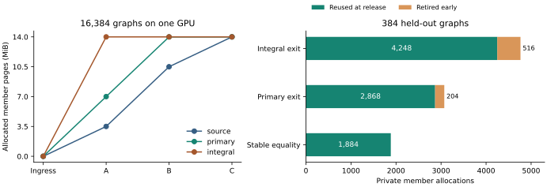

# 图 18　在哪个固定点退出 integral ruleset？

在同一批 384 张留出图上，primary 饱和退出有 2,868 个提前生成的成员到原 Run 时沿原槽直接发布；完整 integral 饱和退出有 4,248 个。为得到多出的 1,380 次复用，后者又多退役了 312 个无效成员。两版的公开结果和有效写入均与原调度一致。六种顺序轮换复测后，单图端到端耗时没有稳定赢家。



## 工作负载与可见性

本实验在图 15 相同的冻结神经生产者上运行。每个已知 Request 有一个 Cell，A 从实际生成的 Pair 中按指定来源取得物理父引用，在本轮创建 Anchor。B 的第一个规则记录两个端口在 B 时刻是否同类；第二条按 Request tag 和父载荷投影出 Tagged。C 读取已公开的 Tagged，再记录这两个端口在 C 时刻是否同类。B 的比较结果是历史事实。局部 union 在 A 与 B 之间到达，外部 union 在 B 与 C 之间到达。输入可能只有一方提交、没有外部边，或通过构造器同余才改变端口关系。[原始规则](source.egg) · [事件和生成 token 接口](integral.py)

三种调度保留相同的 Run 边界。原调度只生成本阶段成员。primary 退出与完整退出都允许私有 B、C 接续消费私有父；一次扫描只消费前一次扫描已有的成员。前者在本阶段规则不再增加事实时退出，后者继续到所有允许的规则均无新增。因此在 A 阶段，primary 可以预存 B 的比较，完整退出还可得到 Tagged 和 C 的结果。新事件抵达时重查私有成员依赖的比较值；若值已变，退役它和依赖其代数的私有后继。在原 Run 发布时验证父代数并打开可见位。[GPU 成员存储](members.metal)

物理页按阶段在设备上分配，已经打开的页保持地址。成员存于有界页内，其逻辑端口指向槽和分配代数。发布不会为同一成员再分配执行记录。为让原调度的读者与审计器观察结果，各臂都将公开字段导出到同样的定长视图，导出计入计时。模型的初始 Pair、union 的精确修复与合成规则来自不同层；本试验测的是这个 GPU 原型在已知四个请求位置上的跨 Run 补全。未测生产 Pass 3 的整图、迭代发现新模板或自由决定匹配数量。

## 一个因 union 失效的成员

规则 266、种子 1703 的图 6，请求 2，在 A、B、C 三个边界读到的相等性依次为 0、0、1。完整 integral 在 A 已分配 Anchor、Compared、Tagged、Result，分配代数依次为 3、7、11、15。B 到来时直接开放 7 和 11；外部 union 到来后，3、7、11 仍然有效，15 退役，C 发布代数 20。最终 Result 同时记住“B 时不同类”和“C 时同类”。另一张图 2 的请求 0 在 B 之前就由 0 变为 1，代数 5 的 Compared 和后继 9、13 一起退役。

留出集每个种子 384 图、1,536 个 Request，分属两个未训练模板族；附加面板是三个含二次同余的已见模板，各用新图。CPU 逐图核对了三阶段的公开字段、父的物理身份、代数、可见性和写入增量，在每阶段都检查了池内分配数和活端口数。每种子的 96 组留出输入在 A 所见完全相同而后续事件不同，A 的准入、私有载荷、分配计数和公开视图逐位相同。两种子的四种正确对照和精确原调度都逐 Run 通过 384/384。[独立审计](audit.py) · [各阶段和成员计数](results/metrics.tsv)

## 哪些提前计算最终被使用？

| 留出集，每种子各 384 图 | 提前分配 | 原槽发布 | 退役 | 累计分配（含正常阶段） | 单图端到端 ms，1703／1709 |
| --- | ---: | ---: | ---: | ---: | ---: |
| 原调度 | 0 | 0 | 0 | 6,144 | 5.155／7.543 |
| primary 饱和退出 | 3,072 | 2,868 | 204 | 6,348 | 5.109／7.564 |
| 完整 integral 饱和退出 | 4,764 | 4,248 | 516 | 6,660 | 5.053／7.428 |
| 完整退出，仅对已同类的端口提前计算 | 1,884 | 1,884 | 0 | 6,144 | 5.077／7.283 |
| 完整退出，以冻结网络在 A 提出的请求准入 | 672／660 | 672／660 | 0 | 6,144 | 8.553／11.895 |

primary 的 204 次退役对应 156 项在 B 前失效的判断、48 项在 C 前失效的判断。完整退出额外生成了依赖前一判断的投影与后续结果，导致一次前提改变可以使三个成员失效。反之，已成立的等价关系在本任务的追加 union 下保持成立：可用此静态条件准入，保住 1,884 次复用且完全消除无效分配。网络准入只看 A 已公开的状态，调用一次额外神经前向，只覆盖 672／660 项后续成员。未准入的请求仍在原边界由同一 GPU 程序执行。关闭失效检查后，完整退出三个观察点全部正确的只剩 243/384；把全部私有结果提前公开则为 0/384。

单图计时含原始动态输入上传、神经生产者、准入、union 修复、三次饱和、分配、导出和最终同步。两种子运行时段的绝对耗时不同，比较限于同一种子的交错测量。另选规则 134、266 各 12 张图，在每张图上轮换三臂的全部六种顺序。完整退出减 primary 退出的四组配对差中位数落在 −0.016 至 +0.124 ms 之间。较多的原槽发布没有带来可复现的端到端优势。[主计时摘要](results/summary.json) · [顺序配对复测](results/repeat.json)

## 分配曲线与 RSS

每图一个批量线程；在独立进程内把规则 266 的 128 张真实输入重复到 16,384 张图。每种策略、每种分配方式启动三个新进程。同步后分别采样实际 GPU 成员页字节、MPS 活张量与驱动分配、当前进程 RSS 及历史峰值。下表是相对 ingress 后基线的成员页增量，单位 MiB。

| 设备实际分配 | A 后 | B 后 | C 后 |
| --- | ---: | ---: | ---: |
| 原调度 | 3.5 | 10.5 | 14 |
| primary 退出 | 7 | 14 | 14 |
| 完整退出 | 14 | 14 | 14 |

这三组 RSS 增量的逐阶段中位数都是 0 MiB，MPS 张量的阶段增量可以区分三条曲线。控制组在 A 一次性分配全部页，三种执行策略此时全为 14→14→14 MiB，但原调度在 A 没有任何未来成员。判断成功预测需要查看同一代成员何时被合法发布，以及失效前是否做了白工。分配空间按已知上限预留；图中另一分面的逻辑分配次数来自 384 张独立评估图。[18 个隔离进程的原始数据](results/allocation.json)

## 源执行与复现

54 个程序保留了真实 eggcc 模板的局部规则和九种外部 union 端点组合。在独立 Rust Cell CPU 上确实执行了原始的 `saturate ia`、局部 union、`saturate ib`、外部 union 和 `saturate ic`，总计 486 次实际 Run。每个程序穷举六个端口的 36 种有向请求，保留 B、C 两个历史值。五种正确 GPU 策略逐个复现了 54/54 个源签名，各 1,944 条有向读取历史。源程序验证比较与投影的逻辑边界，随机重命名、神经父绑定与 GPU 物理代数另由 84 份轨迹核验。[Rust 源程序执行证据](results/native.json) · [GPU 全端口复核](results/sweep.json)

从仓库根目录执行，使用外接盘的训练权重与图 15 归档。

```sh
base=benchmarks/multi-row-generation/integral_ablation
root=/Volumes/EggFuseWorkspace/experiments/NEW-integral-visibility
producers=/Volumes/EggFuseWorkspace/experiments/eclass-ports-20261119
union=/Volumes/EggFuseWorkspace/experiments/union-observers-20261119
runner=/Volumes/EggFuseWorkspace/bin/run-eggfuse
job() { ~/.local/bin/eggfuse-job submit --kind compute -- "$runner" env PYTORCH_ENABLE_MPS_FALLBACK=0 python "$@"; }
job "$base/measure.py" "$root" "$producers"
job "$base/native.py" target/release/examples/real_completion_dataset /Volumes/EggFuseWorkspace/experiments/eclass-all-events-input.json "$root/summary/native.json"
job "$base/audit.py" "$root" "$union" "$root/summary"
job "$base/sweep.py" "$producers" "$root/summary/native.json" "$root/summary/sweep.json"
job "$base/allocation.py" "$root" "$producers" "$root/summary/allocation.json"
job "$base/repeat.py" "$root" "$producers" "$root/summary/repeat.json"
```
