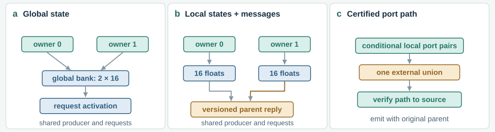

# 图 14　一个图级状态，还是两个局部状态？

在两个留出模板族的 384 张非空图上，全图协调状态使第二个 Run 完整覆盖 382／370 张，两个局部状态加有效回复为 378／360 张（种子 1703／1709）。局部版把原面板 732 个同区义务全部完成，遗漏都在跨区读。只在模板证书和实际 union 端点能构成正面见证时发射，两种子均为 384/384。这个对照保留了神经生产者。



## 状态、消息和原始父

第一个 Run 在线执行图 20 的冻结生产者，GPU 生成八个 Pair 槽，每个槽携带 latent、激活位、原始父选择、字段和物理端口。第二个 Run 消费这块设备张量。两臂均用 32 个浮点数做协调状态，另行保留实际 Pair。全图版的两个 16 维槽各自汇总全部已激活 Pair；局部版的两个 16 维槽各自只汇总归本 owner 的 Pair。每槽用相同 GRU 单元读入本区的阶段、提交位和本次外部 union 的本地端点特征。把 owner 1 的生成 latent 加 7，局部版 owner 0 状态在每种子的 384/384 图逐位不变；全图版为 0/384。这是固定输入下的信息隔离检查。

每个 Request 给出读端口和指定来源，四个请求各有一个输出位置。共同的 GPU 寻址器按 owner、handle 和生产者激活位查实际父槽，保留原始物理见证。模型预测本次读取是否被等价关系允许，投影从选中的父产生 RHS。跨区回复提供所需父、远端状态与端点观察。缺包或版本不符时屏蔽远端载荷，并保留这个请求位置的待办。重发从同一批生成 token 和缓存的局部状态恢复，回写限于待办槽。这里用单设备张量模拟两个 owner 的边界，版本对照是一个当前 Run 版本和一个较旧版本。候选打分、读取与重发走稠密 GPU 张量，没有测量跨卡网络、真实稀疏队列或历史多版本回收。[GPU 前向](network.py) · [训练](experiment.py) · [执行与计时](evaluate.py)

## 跨区负载与完整图

训练使用 7 个模板，各 1,024 张图，每个模型 4,849 个可训练参数、1,024 步，batch 48。每个种子的两种模型具有相同初值、批次、训练标签和生产者权重。留出的规则为 134、135、143，来自两个与训练不重叠的模板族。每个面板沿用相同的 384 个输入图，改变请求放置再重算义务。跨区比例是请求比例，分母按非空图单独列出。热点面板中，同一目标 owner 的所有跨区读取共用一个指定来源端口。[输入、对齐与源审计](audit_locality.py)

| 请求放置 | 非空图 | 全图状态 | 局部状态＋当前回复 | 局部，远端 latent 清零 | 正面路径证书 |
| --- | ---: | ---: | ---: | ---: | ---: |
| 全部同区 | 384 | 384／384 | 384／384 | 384／384 | 384／384 |
| 原始，每图 1/4 跨区 | 384 | 382／370 | 378／360 | 288／274 | 384／384 |
| 每图 2/4 跨区 | 316 | 300／298 | 292／289 | 212／171 | 316／316 |
| 全部跨区 | 87 | 55／36 | 52／36 | 28／15 | 87／87 |
| 全部跨区，集中读同一端口 | 66 | 34／14 | 34／22 | 24／24 | 66／66 |

原始面板的 780 个义务含 48 个合法跨区读。局部版漏 4／16 个、额外发射 2／8 个，未出现错父或重复。单独清零已到达回复里的 16 维远端状态，其他可见字段和父引用照常传递，额外跨区发射增至 78／100。整包扣住或交付旧版本时，384 个跨区请求全部转为待办，本地槽的每个离散输出保持不变。分母含合法和不合法的跨区请求。此时源语义完整图为 336／336；仍有待办的图不能用完整输出宣告饱和。送达当前版本后，两种子都逐槽恢复各自正常局部版的结果。

## 一个可核查的错误及证书的边界

规则 134、种子 1709 的留出图 86 中，外部 union 将 `owner0.handle6` 与 `owner1.handle4` 连到一起。该阶段的本地证明又把 `owner1.handle4` 与 `owner1.handle5` 连到一起。请求 3 要从前者跨区读取后者，其指定来源确实在生成的 Pair 槽 0。全图模型发射了 `[1,5,2,5,3]`，局部模型收到了回复却漏发。正面证书只需检查两个局部端口是否相同或具有已生效的模板等价证明，以及外部边是否正好连接这两侧。它无需重建整图闭包。

留出模板没有额外构造器同余正例。另取**训练见过的模板** 266、267、580 的新图做反例，这 384 张图有 20 个义务需要由外部 union 继续推导构造器同余。短证书完整 364/384，零误发，恰好漏掉这 20 个。全图模型识别 4／4 个同余义务，局部模型识别 6／4 个。学习型提案仍需要具体见证来授权；短证书不能据缺失的见证推断不等。[各 union 状态、误发和遗漏](results/metrics.tsv)

## 计时和验证范围

原始面板每种子计时 96 张单图，各臂轮换顺序。计时包括动态输入上传、冻结神经生产者、GPU 读取生成的 Pair、协调状态计算、RHS 输出和设备同步。离线模板编码和事后 CPU 核验另计。全图版为 6.45／7.29 ms，局部版为 6.56／7.37 ms，短证书版为 5.68／6.78 ms，旧版本后重发为 7.07／7.83 ms。该有界实现没有显示局部拆分的延迟收益。训练任务预分配了请求槽；本实验没有测自由多行生成、生产 eggcc 的 Spine 接续或多设备提速。

纯 CPU 重放核对 36 份 GPU 轨迹、420 项按实验条件和 union 状态划分的统计，实际父见证、RHS 字段、遗漏、重复与等价关系均通过源审计。留出轨迹的第一 Run 输出也与图 20 的旧归档逐项对齐。训练族附加面板的源标签由既有 Rust Cell CPU 分区记录重算。本研究使用这些真实分区上的两 Run 神经探针。[摘要、时延和哈希](results/replay.json) · [协议](PROTOCOL.md)

在根目录使用外接盘运行环境。新训练目录与已有权重分开。依次完成训练、评估和 CPU 重放。

```sh
base=benchmarks/multi-row-generation/locality_ablation
root=/Volumes/EggFuseWorkspace/experiments/NEW-locality
producers=/Volumes/EggFuseWorkspace/experiments/eclass-ports-20261119
runner=/Volumes/EggFuseWorkspace/bin/run-eggfuse
for seed in 1703 1709; do
  for scope in global local; do
    ~/.local/bin/eggfuse-job submit --kind compute -- "$runner" env PYTORCH_ENABLE_MPS_FALLBACK=0 python "$base/experiment.py" "$root" "$producers" "$seed" "$scope"
  done
done
~/.local/bin/eggfuse-job submit --kind compute -- "$runner" env PYTORCH_ENABLE_MPS_FALLBACK=0 python "$base/evaluate.py" "$root" "$producers"
~/.local/bin/eggfuse-job submit --kind compute -- "$runner" python "$base/audit_locality.py" "$root" "$producers" "$root/summary"
```
