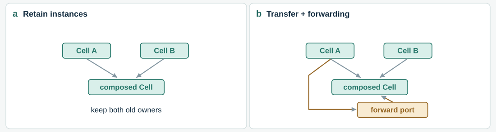

# 图 16　转移所有权后，旧 cursor 如何继续读？

在三个留出模板的 384 张图上，保留源实例和用带 generation 的头转发都通过了全部四个观察点。把旧物理槽改写为另一代载荷之后，转发版仍能逐位重建原始 56 维 Pair token，并能沿旧 cursor 完成后来才被 union 唤醒的读取。两个神经种子的结果分别统计。[完整计数](results/metrics.tsv)



## 实际发生的一次转移

两行从同图八个生成槽中各选两个活 Pair。只有两成员确实引用同一个物理 B 见证，且共享字段相等，才允许组合。离线编译器据此让右成员复用左成员的 owner 和 tag；右成员的 handle、raw 和 payload 对应新边界槽 5、6、7。每个成员还有独立的连续 latent、产生它的指针和虚拟构造器结果端口。两个旧来源即使 union 后语义相等，仍有各自的来源地址。[模板生成与端口投影](plan.py) · [编译产物](plan.json)

读者在转移前取得源槽和 generation 1。转移后，设备将旧槽改写为 generation 2 的测试载荷。持有 generation 1 的读者要查转发头，在目标 generation 和成员身份均匹配时，沿模板投影读取组合实例。请求一个未知 generation 应被拒绝。实验验证所有八个旧槽的全 token、活请求的父见证、逐观察点的结果与有效写入增量。这里用固定容量的设备张量模拟槽位复用，不能据此估算 RSS。[Metal 提交与读取](transfer.metal) · [接入 union 的观察路径](run_owner.py)

## 两行如何分工

每行看到两个公开的请求来源，由同一个 609 参数头给 28 种源对打分。两个种子分别训练 768 步，生产者冻结，三个留出模板属于训练之外的两个结构族。独立选择时，两行先共同提出动作，再按行序提交；被占用的源可以触发一次基于原分数的重选。联合选择在 420 个不重叠的有序组合里最大化两行分数之和，再由同一提交器验证。另有一版直接根据公开请求和已生成的父计算覆盖收益。以下为不同请求分配给两行、在外部 union 前转移的留出结果，种子依次为 1703／1709。[训练](train.py) · [决策与联合选择](actor.py)

| 调度 | 首轮冲突次数 | 两行均完成组合的图 /384 | 组合覆盖的行内请求数 | 单图中位 ms |
| --- | ---: | ---: | ---: | ---: |
| 保留源＋一次重选 | 164／144 | 384／384 | 1,104／1,104 | 8.64／8.96 |
| 转发＋一次重选 | 164／144 | 384／384 | 1,104／1,104 | 8.87／8.76 |
| 转发，禁用重选 | 164／144 | 220／240 | 940／960 | 8.78／9.11 |
| 转发，学习分数联合选择 | 0／0 | 384／384 | 1,104／1,104 | 9.15／9.06 |
| 转发，直接计算收益后联合选择 | 0／0 | 384／384 | 1,104／1,104 | 8.67／8.67 |

1,104 是可组合源对在这批输入上的覆盖上限，按每行分配的请求计。四个请求位置预先给定。禁止重选时，各图的规则结果仍然正确，因为没有被组合的源仍可执行。这解释了为何评估组合质量还要检查组合次数和有效覆盖。让两行读取相同请求会让共享头在所有 384 图上产生同一首选，正常重选路径仍能防止重复接管。

## 反例与计时边界

- 关闭占用检查并保留源载荷，两个种子依旧各有 384/384 图的规则结果正确，但分别有 164、144 张图发生双重接管。忽略 generation 读取已复用的物理槽时，全过程规则结果正确数降至 31、10，完整的地址与输出契约均为 0/384。
- 每个种子各有 48 个请求在外部 union 后才被唤醒。转发加重选分别让其中 47、42 项通过转发头找到原父；其余仍由原槽服务。转移放在外部 union 之后也独立核对。额外测试包含三个已见模板的新图，其中有依赖构造器同余的请求。
- 原始输入上传、冻结生产者、两行提案、设备提交、四轮观察、有效 RHS 发布和最终同步均纳入计时。普通转发两种子的正确吞吐为 115.3／104.7 图每秒，保留源为 112.0／110.1。两种子没有显示一致的速度优势。每图的两行提案并行打分，提交使用单 GPU 上确定的行序；生产 eggcc 的多线程提交仍需验证。

CPU 独立重放 336 份 GPU 轨迹，逐项对照图 15 已核验的 12 份冻结源面板。归档包含正确性、时延、逐图来源与文件指纹。[审计器](audit.py) · [审计摘要](results/summary.json)

## 复现

在外接盘工作树根目录执行。训练使用新目录；两个训练作业完成后，依次执行评估和独立 CPU 审计。

```sh
base=benchmarks/multi-row-generation/ownership_ablation
root=/Volumes/EggFuseWorkspace/experiments/NEW-owner-cursors
producers=/Volumes/EggFuseWorkspace/experiments/eclass-ports-20261119
union=/Volumes/EggFuseWorkspace/experiments/union-observers-20261119
runner=/Volumes/EggFuseWorkspace/bin/run-eggfuse
for seed in 1703 1709; do
  ~/.local/bin/eggfuse-job submit --kind compute -- "$runner" env PYTORCH_ENABLE_MPS_FALLBACK=0 python "$base/train.py" "$root" "$producers" "$seed"
done
~/.local/bin/eggfuse-job submit --kind compute -- "$runner" env PYTORCH_ENABLE_MPS_FALLBACK=0 python "$base/evaluate.py" "$root" "$producers"
~/.local/bin/eggfuse-job submit --kind compute -- "$runner" python "$base/audit.py" "$root" "$union" "$root/summary"
```
