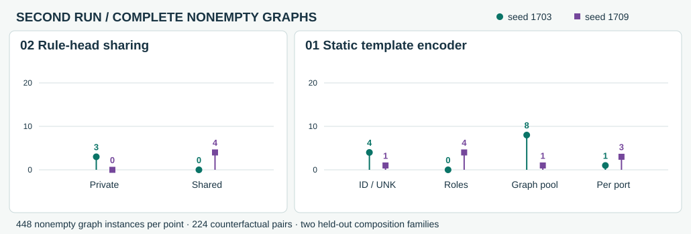

# 单 row 的规则指针头与 Bake 模板编码消融

本研究对应[架构图册的图 01–02](../../../docs/cell-architecture-atlas/README.md)。PyTorch 在 MPS 上顺序发射 8 个位置，后一步只读上一步实际生成的 frontier、下一消费者的候选观测和编译期静态信息。EggFuse 负责离线编译和事后源语义验证。权重、完整神经轨迹与原始计时保存在硬盘实验目录。下文的 Run 1 和 Run 2 指真实规则边界对应的两步端口任务。

## 实测结果

**两个种子均未建立可用的非空整图覆盖。图 02 没有支持一律共享或一律拆头，图 01 也没有显示逐端口 GNN 稳定优于局部角色。** 第二个 Run 的完整图、错父、遗漏都必须同时看。下表每格依次为种子 1703 / 1709，均在相同的 448 张非空图上评估。

| 配置 | 完整 /448 | 错选活父 | 重复 | 遗漏 /917 | 缓存后端到端 ms | 冷端到端 ms |
|---|---:|---:|---:|---:|---:|---:|
| 每规则独立头＋角色 | 3 / 0 | 38 / 70 | 0 / 0 | 890 / 870 | 7.46 / 7.66 | 9.20 / 9.28 |
| 共享头＋角色 | 0 / 4 | 25 / 49 | 0 / 0 | 895 / 878 | 7.28 / 7.59 | 9.47 / 9.32 |
| 共享头＋模板 ID | 4 / 1 | 20 / 100 | 0 / 0 | 876 / 838 | 7.58 / 7.46 | 8.91 / 8.96 |
| 共享头＋整图 GNN | 8 / 1 | 38 / 56 | 1 / 0 | 835 / 869 | 7.55 / 7.45 | 9.69 / 9.65 |
| 共享头＋逐端口 GNN | 1 / 3 | 27 / 62 | 0 / 0 | 852 / 877 | 7.50 / 7.45 | 9.42 / 9.49 |



**图 02。** 窄共享头使用 2,048 个指针参数；独立库为 36,864，单次只选择该规则的一份。只看 4 个双规则都已训练过的留出模板，独立头 2/0 vs 共享头 0/4（分母 256）；在另 3 个含冷消费者的模板上，两者是 1/0 vs 0/0（分母 192）。参数数目匹配的宽共享头为 2/3（/448），错父 40/39，重复 0/0，遗漏 822/831。增加共享参数有时降低遗漏，但没有稳定提高完整覆盖。[容量对照](results/capacity/metrics.tsv)

**图 01。** 整图 GNN 在种子 1703 获得的 8 个完整图全部来自同一个留出家族，在另一个家族是 0；种子 1709 则只有 1 个完整图。逐端口 GNN 的 1703 模型为 248 张图生成了所有所需的正确父，消费者只完成了其中 1 张；1709 为 55 张就绪、3 张完成。角色共享头两个种子则为 41/69 张就绪、0/4 张完成。两步都存在问题。训练家族的新 IID 实例上，角色共享头也只有 8/8 个完整非空图（各 /700）。所以不能把所有失败归因于“新家族太难”，也不能用低重复率证明认领成功。

**快照条件。** 在 317 张局部函数值可共存的碰撞图上，独立头、共享角色、ID、整图 GNN、逐端口 GNN 的完整图分别为 3/0、0/3、2/1、5/1、1/3。所有模板数据仍是合成边界实例。两个家族分别贡献 256 和 192 张图；逐族、逐模板、两头均热及冷启动的二级指标都有独立行。按反事实对分层重采样的区间仅描述这两个固定家族，不能当作对全部 Bake 家族的估计。

**选择。** 先保留简单的共享角色头作为研究基线，理由是权重少、可表达新规则和便于复核。当前数据没有证明它能产生更完整的推理，也没有足够信号选定 GNN 读出。图 20 将单独比较带生效点的模板局部等价类；本次图输入不含该信息。[图 20 协议](../../../docs/cell-architecture-atlas/template-eclass.md)

[两组主指标及分层](results/metrics.tsv) · [同图配对差异](results/paired.tsv) · [完整计时与原始读数](results/results.json) · [核验与作业来源](results/provenance.json)

## 实际接线与整族留出

从 sum-bits 和 Raytrace 冻结的 Pass 3 iterative Bake catalog 开始，用 Rust 编译器重新生成两个 program，核对 typed recipe 哈希与安装的 catalog。保留两叶组合的源操作、目标 pivot、残余读、真实列检查和有序投影。例如，在 sum-bits unit 33 中，生产者发布 SubTuple(expr,index,1)，消费者要求 pivot 中 index=0，并要求 tuple-length(expr) 的值与 len 对齐。改变合法模板的检查可以改变完全相同输入表的正确父绑定。[导出、示例和原始接线](corpus/README.md)

两个 catalog 中 30 个两叶记录去重为 19 个模板。划分依据是去掉 workload、规则编号、列序号、字面值和具体类型之后的结构组，跨 catalog 的同构形状归为一族。12 个模板、9 族用于训练；7 个模板、2 整族留出。全部 34 个更长组合均未训练，其中 14 个包含留出接线。留出中 4 个模板的原子规则都在相应训练阶段见过，另 3 个具有冷启动消费者。前者提供比较旧规则在新组合中表现的对照。[划分与来源](corpus/manifest.json)

实例是合成候选边界记录。第一步对已经给出的生产者 frame 与候选 fact 检查实际 key，第二步按真实委托端口将生成的 fact 与候选消费者 frame/残余读观测对齐。这测量两叶接口的相关绑定和接线；前置规则搜索、完整 RHS 副作用、union、整轮调度和完整 eggcc 执行都没有进入这个计时。多事件命中同一事实时，源见证身份与物理提交次数分别解释。

正式训练共 12,288 个图。每个留出模板的碰撞组有 32 对反事实请求（64 图）。每对保持源表相同，只改变消费 frame 中激活另一父所需的列。两个父共享部分字段，在至少一项真实检查上不同。合法备选父也各自有义务，不将其误记为错父。主组 448 张非空图、917 项消费义务。317 图的残余候选允许同一局部函数快照，另 131 图含同键不同结果的互斥候选；我们另列前者的统计。两组均使用合成实例。[数据与独立审计](data/README.md)

## 公平比较和计时

- 图 02：每条原子规则各有一份双线性指针参数，或所有规则共享一份。两种子 1703/1709 分别配对，普通头单次打分的宽度相同。18 个独立头由相同初值克隆，15 个规则身份在训练中出现，3 个消费者规则首次出现在留出。另用宽共享头匹配独立头库的总参数量；它仍是一张共享双线性映射。
- 图 01：固定窄共享头。四支都保留相同局部端口描述（有序列类型、前步发布、跨操作数等值/同侧/字面值检查、RHS 投影角色）。ID 支额外读取模板查表向量，所有未见 ID 均取固定零向量。角色支使用节点局部属性与入出边计数，等参数 MLP 不聚合邻居。两个 GNN 共享两轮、有方向和关系类型的消息传递结构与初值；一个对所有节点取均值，另一个读取当前操作数的节点向量。与共同的局部支路融合后，四支都产生两阶段、两个有序指针的条件向量。
- 所有臂从头拟合 1,536 步，batch 32、隐藏维数 32、Adam 学习率 0.001。平衡抽取训练模板，每次在同一模板中抽取实例。GPU 模板向量参与训练反传。集合对齐在前向完成后为离线损失给出监督，所有臂另有相同的训练期字段读出。精确谓词和正确父不会反馈到在线网络。所有最终 checkpoint 均计入结果。
- 错父（wrong_live_parent）特指选择了活跃且源绑定合法的父，但该父不满足所选的有匹配消费者的约束。指向空位置、非法生产者或无匹配的消费者另计。重复按真实合法身份的多余发射计，遗漏按缺少的源绑定计。完整非空图须无非法、无多报、无遗漏，且投影与消费祖先正确。若模型经常沉默，单看错父、重复都可能得到错误印象。
- 缓存计时从原始整数输入上设备开始，到两个 Run、两个离散结果、Pair token 完成 MPS 同步。冷计时另含从内存中已解析模板构造静态张量、上传和编码，不含磁盘读取、Rust 编译、离线训练或 CPU 评分。每个模板按相同 16 个单图样本轮换模型次序，独立审计计时样本，并核对缓存前后预测。每个模型共 112 个主计时图。

[单 row 解码器](decoder.py) · [图编码器](encoders.py) · [训练入口](fit.py) · [评估与计时](evaluate.py) · [预定协议](PROTOCOL.md)

## 复现

从仓库根目录运行。需要 PyTorch/MPS 和 NumPy。完整 corpus 重导出和 split 核验见 corpus/ 与 data/。可在新目录运行六种配置的两个种子；宽头只属于补充对照。正式的五种配置共训练 10 个模型，共享角色臂同时服务两张图。

```sh
base=benchmarks/multi-row-generation/port_ablation
run=/Volumes/EggFuseWorkspace/experiments/NEW-single-row-port-roles
for arm in private_roles shared_roles shared_id shared_pooled shared_ports wide_roles; do
  for seed in 1703 1709; do
    ~/.local/bin/eggfuse-job submit --kind compute -- /Volumes/EggFuseWorkspace/bin/run-eggfuse env PYTORCH_ENABLE_MPS_FALLBACK=0 python "$base/fit.py" "$run" "$arm" "$seed"
  done
done
# After fitting, execute evaluate.py through the same queue.
python "$base/evaluate.py" "$run"
python "$base/evaluate.py" "$run" --capacity
python "$base/replay.py" "$run"
python "$base/replay.py" "$run" --capacity
python "$base/summarize.py" "$run/results.json" ./summary
```
