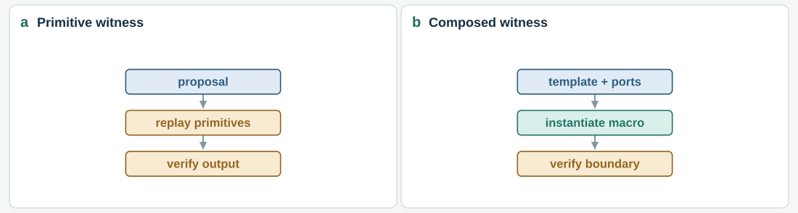

# 图 17　验证一个跨 Run 实例要读多少证明？

对同一条神经提案，逐步重放和组合宏给出了完全相同的接受决定与有效写入。在三个留出模板上，组合宏使两个种子的证书总字节分别减少 **2.4% 和 3.7%**。每图端到端中位数分别从 8.673 变为 8.546 ms、从 8.657 变为 8.658 ms。收益随证明长度变化；这批原始提案的大多数有效证明本来只有一步。



## 谁生成什么，谁验证什么？

第一个 Run 的 GPU 网络生成 Pair token。第二个 Run 直接消费该 token，选择 Pair 和 Request 的物理槽并给出五个 RHS 字段。离线编译器读取图 15 的初始构造器计划，生成由自反、局部提交、外部 union、对称、传递和构造器同余组成的证明程序。独立的栈检查器验证每条宏的有序输入、结论和所需事件。运行时，设备编码器用**网络实际选择的**请求端口和当前事件选取程序。网络学习的是物理绑定和激活；本实验的证明程序由编译器提供。[离线生成与验证](bake.py) · [设备编码](device_proof.py)

两种线格式都有六个 32 位信封字段，分别记录模板版本标识、观察 epoch、图作用域、Pair 槽、Request 槽与正文长度。逐步版每条指令一个字，宏版正文为一个索引。每图的有效信封紧密连续写入；表中给出实际使用字节。设备仍为八个提案预留最坏容量，切片描述符每图另占 64 字节，两臂相同。每个活动提案都进入统计，包括编码器无法为所选绑定提供相等证明而发出的空正文。所声称的五个输出字段、模型本体与实例 token 在两版中相同，另计。

验证器从指定 Pair token 解码其原始 A/B 父、激活位及字段，通过这两个物理引用直接核对来源、提交前提、Request 地址和所声称的 RHS。原子版随后逐条执行证明；宏版核对已准入的结论端口、当前局部提交位和有向外部边。两版都不枚举其他匹配，不会在证书失败后试另一条证明。通过的实例按提案顺序发布，同一个 Request 只登记一次有效写入。本实验把一个不可变的两 Run 快照作为作用域，仅验证给定 epoch；长期版本回收另需协议。[GPU 验证和发布](proof.metal)

## 同一实例的九步证明

规则 266、种子 1709 的测试图 6，神经槽 0 实际选择了 Pair 槽 1 和 Request 槽 2，声称输出为 `[0,5,2,7,2]`。两边的局部 union 均已提交。证明先使用外部边得到第一对参数等价，再通过两侧的局部 union 和这条外部边连出第二对参数的有序见证。两个参数对齐后，构造器同余推出两个结果等价，最后调整证明方向以满足请求。逐步版共九条指令，含信封 60 字节；宏版绑定同一对物理父，含信封 28 字节。宏版仍核对本次两个局部提交和实际外部边。

## 两个留出模板族

三条规则各 128 张非空图，共 384 图、780 项应发布的读取。种子分别为 1703、1709。下表统计原始神经提案，完整图按幂等发布后的实际可见结果计算。

| 种子 | 活动提案／通过／有效写入 | 完整图 | 两版证书总字节，原子 → 宏 | 执行的证明指令／宏检查 | 仅验证 ms，原子 → 宏 | 端到端 ms，原子 → 宏 |
| --- | --- | ---: | ---: | ---: | ---: | ---: |
| 1703 | 857／311／299 | 83/384 | 24,432 → 23,844 | 335 → 311 | 0.194 → 0.190 | 8.673 → 8.546 |
| 1709 | 821／285／275 | 73/384 | 23,676 → 22,800 | 345 → 285 | 0.195 → 0.194 | 8.657 → 8.658 |

通过的提案中分别有 **291/311、253/285** 项只需一条原子指令。两个种子分别重复提案 12、10 次，仍漏 481、505 项。作为独立的覆盖对照，给全部四个公开 Request 各发一项提案，从实际生成的前沿按指定来源取活父，两种验证器均发布 780/780 项；其中检索工作显式计入这个对照的提案侧。正式神经端到端计时含上传、两个神经 Run、证书编码、GPU 验证、发布和最终同步。仅验证一列使用已在设备上的证书。每种子同一面板取 48 张单图交替执行。[逐项指标](results/metrics.tsv)

在额外的三个训练族模板的新图上，给出全部请求后，两版验证器都保留了依赖构造器同余的阳性请求。单独对实际已通过的长证书（至少四步）做吞吐探针。将真实绑定重复至 4,096 张图、每图一份活证书，其余槽关闭，预置好输入、证书和输出缓冲区。规则 143 平均 5.38 步，GPU 验证服务区间约 109 → 95 µs；规则 266 平均 7.5 步，约 138 → 95 µs。数字排除编码、网络与数据准备，来自单 GPU 的 12 次交错重复。单步、单图和其他批量也独立记录。[服务区间原始样本](results/service.json)

## 离线开销和反例

每个实测模板有 60 或 68 条宏。穷举两次局部提交的状态与一种可选外部边，再对六个端口间的读取实例化，路由表有 1,440 个有符号整数，占 5,760 字节。当前共享宏记录每条 24 字节，每模板占 1,440 或 1,632 字节；摘要另列原子程序、构造器规则与其他设备表的实际字节数。在本机的 12 次重复中，每模板生成计划的中位数约 0.73–0.84 ms，其中已包含静态证明检查。单独重新准入全部宏约需 0.074–0.105 ms。这里的静态成本依赖两实例、六端口和单一外部边的有界空间；更大空间的表规模尚未验证。

每种验证器分别对 4,313 份已通过的实例注入八种错误，包括**真实但来源不同的活父**、过期 epoch、未知模板、缺父、字段篡改、错误图作用域、坏指令／宏号和截断正文，全部拒绝。另将六个模板中所有已准入的良构证明放进 40 种边界状态。每种验证器检查 15,360 个原端点实例，接受 2,722 个；其余中有 **1,856** 个结论能由别的证据证明，当前证书仍被拒绝。再改变声明的起点，15,360 次均拒绝；在原本可接受的 2,722 项中抹去父的物理端口，同样全部拒绝。以上是有限反例实验。源审计另以真实 Rust Cell CPU 重放的端口分区，逐提案核验 24 份设备轨迹的决定、物理父与有效发布。[独立审计](audit.py) · [开销、反例与哈希](results/summary.json)

在外接盘工作树根目录，依次运行以下任务。使用已有的两个冻结权重，无需训练。

```sh
base=benchmarks/multi-row-generation/proof_ablation
root=/Volumes/EggFuseWorkspace/experiments/NEW-proof-macros
producers=/Volumes/EggFuseWorkspace/experiments/eclass-ports-20261119
runner=/Volumes/EggFuseWorkspace/bin/run-eggfuse
job() { ~/.local/bin/eggfuse-job submit --kind compute -- "$runner" env PYTORCH_ENABLE_MPS_FALLBACK=0 python "$@"; }
job "$base/measure.py" "$root" "$producers"
job "$base/challenges.py" "$root"
job "$base/audit.py" "$root" "$producers" "$root/summary"
job "$base/service.py" "$root" "$root/summary/service.json"
```
