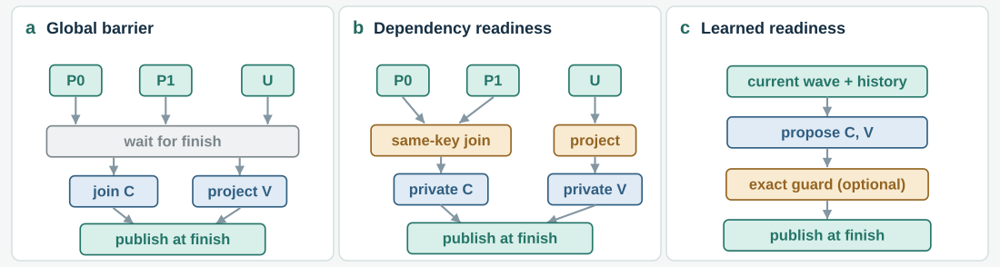

# 图 07　消费者可以提前多久计算？

在 512 张留出图中，GPU 只凭已经到达的同键父事实，就在原定的 `finish` 之前算出了全部 3,760 个消费者 RHS。前三个源 Run 中公开的消费者行仍为零。到了 `finish`，父引用、RHS 和公开结果逐图与 Rust Cell CPU 对齐。首轮单图中位数为局部调度 1.210 ms、最简屏障 1.171 ms，提前计算在这个小工作负载上没有带来墙钟加速。



## 一个必须等、另一条可以走的例子

在 Rust 的 delayed 样例中，第一波已有 `P0(0,5)`、`P1(1,5)` 和 `U(2,1)`。C 需要同一个 key 的两个父，即使前两个值都是 5，也不能生成 `C(0,5,5)`。V 只读 U，可以立即算出 `V(2,1)`。第三波补来 `P1(0,5)` 后，C 才能使用第一波和第三波的两个见证。另一个样例前三个输入相同，第二波也相同，第三波始终缺这个父。两者都要保留 V；后者没有 C。三个生产者 Run 都只公开生产者事实，第四个 Run 才开放 C、V。[源规则、反例与四个边界](compiler/README.md)

独立 GPU 原型有 4 个键，每个关系每个键用一个槽，每波接收最多 16 条稀疏输入。设备只收到已释放的波次，重复输入保留第一次出现的 epoch。私有结果保存实际字段和父见证。流结束时另有封闭标志，允许区分仍开放的缺失义务与已确认缺失。该标志属于输入协议。这个实验覆盖单调追加与同键连接；一般的 union、撤回、可变读取和物理并行扩展均需各自验证。[GPU 执行](engine.py) · [冻结协议](PROTOCOL.md)

## 源对齐与时间

训练集有 4,096 图。独立评估包含 256 张同分布新图与 512 张来自两个留出调度族的新图。留出集以 128 个基础组构造，每组四种变体为早到、迟到、缺失仍开放、缺失且封闭。封闭标志不改变源程序。Rust 独立 Cell CPU 共执行 576 个不同源程序、2,304 次 Run。CPU 从保存的 30 份 GPU 轨迹核对逐 Run 的有效新增、可见关系、RHS 和最终父身份与首次发布波次。这里的集合规则不依赖同 Run 内的插入顺序。[源执行摘要](compiler/panel-audit.json) · [独立审计](audit.py)

| 精确调度 | 留出完整图 /512 | 前三波私下完成 | finish 计算 | C／V 累计就绪后等待 tick | 单图中位 ms |
| --- | ---: | --- | ---: | ---: | ---: |
| 全局屏障，每波调用消费者 | 512 | 0、0、0 | 3,760 | 2,980／4,492 | 1.196 |
| 最简屏障，只在 finish 调用消费者 | 512 | 0、0、0 | 3,760 | 2,980／4,492 | 1.171 |
| 按依赖就绪 | 512 | 1,332、1,048、1,380 | 0 | 0／0 | 1.210 |

三种调度各发布 1,720 个 C 和 2,040 个 V。128 组中每一组的 C 都能在对应的第二个父到达时私下完成；V 在 C 缺父时也能及时计算。固定观察的无关 V 累计少等 1,536 个 tick，这是全部 V 等待的一个子集。设备原型每波检查有界候选；最简屏障只需 3 次输入 kernel 与 1 次消费者 kernel，局部方式为 3 次输入与 4 次消费者 kernel。

计时使用同样 64 张留出图，单图分别创建状态、按波上传、计算、发布、同步。编译计划和着色器预热，CPU 审计另计。随后仅保留三个精确方案，每张图轮换全部六种执行顺序，得到 384 个配对。局部减最简屏障的配对差中位数为 **+0.040 ms**，六轮各自为 +0.038、+0.132、+0.061、+0.051、+0.006、−0.011 ms。这里的消费者只做一次投影或小连接；该测量无法估算昂贵消费者与其他 GPU 工作重叠时的收益。[计时记录与轨迹指纹](results/evidence.json)

## 网络是否能自己决定就绪？

两个种子各自从相同初值开始对比两种网络输入。一版能看到原始事件的 key，另一版将事件 key 特征清零，两版都能看到事件的关系、值和波次。所有前向只接收当前波及自己的历史状态。模型没有未来输入。训练时用独立的就绪标签监督 768 步，推理阈值固定为 0.5。[预测器](predictor.py) · [训练](fit.py)

| 调度 | 留出完整图，1703／1709 | 缺父时提前计算次数 | 单图中位 ms，1703／1709 |
| --- | ---: | ---: | ---: |
| 直接采纳网络，含 key | 220／220 | 328／328 | 2.615／2.789 |
| 直接采纳网络，遮住 key | 30／26 | 1,208／1,204 | 2.551／2.615 |
| 含 key，设备核对同键父后才执行 | 512／512 | 0／0 | 2.751／2.760 |
| 遮住 key，设备核对同键父后才执行 | 512／512 | 0／0 | 2.761／2.527 |

保留键有助于学习判断，仍不足以让预测作为发布依据。含 key 的直接提案在每个种子消耗了 160 项本应保留的开放义务，另有 168 项已封闭缺失判断错误。加精确检查后，含 key 版本仍让已就绪的 C 累计多等 1,260 个 tick。额外设置的 finish 精确补算在两面板、四个权重上触发次数均为零；单靠只审核已有提案的门无法保证覆盖未来工作负载中从未提出的合法结果。[两个面板的全部 15 种调度](results/metrics.tsv)

## 复现

先按 compiler 目录的说明重新生成 Rust 参考证据。以下命令在外接盘工作树的根目录执行，使用同一设备队列。运行 fit 时使用新目录；已有检查点受覆盖保护。

```sh
base=benchmarks/multi-row-generation/readiness_ablation
root=/Volumes/EggFuseWorkspace/experiments/NEW-readiness
runner=/Volumes/EggFuseWorkspace/bin/run-eggfuse
for arm in keyed blind; do
  for seed in 1703 1709; do
    ~/.local/bin/eggfuse-job submit --kind compute -- "$runner" env PYTORCH_ENABLE_MPS_FALLBACK=0 python "$base/fit.py" "$root" "$arm" "$seed"
  done
done
# After fitting, run in this order.
~/.local/bin/eggfuse-job submit --kind compute -- "$runner" env PYTORCH_ENABLE_MPS_FALLBACK=0 python "$base/evaluate.py" "$root"
~/.local/bin/eggfuse-job submit --kind compute -- "$runner" python "$base/audit.py" "$root"
~/.local/bin/eggfuse-job submit --kind compute -- "$runner" env PYTORCH_ENABLE_MPS_FALLBACK=0 python "$base/repeat_timing.py" "$root"
~/.local/bin/eggfuse-job submit --kind compute -- "$runner" python "$base/report.py" "$root" "$root/summary"
```
