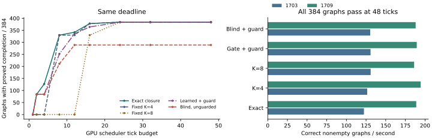

# 图 19　何时可以声明一个 Run 已经饱和？

在 384 张普通留出图中，停止门看不到在途消息和输入封闭标志时，两个种子都在 **95 张图**上提前宣告饱和；其中 **45 张图的所有公开视图碰巧与源执行一致**。一个迟到的重复消息可以不改变最终图，但在它被处理之前，接收者仍负有处理义务。把停止提案送到设备端精确闭包检查后，两种子均为 384/384，普通流分别拦下 548 次提前停止尝试。



## 设备上保留什么？

冻结神经生产者在线发出带来源的 Pair token。GPU 捕获 Request 指定的真实父。局部 union、外部 union 各有一个必须执行的观察边界，另有初始视图。比较三个边界的六端口分区、每项读取的原始父和五个 RHS 字段。源语义沿用图 15 逐观察点核验过的 Rust Cell CPU 分区和神经父证据。延迟的是属于相应阶段的实际事件。多个小图在一个 GPU 上并行；这里的 tick 是调度机会，不能换算成外部网络传输时间。[GPU 输入和状态](queue_gpu.py) · [源审计](replay.py)

每个阶段包含四种需要保留的工作。已发送的消息在到期后进入收件箱；处理一个有效 union 后，还有构造器同余需要扫描。若扫描继续产生等价，下一轮要再扫描。最后将变化传播到观察者实际读取的索引。设备在已收到封闭通知、在途和收件箱均空、同余扫描和索引传播都清空时才有闭包证据。到达预算会返回当前类、索引、队列、封闭状态、未开放的下一阶段以及已发布的观察。一个空收件箱不能授权跳过下一个源 Run。[Metal 状态机](stop.metal)

- **固定 K** 每 K 个阶段内 tick 尝试关闭一次。如果检查失败，则保留状态进入后续时间片。额外的总预算可在任意 tick 截断。
- **精确闭包** 在最后一项工作完成的同一 tick 检查并开放观察边界。
- **学习门** 在本 tick 执行工作之前，从工作、等待、关闭三种动作中选择一个。含账本版本读取收件数、待修复、待传播、前轮变更、在途数和封闭通知。盲门把最后两个特征清零。两个版本同为 123 参数的 PyTorch 网络，由相同训练模板生成的真实设备轨迹监督，部署时在同一个 Metal 内核执行相同权重。诊断臂直接采纳关闭请求；安全臂在设备上复核声明。另测就绪工作连续两步被跳过时强制调度的版本，本次正常权重没有触发强制执行。工作粒度每 tick 最多一个消息、一次扫描或一次索引传播。[训练](train.py) · [计时与分段恢复](measure.py)

七个训练模板、两个种子各训练 512 步，固定最终权重。每个种子的两个模型共用 57,856 个训练状态与相同的 minibatch 顺序。训练罕见延迟为 3 个 tick，测试为 10 个 tick。主面板含两个完整留出结构族共 384 图；附加 384 张新图来自有二次同余的已见模板。普通测试流按输入位置确定少数迟到的 union、重复消息或封闭通知。另在同一批源输入上固定三种压力条件。门看不到未来的消息内容、到达时刻或源端答案。

## 同预算与同正确性

表中的“完成”同时要求三个源观察均正确，且两个关闭点都没有残留义务。两个种子在本表中的调度计数一致。每种子的分母均为 384 张非空留出图。

| 普通流 | 4 ticks 完成 | 8 ticks 完成 | 16 ticks 完成 | 48 ticks 完成 | 至终态平均 ticks |
| --- | ---: | ---: | ---: | ---: | ---: |
| 精确闭包 | 127 | 330 | 378 | 384 | 5.96 |
| 固定 K=4 | 0 | 330 | 378 | 384 | 9.19 |
| 固定 K=8 | 0 | 0 | 330 | 384 | 17.13 |
| 学习门＋精确关闭检查 | 84 | 252 | 364 | 384 | 6.99 |
| 盲门＋精确关闭检查 | 84 | 252 | 364 | 384 | 6.99 |
| 直接采纳盲门 | 84 | 211 | 289 | 289 | 5.11 |

精确策略在 4 ticks 后仍有 257 图未完成。检查点解码为 236 图等待开启下一阶段，21 图在等传输或封闭；已完成的 127 图可以安全返回。其余精确策略和带门策略到 48 ticks 完成时均执行 1,368 项实际工作。含账本的原始门在本次有限输入上也全部正确，但网络分类器本身没有提供一般性的闭包证明。学习门多用的一部分 tick 来自它在工作开始前选动作；精确策略可在工作结束后立即开放观察。[各预算下的残留和实际工作量](results/metrics.tsv)

| 压力输入 | 盲门假饱和 /384 | 其中所有视图仍正确 | 盲门加检查后正确 /384 |
| --- | ---: | ---: | ---: |
| 普通混合流 | 95 | 45 | 384 |
| 仅将启用的外部 union 延后 | 140 | 0 | 384 |
| 加入一个迟到的恒等 union | 384 | 340 | 384 |
| 仅延迟外部阶段的封闭通知 | 384 | 340 | 384 |

在每个种子 **252 对**输入中，普通流与迟到重复消息流从外部阶段开始到决策时，盲门能读到的整段特征前缀完全相同。一边已经能关闭，另一边必须等待。保留额外的源实例或增加重复训练样本都不会让相同的观察区分这两个动作。检查点测试在第 4 tick 克隆设备状态，主动污染旧执行器载荷，再用新执行器每次恢复 4 ticks。所有被测策略的最终状态、父引用、观察与不间断执行一致。[配对和恢复记录](results/resume.json)

普通面板固定 48 tick 上限、实际完成后提前退出。计时包入数据上传、神经生产者、GPU 调度、所有观察和同步，模型与模板预热。两个种子的精确版中位数约 **7.49／5.14 ms**，含账本学习门加检查为 **7.59／5.13 ms**。每种子从三个模板各取相同 12 张单图轮换计时；不同种子的绝对时延受运行时段影响。单图端到端没有一致学习门优势。单独预置输入并重复至 4,096 张图时，规则 134、266 普通流的精确核与含账本门的 GPU 服务中位数分别为 220→241 和 258→273 µs。该结果覆盖有界的两个阶段和已登记发送的传输；没有测生产 eggcc 或跨设备协调。[计时汇总](results/summary.json) · [设备服务样本](results/service.json)

## 复现

CPU 审计逐 tick 独立重放消息交付、构造器修复、索引发布和状态转换，验证九个预算边界；不能从最终图倒推出一次停止是否合法。48 份 GPU 归档各含 12 种策略。每个归档原始父与图 15 已核验的源面板对齐，训练标签和 CPU 对照都没有进入在线推理。

```sh
base=benchmarks/multi-row-generation/stopping_ablation
root=/Volumes/EggFuseWorkspace/experiments/NEW-stop
prod=/Volumes/EggFuseWorkspace/experiments/eclass-ports-20261119
prior=/Volumes/EggFuseWorkspace/experiments/union-observers-20261119
runner=/Volumes/EggFuseWorkspace/bin/run-eggfuse
job() { ~/.local/bin/eggfuse-job submit --kind compute -- "$runner" env PYTORCH_ENABLE_MPS_FALLBACK=0 python "$@"; }
for seed in 1703 1709; do job "$base/train.py" "$root" "$prod" "$seed"; done
job "$base/measure.py" "$root" "$prod"
job "$base/replay.py" "$root" "$prior" "$root/summary"
job "$base/controls.py" "$root" "$prod" "$root/summary/resume.json"
job "$base/service.py" "$root" "$prod" "$root/summary/service.json"
```
