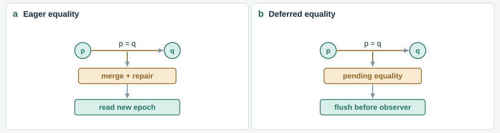

# 图 15　union 可以等到哪个读者之前？

在三个留出规则和三个含二次同余的规则上，GPU 可以合并两次观察之间到达的 union，在读者检查等价关系之前集中修复。两种子、两个面板、三种观察位置下，立即修复、按读者修复以及合并 GPU 调用三版，每次均有 **384/384 张图在所有观察点正确**。这包括之前短证书漏掉的 20 个构造器同余读取。忽略中间读者的版本同样可以得到正确的最终可见行，却会漏掉中间的有效写入。



## 修复计划来自哪里？

离线编译只读取最初的构造器行、类型、模板局部 union 证书和公开端口地址。同一个构造器的两行形成一条条件指令：各参数位置都等价时合并两个返回值。不同构造器或不同标量字面量不产生这条指令。GPU 从本批已到达的 union 开始，执行满足条件的指令，直到没有新合并。计划专用于已知构造器行的有界实例形状。运行时新增构造器、撤回事实以及所有权迁移需要单独的维护协议。[编译器](compile_plan.py) · [十个模板的计划](plan.json) · [Metal 执行](schedule.metal)

例如规则 266 的第 6 张测试图中，请求 2 从 `owner1.handle5` 读取指定来源 `owner0.handle5`。两边的 handle 恰好同号，身份仍不同。本地 union 后这项请求仍为空。随后到达的外部 union 连接的是 `owner1.handle4` 和 `owner0.handle7`。它使两行 `DelayedDropUnion` 的各对有序参数都变得等价，因而两个构造器结果也等价。旧的空结果失效后，GPU 沿原生产者的物理父引用发布 RHS `[0,5,2,7,2]`。

第一 Run 执行图 14 相同的冻结神经生产者；第二 Run 在 GPU 直接消费生成的 Pair。union 接受已发布的环境事件，修复、读者调度及基于物理身份的 RHS 投影均为确定性操作。两个本地提交和一条外部边按序到达，各自可以缺席。每图有四个已知请求位置，每个请求的 miss 记住当前 epoch。只有等价分区改变时才更新 epoch。读者重新检查过期的 miss，保存实际 RHS 和父引用，只登记首次发布的增量。[设备路径](engine.py) · [冻结比较协议](PROTOCOL.md)

## 观察点决定批量大小

下面是含二次同余的 384 张图，每一种子计数相同。所有方案开头都读取一次。表中“批”只数含有效输入的修复调用；“检查”是构造器候选签名检查次数，不等于 union 或有效写入数。

| 后续读者出现位置 | 立即修复：批／检查 | 读前修复：批／检查 | 最大待处理数 | 图中实际同余合并 | 此前为空、本轮被唤醒的请求 |
| --- | ---: | ---: | ---: | ---: | ---: |
| 仅末尾 | 576／808 | 288／424 | 3 | 36 | 180 |
| 两个本地事件后，再在末尾 | 576／808 | 384／552 | 2 | 36 | 180 |
| 每个事件后 | 576／808 | 576／808 | 1 | 36 | 180 |

36 次是合并的新类对。原始四请求面板中只有 20 项合法读取依赖这些新增关系。两种子的立即和延迟方案都完成了 20/20；关掉构造器传播均为 0/20。此时第二 Run 的最终公开行仍有 364/384 图完全正确，但六个端口的完整分区连同所有观察都正确的只有 348/384。另对十个模板枚举全部 90 种外部边以及每图六端口的 36 种有向读取。立即与合并调用版在四个观察点均为 90/90。关闭同余修复时 81/90，遗漏 24 个有向读取；这 24 与前面的 20 来自不同请求面板。[穷举端点结果](results/all-endpoints.json)

两个错误对照给出了必须保留的语义。

- 在本地事件后已有读者，仍把 union 一律推到末尾，含同余面板的最终可见行与最终公开端口分区均为 384/384，但所有观察点均正确的只有 **96/384**，中间漏读 138 次。
- 执行全部 union 和修复，却继续使用原先的空结果，只设末尾读者时也只完成 **268/384**。它漏掉 180 项已被新等价关系唤醒的读取。留出面板为 243/384，漏 204 项。[两个种子、所有观察和计数](results/metrics.tsv)

## 端到端和设备服务区间

每个面板每种子从三种模板各取相同 18 张图，单图轮换计时次序。冷编译与 CPU 审计另计。“端到端”含动态输入上传、神经生产者、事件交付、修复、读取、RHS 增量发布和设备同步。三种方案都有相同的初始负读；合并调用版仅打包当前读者之前已经到达的设备张量。只读末尾时，四次 Metal 调用变为两次；每次事件都读时，各方案同为四次。

| 含同余面板，仅末尾读取 | 单图端到端 ms，1703／1709 | 已有生成 token 后的 union 与读取 ms |
| --- | ---: | ---: |
| 立即修复 | 5.137／5.793 | 0.717／0.777 |
| 按读者修复 | 4.949／5.551 | 0.710／0.776 |
| 按读者修复并合并调用 | 5.331／5.607 | 0.719／0.825 |

两个种子在留出面板上的对应端到端为立即 5.545／5.017 ms、按读者 5.716／5.189 ms、合并调用 5.564／5.477 ms。减少签名检查没有转化为跨面板稳定的单图加速。[端到端计时摘要](results/summary.json)

另将状态、输入和输出缓冲区预置好，用 MPS 时间事件量 Metal 提交区间。每图一个线程；4,096 图使用 128 张图循环填充，不代表一次包含 4,096 个节点的单图推理。仅末尾读取时，4,096 图的立即→合并调用中位数，规则 134 为 **154.0→133.2 µs**，规则 266 为 **150.2→127.7 µs**。改为每次都读，分别为 160.9→171.2 和 169.1→170.1 µs。每个样本都复核了真实输出和计数。这个区间包含队列发射开销，未隔离真实 eggcc 引擎的 rebuild stall，也没有测跨线程互锁。[12 次交错样本及同步墙钟](results/service.json)

## 验证与复现

留出模板 134、135、143 以及含同余的训练族模板 266、267、580 各使用 128 张测试图。两组分别报告。CPU 独立检查 216 份保存的 GPU 轨迹，将完整六端口分区、四请求读取、有效写入增量、原始父及公开行逐观察点对照图 20 的真实 Rust Cell CPU 分区记录。插入的读者是该分区上受控的观察序列，生产者提交顺序由实验释放。该序列不能替代生产 Pass 3 的原始调度、Spine 链或最终完整 e-graph 的验证。[独立 CPU 审计](audit_union.py)

从根目录执行。设备任务使用已有外接盘工作环境，审计只用 NumPy。

```sh
base=benchmarks/multi-row-generation/union_ablation
root=/Volumes/EggFuseWorkspace/experiments/NEW-union-observers
producers=/Volumes/EggFuseWorkspace/experiments/eclass-ports-20261119
locality=/Volumes/EggFuseWorkspace/experiments/locality-neural-20261119
runner=/Volumes/EggFuseWorkspace/bin/run-eggfuse
"$runner" python "$base/compile_plan.py" /Volumes/EggFuseWorkspace/experiments/eclass-rule-replays-v2.json "$base/plan.json"
~/.local/bin/eggfuse-job submit --kind compute -- "$runner" env PYTORCH_ENABLE_MPS_FALLBACK=0 python "$base/evaluate.py" "$root" "$producers"
~/.local/bin/eggfuse-job submit --kind compute -- "$runner" python "$base/audit_union.py" "$root" "$producers" "$locality" "$root/summary"
~/.local/bin/eggfuse-job submit --kind compute -- "$runner" env PYTORCH_ENABLE_MPS_FALLBACK=0 python "$base/sweep.py" "$producers" "$root/all-endpoints.json"
~/.local/bin/eggfuse-job submit --kind compute -- "$runner" env PYTORCH_ENABLE_MPS_FALLBACK=0 python "$base/service.py" "$root" "$root/service.json"
```
