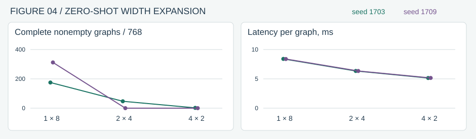

# 图 04 · 单 row 策略的零更新展开

**冻结单行策略直接展开，虽然推理时间下降，但第二 Run 完整覆盖大幅下降。** 两种子从 1×8 到 2×4 再到 4×2 的完整数分别为 175→47→2、312→0→0，各 /768。比起单独将生产者分行，单独将消费者分行造成更大的覆盖损失。



## 模型和数据

复用图 20 的 pairwise 模板局部等价编码、两实例两 Run 契约、实际证书和全部 7,168 张训练图。新的 39,156 参数模型从头只在一行八位置上拟合 1,536 步，种子 1703 和 1709。源与输出位置均以打包地址的常数、线性、正弦、余弦四个固定特征经共享线性函数取得向量。从头训练不读取旧位置表。这里的打包地址用于确定固定的八个查询坐标；图 03 的学习型地址头没有接入本次解码。

每个源 Run 有八个潜在输出。设行数 R，长度 L=8/R。第 t 个设备轮次可并行产生 R 个 token，物理位置为 rL+t。所有行看到相同输入，全局共享策略权重，各行自己的前一位置提供真实生成历史；每行第一个位置的 history 为零。同轮尚未生成的选择不可见。finish 直接使用 make 生成的 Pair tensor，保留原端口身份与局部等价状态。没有更新多行专属权重、外部冲突消解、确定性去重或 CPU 补齐。[模型](model.py) · [单行训练](train_width.py) · [冻结协议](PROTOCOL.md)

新验收包含规则 134、135、143，每条 32 个新基础组、每组 8 张反事实图。共 768 张非空图、1,512 项消费义务。新组与旧训练和测试均无完整输入哈希重叠。三规则属于两个留出的模板结构家族，沿用有证书模板的受控实例。并非 768 个独立拓扑。make 的无关输出不全不会自动让 finish 失败；finish 通过要求所有所需合法祖先与绑定完整、字段正确、无额外非法或重复提案。

## 零更新宽度矩阵

每格依次为种子 1703 / 1709。耗时从原始整数输入上设备计至两个 Run、Pair token 和各槽输出完成 MPS 同步；每个布局、种子均使用相同 96 个新图轮换计时。完整非空图/秒是这些计时图的真实成功数除以总耗时。

| 每个 Run 的布局 | make 完整 /768 | finish 完整 /768 | finish 错父 | finish 重复（其中同轮跨行） | finish 遗漏 /1512 | 中位数 ms | 完整非空图/s |
|---|---:|---:|---:|---:|---:|---:|---:|
| 1×8 | 544 / 768 | 175 / 312 | 970 / 632 | 13 / 45（0 / 0） | 861 / 547 | 8.40 / 8.38 | 28.29 / 61.47 |
| 2×4 | 0 / 0 | 47 / 0 | 1650 / 1416 | 73 / 374（12 / 193） | 893 / 682 | 6.35 / 6.34 | 9.75 / 0 |
| 4×2 | 0 / 0 | 2 / 0 | 2979 / 2757 | 318 / 800（208 / 732） | 872 / 913 | 5.14 / 5.15 | 0 / 0 |

1703 的 4×2 有两张全量完整图，均不在该次 96 张计时子集中。错父按实际发射计，多条错误发射可以指向同一个请求。因此错父可以超过源义务数。重复只计有效源身份被多次认领；同一个父分别合法地服务不同请求不计重复。每个重复归入同轮跨行、异轮同一行或异轮跨行，三个互斥桶之和等于合法重复总数。[全部桶和分模板读数](results/metrics.tsv)

## 分别改变生产者与消费者

| make 行数 | finish 行数 | 第二 Run 完整非空图（种子 1703 / 1709，各 /768） |
|---:|---:|---:|
| 1 | 1 | 175 / 312 |
| 1 | 2 | 48 / 0 |
| 2 | 1 | 154 / 203 |
| 1 | 4 | 2 / 0 |
| 4 | 1 | 136 / 111 |

同一 make 宽度下，不同 finish 宽度收到的整个 Pair tensor 逐位相同。在 1 行与 4 行都供齐所需父的共同子集上，消费者完整率仍分别从 132/517→2/517、88/156→0/156。4 行每个位置能看到的行内生成历史更短；这组布局没有额外训练或跨行认领消息，因而无法把退化外推到接受过联合训练的多行模型。[配对胜负与共同就绪子集](results/paired.tsv)

将各行按完全相同的数据依赖逐行串行执行，两个 Run 的离散输出在所有模板和两个种子上均与对应并行实现完全相同，生成 Pair token 的最大绝对差为零。两行串行耗时 8.42/8.44 ms，对应并行 6.35/6.34 ms。四行串行耗时 8.51/8.49 ms，对应并行 5.14/5.15 ms。这是相同多行策略下可验证的执行加速。它没有弥补与单行相比的质量损失。抹去行内生成历史的推理干预在三个布局中均为 0 个完整图；历史载荷对冻结策略的作用清晰可见。

另用历史图 20 的检查点保留八个独立学习的位置向量，复现旧 1×8 轨迹后展开，多行下同样退化。这个对照使用旧 384 图面板，与主模型、新 768 图面板分别解读。[历史检查点报告](LEGACY.md) · [独立 NumPy 审计](audit.py) · [实验数据与环境](results/provenance.json)

## 复现

独立 PyTorch，Apple Silicon MPS，关闭 CPU fallback。使用共享 FIFO 和外接环境。

```sh
base=benchmarks/multi-row-generation/width_ablation
run=/Volumes/EggFuseWorkspace/experiments/NEW-single-to-multi-width
for seed in 1703 1709; do
  ~/.local/bin/eggfuse-job submit --kind compute -- /Volumes/EggFuseWorkspace/bin/run-eggfuse env PYTORCH_ENABLE_MPS_FALLBACK=0 python "$base/train_width.py" "$run" "$seed"
done
# 待两份权重写出后
~/.local/bin/eggfuse-job submit --kind compute -- /Volumes/EggFuseWorkspace/bin/run-eggfuse env PYTORCH_ENABLE_MPS_FALLBACK=0 python "$base/evaluate_width.py" "$run"
python "$base/summarize.py" "$run" ./summary
```

全量 GPU 轨迹与逐图回放保存于 `/Volumes/EggFuseWorkspace/experiments/single-to-multi-width-20261119`。登记的 72 份 trace 包括两种子 × 三模板 × 十二种主布局、混合布局和干预配置。
