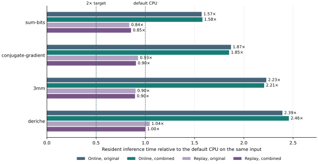

# Pay verification, ordered Cell effects and repair in the same native execution

The bounded compiled page verifier shares parent words by dictionary coordinates, checks residual functions and primitives, and seals the original source-order ticket. The ordered effect block keeps the original operation numbers and frame identities but pre-resolves proven source operands and delays a writer frame until an effective change. The repair treatment changes native reverse-edge maintenance, preservation of compatible decoded fields and canonical key handling. It still processes all original unions and scheduled source updates. This study tests the three changes together in one linked CPU engine and includes the individual online arms. No sum of timings from separate executables is used to construct the joint result.

Two separate input conditions run from a newly initialized original graph. Live executes the actual frozen parent model. Positive replays only previously accepted parent addresses and versions from a prior real source pass, before deduplication. It pays fresh page construction, actual validation and source-ordered execution. The capture was run with all three optimizations off. No captured row, RHS input or mutation is supplied to the replay. The joint positive run builds and consumes the changed page format anew. Every replayed root has zero online discovery credit. The later constructor/merge-child execution is preserved. The original exact CPU is a third independent control. These are four rotated resident samples after warmup, one seed, excluding offline capture, setup and final export.

Validation compares every Run's ordered RHS, effective writes, Spine and union sequence, schedule, final graph, actual winning parent and fresh Cell identity to the original. Within a given source of addresses the full raw multi-parent and root page digests must be the same across arm selections. Replaying the accepted subset has a shorter raw stream than the full online proposer. We check both without conflating distinct logical proposals with committed mutations.

| Program | Vanilla | Live original | Live combined | Accepted oracle original | Accepted oracle combined | Half vanilla, ms |
|---|---:|---:|---:|---:|---:|---:|
| sum-bits | 21.84 | 34.33 | 34.49 | 18.29 | 18.67 | 10.92 |
| conjugate-gradient | 383.32 | 716.78 | 709.42 | 355.04 | 346.78 | 191.66 |
| 3mm | 942.41 | 2,099.72 | 2,079.29 | 848.75 | 843.62 | 471.20 |
| deriche | 1,599.71 | 3,826.34 | 3,931.51 | 1,671.17 | 1,600.78 | 799.86 |

In this matrix the combined execution does not reach the 2× target even when every supplied parent tuple will verify. It also does not improve all live workloads. On Deriche, for example, the accepted-only diagnostic falls from 1,671.17 to 1,600.78 ms but live inference increases from 3,826.34 to 3,931.51 ms. The allocation, encoding and verification costs of processing failed live proposals still matter. [Factorial arms and charged phase samples](results.json) · [Deriche transfer](deriche.json) · [Independent profile](phases.json)



## Physical addressing in the joint binary

A separate build retains the original logical fact addresses while storing Cells in the existing dense live-record arena. It reuses the verified joint tree and measures both binaries again. The residual cost is checked against a prepaid oracle; that column earns zero online discovery credit.

| Program | Vanilla | Hash original / repair / combined, live | Arena original / repair / combined, live | Hash original / arena repair / arena combined, accepted-only |
|---|---:|---:|---:|---:|
| conjugate-gradient | 350.38 | 716.55 / 668.39 / 672.02 | 631.98 / 652.23 / 641.89 | 330.15 / 294.29 / 297.22 |
| 3mm | 919.17 | 2,058.13 / 2,014.33 / 1,998.44 | 1,966.77 / 1,904.45 / 1,950.48 | 846.40 / 743.14 / 741.55 |

The model, labels, complete source program, stable Cell identities and input fact stream are unchanged across the two physical stores. The separate exact layout timings and memory measurements are documented in the [storage study](../paged-cell-ids/README.md). [Matched combined arena evidence](arena.json)

```sh
d=benchmarks/pass3-cell-gpu/block-execution-ceiling
python "$d/build.py" "$EXP/joint-block"
python "$d/study.py" "$EXP" "$EXP/joint-block/session" "$EXP/joint-block-study"
python "$d/study.py" "$EXP" "$EXP/joint-block/session" "$EXP/joint-block-transfer" --cases deriche --transfer-only
python "$d/phases.py" "$EXP" "$EXP/joint-block/session" "$EXP/joint-block-clocks"
python "$d/arena.py" "$EXP" "$EXP/joint-block" "$EXP/joint-block-arena"
python "$d/verify.py"
```
