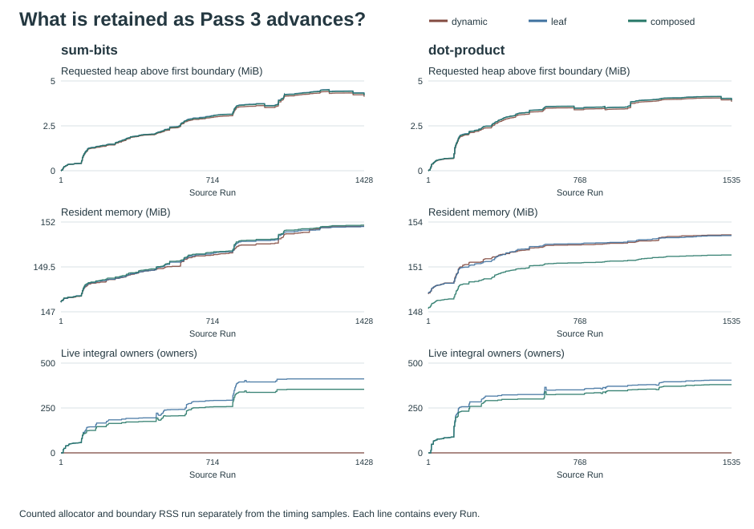

# Figure 44 — actual online ownership and physical state

These measurements execute the current 1,428-Run sum-bits and 1,535-Run dot-product Pass 3 programs. The native CPU implementation of integral member storage is pinned to EggFuse revision f62704246fef80e13b4c1afb43f827e9a9da1761 and built in an isolated source archive. The original historical 882-Run sum-bits dataset is not used. The authoritative exact scheduler supplies rule bindings in all three arms. This comparison isolates physical storage after a binding is accepted and gives the neural model zero RHS credit.

* Dynamic uses the normal independent native source frame/completed descriptor for a matched RHS.
* Leaf stores a matched member in the compiled leaf instance arrays when its original Run commits. Existing external Cell source ids resolve to an instance/member address. It cannot use a larger composition.
* Composed loads the identical library, admits the identical members and allows a verified source-effect/child-entrance edge to switch the parent layout in place. The newly eligible child is published as an internal member at its original source Run. This omits a separate child owner and root hold. Previously published root members keep their source ids. We count the avoided child owner separately from actual view retirement.

Each program learns four batches on native executions before freezing a 32-edge library shared by the three modes. To separate admission from representation, the driver intersects actual admission tuples (source epoch/id, root Cell/operation, base unit, member position) and reruns until all arms accept exactly the same set. This diagnostic uses a workload-specific frozen id mask; it is not a learned online admission policy or a cross-family library generalization result. All three modes allocate the same mask. Every Run has equal schedule, ordered RHS digest, effective writes, actual Spine resumes and full logical graph across the three modes. Each also agrees with the current CPU reference on every ordered digest and final state.

During the separate live-payload audit, every issued integral id must route to the correct instance/member, and it must have no ordinary Cell frame, no completed standalone slot array, and no completed standalone fact map. The audit decodes every surviving old source fact address through the real current graph at each boundary. Query, index, active-hold, canonicalization and repair logic execute normally. The common library charge, graph fields, root-directory estimate, handle counts and locator costs are reported separately. No witness or fact is restored from a saved reference graph.

| Program | Arm | Matched admissions | Final standalone descriptors | Final integral owners / view handles | Peak mixed-Run owners | Retained Graph B | Graph + private context + library B | Peak sampled RSS MiB | Median inference ms |
| --- | --- | ---:| ---:| ---:| ---:| ---:| ---:| ---:| ---:|
| sum-bits | dynamic | 920 | 2174 | 0 / 0 | 0 | 1,858,067 | 2,326,149 | 151.77 | 41.31 |
| sum-bits | leaf | 920 | 1723 | 412 / 452 | 16 | 2,002,295 | 2,441,633 | 151.75 | 41.59 |
| sum-bits | composed | 920 | 1723 | 354 / 452 | 42 | 1,980,455 | 2,420,241 | 151.83 | 41.32 |
| dot-product | dynamic | 951 | 2122 | 0 / 0 | 0 | 1,877,367 | 2,348,521 | 153.14 | 31.98 |
| dot-product | leaf | 951 | 1647 | 405 / 475 | 32 | 1,992,967 | 2,438,825 | 153.09 | 32.35 |
| dot-product | composed | 951 | 1647 | 380 / 475 | 49 | 1,984,583 | 2,430,889 | 151.80 | 32.01 |

Sum-bits switches 58 live layouts; dot-product switches 25. The composed arm avoids precisely that many standalone child owners relative to leaf storage. Both leaf and composed retain 530 / 552 integral facts respectively in the two programs and actually retire 468 / 476 member views over execution. The existing source frame count is 211 / 267 in addition to the completed descriptors shown. The integral arrays, forwarding directory, lifecycle exceptions and existing global index still cost memory. After including these costs, ordinary dynamic representation is smaller on both inputs. The leaf-to-composed reduction is real, and it does not establish a whole-pass speedup. Boundary RSS uses separate counted-allocator passes; small differences within a few allocator pages should not be interpreted as throughput improvements.

[Every Run as TSV](storage-curves.tsv) · [Storage and timing detail](storage-results.json)

## Current-graph producer-port census

A separate native observer on the current research branch records each source binding before sibling effects. It reconstructs all table premises through complete physical keys and checks bound result identity on the actual Graph. It inspects completed source effects through their real frame values, resolves their output addresses, and compares the physical row, table, full canonical tuple and source epoch at the later consumer. Effective writes/births and source-less repair updates are checked independently against native events. This is a diagnostic on a successful reference trajectory with access to actual union and mutable-graph state. It issues no neural proposals and earns zero neural credit.

Holding identical physical versions rigidly loses many opportunities after union. Revalidating through actual prior union events recovers many of them, but a further source of missing context is the merge expression of ExtractedExpr. Its declaration invokes Smaller(old,new) and returns the resulting constructor. The observer matches a real Smaller constructor birth to the *same* source RHS, the actual previous function value, the source's candidate operand, a unique set effect/function row, and the following write of the returned constructor result. A source-less repair birth or an ambiguous source port is excluded. This gives a named nested output, distinct from either the raw candidate or the merged function value.

| Program | Source RHS | Any earlier explicit effect, strict matching version | Any earlier source effect after same-address union check | Conditional recursive LHS with nested merge + checked aliases |
| --- | ---:| ---:| ---:| ---:|
| sum-bits | 7,265 | 6,621 | 7,261 | 7,261 |
| dot-product | 6,704 | 6,445 | 6,700 | 6,670 |
| gemm-bias-relu | 15,462 | 14,223 | 15,458 | 15,462 |
| stable-argmax | 8,190 | 7,588 | 8,186 | 8,190 |

The conditional recursive count requires all table premises to reach prior supported outputs or an admissible original fact. It assumes the recorded union relation and live-key/visibility checks are available, and that the authoritative merged prior value is supplied at the writer. It does not prove a source scheduler's negative coverage, derive all union causes, or train a policy to choose any of these bindings. Replacing the final table lookup with a reference to an arbitrary historical equal row would not be sound. [Strict references](parent-ports.json) · [Union/mutable revalidation](versioned-ports.json) · [Nested merge results](merge-ports.json)

An additional native observer records every actual old/proposed value, including no-op sets. Requiring the old mutable value to have its own recursively justified effective writer narrows the counts to 7,259/7,265, 6,589/6,704, 15,458/15,462 and 8,190/8,190. This still uses the recorded union closure and paid current-state key/visibility checks. At least 1,201 / 1,509 / 2,298 / 1,427 source key-absence checks remain in the four programs. Source-less repair updates can break these chains. [Ordered mutable input obligations](mutable-ports.json)

## Reproduction

Set EXP to the workspace experiment directory. Keep the checked-out main research source for the proof observer; the old integral implementation is extracted into EXP/legacy. The preparation script changes only that isolated archive.

    dir=benchmarks/pass3-cell-gpu/online-storage
    rev=f62704246fef80e13b4c1afb43f827e9a9da1761
    mkdir -p "$EXP/legacy"
    git archive "$rev" | tar -xf - -C "$EXP/legacy"
    python "$dir/prepare_legacy.py" "$EXP/legacy"
    CARGO_TARGET_DIR="$EXP/target" cargo build --release --locked --manifest-path "$EXP/legacy/Cargo.toml" -p eggfuse-cell-compiler --features iterative-bake,sparse-cells,storage-metrics --example online_storage_trial --example runtime_storage_peak
    for n in sum-bits dot-product; do "$EXP/target/release/examples/online_storage_trial" "$REF/$n/program.json" "$EXP/library-$n" learn; done
    python "$dir/storage_study.py" "$EXP" "$REF" "$EXP/storage-paired"
    python "$dir/package.py" "$EXP/storage-paired" "$REF"
    python "$dir/plot.py"
    cargo build --release --locked -p eggfuse-cell-runtime --features slot-transfer-audit --example actual_parent_ports
    for n in sum-bits dot-product; do "$CARGO_TARGET_DIR/release/examples/actual_parent_ports" "$REF/$n/program.json" "$EXP/v4-$n"; done
    for n in gemm-bias-relu stable-argmax; do "$CARGO_TARGET_DIR/release/examples/actual_parent_ports" "$FAMILIES/$n/program.json" "$EXP/v4-$n"; done
    python "$dir/merge_ports.py" "$EXP" "$REF" "$FAMILIES" "$EXP/merge-ports.json"

For the additional mutable-input analysis, use the same observer (which enables set-input observation) and name its four output directories mutable-PROGRAM; then run mutable_inputs.py with the same EXP, REF and FAMILIES arguments as merge_ports.py.

The archived catalog and masks beside this document can also be checked against the published file hashes instead of retraining.
