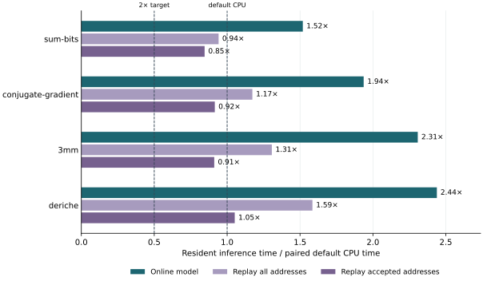

# What if the parent generator already knew which addresses to propose?

This retrospective control isolates the part of the performance gap that can be affected by parent selection. An actual frozen CPU actor first executes the full program. Before verification the observer saves the singleton token address, version, score, flags and causal scalar telemetry, and the multi-parent pages of ordered physical addresses/versions. It marks candidates that pass their original verifier before source deduplication. The tape contains no source row fields, RHS inputs, final graph, resolved numeric values or mutation stream. Capture is offline to the measured replay and is not a deployable prediction. A future workload supplies no such outcome labels.

Every replay starts with a new native graph, uses the original schedule, seals fresh page objects, resolves actual witness addresses, executes all remaining source point reads and primitives, checks the seminaive watermark and publishes verified RHS in order. The same nested constructor/merge-child mechanism, root physical construction, notifications and union/rebuild remain active. Replaying a provider supplies no online root-discovery credit to it. Donor scalar metadata is available to the singleton recurrent bookkeeping; a replayed singleton does not use that bookkeeping to generate its next addresses. Placing the captured tape in memory is outside the clock. Traversing it, copying the selected addresses and allocating fresh native receipts take place during inference. A different architecture can change those costs.

* Live runs both trained issuers. All replays both original signed streams, including rejected tuples. It reproduces the complete raw multi-parent and root-page digests.
* Single or multi replaces only that provider with its accepted-before-deduplication subset. The other provider computes its addresses online. Coverage for the live provider is separately attributed.
* Positive replays only accepted candidates for both providers. Scope, Run epoch, rule and watermark must match every stored call. A changed source site is rejected. An inconsistent emitted single-parent version is also rejected by the actual verifier. The source may still encounter repeated candidates and perform the original ordered merge.
* The replayed multi-parent suffix uses an unconstraining upper watermark for pending table reads and the original binding watermark at completion. The verifier no longer needs to materialize every table frame just to start enumerating the independent parents. The final source eligibility test remains in force.

Source verification in the detailed pass checks each Run's ordered RHS, effective writes, Spine, committed unions, schedule and full final state. It separately checks winner parents, source ordinal and allocation identity of every observed fresh Cell. Counts preserved from accepted oracle receipts are labeled verified addresses, not neural discovery. Uninstrumented timings rotate four full resident inferences after a warmup. All arms use the compact published headers, two trained port views and delayed arithmetic from the composed CPU path.

## Complete resident inference

| Source | Vanilla | Live | Replay all | Accepted singles only | Accepted multi only | Accepted both, ms | Half vanilla |
|---|---:|---:|---:|---:|---:|---:|---:|
| sum-bits | 21.80 | 33.12 | 20.53 | 30.29 | 21.15 | 18.43 | 10.90 |
| conjugate-gradient | 354.37 | 686.24 | 415.74 | 592.35 | 437.06 | 324.40 | 177.19 |
| 3mm | 901.45 | 2,080.15 | 1,177.79 | 1,625.32 | 1,280.14 | 821.67 | 450.72 |

On 3mm, 845,168 issued singleton addresses supplied 147,952 accepted singleton observations. The multi-parent provider issued 220,972 tuples, of which 146,965 were accepted. In this trace all 294,917 winning RHS have source and exact physical provenance. The single-only replay leaves 146,965 online multi-parent wins; the multi-only replay leaves 147,952 online singleton wins. The both-provider replay has zero online root-discovery wins. The three-way timing split distinguishes proposal discovery, unsuccessful verification and the remaining exact execution. Only the live arm is a deployable model measurement. [Source ledgers, tape counts and individual times](results.json)

A separate three-repeat profiling pass attributes the preserved source intervals. Search includes source validation and accepted binding assembly. The outer column covers schedule time outside the five Run clocks. The independent medians need not add exactly. [Phase samples](phases.json)

| Accepted-only replay | Search | RHS | Repair | Publish | Delivery | Outer | Full, ms |
|---|---:|---:|---:|---:|---:|---:|---:|
| sum-bits | 7.21 | 5.97 | 2.11 | 1.41 | 0.18 | 0.32 | 17.21 |
| conjugate-gradient | 134.51 | 101.96 | 37.48 | 24.32 | 2.80 | 0.84 | 301.86 |
| 3mm | 343.86 | 294.01 | 108.53 | 66.33 | 7.01 | 1.20 | 818.71 |

The largest transfer case, Deriche, executed 635,818 RHS. Its original network, all-address replay and accepted-only replay took 3,850.02 / 2,502.59 / 1,661.00 ms. Even the accepted-only stream was slower than the separately measured 1,578.79 ms vanilla median. On 3mm the accepted-only replay was faster than vanilla but was still 370.95 ms above the 2× target. In three separate 3mm phase samples, costs outside the entire search clock were 473.80–499.63 ms. That comparison uses a separately measured half-vanilla target of 450.72 ms and describes this implementation. Grouped verification, less binding assembly or changes to how ordered effects run could move the measured boundary. [Deriche source and intervention evidence](deriche.json)



```sh
d=benchmarks/pass3-cell-gpu/perfect-receipt-replay
python "$d/build.py" "$EXP/oracle-build"
python "$d/study.py" "$EXP" "$EXP/oracle-build/session" "$EXP/oracle-study"
python "$d/study.py" "$EXP" "$EXP/oracle-build/session" "$EXP/oracle-deriche" --cases deriche --transfer-only
python "$d/phases.py" "$EXP" "$EXP/oracle-build/session" "$EXP/oracle-phases"
python "$d/verify.py"
```
