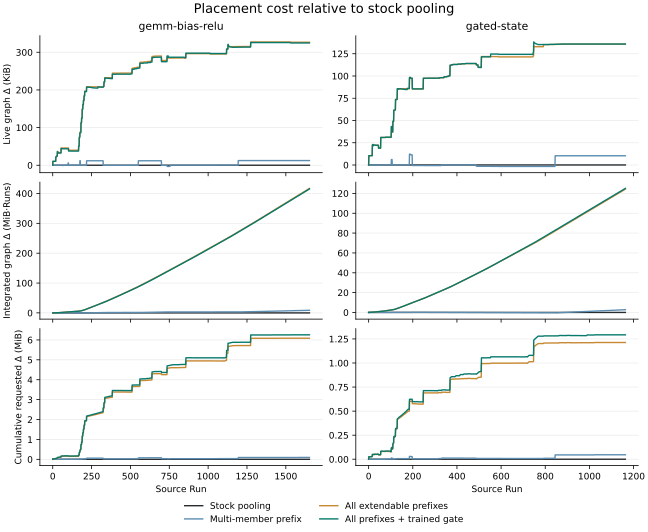

# Lifetime cost of natural owner placement

This native standalone Cell CPU experiment asks whether the immediate space released by a learned owner merge repays the cost of housing its two inputs before and after that action. It uses the frozen workload catalog and authentic, naturally occurring opportunity stream from [prospective owner placement](../prospective-owner-placement/README.md). Four executions of each source use ordinary pooling, isolation of extendable multi-member prefixes, isolation of all extendable prefixes with every owner kept, and the last layout with its frozen natural-data gate.

## Measurement boundaries

Each observation is taken after completing an original Run, the actual physical owner action, placement and both normal boundary compactions. Run 0 is the graph after importing initial source facts. The model sees the same eight causal counts as in the prior experiment. The archived offer supplies a source Run, two old owner addresses, member IDs, birth epochs and shape. The native runtime checks the actual settled graph and current compiler component, proves that the proposed members cover each whole owner, computes the feature vector and invokes the frozen Rust head. A prior accept or byte delta is used only to check what happened afterwards. Candidate discovery was recorded by an earlier independent run of the same arm. No source binding, row value or graph mutation is supplied by the archive. This is a diagnostic of storage and policy-controlled moves; the exhaustive opportunity observer and its cost are outside this replay.

The parent samples its counting allocator after every settled boundary. Working-set bytes are live requested bytes above a baseline taken after reading the archived candidate data and reserving the observation buffer. They include the compiled Program, the graph and normal executor state. Cumulative requested/freed bytes count original execution, storage admission/compaction, validation of the offered coordinates and the actual move, each in a separate interval. They exclude initial parsing, diagnostic sampling, final export and the separate source audit. A reallocation charges the full newly requested and released layout sizes. Summing retained heap after equally weighted Runs measures byte-Runs. It does not measure elapsed byte-seconds, bandwidth, process RSS or peak allocator fragmentation.

A macOS-only destructive probe takes a copy-on-write snapshot of the single-threaded native process; it checks the system's single-thread status before forking. The child releases the actual Graph fields, leaving the compiled Program, scheduling state and observer allocations alive. The requested bytes actually freed give a boundary's graph-only count. No child result enters model inference. At initialization and the last Run the probe separately releases the compilers' Program fields and attributes the serialized `ownership_fragments` payload and compiled ownership/composition fields to the profiled ownership library. Other source/compiled fields are counted in the remaining Program. Shared objects are charged to the last released owner. An independent final teardown in the original parent must agree with the private-process probe taken on the same post-export state.

A separate native audit compares ordered RHS, effective writes, Spine resumes, union and schedule for each Run with the original audited source stream, plus final graph equality. All archived old-owner offers are checked for the same full external-reader state before and after the action and must reproduce the original physical allocation/free difference. Pair discovery, source matching and data layout have separate attribution.

## Every-Run results on unseen programs



The graph probe ran at every boundary across 1,652 GEMM-bias-ReLU Runs and 1,163 gated-state Runs. Delta columns compare the same settled source Run with ordinary pooling. The area sums Runs 1 through the end. Cumulative requests exclude the separate archived-opportunity validation phase in the final column. The figure's bottom panels include that validation phase.

| Source | Layout and action | Immediate move savings B | End graph Δ B | Integrated graph Δ byte-Runs | Runs below stock | Cumulative requested B, without offer checks |
|---|---|---:|---:|---:|---:|---:|
| gemm-bias-relu | pooled/keep | 0 | 0 | 0 | 0 | 76,886,460 |
| gemm-bias-relu | multi-prefix/keep | 0 | 12,776 | 9,081,012 | 299 | 76,940,516 |
| gemm-bias-relu | defer/keep | 0 | 334,420 | 437,164,696 | 0 | 82,555,204 |
| gemm-bias-relu | defer/retrained | 8,632 | 332,564 | 435,218,844 | 0 | 82,664,740 |
| gated-state | pooled/keep | 0 | 0 | 0 | 0 | 28,101,563 |
| gated-state | multi-prefix/keep | 0 | 10,588 | 2,917,720 | 498 | 28,129,075 |
| gated-state | defer/keep | 0 | 138,976 | 130,353,404 | 0 | 29,074,203 |
| gated-state | defer/retrained | -1,668 | 139,132 | 131,113,304 | 0 | 29,123,627 |

For GEMM-bias-ReLU the frozen gate recovered 1,856 B at pass end and 1,945,852 byte-Runs over the broad placement that keeps every offer. That recovers about 0.45% of the broad placement's additional graph residency. On gated-state the same comparison adds 156 B at the end and 759,900 byte-Runs. A return measured around one physical move and a return accumulated over all later source Runs can therefore have different magnitudes and compare different counterfactuals. The broader policy's first actual accepted move was in Run 18 / 15, respectively. Neither broad trajectory ever used less live graph memory than stock at a settled Run.

The narrow layout did dip below stock in 299 / 498 Runs, yet ended larger on both workloads. The exact area records those short savings as well as the later persistent costs. These are complete trajectory contrasts. Dividing the difference among individual decisions would require intervening on each prefix while preserving the intended future policy.

| Stock source | Dynamic graph at init → last Run (B) | Final compiled Program (B) | Ownership library included in Program (B) | Remaining executor/runtime live at last Run (B) |
|---|---:|---:|---:|---:|
| gemm-bias-relu | 230,517 → 3,111,247 | 116,136,980 | 2,797,615 | 8,166,765 |
| gated-state | 230,517 → 1,528,107 | 114,500,523 | 2,590,684 | 5,462,754 |

The library byte count was equal at initialization and final teardown on all eight arms. The graph-only curves already exclude the entire compiled Program. A stale issuing epoch and a tampered action decision were rejected on each policy workload. All observed source digests, old physical owner coordinates, final graphs and individual move allocator deltas match the prior independent native record. Each policy controls its own later storage history. This experiment makes no inference speed claim; timing the snapshot process would measure the observer.

[Computed returns](summary.json) · [GEMM-bias-ReLU boundary series](gemm-bias-relu.json) · [Gated-state boundary series](gated-state.json) · [Probe calibration](pilot.json) · [Pinned build inputs](build-manifest.json)

## Reproduction

Use the release experiment built from the frozen prospective placement source. The allocator and field-release probes require the native storage-metrics feature. The copy-on-write probe requires a single-threaded macOS process.

```sh
d=benchmarks/pass3-cell-gpu/placement-lifetime
python "$d/build.py" "$EXP/prospective-owners-build-v3" "$EXP/life-build"
python "$d/study.py" "$EXP" "$EXP/life-build/engine" "$EXP/life-pilot" gemm-bias-relu --arms pooled/keep --stride 32
python "$d/study.py" "$EXP" "$EXP/life-build/engine" "$EXP/life-full" gemm-bias-relu
python "$d/study.py" "$EXP" "$EXP/life-build/engine" "$EXP/life-full" gated-state
python "$d/analyze.py" "$EXP/life-full" "$EXP/life-summary.json"
python "$d/plot.py" "$EXP/life-full" "$EXP/life.svg"
python "$d/verify.py"
```

Each worktree result stores one curve with rows in this order: Run ordinal, live graph-only bytes, total engine live bytes above the observer baseline, cumulative requested, cumulative freed, live owner count, charged owner-array bytes and cumulatively accepted moves. The phase matrix lists source, placement/compaction, offer validation and physical transfer, each as requested/freed bytes. At the endpoints, the three teardown entries are live graph-only, compiled Program and its ownership-library subset.
