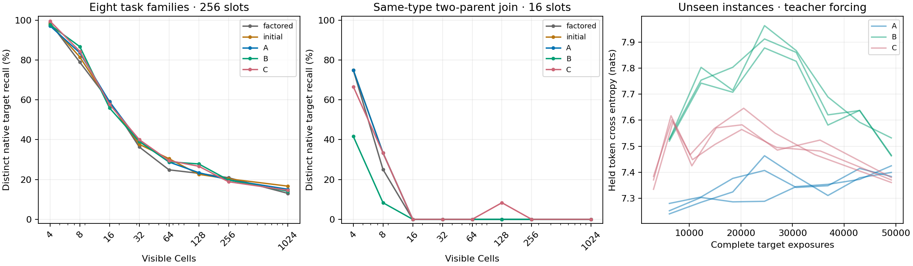

# Cell Completion 的上下文课程实验

上一轮 `2a257935` 没有实施按上下文规模推进的课程。`next_cell_train.run` 分别从同一权重启动 24 程序、200 程序及补入 Higher 轨迹的训练，每个 epoch 打乱程序，随后打乱程序内的目标。训练器没有读取可见 Cell 数来确定阶段。本轮只改变训练样本的呈现顺序，在同一套原生任务上训练三个地址解码策略。[上一轮训练入口](../../next_cell_train.py) · [本轮训练入口](../../completion_fit.py)

## 环境、目标与验收口径

每个环境都独立编译为 Recipe IR。先在原生执行器运行真实前缀，再在该状态的离线分叉中完整查找下一 Run 的证明，逐项签发并检查原生回执。每个目标必须被接受并实际贡献一个有效原子操作。每个测试快照都有完整的目标集合。生成器只看已发布 Memory、Recipe 和原有 Query，它在相同物理类型域里自由生成。离线审计得到的引用没有传给生成器。父引用组合的穷举只用于四行环境的归因。[环境生成](../../completion_context.py) · [原生自由签发](../../completion_free.py)

主矩阵使用 4、8、16、32、64、128、256、1024 个可见 owner；每个快照都断言可用具名端口也是同一数量。双父主任务为 `Edge(a,b), Edge(b,c), a<c → Result(a,c)`。加入同类型行时保留原有有效链，另有共享中间变量却因 guard 失败的链。变体切换干扰行为不同类型、同一 Stage 的 2 或 4 个规则、1 或 3 个父引用、最多 32 个合法绑定，以及真正经历前缀发布的状态。在前缀变体中，从 2k 个合法生产步骤中选 k 个，随机化签发顺序和请求 ID，原生发布后再求证消费步骤。k 随实例及容量取 1–3。此项覆盖发布依赖，merge 和 repair 的难度没有作为独立实验轴。真实 EggCC 保留其原有机制。[逐环境配置和具名映射摘要](worlds.csv)

主矩阵含 768 个训练配置和 2,756 个经核验的配置×目标，756 份不同的训练程序文本。4 Cell 时多绑定变体退化为单绑定，与基础任务重合。留出矩阵有 256 个配置和 918 个目标，每个规模和变体使用两个新数值实例、每例两种物理顺序。另取 16 个新实例、两种顺序，在 4 和 8 Cell 双父任务上作独立确认。训练与测试共享任务结构，这是对新输入与新地址的受控检验。三份 EggCC 程序均未加入本轮课程训练。

A 从第一阶段开始混合全部规模；B 每个阶段只训练一种规模，升到下一档后不回放；C 每引入一档训练该档的一半批次，将余量分布到后续阶段，最后一档全部在最后阶段呈现。每个种子预先固定每档的 96 个 minibatch，每批 64 个已核验目标，A/B/C 只重排同一批样本。每臂 768 步，49,152 次完整目标曝光。每档内等概率抽状态，再在该状态内等概率抽合法绑定；三个种子实际看到 2,600、2,608、2,595 个不同配置×目标。三臂共用同一初始检查点、普通完整 Token CE、AdamW 和学习率 0.00015；更新现有 314,369 参数的寻址打分器，沿用冻结 GNN、Actor、复制门和 Recipe。继续使用固定退出。[逐阶段曝光和留出 CE](learning.csv) · [权重校验和](weights.csv)

## 具名地址为什么必须真正置换

原生 History 初始化先按表内带类型的行值排序，再依次分配负奇数句柄。因此打乱源程序插入顺序，仍可能保留正确父地址。在第一轮对照中，专门拟合四个双父快照后，训练快照的正确 Token 概率为 97.64%，相同值、打乱插入后的概率仍有 97.71%。这一结果不能作为学会了计算关系的证据。[原始命名对照](canonical-small-fit.csv)

正式实验在离线 capture 时把种子写入单独的重放 tape 格式，用与字段值无关的置换重新分配同一表内的初始具名句柄。每一步神经签发使用真实句柄，原生回放从 tape 恢复同一命名；混用不同命名的探针会被拒绝。普通 Runtime 的默认命名、CCP v0.1、规则、发布顺序和计费沿用原实现。两个新种子碰巧保留部分句柄是合法结果；四行确认组的 18 个数值实例中有 16 个的正确父地址对确实随置换改变。回归测试要求三种命名产生相同的原生终图摘要。[原生重放入口](../../../../../../engine/cell-runtime/examples/cell_token_replay.rs) · [回归测试](../../test_completion_curriculum.py)

在正式置换环境上，用相同 CE 专门拟合四个实际绑定，1,024 步后，在训练状态上正确完整 Token 的平均概率为 **94.90%**。保持值和正确计算相同，仅改源插入顺序为 **90.3%**，仅换具名句柄为 **39.8%**，两者都换为 **24.6%**。换成 18 个新数值实例的 36 个状态后仅 **4.35%**。这些是完整生成分布的目标概率，区别于完整自由采样的有限预算实测。小数据能拟合，但四个实例没有教会模型稳定迁移这条绑定关系。[专项拟合与成对干预](small-fit.csv)

## 上下文规模与计算复杂度

下表为 256 槽自由生成后，不同原生有效计算的累计召回率（%）。先按快照分母归一化，再在八类任务和三个种子上等权平均。同一合法 Token 抽到多次只贡献一次召回。固定槽预算为 1、4、16、64、256；完整率、每次签发的核验目标命中率、首次接受及累计不同计算分别记录。

| 可见 Cell | 因子化随机 | 冻结初始 | A 混合 | B 分档 | C 保留小样本 |
|---:|---:|---:|---:|---:|---:|
|4|98.7|98.2|97.1|97.7|99.5|
|8|78.9|81.5|83.6|86.7|84.4|
|16|59.2|58.7|59.0|55.9|57.7|
|32|36.3|37.7|39.2|39.1|40.0|
|64|24.8|30.4|28.8|28.9|29.5|
|128|23.1|22.6|23.4|27.8|26.7|
|256|20.9|20.3|19.8|19.7|18.9|
|1024|13.0|16.7|15.1|14.1|14.6|

主矩阵、额外确认组和四行课程检查点共运行 4,992 个 256 槽试验，所有槽都形成完整 Token；其中 960 个试验为因子化随机。对这些环境，固定槽与固定完整 Token 的预算相同。不同种子的自由签发明细保留在实验盘。所有快照都至少有一项可执行计算，因此这里测不到无合法计算时的行为。

课程有局部收益，但没有一种在这些规模上持续领先。规模相同也不能说明任务难度相同。A 在 1,024 Cell 的异类型干扰组仍达到 100% 召回，因为两个父角色的类型域各只有两个入口；在相同规模的同类型唯一双父绑定组，256 槽内没有发现目标。在 16 Cell 的三父组，A 的观测召回已经为零。这些零是给定预算和留出样本内的实测。[分复杂度和预算的完整矩阵](free.csv) · [逐种子数据](free-seeds.csv) · [原生接受率](native-accept.csv)



## 四行环境里的信息损失

同类型四行双父任务有 16 个完整物理绑定。对每一对用原生核验分解：14 对共享变量绑定失败，1 对通过绑定但 guard 失败，1 对合法并产生新事实。无需学习，因子化随机每槽就有 1/16 的成功概率。独立确认组中，A/B/C 的每次实际签发命中率约为 5.8% / 5.7% / 5.7%，随机为 6.4%。8 Cell 时三臂约为 1.2% / 1.2% / 1.3%，随机为 1.5%。四行下的高累计召回主要来自重复尝试。[确认组自由生成](free.csv)

对全部 18 个新数值实例和两种地址顺序，离线计算所有绑定的模型概率，并逐对取得原生判定。表中“次父”以正确首父为条件，“通过绑定”为通过共享变量检查的两条路径的总概率。概率分别跨状态平均，列均值不能直接相乘。

| 策略 | 正确首父 | 正确次父 | 通过绑定 | 完整有效 Token |
|---|---:|---:|---:|---:|
| 因子化随机，精确值 |25.00%|25.00%|12.50%|6.25%|
| 初始 |24.33%|22.48%|11.46%|5.41%|
| A |26.40%|21.25%|12.78%|5.71%|
| B |26.40%|22.41%|12.66%|6.05%|
| C |26.56%|21.19%|12.29%|5.83%|

这里只有一个可选模板，模板选择概率为 1。真实首父已提供给第二次寻址时，模型仍不能稳定优于随机。共享变量和 guard 在原生 Recipe 中可区分。当前端口编码接受有序字段的哈希位，将不同列按位移和列权重加到同一 32 维表示，再经过冻结动态编码器；Query 收到静态槽表示及通过 Actor 递归更新的已选端口向量。物理地址树的每个二叉决策只看 Query 和两侧各一个代表叶。四个专项训练状态的端口 Key 彼此可区分，训练能够高概率拟合它们。现有证据定位到关系向新值和新位置迁移时的父绑定，并未分别证明是哪一层造成损失。尤其不能从可区分的 Key 推出模型能比较两个 i64 的实际大小。[精确分支概率](binding.csv) · [字段编码](../../actor.py) · [父引用条件化](../../address_corpus.py) · [实际地址树](../../address_scores.py)

按数值实例整簇重采样，保持同一实例的两种地址排列和三个种子在一起，完整有效 Token 概率相对精确随机的均差及 95% 描述性区间分别为 A −0.54 [−1.78, +1.09]、B −0.20 [−1.97, +1.89]、C −0.42 [−1.91, +1.32] 个百分点。三组都缺少稳定超过随机的证据。[按实例配对的估计](paired-binding.csv)

## 真实 EggCC 的早期状态

从三个程序各自已归档的 Teacher 和自主轨迹取最早三个有原生审计的 Run。三个自主轨迹在 Run 1 就各有 129 个具名 owner 和 129 个端口，没有用 Teacher 挑选少数正确父引用来伪造 4–128 Cell 的 EggCC 环境。后续两个自主检查点有 130–131 个 owner，实际端口最多 364 个。Teacher 检查点中，fact 最早为 Run 7 的 145 owner / 244 端口，loopfact 为 Run 8 的 149 / 216，sum-divisors 为 Run 17 的 242 / 547。每次生成读取对应的真实发布，归档自主状态还恢复原策略当时的事件及 Response 上下文。

固定 256 神经槽，每个来源共 9 个快照、每个快照 3 个种子和 2 次抽样。下表累加的是**每次抽样内不同**的已知有效计算；不同抽样可能命中同一计算。EggCC 历史检查点只对经核验参考贡献计数。另有实际提交后的新增原子操作记录，操作数可以大于被接受请求数。

| 早期来源 | 因子化随机 | 冻结初始 | A | B | C |
|---|---:|---:|---:|---:|---:|
| Teacher |207|126|109|102|107|
| 自主轨迹 |72|69|70|66|69|

六组档案都参加了原生审计，分别保存固定槽与固定完整 Token 的结果。表内数字只涉及冻结状态，完整程序的连续结果单列。[早期快照逐次签发与原生贡献](early.csv)

## 固定退出的独立执行

每个程序、每个策略运行三个配对的训练与生成种子，第一组种子反序复测，总计 60 次原生独立执行。所有运行走完原调度。先在同种子的计时重复内取中位数，再对三个种子等权平均。Coverage 为参考派生事实覆盖率，EPT、EPS 分别以原有付费 Token 和含初始化的端到端秒数为分母，有效原子操作取自原生账本。

| 程序 | 策略 | Coverage | EPT | EPS |
|---|---|---:|---:|---:|
|fact|factored|10.21%|0.02403|125.5|
|fact|initial|9.05%|0.02394|27.2|
|fact|A|8.51%|0.02185|23.8|
|fact|B|8.27%|0.02248|20.5|
|fact|C|9.14%|0.02007|21.2|
|loopfact|factored|11.15%|0.02198|109.2|
|loopfact|initial|11.54%|0.02224|26.1|
|loopfact|A|9.77%|0.01993|21.5|
|loopfact|B|10.52%|0.02166|20.1|
|loopfact|C|11.03%|0.02089|22.6|
|sum-divisors|factored|2.67%|0.04314|214.1|
|sum-divisors|initial|2.40%|0.04043|50.0|
|sum-divisors|A|2.53%|0.04108|41.2|
|sum-divisors|B|2.57%|0.04070|39.8|
|sum-divisors|C|2.43%|0.03882|42.0|

C 在 fact、loopfact 的平均覆盖高于 A 和 B，仍低于同预算因子化随机。各组的实际事实集合不同，因此单点 EPT、EPS 无法证明同终图加速。历史高召回 Cell Stream 在三个程序上分别为 99.02%、94.33%、39.12% Coverage，生成预算更大，保留其已有原生结果作为覆盖参照。本轮没有观察到课程在多个程序和种子上稳定改善 Coverage–EPT–EPS 前沿。

在这些受控小环境中，完整 Token 可以形成，正确模板也可以给定；共享变量的父绑定依然失败。数据支持优先检查从一个已绑定行的字段，到另一个同类型行的对应字段，关系信息如何传给寻址决策。关于冻结 GNN、字段编码或树解码器谁负主要责任，仍需要单因素对照。

[逐次原生 Coverage、EPT、EPS 和终图摘要](native.csv) · [各种子实际覆盖的事实集合](facts.json) · [历史 Cell Stream 原始结果](../fine-credit/historical-stream.csv)

## 复现与验收

在研究分支仓库根目录构建 `cargo build --locked --release -p eggfuse-cell-runtime --features cell-token-ept --example cell_token_replay`，再进入 `benchmarks/pass3-cell-gpu/recurrent-generator/instruction_pointer`。设置已有实验盘的 `ARTIFACT_ROOT`、原生工作负载目录 `CELL_DATA`、以上构建的 `CELL_REPLAY`、编译器 `CELL_COMPILER`、具备 PyTorch MPS 的 `PYTHON` 和有 matplotlib 的 `PLOT_PYTHON`。默认输出在 `$ARTIFACT_ROOT/completion-named-curriculum`。独立复验时指定新的输出目录。完整命令如下。

```sh
COMPLETION_OUT="$ARTIFACT_ROOT/completion-named-recheck" \
RESULTS_DIR="$ARTIFACT_ROOT/completion-named-recheck/tables" \
sh completion_reproduce.sh

"$PYTHON" -m unittest test_completion_curriculum test_next_cell_pretraining
```

可单独以 `COMPLETION_NAMING=canonical` 和另一个输出目录复跑原始命名对照。源程序、编译后的程序、原生前缀、核验 tape、各预算原生回执统计、每阶段检查点摘要、拟合权重和独立执行终图均保存在实验盘。主实验使用分档表中的三个种子，核对同一种子下三臂的抽样摘要相同。Teacher 或穷举只出现在离线构建和核验。README 的本机 Cargo 编译、执行和五次 bench 已运行；已有 sum-bits 导出的语义验收为 `pass`。以上 CPU 检查独立于学习结论。[完整复现脚本](../../completion_reproduce.sh) · [权重摘要](weights.csv) · [结果汇总代码](../../completion_results.py)
