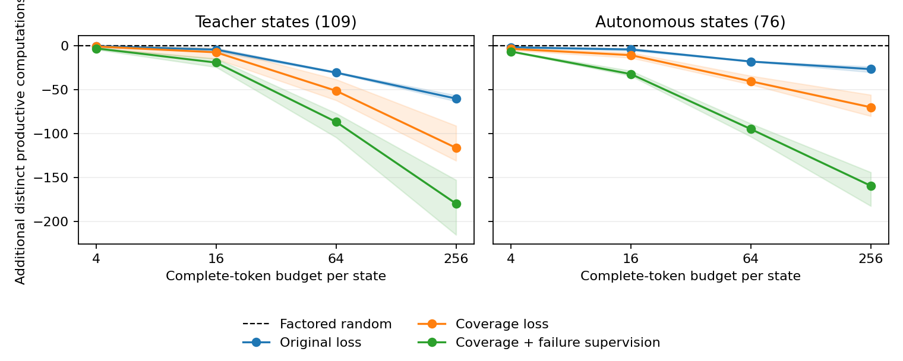

# 固定 Token 预算下的不同有效计算发现

**Coverage Loss 没有稳定超过因子化随机。** 三个训练种子与五个冻结生成种子交叉，预算 64 和 256 时，两种新 Loss 在 Teacher 状态和自主状态的 15 对比较中均为 0 胜。数学目标可以直接对预算内的发现数求梯度，但在这组数据、权重和训练预算下，学到的策略把更多抽样集中在少量有效计算上。

## 同一状态、相同完整 Token 预算

每格依次为预算 4、16、64、256 的累计不同有效签名。先在各状态中按原生签名合并地址，再跨状态求和、跨种子取均值。所有正式冻结抽样都填满了配平的完整 Token 预算。随机组复现上轮全部八个累计点。

| 方法 | Teacher，109 个状态 | 自主，76 个历史 D 状态 |
|---|---:|---:|
| 因子化随机 | **26.2 / 81.0 / 222.0 / 422.6** | **61.6 / 128.8 / 240.8 / 353.0** |
| 原等价地址 Loss，配平重训 | 25.5 / 76.5 / 191.3 / 362.3 | 59.8 / 124.5 / 222.7 / 326.3 |
| Coverage Loss | 25.3 / 73.4 / 170.6 / 306.2 | 58.0 / 118.0 / 200.2 / 282.9 |
| Coverage Loss＋真实失败 | 23.1 / 61.7 / 135.1 / 242.7 | 54.9 / 96.5 / 145.8 / 193.4 |

带宽为三个训练检查点各自五次生成平均后的最小值至最大值。五次生成复用了同一组状态。各点不能解释为对任意新程序的独立重复试验。[配平曲线](frozen.csv) · [逐程序和种子](frozen-seeds.csv)

**增加命中次数仍可能减少发现数。** 在 Teacher 的最大预算下，Coverage Loss 的有效抽中次数为 1,490.8，高于随机的 1,351.8。但物理 Token 重复数由随机的 3,232.8 升至 5,673.2，实际发现的签名少 116.4 个。在 76 个自主状态上，失败监督组为交付 10,824 枚完整 Token 使用了平均 450,922 个神经槽位尝试，原 Loss 为 42,017 个。槽位数含最后一批的富余尝试；正式独立执行使用原有尝试上限并计入全部耗时。[尝试量及重复](frozen.csv)

**训练集的小预算信号存在。** 固定训练种子 9633，以两次新抽样复测全部 108 个训练状态。在预算 4 时，原 Loss、Coverage Loss 和因子化随机分别发现 19.5、23.5 和 16.5 个有见证的不同签名；到预算 256，分别为 291.0、257.5 和 286.5。这个差距在训练程序内已经出现。未见证地址没有被标为负例。[四档训练集复测](train-fit.csv)

**575 的局部错误可以减少。** 在三个 EggCC 自主轨迹的 Run 3，共有六个已核验的有效 575 绑定。最大预算下，原 Loss 和失败监督组均抽出 27.6 次 575，绑定错误由 16.67 降到 11.33，发现的不同有效计算均为 5.13。单用 Coverage Loss 的错误降至 8.80，签发也减少到 17.67，发现 5.07 个。失败标签来自训练程序上冻结模型的真实回执，包括 12 次 575 错绑，按同页物理地址去重后为 11 个。三个评估 Run 的失败没有用于训练。[Run 3 明细](run3.csv) · [训练侧回执及取样](failure-data.csv)

## 独立原生执行

每格依次为覆盖的参考事实数、EPT、端到端 EPS。覆盖数与 EPT 对三对训练／生成种子取均值，EPS 取固定种子的正反序冷启动中位数。四个工作负载合计 64 次实际执行均到达原生 schedule_end。

| 工作负载及参考事实总数 | 因子化随机 | 原 Loss | Coverage Loss | Coverage＋失败 |
|---|---:|---:|---:|---:|
| fact / 1120 | 114.3 · 0.0240 · 124.5 | 108.0 · 0.0231 · 26.2 | 111.7 · 0.0228 · 20.6 | 89.3 · 0.0218 · 5.0 |
| loopfact / 1112 | 124.0 · 0.0220 · 113.5 | 129.7 · 0.0214 · 25.6 | 131.7 · 0.0203 · 18.6 | 107.7 · 0.0196 · 4.3 |
| sum-divisors / 8018 | 214.3 · 0.0431 · 229.3 | 205.0 · 0.0409 · 48.5 | 200.0 · 0.0439 · 44.9 | 179.7 · 0.0435 · 9.7 |
| 留出 grammar / 233 | 27.3 · 0.4271 · 501.3 | 17.7 · 0.2760 · 154.4 | 14.0 · 0.2188 · 117.4 | 13.3 · 0.2083 · 92.2 |

loopfact 的 Coverage Loss 覆盖事实数高于因子化随机，EPT 和 EPS 均较低。sum-divisors 的 EPT 略高于随机，覆盖事实数和 EPS 均较低。各组终图有差异，此处的 EPS 不构成同终图加速比。[逐程序指标与计时范围](native.csv) · [每次执行的原生终图哈希、计费及墙钟](native-runs.csv)

对 48 次非重复配置求和，原 Loss 的 71,369 个付费请求中有 63,993 个未触发，失败监督组为 60,337 中的 54,065 个，比例均约 90%。原 Loss 实际产生 2,091 个有效原子操作，失败监督组产生 1,766 个。后者使用 1,684,016 个神经槽位尝试，仍有 5,325 个完整 Token 的页预算未填满；原 Loss 使用 231,360 个槽位并填满预算。对完整抽样条件下的发现数求导并不会单独奖励更容易构造完整 Token 的策略，实际尝试和墙钟需要另行核算。

本轮保留现有架构、寻址、执行和付费机制。正式实验在固定快照上估计抽取 B 枚完整 Token 的不同有效签名期望；该目标与跨 Run 的独立 Coverage 仍有距离。有限监督、随机梯度方差、不同预算间的权衡以及自主状态分布，都可能限制收益，此轮没有单独辨识其因果份额。目前结果没有达到继续放大 DFM 或 Higher Cell 的条件。

## 复现与验收

[训练目标、抽样梯度、失效的离线估计器及 B2/B3 边界](method.md) · [复现命令](reproduce.sh) · [九份权重校验和](weights.csv)

原始完整运行、逐状态抽样统计及权重位于移动盘的 `eggfuse-experiments/coverage-loss/confirmed`。训练侧回执及试验性估计器保存在上一级目录。使用真实 CCP v0.1 Rust Cell Runtime。Cargo 的 compile、run 和 bench 烟测通过，147 项 Python 测试通过；已保存的 sum-bits 语义导出重新验证为 pass。[语义结果](semantic.json)
