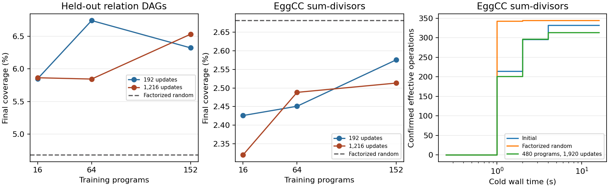

# 第一档 Cell Token 经验与 Credit Scaling

本轮对同一套地址生成器实际采集、训练和原生执行。训练域是新编译或复用的多 Stage 有向关系图，每条规则从 1–3 个具名父输入取得同一个整数，部分规则带 guard。独立执行同时测试 8 个结构留出的同族图、3 个 EggCC 程序和一个留出 grammar。所有执行均在仓库的独立 Rust CCP v0.1 Cell Runtime 上进行。EggCC 指工作负载；数据不能用于推算 upstream egglog 引擎的加速比。

## 实际采到了什么

| 采集轨迹 | 程序轨迹数 | 神经签发完整 Token | 原生有效操作 | 离线核验的直接遗漏，出现次数 |
|---|---:|---:|---:|---:|
| 神经页后补全 Teacher 后继 | 152 | 110,560 | 28,010 | 136,692 |
| 神经页后添加随机探索及 Shuffle 后继 | 152 | 86,727 | 16,407 | 62,230 |
| 全程自主，无辅助请求 | 480 | 206,793 | 45,781 | 134,978 |

**仅全程自主轨迹就有 2,186 个决策状态、180,759 个经核验的状态 × 有效计算。** 每次发布内把物理重复剔除后还有 102,154 枚已触发的不同请求。三组共 404,080 枚神经签发，按程序、Run 和提交前原生状态 SHA 合并后有 3,264 个状态、480,520 个不同状态 × 计算和 324,190 个状态 × 有效计算。状态计数允许同一程序的多个决策时点，有 480 个程序、480 份 Recipe，合计 16,295 个程序内 Primitive 模板定义。235,025 种具名请求按程序、规则、物理引用及版本区分。辅助策略实际签发的 208,187 枚请求单列。只在受审计的单输出关系族中，原生见证允许以输出关系与标量归并有效效果。所有物理引用仍保存在原始记录中。[逐分支账本](inventory.json) · [嵌套数据量](nested.csv) · [经验分片与校验和](shards.csv)

在 4,643 个绑定上，不同决策状态观察到了不同的回执或贡献。新签发中，接受 90,198，原生重复 138,429，绑定失败 163,228，guard 拒绝 12,225。物理重复按同页出现计数，可以与绑定失败重叠。29,779 枚神经签发有已见证的后继消费；该数包括训练辅助轨迹上的后继。受控重放还在 32 个程序上分别签发同一请求、立即重复、延迟一个 Stage。32 次及时签发均有效，32 次重复均收到 duplicate，32 次延迟时调度窗口已关闭且未签发；及时签发的端口共支持 21 个下一 Run 的绑定。训练只传播到直接父，尚无整条长程路径的必要性证明。[受控的执行时机反事实](controlled-timing.csv)

这个训练族能产生大量绑定错误和真实遗漏，但几乎没有 EggCC 式的生命周期变化。新样本中可认证的不同物理地址同效果、部分贡献的 Higher、版本拒绝与未触发均为零。历史原生数据单独链接了 119 个状态、122 个遗漏、3,462 个可替代绑定及 5,506 次未触发。历史权重 TSO 用作各组共同起点，历史训练程序与 EggCC 共享规则族。本轮更新没有混入评估程序或其 Teacher 标签，同族新图与 8 个留出图在扰动前按程序和去名称、去常量的图签名检查隔离。[历史监督账本](archive.json)

## 经验如何产生

1. 多个原生进程各自维护状态。Metal 在同一轮为各进程启动已有的设备驻留寻址，从共享下载缓冲区取回结果。各程序模型页独立提交设备计算，共享读回；未实现单个跨程序融合 GPU kernel。签发前不做语义筛选或去重。未形成完整 Token 的设备槽单列。
2. 每个 Run 保存原生发布增量、神经上下文、具名 Token、按请求对齐的回执及版本。每个训练进程可从自己的历史独立重放。辅助组在模型签发后才接收 Teacher 或随机请求。Shuffle 改变同一 Run 内的独立后继顺序、保留子集和事务分块。所有变化重新执行，后继使用真实回执；跨 Stage 顺序保持原生发布约束。
3. 离线从实际决策入口枚举合法绑定。在另一分叉先用原生已接受请求带恢复实际计算，再添加有见证的其他绑定。所有被拒与重复的签发都在真实回执账本中计费。全库检查确认直接遗漏与该页实际生成的具名请求无交集。仅当原有签发各自的有效操作数不变、新增贡献之和等于原生总差额时收录直接遗漏。它们提供可执行正例，预算不足、发布前等待和未测试项保留未定。生产页始终立即签发所有完整 Token，因此这里没有生成后未签发的正例，也没有把遗漏归咎于某一个重复请求。
4. 首批 96 个程序使用历史 TSO，其中 16 个程序的原生监督更新了采集策略。随后使用新权重采集其余辅助轨迹和全程自主轨迹。训练重新从当前策略抽取完整 Token、计算当前对数概率；回放中的旧策略只提供状态和经核验的反馈。用于训练的每页 Token 预算在 4、16、64、256 中采样。
5. 每个权重的训练与生成种子均记录。训练策略依次加入自主状态、直接遗漏、同页物理重复、确认的原生失败、Shuffle 状态和直接下游 credit。mixed 进一步采样纯自主轨迹。长程项将每个新签名的半份收益转移到实际为它提供输入的正贡献父，整张见证图总收益守恒。失败项仅惩罚采样命中已核验拒绝的动作。以多输出语义重叠或 merge 核验为目标时，还需要相应程序和证明。

## 生产与训练成本

五批实际采集墙钟合计约 253.72 秒，含采集进程初始化、在线神经生成、原生执行、离线审计及写盘，部分时段与训练重叠。约 1,593 枚完整签发/秒，12.9 个去重决策状态/秒，1,278 个经核验状态 × 有效计算/秒（含遗漏）。独立轨迹两批约 1,464 枚签发/秒。Teacher 审计占 442.49 个累计 worker 秒，多个进程并发。设备向模型提供过 780,736 个物理槽，3,568 个程序页合并为 754 次显式主机读回，上传 1.162 GB，读回 34.58 MB。协议请求与响应另计 58.58 MB、19.89 MB。额外六程序复放逐个对齐了请求、回执和终图，28 页合并 6 次读回，驱动实际等待 48 次（含准备与最终同步），单纯统计读回会低估同步。[Metal 实测](metal-profile.json)

784 个压缩经验分片共 21.76 MB，派生 credit 流约 2.21 MB；该卷按分配块统计经验分片占 785 MiB。共享 Recipe 和新增 270 个程序的原生导出额外占约 2.1 GiB。训练 30 份权重，优化器累计使用 2,998,656 枚完整策略抽样，与采集规模分账。含状态恢复、Metal 采样、CPU 封装、反向和更新的实际吞吐在各批次为 743–2,888 个优化器 Token/秒。两份种子或多组共训的耗时只计一次。训练采用 192 步固定预算，与 1,216 或 1,920 步延长预算对照。480 程序的 192 步组只真正看到了 192 个程序；扩展预算也不构成收敛证明。[各权重实际见过的数据与 SHA](training.csv) · [训练吞吐](training-throughput.csv)

## 独立执行与学习曲线

**同族计算图上的发现能力提高了。** 8 个留出程序各跑两个种子，共 160 次独立执行（10 种策略）。每次原生终图均与自身签发带的独立重放一致。最终模型平均 Coverage 为 6.50%，初始权重为 5.24%，因子化随机为 4.68%。最终模型在 16 对试验中 15 次比随机获得更多参考事实，1 次相同。EPT 为 0.264 对 0.190，实测 EPS 约 547 对 773。该组页预算最高为 128 个完整目标，按各自状态的物理域封顶，神经页最多补抽 8 批；不同终图会产生不同的后续域。这里的 EPS 是整次冷启动的描述计时，包含与离线 CPU 诊断并行时的资源竞争。[同族汇总](held-dags.csv) · [逐次原生终图和事实](held-dags.jsonl)

固定遗漏训练 192 步，16、64、152 个程序的同族 Coverage 分别为 5.85%、6.74%、6.32%；延长到 1,216 步为 5.86%、5.84%、6.53%。数据量和训练时间都没有呈现单调增益。480 程序 mixed 的训练源构成也发生了变化；它与前三点的差距不能只归因于程序数量。

**真实 EggCC 上未取得稳定的前沿改善。** 以下为 204 次完整原生执行的主对照。Coverage、EPT 对两对训练/生成种子取平均；EPS 使用首个种子按正序、反序执行的冷启动 EPS 中位数。第二种子的部分质量测量与训练并行，未纳入配对 EPS。每个种子各策略的事实集合单独保存；首种子的两次终图逐组完全相同。[全部策略的 Coverage、EPT、EPS 与计时范围](native.csv)

| 工作负载 | 初始 Coverage | 480 程序、1,920 步 Coverage | 随机 Coverage | 训练后 / 随机 EPT | 训练后 / 随机 EPS |
|---|---:|---:|---:|---:|---:|
| fact | 7.81% | 9.20% | 10.71% | 0.0225 / 0.0238 | 27.9 / 125.7 |
| loopfact | 9.80% | 11.33% | 11.02% | 0.0212 / 0.0220 | 24.7 / 104.4 |
| sum-divisors | 2.41% | 2.38% | 2.68% | 0.0363 / 0.0462 | 49.7 / 223.0 |
| 留出 grammar | 6.65% | 7.51% | 12.02% | 0.2734 / 0.4375 | 132.1 / 499.8 |

loopfact 上两对种子的训练后/随机覆盖事实分别为 119/121、133/124。平均多出 3.5 个事实，但两个终图每对平均各有 28 和 24.5 个对方未覆盖的事实。sum-divisors 上最终两种子分别有 7,743 和 8,763 个未触发回执，而新增训练库中同类型回执为零。该分布差异已经测到；它对性能差距的因果份额尚未测出。

在相同的 152 个程序和 192 步上，加入直接遗漏将三项 EggCC Coverage 从 7.63/9.31/2.33% 提高到 7.95/9.80/2.58%；再加物理重复惩罚则降为 7.81/8.77/2.39%。从 Shuffle 到下游信用，三项变为 8.79/10.16/2.61%，留出 grammar 从 8.80% 降至 6.22%。独立执行考察了这些干预能否继续产生事实；它们并没有在所有 workload 上一致兑现。

同一冷启动墙钟 2 秒时，最终模型在三个 EggCC 程序已经确认的有效操作均值分别为 139.5、127.5、297，随机为 185、161、344。操作数按实际签发记录在原生发布边界重放。时点之间不推测未发布结果。[逐时点曲线数据](clock.csv)

在 76 个归档自主状态上，给各策略相同完整 Token 预算，逐状态统计不同的原生有效计算，再跨状态求和并对种子取均值。

| 策略 | 4 | 16 | 64 | 256 |
|---|---:|---:|---:|---:|
| 因子化随机 | 61.0 | 126.5 | 241.0 | 352.0 |
| 初始 TSO | 63.5 | 115.0 | 191.0 | 267.0 |
| 480 程序、1,920 步 | 63.5 | 122.0 | 220.25 | 324.25 |

预算 256 时，后训练模型的物理重复占 53.29%，低于初始权重的 56.35%，仍高于随机的 42.07%。独立执行中，合计三个 EggCC 程序、两个种子，付费请求从初始 45,903 增至 48,266；同 Run 物理重复从 12,045 降到 9,642，原生 duplicate 回执从 690 到 689，未触发从 41,788 增至 44,219。不同物理请求仍可能一起消耗在未触发规则上。模型在大预算时平均发现了更多不同有效计算，但四项 workload 的证据不支持继续单纯扩大同分布数据到百万档。[等预算汇总](frozen.csv) · [逐程序、预算和种子](frozen-pairs.csv)

高召回对照使用历史源顺序 Cell Stream A，同时保留其实际请求量与冷启动墙钟。它的生成预算高于本轮固定两页的地址模型。等预算随机与神经对照走相同的 CCP 请求与原生核验；随机策略按规则和类型相容父域独立抽样。所有发现、寻址、通信、发布和 Memory 更新都进入在线墙钟。独立执行结束意味着原生调度结束；事实与参考终图另行比较。[高召回原始基线](historical-stream.csv) · [各次执行、拒绝与时间](native-runs.csv) · [终图与真实覆盖事实集合](native-facts.jsonl)

## 复现

从 instruction_pointer 目录执行 [reproduce.sh](reproduce.sh)。依赖既有 data-scale-1126 程序库、原生可执行文件、历史权重与 discovery-control 快照。原始经验、各策略页、训练历史、权重和完整原生执行保存在移动盘 `eggfuse-experiments/credit-scaling-1126`，已保存训练分片和权重可用清单校验。六条自主轨迹单独重采后，具名请求、回执、直接遗漏及终图逐项一致。16 程序、192 步两种子的第二次训练成功完成，相对已发布权重的最大单参数绝对差分别为 0.000875 和 0.000938；报告使用原始权重，校验和标识具体运行，重训存在数值差异。153 项 Python 测试通过。原生 CPU compile/run/bench 烟测通过。保存的 sum-bits 导出经项目入口复核为 pass，此项只覆盖既定 sum-bits 合同。[语义核验输出](semantic.json)
