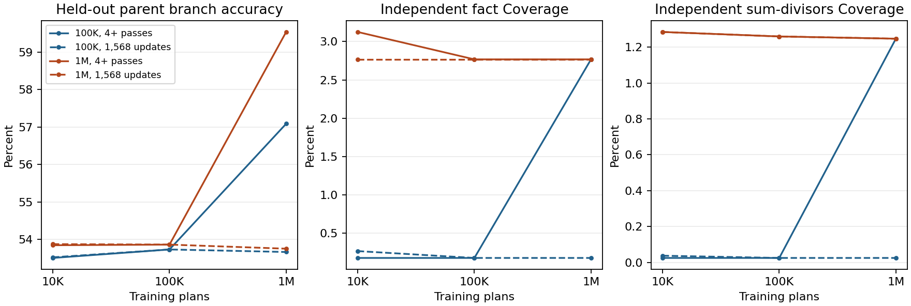

# 原生计划 Data Scaling、自由生成拟合与 Metal 寻址

在三个训练种子上，增加已核验的计划和训练步数，改善了新程序上的父地址预测。EggCC 的独立执行仍有很大差距。另一个可单独复现的结果是，四步 Edit Flow 和完整地址树可以在 Metal 内执行。相同随机数下，48 组 CPU、逐层 Metal、设备内 Metal 比较全部得到相同事实终图、付费数及原生判定。fact 的设备内实现略快于对应 CPU，另外三个 workload 上 CPU 的配对中位数更快。

## 数据从哪里来

冻结 Recipe IR、Bake、规划器及 CCP v0.1。从源程序生成具有不同生产消费接线的分阶段 DAG，包含共享变量、分叉、汇合、标量 guard 及一至三个关系输入。结构签名记录输入表数、阶段、依赖表和 guard 有无，忽略 guard 常数。训练的 210 个程序及另 8 个留出程序的签名互不重复。这种签名检验没有证明任意节点重命名下的图非同构。

每个程序用项目编译器编译，再用原生执行器 capture 和 replay。要求请求全部接受且两次终图摘要相同。取归因有正收益的具名请求；另在末 Run 重排一个子集，从同一前缀重放并逐项检查接受及正收益。末 Run 的反事实共核验 29,292 个请求。计划是这些原生轨迹内、同 Run 的 1–4 请求窗口，按有序请求身份去重。由于同阶段的读表与写表分离，计算窗口不用依赖同阶段其他请求产生的局部端口。每个窗口的执行依据来自包含它的原生重放；未对一百万个窗口各启动独立进程。

| 训练计划数 | 不同程序 | 程序 × Run | 至少出现一次的不同具名请求 |
|---:|---:|---:|---:|
| 10,000 | 16 | 73 | 13,039 |
| 100,000 | 64 | 287 | 64,871 |
| 1,000,000 | 210 | 960 | 230,281 |

三个子集嵌套。原生训练池有 1,001,817 个可用窗口，随着窗口数量增长，许多窗口共享请求。留出池有 37,808 个窗口，固定取 32,768 个比较所有权重。历史的 960 条训练计划及其反事实/rollout 通过旧损失项继续参与训练，占损失权重 25%。历史 dot-product 留出、生成式程序留出及独立执行 workload 单独评估。新增数据覆盖了整型关系 DAG；EggCC 的可变合并、版本更新、跨发布续接以及真实模型的长程错误主要仍由旧数据覆盖。当前数据量不能代表百万条独立 EggCC 执行轨迹。[数据组成](levels.json) · [原生终图与反事实摘要](corpus.json) · [留出清单](held-corpus.json)

## 模型和预算

沿用上一轮的地址网络与 Edit Flow 速率网络，分别合计 102,068、1,008,468 参数。主实验冻结现有 GNN 与 Actor。每个计划采样有序编辑桥上的时间、位置、剩余标记及树分支，用既有地址交叉熵和条件 Poisson 速率目标训练。新增数据主要监督空计划或合法前缀的插入。旧数据继续提供其他编辑类型。每批最多 512 条新计划，另抽取旧训练样本。训练种子为 243、8201、536。

第一组分别训练 1,580、1,568、7,816 次更新，每档至少遍历四遍；第二组全部固定 1,568 次更新，用来分开数据和计算预算效应。主实验 36 个训练权重，另有 14 个小集诊断和 8 个局部/联合微调权重。保留完整训练曲线及时间；四遍训练并不保证达到各规模的最优拟合。[训练明细](training.json) · [留出拟合](held-metrics.json) · [权重 SHA-256](weights.json)

| 模型 | 训练量 | 训练地址分支准确率 | 留出模板分支准确率 | 留出父端口分支准确率 | 留出地址损失 | 留出速率损失 |
|---|---:|---:|---:|---:|---:|---:|
| 100K | 10K | .544 | .5613 | .5350 | .6750 | .3088 |
| 100K | 100K | .541 | .5613 | .5373 | .6764 | .3078 |
| 100K | 1M | .578 | .5592 | .5709 | .6551 | .3063 |
| 1M | 10K | .542 | .5617 | .5384 | .6733 | .3089 |
| 1M | 100K | .543 | .5613 | .5386 | .6747 | .3075 |
| 1M | 1M | .592 | .5667 | .5954 | .6360 | .2965 |

三种子中位数，使用至少四遍组的最后一个 checkpoint。准确率按抽到的单个二叉决策计，留出损失按桥上的权重归一。后续所有独立执行都从真实初始状态启动。

## 训练拟合与自由生成

小集固定 8 个状态，每个指定一个由原生验证的目标。分别训练模板与父引用共用的读出、速率网络、仅 Encoder、加宽其中一个已有读出，以及联合更新 Encoder/Actor 和解码器。给定正确前缀后测 21 个模板分支和 122 个父地址分支；再无提示抽样 512 次完整绑定，另从空草稿运行四次离散编辑。精确计划要求与目标单请求序列完全一致。其他合法解另计，保留在 tiny.json。

| 更新 | 可训练部分 | 正确父地址分支 | 自由生成精确绑定 / 512 | 自由生成精确计划 / 512 |
|---:|---|---|---|---|
| 768 | 冻结 Encoder，训练原解码器 | 122、122 | 300、260 | 210、155 |
| 768 | 仅 Encoder/Actor，固定初始解码器 | 110、105 | 0、0 | 0、0 |
| 768 | 单独加宽地址网络，训练解码器 | 121、122 | 248、311 | 176、231 |
| 768 | 单独加宽速率网络，训练解码器 | 122、122 | 294、243 | 205、191 |
| 4,096 | 冻结 Encoder，训练原解码器 | 122、122 | 511、510 | 345、347 |
| 4,096 | 联合训练 | 122、122 | 466、512 | 305、360 |

列内顺序为种子 243、8201。最后两组在给定正确前缀时也都答对 21 个模板分支。小集充分训练后，冻结的表示已支持记住具名绑定；即使抽中目标绑定，完整计划仍取决于速率采样、位置、数量及后续编辑。仅调 Encoder 是固定随机决策读出的诊断，不能据此判断预训练 Encoder 的能力上限。[全部小集实验](tiny.json)

另用同一批 10K 计划、相同样本顺序、两次额外全量遍历和相同预算微调。对照分别使用冻结表示、加宽地址、加宽速率和联合训练。宽分量从同种子同数据量的已有宽模型初始化。联合组对新程序的 GNN 与 Actor 回传梯度；旧数据用缓存特征，只有解码器收到旧数据梯度。fact 的两种子覆盖事实依次为冻结 31/32、宽地址 41/35、宽速率 31/31、联合 40/2；sum-divisors 依次为 104/103、104/103、100/100、101/2。两个种子的结果不足以判定联合训练提高了跨程序执行能力。[逐组原生结果](pairs.csv)

## 原生独立执行

表内依次是覆盖事实数、EPT、cold EPS，分别取三训练种子的中位数。Coverage 的分母在 workload 栏中。EPS 包含在线权重与表示准备、寻址、编辑、CCP 通信、原生执行及状态更新。EPT 和 EPS 的分子沿用原生带归因的有效原子操作；覆盖事实数单独计。每个权重按正反序运行两次，明细保存最短和最长墙钟、付费数、事实身份及终图。此表沿用历史采样器，在同一 CPU 路径上比较学习效果。

| 模型 | workload / 参考事实 | 10K 计划 | 100K 计划 | 1M 计划 |
|---|---|---|---|---|
| 100K | fact / 1,120 | 2 / .105 / 1.9 | 2 / .087 / 1.8 | 31 / 36 / 53.1 |
| 100K | loopfact / 1,112 | 2 / .125 / 1.9 | 2 / .077 / 1.9 | 38 / 26 / 37.9 |
| 100K | sum-divisors / 8,018 | 2 / .125 / 1.7 | 2 / .083 / 1.8 | 100 / 99.5 / 157.7 |
| 100K | 留出 grammar / 233 | 0 / 0 / 0 | 0 / 0 / 0 | 0 / 0 / 0 |
| 1M | fact / 1,120 | 35 / 2.929 / 33.7 | 31 / 4 / 29.1 | 31 / 36 / 45.0 |
| 1M | loopfact / 1,112 | 40 / 4.308 / 24.5 | 39 / 4.077 / 20.6 | 38 / 26 / 34.2 |
| 1M | sum-divisors / 8,018 | 103 / 6.516 / 91.1 | 101 / 25 / 78.7 | 100 / 99.5 / 131.9 |
| 1M | 留出 grammar / 233 | 0 / 0 / 0 | 0 / 0 / 0 | 3 / .75 / 45.7 |

在固定 1,568 次更新的对照中，100K 模型三个档位对三项 EggCC 的中位命中均为 3 → 2 → 2。1M 模型 fact 为 31 → 31 → 31，loopfact 为 40 → 39 → 38，sum-divisors 为 103 → 101 → 100。扩大数据与增加更新次数共同出现时看到的提升，无法单独归因于数据量。1M 计划组的 sum-divisors 六个权重均签发两份请求，一份接受、一份重复，得到 199 个归因原子操作；这解释了 99.5 的 EPT 和仅 1.25% 的 Coverage 为什么能同时出现。

历史高召回 Cell Stream 分别覆盖 1,109、1,049、3,137、233 个参考事实。在四个 workload 上，本轮全部训练组和设备对照的事实并集分别为 68、82、156、6，均包含在对应历史事实集合中。历史时间取自先前运行，仅用作背景。每个设备比较都核对同终图；跨学习组读表时需要同时看 Coverage。运行到 schedule_end 也不代表达到参考不动点。[历史对照](high-recall.json) · [496 次原生执行](runs.jsonl) · [248 组正反序](pairs.csv)

## Metal 设备内寻址

固定同一权重，将地址树的两个枢轴、端口向量、owner 到具名 op 的索引、GRU 当前状态和未签发草稿留在 GPU。每个提案用一个 Metal threadgroup 顺序执行其依赖的树决策，独立提案成批执行；四个编辑步均在设备上更新草稿和局部引用。原生发布后仅增量写入变化或退役的端口。只有签发、Run 的下一次发布边界，以及空间不足须重试时取回结果。设备草稿容量按需扩大，重试同一未签发页及相同随机数。CCP v0.1、静态 GNN 预编码、原生端口更新的 CPU 编码与调度继续沿用。当前内核支持本实验两个 Mark 宽度和 D4 两波流，未验证其他网络尺寸或采样步数。

为比较相同计算，引入每个编辑位置独立的计数随机流，三个设备组使用同一流；学习曲线仍用历史 NumPy 流。864 个完整草稿与标量参考一致，包含未物化、过期、局部引用及容量重试。设备对照为两尺寸 × 三训练种子 × 四 workload × 两个正反序块。48/48 组三路径的终图、付费和判定相同。两个块只能报告运行范围。早期数值校对发现很小的 softplus 速率在 Metal 中被舍为零，改变了随机数消费；修复后重新执行全部设备对照，早期 pilot 未纳入计时。[草稿校对](page-parity.json)

| workload | 逐层 Metal 等待 | 设备内 Metal 等待 | 设备内回读 | CPU / 秒 | 逐层 Metal / 秒 | 设备内 Metal / 秒 | 旧 Metal 对设备内配对加速 |
|---|---:|---:|---:|---:|---:|---:|---:|
| fact | 20,718 | 338 | 332 | 1.701 | 6.398 | 1.548 | 4.00× |
| loopfact | 17,952.5 | 333.5 | 327.5 | 1.561 | 5.506 | 1.579 | 3.52× |
| sum-divisors | 18,099 | 322 | 316 | 1.548 | 5.411 | 1.703 | 3.49× |
| 留出 grammar | 70 | 8 | 2 | .056 | .080 | .066 | 1.23× |

每行 12 个观测的中位数。等待在 M3 Max、48 GB、PyTorch 2.15.0 上对实际 Metal command buffer 的 waitUntilCompleted 调用计数，启动时触发一次取标量验证仪表工作。这一指标覆盖被测命令缓冲区类上的该方法；应用层回读独立计数。禁用了 MPS CPU 算子回退。设备内路径相比 CPU 的配对速度比分别为 1.05、.97、.91、.83。

fact 中位逻辑上传量 30.18 MB、回读 0.113 MB；sum-divisors 为 70.52 MB、0.107 MB，包含冷启动的 Recipe 布局和权重。字节数统计程序提交的 buffer，不等于硬件总线流量。fact 每次完整运行的有效标记 lane 中位数为 395.5，预留 32,080；sum-divisors 为 467.5 和 24,848。所有运行单步最多并行 7 个真实标记，另有 4 次缓冲区扩容重放。设备同步显著减少，但有效批次小，仍要为预留空间计算速率和发射内核。候选访问与设备内草稿局部引用扫描都计入运行成本。[同步、批量、传输及索引计数](device.csv)

额外对 100K、种子 243 做 8 次独立发布计时。fact 两次各更新 260 行，293 次发布的 MPS 时间区间合计 21.9–23.3 ms；sum-divisors 两次各更新 371 行，263 次发布合计 19.4–31.9 ms。每个区间用同一 stream 上的 MPS event 包围物理索引更新及草稿引用刷新，运行结束一次读取计时；区间可能含发射间隙。CPU 提交耗时和设备区间有重叠，两者不能相加。带事件的 profile 单列，不参与主对照墙钟。[逐次发布计时](publication-profile.csv)

## 边界和复现

在线地址域沿用可见物理表成员、已选 owner 的静态具名投影和本地草稿引用。神经地址树每次按学习到的分支选择下一段。运行中不读取 teacher、不按共享值构造合法域、不用跨角色水位提前排除候选，也不由 CPU 补全或去重。CPU 继续处理网络实际签发请求的核验、版本与可见性。基准是原生 CCP 独立执行；独立 Cell CPU 的 Cargo compile、run、bench 作为单独回归，五次 bench 中位 22.82 ms。既有 sum-bits 语义验收 pass，Python 回归通过 121 项。[语义验收](semantic.json)

从 instruction_pointer 目录运行 `sh run-recall/data-scaling/reproduce.sh`。设置 PY、DATA、COMPILER、PREVIOUS 和 OUT；PREVIOUS 的生成命令见上一轮 metal-scaling/reproduce.sh 的 prepare 步骤。实测 DATA 为 /tmp/dfm-local/data，原生编译器为 /tmp/cost-audit-build/release/eggfuse-cell-compiler，完整语料、原生轨迹、特征、检查点和每次执行 JSON 存在 /Volumes/Extreme SSD/eggfuse-experiments/data-scale-1126。仓库保存可重复生成的大语料及权重的程序、所有正式计时数据和校验摘要。[复现命令](reproduce.sh)
