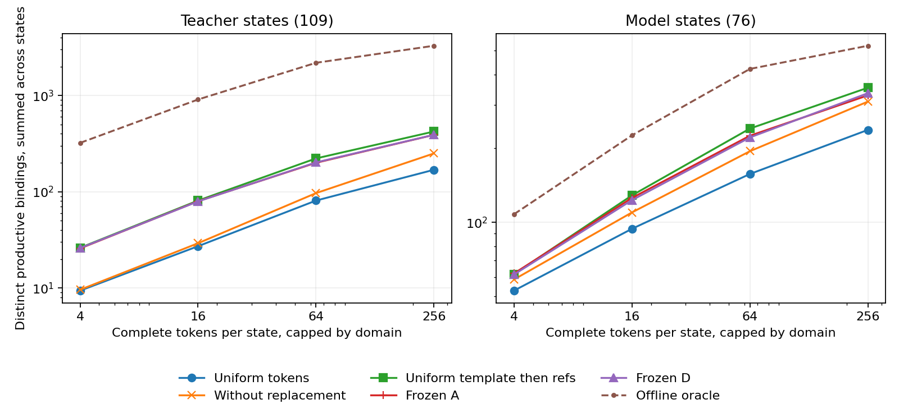

# Cell Token 寻址相对随机的计算发现能力

冻结 `9317cbc7` 的 A 和 D 后，A 在 teacher 状态上发现的不同有效计算为整枚 Token 均匀随机的 2.30 倍，在 D 的独立状态上为 1.38 倍。加入一个保留 Cell 因子化结构的无学习对照后，结论发生变化。先均匀选模板、再均匀绑定具名父引用，在两类状态的累计发现数都超过 A 和 D。独立执行也未显示神经方法在 Coverage、EPT、EPS 上具有稳定优势。

## 同一起点、相同完整 Token 预算

四个工作负载为 fact、loopfact、sum-divisors 和留出 grammar。teacher 组复用原有 109 个状态。自主组从 D 的实际独立轨迹选了 76 个状态，按有无署名有效操作分层，每层每程序最多随机取 12 个，另包含首次产出空档和最后一次产出之后的首个 Run。两类状态的目标密度不同，自主样本没有按运行时频率加权。D 的第一张生成页使用实测的事件、状态和 Query，重新计算出的 Query 与现场记录逐元素一致。A 在相同发布事实和事件上使用原 Query。每次冻结抽样都从未编辑的空页开始。

- **整枚均匀**按每个模板的活动类型槽位笛卡尔积大小分配抽样质量。混合进制整数解码只实例化抽到的一枚 Token。**无放回**在同一物理空间上使用稀疏交换抽样。**因子化随机**在可形成完整 Token 的模板间均匀抽样，再独立均匀抽各槽的活动地址。三个对照只读静态类型、可见身份和对应版本。大接口模板拥有更多物理组合，因此整枚均匀与模板均匀是不同的问题。[随机空间及采样](../../discovery_sampling.py)
- A、D 复用原 GNN、物理地址树、复制门、命名投影和冻结权重。所有方法共享原生调度词表，含零父和可选 Higher。每个状态给 4、16、64、256 枚完整 Token 的累计预算，上限为物理域容量；有放回方法也使用相同上限。6/109 个 teacher 状态、40/76 个自主状态的域小于 256。神经抽样构造失败会继续抽，额外尝试和设备开销单独记账。所有冻结状态和种子均实际填满配平预算。五个种子分别运行。
- **离线 Oracle**从完全相同的前缀执行一次原生具名计算。teacher 使用已核验的原始 Run，自主状态使用 `--audit-next-proofs` 在该状态精确分叉，再执行具名证书并回读 EPT 归属。Oracle 优先选有贡献、可寻址的不同签名计算，剩余预算用已知合法计算补足，有必要时重复；无已知合法计算时沿用随机抽样。Oracle 值是该 Run 已见证贡献口径的上限。输出竞争和后续 Run 可以改变归属，这个数不代表任意执行顺序或终图的全局上限。[原生分叉与首次停产诊断](../../discovery_states.py)
- 所有采样的完整绑定均经原生核验。用相同签名区分物理重复、语义重复与不同计算。不同有效计算取当前精确分叉里有署名原子操作的不同签名。另为每个方法和种子从同一状态单独原生执行整批请求，记录实际接受、贡献请求及操作数。Higher 的入口可以贡献一次真实根操作，冻结测量不把入口成功外推为后缀完成。完整独立执行使用原有 Higher 接续和实际计费。[核验与归属](../../discovery_score.py)

## 累计发现

下表是在所有相应状态上累加不同有效签名，再对五个生成种子取均值。每格依次为预算 4 / 16 / 64 / 256 时的结果。

| 生成策略 | Teacher，109 个状态 | 自主，76 个状态 |
|---|---:|---:|
| 整枚 Token 均匀 | 9.4 / 27.2 / 81.0 / 169.2 | 52.8 / 94.2 / 157.4 / 237.8 |
| 整枚均匀无放回 | 9.6 / 29.2 / 96.8 / 250.2 | 58.6 / 109.8 / 194.8 / 310.0 |
| 因子化随机 | 26.2 / 81.0 / 222.0 / **422.6** | 61.6 / 128.8 / 240.8 / **353.0** |
| 神经 A | 25.8 / 79.8 / 200.0 / 390.0 | 62.0 / 125.8 / 225.2 / 328.6 |
| 神经 D | 26.0 / 79.4 / 201.8 / 390.8 | 61.4 / 123.2 / 221.6 / 335.4 |
| 离线 Oracle | 322 / 909 / 2,187 / 3,287 | 108 / 226 / 421 / 523 |

在最大预算，teacher 状态共抽 27,096 枚完整 Token/种子，自主状态为 10,824 枚/种子。A 相对因子化随机在 teacher 上五次分别少 27、23、27、11、75 个，在自主状态上分别少 0、27、46、20、29 个。局部优势确实存在。Teacher 的 fact 上 A 为 101.4、因子化随机为 93，loopfact 上为 103、95.4；sum-divisors 上则是 160.6、201.2。五个种子只重复了同一组状态，无法给出跨任意程序的显著性结论。[各预算曲线](curves.csv) · [各程序、状态来源及种子](seed-curves.csv)

## 概率质量与重复

以下是最多 256 枚完整 Token 预算下的经验比例。模板列表示抽中的模板有已核验的有效入口；首父列条件化于有见证的模板及至少一个父槽，后续父列条件化于此前整个前缀有见证，并按父决策次数统计。前缀见证来自原生有效证明、teacher 程序的已验证等价地址，以及本轮各方法原生验证通过的有效补全，所有组共用同一集合。前缀百分比限于已验证的延伸，未见证前缀保留 Unknown。完整列按抽样绑定的原生签名及当前分叉的贡献计数，允许重复。接受率来自独立支付整批请求后的原生回执，包含接受后没有新增操作的请求。

| 状态 | 方法 | 有效模板 | 有效首父 | 有效后续父 | 完整有效 | 物理重复 | 原生接受 |
|---|---|---:|---:|---:|---:|---:|---:|
| Teacher | 整枚均匀 | 33.8% | 24.0% | 15.4% | 1.0% | 1.4% | 0.7% |
| Teacher | 因子化随机 | 29.9% | 31.7% | 21.2% | 5.0% | 11.9% | 1.9% |
| Teacher | A | 33.8% | 31.4% | 23.1% | 5.7% | 18.1% | 1.9% |
| Teacher | D | 35.8% | 30.1% | 22.8% | 5.4% | 16.7% | 2.0% |
| 自主 | 整枚均匀 | 14.9% | 68.7% | 18.7% | 4.2% | 12.7% | 2.4% |
| 自主 | 因子化随机 | 17.3% | 89.7% | 26.8% | 11.8% | 41.8% | 3.5% |
| 自主 | A | 17.9% | 83.3% | 29.7% | 11.2% | 49.2% | 3.4% |
| 自主 | D | 18.0% | 82.2% | 30.4% | 10.7% | 48.8% | 3.5% |

上一轮的约 3% 是一个指定物理首父的概率，不能解释为只有 3% 的首父可用于有效计算。A 在 teacher 上把更多完整抽样质量给了有效绑定，同时也更常重复物理 Token，因此累计覆盖较少。在自主状态上，A 的重复率接近一半，完整有效质量也低于因子化随机。同一批请求实际重放得到的有效原子操作均值分别为 teacher 上 A 581.0、D 568.4、因子化随机 601.8，自主状态上 880.6、883.2、915.2。局部签名归属与整批实际贡献的方向一致。[完整统计，包括语义重复](curves.csv)

**Loss 审计。** A 的目标是每个见证原始完整地址的负对数概率。C/D 在每个签名内对已核验的同义地址求和，各个签名仍分别计损失；4,557 个训练组包括合法但没有署名新增操作的绑定。它们没有直接优化预算内不同有贡献签名的累计数量。在 teacher 的 6,423 个评估绑定中，3,316 个在原轨迹有贡献。使用前轮逐目标概率精确求和、按状态等权，改为等价监督后，旧 Query 的已见证有效概率总质量从 A 的 2.1301% 变为 C 的 2.1533%；新 Query 从 B 的 2.1360% 变为 D 的 2.1484%。这些值包含构造失败的原始尝试，并且只计历史已认证的地址子集，和上表按完整 Token 统计的经验质量口径不同。监督目标与累计发现指标存在可定位的差异；本轮没有用新损失重训，不能把全部差距归因给损失。[原目标代码](../../query_fit.py) · [逐状态概率求和](loss.csv)

## 首次停产和 dirty 审计

在 D 首次有署名产出后，紧接着没有新增署名操作的 Run，三个 EggCC 程序都停在 Run 3。精确分叉均给出两条规则 575 的二父绑定，两个绑定各有一项有效操作。历史高召回 Cell Stream 在这三个原状态分别签发 6、4、6 个请求，三次都实际接受 2 个并完成 2 项有效操作。D 当时已选中规则 575，fact、loopfact、sum-divisors 各有 4、3、4 个 575 请求被原生 `binding` 拒绝；另向未触发的 574 签发了 6、6、5 个。留出 grammar 的首次空档 Run 2，两个离线对照都得到零个合法后继。另查三个 EggCC 最后一次有效产出后的首个 Run，分别为 80、96、100，精确分叉和高召回均为零。这些结果只对所查 Run 成立。[停产分叉](stalls.csv)

对上轮 D 的原始生成策略重跑四个完整 workload。每一页在生成时记录 Run 和 dirty；在 Rust 实际准入判断处按 Request ID 记录 epoch、Rule、dirty 检查开关及原始 dirty 位，与客户端回执逐条关联。9,958 个请求均对齐，四份终图及分类回执与归档一致。8,842 个 `untriggered_rule` 中，8,839 个由神经网络在同一 Run 生成，模型当时已看到 dirty=false，签发时依然为 false；3 个来自已选 Higher 的固定后缀，签发时也为 false，未执行新的模板 Query。没有发现神经草稿跨发布失效造成的未触发拒绝。A 的 Query 本身没有 dirty 通道，以上归因特指 D。[生成端与回执关联](../../discovery_dirty.py) · [实际原生准入点](../../../../../../engine/cell-runtime/src/token_transaction.rs) · [逐程序分类](dirty.csv)

## 独立执行

每 Run 两页，每页最多 16 枚完整 Token，全 Run 的共同上限为 32 和可表示物理域大小的较小值。神经方法允许额外尝试以补满页，内部尝试全部计时，全部运行的 shortfall 为零。这是对生成预算配平的独立执行实验，和上轮每页固定 16 次**尝试**的独立成绩分开。不同策略会产生不同状态、调度长度和实际付费数。随机控制不读取 dirty 或语义标签；因子化随机显式承担维护和读取类型地址域的 CPU 成本。只对无放回随机臂执行物理抽样去重。原生签发后的重复回执和所有费用都保留。

下表依次为五个生成种子的平均覆盖事实数、平均 EPT、固定种子 536 单独正反序冷启动配对的 EPS 中位数。EPS 包括神经或随机采样、通信、Runtime、Memory 和地址维护。这里比较的是实际操作/秒，终图不完全相同时不能解释为同终图加速比。

| 工作负载及分母 | 因子化随机 | 神经 A | 神经 D |
|---|---:|---:|---:|
| fact / 1,120 | 115.0 · .0240 · 124.6 | 102.4 · .0196 · 22.4 | 92.8 · .0215 · 26.7 |
| loopfact / 1,112 | 130.2 · .0222 · 111.7 | 122.0 · .0207 · 23.1 | 118.2 · .0203 · 23.3 |
| sum-divisors / 8,018 | 213.6 · .0429 · 190.9 | 198.6 · .0402 · 44.7 | 200.4 · .0403 · 48.7 |
| 留出 grammar / 233 | 25.6 · .4000 · 540.1 | 14.0 · .2188 · 77.2 | 17.8 · .2781 · 131.4 |

全部组共 100 个方法、程序、种子配置，另有逆序重复及单独配对计时。Oracle 与高召回分叉仅用于离线诊断。神经网络确实学到了相对物理组合体积均匀分布有价值的偏好；保留模板和类型结构的简单随机策略已经解释了相当大一部分优势。当前结果不足以支持学习寻址比这个对照有更好的独立计算发现能力。[全部五组与种子范围](independent.csv) · [终图、请求及访问量](native.csv) · [单独配对计时](timing.csv)

## 复现

在原 research checkout 的 `instruction_pointer` 目录执行 [复现脚本](reproduce.sh)，需 Metal、既有四个 workload、查询实验权重与原生归档。无重新训练。真实 CCP v0.1 Cell Runtime 经执行和核验；这里的 EPS 不代表上游 egglog。CPU compile/run/bench 烟测及 143 项 Python 测试通过，保存的 sum-bits 最终语义导出重新验收为 pass。[语义验收](semantic.json)

原始逐状态样本、oracle 证书、原生逐签名核验、各独立运行的已签发带和终图保存在移动盘 `eggfuse-experiments/discovery-control`。每组被采样 Token 的原生验证结果可重新组合出任一采样顺序；签发前的离线求解、等价地址和 teacher 信息均未接入在线神经解码。
