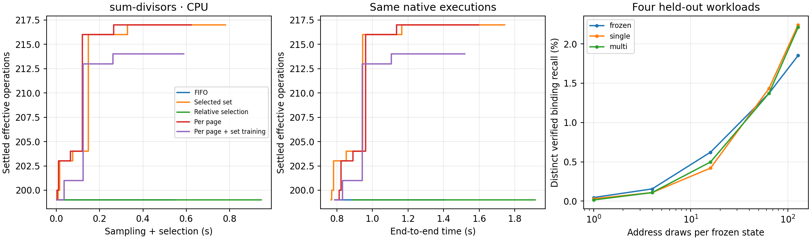

# 草稿签发、零父规则与完整绑定召回

从 419f0cce 的百万计划检查点 s243 开始。实际执行使用 EggFuse 的独立 Rust Cell Runtime、原生 EggCC 程序和 CCP v0.1。研究轨道为 Neural Execution。CPU 单线程复现历史随机流，Metal 对照使用四步设备内地址树和相同权重。两个后端有各自的采样序列。覆盖率分子取最终图中的不同参考派生事实，EPT 的分子取原生署名有效操作，分母取全部 CCP 付费请求。EPS 包含模型装载、GNN、草稿、寻址、通信、执行与发布。源 Run 结束时回放核对的有效操作、推理秒数和端到端秒数分别留存。[执行与成本](runs.csv) · [原生曲线](curves.csv)

## 375 和 574

在 CPU 的 sum-divisors 历史轨迹上，A 的第一个请求产生 199 个有效操作，第二个是重复。此后的 406 页都曾出现 574 排在 375 后面、整页没有签发。独立运行 B 和 C 时，Run 1 的两个 375 都能在一页签发。Run 2 生成零父 574，原生回执为请求 4、accepted，累计有效操作增至 200。

另一次离线干预保持 FIFO 到 Run 5 的原始输入状态，然后在同一份自然生成的草稿上启用 B。草稿 UID 0 对应 375，UID 1 对应 574；网络明确选择了 UID 1，请求 3 的实际回执为 untriggered_rule。该路径最终仍只有 199 个有效操作。非队首签发能恢复在执行窗口内的机会；已经错过的窗口仍由原生调度决定。[逐页证据及回执](ledgers.json)

| CPU，sum-divisors | 参考事实 / 8,018 | 有效操作 | 付费请求 | EPT | EPS，两次中位数 |
|---|---:|---:|---:|---:|---:|
| A，历史 FIFO | 100 | 199 | 2 | 99.500 | 135.0 |
| B，神经位置选择 | 114 | 217 | 318 | 0.682 | 122.1 |
| B，相对分数读出 | 100 | 199 | 3 | 66.333 | 105.6 |
| C，独立页 | 114 | 217 | 318 | 0.682 | 135.0 |

B 和 C 的原生终图摘要一致。C 进行了 1,372 次 mark 生成尝试，实际签发 316 个直接请求，其中 7 个接受并有署名贡献。另有 2 个 Higher 后缀请求。全部 318 个请求的原生回执为 9 次接受、4 次重复、293 次 untriggered_rule、12 次绑定失败；8 个请求得到非零有效操作归因。未签发、等待失败和编辑删除都没有记作成功去重。Run 64 已结算 216 个有效操作；Run 128 达到 217，随后又支付 180 个请求，直到 Run 298 没有新增收益。曲线的检查点按对应前缀实际重放，另列按最终贡献回溯到签发 Run 的数字。[Token 转化与原生计费](runs.csv)

## 签发实现与边界

A 保留一页只尝试队首的历史选择。B 将已有冻结 DFM 的终点删除和替换强度用于逐位置采样，签发概率取 exp(−删除强度−替换强度)。这是复用已有权重的一种读出约定，训练时没有提供“此刻提交”的标签。独立采样器选择任意位置子集；网络为每个位置打分，静态的本轮指令词表限制可编码 opcode。原生协议收到未调度 opcode 会终止会话，这条约束不依赖父字段或跨角色水位。所有已选且引用已物化的 Token 组成同批请求，绑定、guard、触发及版本合法性留给 Runtime 判定。单次选择不访问 teacher。C 从空草稿开始每页，发送该页最终的网络输出；后一页读取真实 Response。独立页只可留下已经明确选择、等待具名发布的局部依赖。

每次 enqueue 之后，用实际 ticket 中的 Request ID 登记草稿 UID，并按返回行上的 ID 结算。草稿 UID 只在本草稿的命名空间有效。已接受的生产者仍须等实际端口发布才能为依赖提供版本。被拒生产者无法为封页后的子请求提供端口，这些子请求单列为未签发。CCP 仍要求有序传输，映射层也测试了调换行序、重复 ID 及缺失 ID。CPU 不挑选替代父引用。设备地址树和四步采样中间状态驻留 Metal，页末读回草稿；B 的附加终点打分、掩码回读及主机采样均计时。本轮没有新增控制头。

另记录了调试中一次 loopfact 会话退出。初版 B 将旧草稿里当前 Run 未声明的 opcode 写入 CCP，当前 ABI 对该 opcode 返回会话级错误，无法形成单请求回执。正式配对采用上述静态指令词表，并重新完成每个源调度。该失败运行没有纳入性能均值。

## 高召回 Cell Stream 的单阶段替换

离线按原生 Run 的指令词表复核，CPU sum-divisors 的 B 对词表内 316 个位置全部选择，81 页选择多个位置。终点编辑强度过低使签发概率接近 1。补充对照复用相同 logits，以删除和替换倾向的相反数对页内位置打分，保留分数达到可编码位置平均值的项。并列项可同时签发，余项仍可在后续页修改。CPU loopfact 有 1 页保留较早的可编码项并选择较晚项，在 Metal 的 fact、loopfact、sum-divisors 分别有 2、2、1 页。CPU sum-divisors 得到与 FIFO 相同的终图，多付 1 个请求。Metal sum-divisors 得到 115 个事实、215 个有效操作、64 个请求。Run 5 干预中的 375 已退出当轮指令词表，该样本单独能验证的是解除阻塞及随后的真实回执。[位置选择与词表审计](position-mask.json)

同一高召回基线重新独立执行。保留原有前缀权重、完整残余枚举、分块打分和原生接收器。Rule 组每 Run 进行四次冻结地址树抽样，用选中的 Primitive 集合驱动原 Cell Stream；首父组保留规则选择，每个 Rule 抽四个首父；后续父组保留原首父枚举，每个已到达的首父抽四个条件后缀。前缀模型仍对保留路径打分。后续父的条件输入来自实际存活前缀，未使用正确答案。这是同一阶段内四次可重复抽样的局部预算，三个阶段的总抽样数与整条独立轨迹均可不同。表内差值不具可加性。高召回基线只按单一源锚点的公开版本及类型构造可见域，后续父与完整组合由原神经分数控制。地址替换诊断用 CPU 原地址读出；GPU 驻留的正式 DFM 对照另列。

| 独立执行覆盖的事实 | 高召回 Cell Stream | 换 Rule | 换首父 | 换后续父 |
|---|---:|---:|---:|---:|
| fact / 1,120 | 1,109 | 60 | 141 | 243 |
| loopfact / 1,112 | 1,049 | 54 | 172 | 308 |
| sum-divisors / 8,018 | 3,137 | 103 | 261 | 609 |
| 留出 grammar / 233 | 233 | 0 | 25 | 37 |

在这组预算下，Rule 替换造成的终图损失最大。即使保留基线 Rule，单独替换任何一个父寻址阶段也大幅丢失参考事实。sum-divisors 的高召回基线支付了 3,396,005 份请求；它提供较高覆盖率的实际成本参照。各臂实际访问量、付费量、有效操作和计时可逐行核对。[分阶段独立执行](runs.csv)

## 同状态多结果监督

复用 sum-bits、dot-product 和训练 grammar 的 Teacher，以及原先保留的 sum-bits 和训练 grammar 的高召回轨迹。按目标集合大小分层，以固定种子抽取共 108 个真实 Run 起点，每个起点保留其中全部已核验、不同的完整绑定，共 4,557 个状态–绑定对。为每份既有 tape 核对原生接受计数，并在相同原生快照作额外 recall 核验。没有扩充轨迹或训练模型容量。这个分母覆盖已知具名绑定；其他可能的替代证明保持未知。

同一地址网络分别从相同权重训练，普通对照使用同状态第一个可表示的已核验目标。多结果对照将每个不同目标的完整寻址路径纳入训练，先等权分配给状态，再等权分配给不同完整绑定，再归一化单条路径内的地址决策。共享分支允许接收两个方向的监督。两组都是 384 次更新、每批 256 个节点，原 DFM 编辑速率、GNN 和 Actor 冻结。检查点和抽样状态均只有一组种子，本轮无法估计训练间方差。[学习记录](training.json)

| 每个留出状态自由抽样 128 次 | 冻结 | 单目标训练 | 多目标训练 | 已核验绑定 |
|---|---:|---:|---:|---:|
| fact | 11 | 12 | 23 | 1,069 |
| loopfact | 27 | 26 | 34 | 799 |
| sum-divisors | 72 | 87 | 75 | 4,419 |
| 留出 grammar | 9 | 19 | 10 | 136 |
| 合计 | 119 | 144 | 142 | 6,423 |

这 109 个留出起点与训练按程序隔离。累计指标统计状态中不同的完整具名绑定。全体状态每次抽样 1、4、16、64、128 个时，多目标的累计命中依次为 1、7、32、88、142。CPU 独立执行的每页签发臂中，多目标相对单目标在 fact 多覆盖 1 个事实、loopfact 多 1 个、grammar 多 3 个；sum-divisors 少 9 个。后者在事实集合上新增 8 个、失去 17 个。该程序的 EPT 从 0.616 升到 0.833 时 Coverage 同时下降。当前证据不足以用多目标训练替换高召回生成器。[逐预算冻结召回](recall.csv) · [独立执行](runs.csv)

## 零父规则、Higher 与设备

EggCC 三个程序的零父 Primitive 均为 375 和 574。每个程序有 57 个注册 Higher 根，其中零父 Higher 为 0。模板树先从当前 Run 的 Primitive/Higher 共享结构词表选取结构，再按 Recipe 逐槽生成父引用；零槽直接得到空引用元组。测试覆盖没有任何父端口或 Cell Event 的零槽读出。此次 CPU per-page 的 sum-divisors 独立执行同时产生了原生接受的零父 Primitive 和一次完整 Higher。Metal per-page 在三个 EggCC 程序各完成一次 Higher。三个额外的已声明 Higher 接口小样本中，join 和 merge6 各尝试一次 Higher、均未经原生接受，permit 没有选择 Higher；这些程序的完整覆盖仍可由 Primitive 达成。统一接口可用，未观察到真实零父 Higher 的泛化证据。

Metal 的冻结 FIFO、位置选择、每页签发在 sum-divisors 上分别覆盖 110、119、119 个事实；在 fact 上分别为 51、48、48。CPU 与 Metal 的采样序列不能交叉配对。CPU 三组在 fact 的覆盖为 31、41、41，在 loopfact 为 38、46、46，在 grammar 均为 3。两组定时按正反顺序进行，保留每次的冷墙钟、事实集合摘要和终图摘要；两个样本不能支撑小幅速度优势。两个后端均未建立相对高召回 Cell Stream 的整体替换收益。

从 instruction_pointer 目录执行复现脚本。外置盘的 OUT 保存检查点、逐页生成、真实请求 ID 与状态、原生接受 tape 和实际终图；manifest 提供逐运行结果相对路径与摘要。[复现命令](reproduce.sh) · [原始结果索引](manifest.json)

## 核验与产物

正反序运行逐臂核对付费量、有效操作、事实集合摘要和原生终图摘要。130 项 Python 测试通过，Cargo 的 compile、run、bench 冒烟检查通过，既有 sum-bits 最终状态契约为 pass。该契约复用保存的语义导出。两份地址检查点位于 OUT 根目录，single.pt 与 multi.pt 的 SHA-256 分别为 `4442729e33b02f704a85dfd71aff249458488f67819e4dd6b3b9f888af117903` 和 `15b46aebff7dfed6d880a677093c03997b5cf1203eab6db356043b001202acff`。[语义验收](semantic.json)
