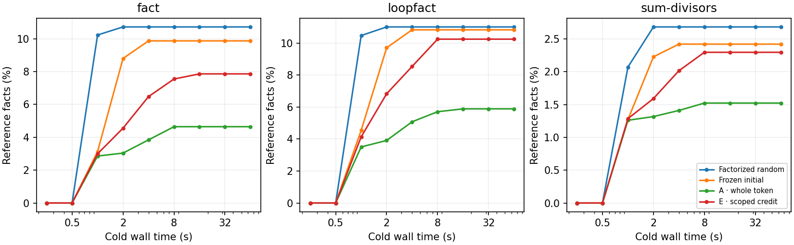

# 原生回执归因与动态 Cell Token 经验

同一枚经过 Bake 的两步 Higher 在三个起始状态都收到完整回执。入口引用和内部接线完全相同，新增有效操作分别是 **2、1、0**。这给出了直接的归因边界：收到 accepted 可以确认本次准入；判断新增贡献还需要执行后的原生记录。原生执行器为仓库的 Rust Cell Runtime，接口为 CCP v0.1。实验没有测量上游 egglog 的吞吐。

## 数据来自哪里

第一档静态采集的 3,568 个决策状态中，26,559 条受调度的规则记录全部 dirty，404,080 次签发没有一次遇到失活规则。此前三个 EggCC 程序产生的 44,219 次未触发请求中，有 41,306 次发生在当前调度集合全部失活的 Run。其余 2,913 次至少有一个已调度规则 dirty，但这个条件仍不足以证明存在有效绑定。本轮只在线读取已有调度器和 CCP 状态。原生回执、分叉结果及遗漏标签留在离线训练端。

训练环境在同一 Recipe 的不同 Stage 中重复调度规则，执行可变函数写入、删除、union、自定义 merge、repair 与后续具名消费。训练使用 0–79 号程序；8 个留出程序为 256–263。训练前同时检查去除实例名的拓扑签名。EggCC 用于独立执行与事后诊断。历史初始化权重及三个长期用于开发的 EggCC 程序有既往研究历史，严格的结构留出结果看那 8 个新程序。

| 实际计量 | 新增精细归因批 | 合并历史动态批 |
|---|---:|---:|
| 全自主轨迹中实际签发的完整神经 Token | 43,787 | 1,222,388 |
| 在 Teacher Shuffle 辅助轨迹上由神经策略实际签发 | 55,989 | 245,674 |
| 不同决策状态，含辅助轨迹 | 3,532 | 13,746 |
| 不同决策状态，仅全自主轨迹 | 1,806 | 10,598 |
| 状态 × 已签发具名请求，含辅助轨迹 | 71,007 | 309,190 |
| 状态 × 经核验的单输出语义效果下界，含直接遗漏 | 65,864 | 245,806 |
| 状态 × 有贡献的具名绑定，含直接遗漏 | 72,889 | 266,244 |
| 全自主轨迹上的直接遗漏见证次数 | 30,691 | 186,403 |
| 同一轨迹中同具名 Token 跨 Run、回执或增量不同的状态对 | 15,833 | 105,358 |

状态键包含程序、Run、原生终图摘要和调度版本。相同状态跨轨迹合并，历史响应有差异时这个计数是保守口径。语义效果下界只归并可由单输出 Recipe 投影确认的效果；多效果 Token 保留原始签发及原生有效操作计数。同 Token 的对照统计包含准入失败、原生重复和实际贡献变化；不能把全部状态对当成“已完成／未完成”的训练正反例。跨分支训练配对只允许引用相同程序的稳定初始 owner。辅助策略自行提交的请求另计。重复切片、训练重采样、反事实重放均未计为新自主经验。

百万档包含大量同页物理重复。全自主轨迹合计 1,024,239 次同页重复。早期 512 槽等大页批到 1,030,858 枚自主签发时，仅有 72,874 项不同的状态 × 具名请求。另采 200 个程序的 64 槽轨迹，再采 48 槽批，分别更换了轨迹种子；页宽、权重、起点等因素有差别。合并数据用于核验覆盖面，本轮 A–E 的训练只使用新采的精细批。

## 可复用的经验生产器

[采集器](../../credit_scale_buffer.py)分别记录生成时观察到的规则、dirty、水位、Run、epoch、端口更新／退役、模型上下文，以及原生处理具名请求时的 admission observer 行。每页先生成再同步分批签发，已签发响应按 request ID 对齐。页内各签发批共享同一次发布；分批内没有重新运行生成器。

[fine_credit.py](../../fine_credit.py) 在签发结束后生成与原始分片内容摘要绑定的归因索引。调用 `experiences(raw_shard, credit_shard)` 可读出公开端口、版本、生成页、最近响应、签发批、每个已知维度的对象、值、来源、是否原生直接核验，以及全部九个有效性 Mask。成本按实际测量粒度保存。单次签发有付费次数，整页有执行／通信耗时，分片有共享 GPU 下载、字节及时间；没有把整页墙钟平均分给各父地址。归因索引保留原始请求、局部替换以及有向依赖的关联。既有分片没有逐请求 admission observer 的地方保留空值。

### 原生检查顺序

| 原生判定 | 直接支持的监督 | 仍未知或需要另行验证 |
|---|---|---|
| CCP envelope 检查、局部未发布引用 `pending_port` | 选中的引用在这次签发时不可消费 | 后续 guard、绑定、何时出现目标端口 |
| `check_dirty && !dirty[rid]` | 本次触发条件失败；生成时也失活可监督上下文中的模板选择 | 每个父端口、guard、潜在产出、是否已经饱和 |
| `arity / unknown_output / retired / hidden / type / version / binding` | 请求在一个具名绑定检查处失败 | 完整绑定的失败位置没有逐槽明细。不能把每个父地址都标错 |
| `watermark` | 全部表原子已成功绑定，当前 tuple 没过 seminaive 水位 | 后续 guard、RHS 贡献 |
| `unbound_primitive / guard / unbound_input` | 表原子已通过；guard 拒绝证明至少一个条件失败 | 单条回执没有 guard PC；没有标签覆盖后续未经检查的条件 |
| `duplicate` | 完整检查通过，当前签名表已有同一规则与输入值的键，本次没有第二次准入 | 另一时刻的价值、任意语义等价计划的整体价值 |
| `accepted` | 检查返回合法实例，准入后排入 ready | 预期端口已经发布、长期收益或全部祖先必要性 |

判定来自 [CCP 事务处理](../../../../../../engine/cell-runtime/src/token_transaction.rs) 与 [具名绑定、准入和签名](../../../../../../engine/cell-runtime/src/cell_tokens.rs)。表格针对证明请求。独立的 Computation opcode 有自己的执行回执，这批训练没有将其与证明拒绝混标。生成时 dirty 已知为真、签发时变假只监督签发窗口；当前模型没有可训练签发接口，这项 Credit 只入档。主采集的生成与签发在同一发布内，跨窗属于单列的原生控制实验。

### 成对核验与 Unknown

- 新批 99,776 次签发中，56,073 次未触发、13,561 次完整绑定失败、8,002 次 guard 拒绝、1,219 次水位拒绝、9,640 次原生签名重复、11,281 次被接受。9,787 枚签发得到实际正操作。原始数据另有 27,726 次同页物理重复。
- 签发记录中，Structure、Timing、Binding、Condition、Novelty、Contribution 的 Unknown 比例分别为 79.03%、21.61%、56.20%、71.01%、80.00%、79.03%（按存档精确分子分母可重算）。成本均有付费次数。299 枚神经签发作为父请求获得了后续消费者的移除对照，其他签发的长期贡献均为 Unknown。Omission 独立记录为未签发见证，签发记录上没有“遗漏自身”的监督。
- 以真实自主状态为起点，离线 Teacher 先提议，再原生重放。新批中 67,711 个遗漏见证使原生操作增加。保留原签发各自的贡献不变，同时核对新增总量。280 个不稳定审计点的未确认结果保留 Unknown。这里没有推断遗漏究竟由预算、重复挤占还是延迟造成。
- 640 次抽样的单父替换全部通过双分叉复核。选择范围限于同一快照中，已有失败绑定与有贡献候选仅差一个父引用的情形。分叉分别重放原失败、替换及无新增请求的前缀。替换保留其他槽的完整地址与版本。该成功率以“已经有可验证替代候选”为条件。
- 在 551 个有真实具名父引用的子请求上，从相同接受记录移除该父并保持后缀不变，532 个消费者失去原来的正贡献。303 条边两端都是神经签发。只为每个被审计的消费端选择一条边。这个实验验证固定后缀中该次具名消费的依赖，其他证明路径仍可能产生同一最终事实。
- 同一 Primitive 的四次原生分叉获得 2、1、0、2 个新增操作。跨窗分叉在 Run 4 形成合法请求，Run 5 的原生观察器确认失活；不惩罚其原父引用。两步 Higher 在三个起点均完成，新增操作依次为 2、1、0。另一个控制先收到 `pending_port`，随后在真实发布后消费成功。旧版本的具名读取在原生对照中收到 `version`，同次调度的当前版本通过。脚本驱动的对照用于验证 Credit，独立神经成绩另测。[Primitive 控制](native-controls.json) · [Higher 控制](higher-control.json) · [版本与 pending](port-controls.json)
- 在单独的 EggCC `sum-divisors` 独立轨迹中观察到 419 次绑定失败。记录观察前后原生终图及逐类回执相同。离线按规则 575 与失败频数抽查四个 Run／Rule 组合。规则 575 在 Run 3 的一条错误绑定有两种经原生重放验证的单槽替换；Run 91 规则 312 另有一种。另两个抽查点的当前原生枚举没有产出目标。EggCC 替换均留作诊断。[实际地址及签发记录](egg-audit.json)

完整索引覆盖 1,468,062 枚神经签发，其中全自主轨迹占 1,222,388 枚。三个批合计 1,566 组核验单父替换与 1,348 条固定后缀移除见证，训练、留出和 EggCC 诊断各自落盘。新批每千枚签发有 98.1 枚正贡献请求、678.6 次直接遗漏见证及 6.4 次单父替换。三项的分母相同，事件可以重叠。新批生成、签发及常规审计 116.73 秒，约 855 枚签发／秒；附加原生取证约 34.48 秒，含读取、执行、特征联接及写盘。六条 lane 的审计累计 worker 时间为 376.39 秒。新批经历了 1,302 次具名端口版本改变、1,055 次退役、96 个系统 repair 回执、132 次规则从 clean 回到 dirty。[按批计量](quality-by-cohort.csv) · [分片和签名](shards.csv) · [语义计数](fine-inventory.json)

## 训练与消融

各组从同一历史权重出发，冻结结构、GNN、Bake、寻址、CCP 及端到端计费。每个训练种子使用相同的程序、状态、预算和核验记录。A 为受控的整枚 Token 粗归因，原有已训练的上线策略单列为 initial。A–D 的直接正目标来自模型成功产生的操作；E 另外启用遗漏。各组都保留完整 Token 的多结果监督。

| 组别 | 梯度作用范围 |
|---|---|
| A | 按完整 Token 概率学习不同的有效计算，同时对有失败回执的完整 Token 施加负监督 |
| B | 未触发只对模板项计算负梯度；绑定失败只对条件父 tuple 概率计算负梯度。没有对应决策的 guard／签发标签只保留在数据层 |
| C | B 加同 Token 跨状态对比，提升未完成状态相对已满足状态的概率 |
| D | C 加原生单槽替换。比较同一前缀下的两个条件父概率，只对发生替换的槽计算这项损失 |
| E | D 加可执行遗漏与依赖对照。每次辅助路径监督将固定权重均分给两个端点；原生有效操作的统计始终按唯一执行来源计算 |

正式训练按完整 Token 条件采样。每状态预算从 4、16、64、256 中取值，配对样本估计不同有效计算的边际收益。局部信用只作用于相应的对数概率因子；各因子共享网络参数，其他决策仍会受到间接影响。两个训练种子各安排 400 次更新。每次最多试 8,192 槽；不足以完成预算的整次更新显式记为 censored。合计 A/B/C/D/E 实际更新 767/797/784/796/799 次。各组计划预算相同，实际完成数有差异。独立的单槽目标对照每组都完成 800 次更新。完整 Token 模型实际参与梯度估计的采样数和被截断的训练槽全部保存在 [训练账本](fit-full.json)。

### 结构留出

下表合并 8 个留出程序与两个生成种子，Coverage 按参考事实数加权，EPT、EPS 使用各组累计分子和分母。槽级目标及完整 Token 目标的全部模型都经过原生独立执行。[完整指标和条件概率](held.csv)

| 完整 Token 训练组 | Coverage | EPT | EPS | 128 个留出替换 × 2 种子中，正确槽概率较高 |
|---|---:|---:|---:|---:|
| 因子化随机 | 9.76% | 0.0876 | 1,660 | — |
| 历史权重 initial | 9.62% | 0.0925 | 418 | 49.2% |
| A 粗归因 | 1.09% | 0.013 | 53 | 51.2% |
| B 局部归因 | 5.95% | 0.066 | 274 | 48.8% |
| C 加状态成对 | 5.60% | 0.065 | 255 | 49.2% |
| D 加局部替换 | 6.93% | 0.072 | 286 | 45.7% |
| E 加遗漏及后续依赖 | 8.33% | 0.086 | 358 | 50.8% |

B 的已核验正例条件父 tuple 平均概率从 A 的 3.2% 升至 3.6%。C 在同 Token 跨状态上的正序比例从 B 的 32.9% 到 37.8%，仍低于一半。D 的 Coverage 回升，但局部替换排序未随之改善。E 恢复的 Coverage 最多；本轮 E 同时启用遗漏和后续依赖，两者的独立贡献尚未拆开。相同 400 个计划更新，用前 16 个程序的 20,063 枚签发训练，E 留出 Coverage 为 9.2% 左右；扩到 80 个程序后为 8.33%。这两个数据点没有给出单调的数据量收益。

另有一次固定数据量的先导对照。静态和动态样本各使用 43,548 枚神经签发、20,200 项遗漏。相同完整 Token 目标下，静态、动态普通、动态平面物理重复惩罚、动态跨状态成对的留出 Coverage 分别为 10.80%、2.82%、9.26%、3.14%。训练时跨状态排序与页内重复成本作用于不同的分布；直接替换原惩罚没有保住覆盖率。200 程序稀释数据的早期无界抽样试验在交付足量完整 Token 前触发原安全上限，没有产生可评估权重。[等量对照](matched-distribution.csv)

## EggCC 和 grammar 的独立执行

每组使用同一合法寻址域、16 槽页、每 Run 两页、相同原生调度。相同槽预算产生的完整 Token 数不同，报告保留未交付数。两个独立训练／生成种子配对为 9633／536、5003／1129。第一对正序和反序执行，验证同一种子的终图和事实身份。Coverage 使用两个种子的参考事实数加权，EPT 用总有效操作除以总付费请求，EPS 为含初始化、寻址、推理、通信、更新和执行的冷墙钟 EPS 中位数。部分正序计时与其他实验并行，时间离散度见逐次结果；不同终图之间不能报告等终图加速。

| 工作负载 | 因子化随机 Coverage | 历史权重 | A 粗归因 | B 局部归因 | C 加成对 | D 加替换 | E 加遗漏和依赖 | E 的 EPT / EPS | 随机的 EPT / EPS |
|---|---:|---:|---:|---:|---:|---:|---:|---:|---:|
| fact | 10.71% | 9.87% | 4.64% | 7.23% | 6.74% | 7.19% | 7.86% | 0.0199 / 8.6 | 0.0238 / 121.6 |
| loopfact | 11.02% | 10.84% | 5.89% | 9.71% | 7.33% | 9.35% | 10.25% | 0.0193 / 8.4 | 0.0219 / 104.6 |
| sum-divisors | 2.68% | 2.42% | 1.52% | 2.20% | 2.05% | 2.46% | 2.29% | 0.0373 / 18.4 | 0.0461 / 193.1 |
| 留出 grammar | 12.02% | 9.23% | 2.15% | 7.30% | 5.58% | 7.94% | 5.58% | 0.2031 / 98.1 | 0.4375 / 450.1 |

各组都跑到了原生调度终点。E 在 fact 的两个种子合计尝试 145,264 个神经槽，历史权重使用 44,416 个。sum-divisors 上 D 覆盖的事实数超过 initial（两种子合计 394 对 388），但 E 没有保持这点优势，D 的 EPT 与 EPS 也低于 initial。不同种子和不同方法可能覆盖不同事实；逐对新增、共同和漏掉的事实已按身份比较。高召回 Cell Stream 的历史独立结果为 fact 1,109/1,120、loopfact 1,049/1,112、sum-divisors 3,137/8,018、grammar 233/233；其生成预算与本轮不同。

**结论。** 局部归因避免了将未触发直接变成坏父地址标签，恢复了粗粒度训练丢掉的一部分独立计算。更精确的标签仍不足以让生成器稳定胜过随机，扩大配对数据也没有证明状态区分或局部修正能泛化。尤其是 E 的有效事实和运行速度都没有超过历史生成权重。单槽目标的先导实验完成了全部留出动态图和 fact 第一种子的对照；该目标下大量槽无法交付完整 Token，后续 EggCC 完整面板使用完整 Token 条件训练。完整面板共 84 次原生独立执行，留出动态图另测。[完整 Coverage、EPT、EPS](native.csv) · [每次签发与墙钟统计](native-runs.csv) · [事实集合差异](fact-differences.csv) · [真实事实身份](fact-sets.jsonl) · [历史 Cell Stream](historical-stream.csv) · [按统一墙钟预算重放](clock.csv)

单独停止训练与其他 GPU 作业后，用同一生成种子对 sum-divisors 再做一轮正反序。E 两次都覆盖 169 个事实，支付 7,561 个请求，墙钟 16.29／16.56 秒。历史权重覆盖 188 个事实，支付 8,361 个请求，墙钟 6.55／6.35 秒。随机覆盖 207 个事实，支付 7,683 个请求，墙钟 1.51／1.57 秒。E 少发的请求没有换来更多有效计算或更短墙钟。[隔离计时](isolated-timing.csv)

## 复现与审计

[复现脚本](reproduce.sh) 从第一档程序、权重和 CCP 可执行文件出发重新采集、核验、训练并执行。工作目录为 `benchmarks/pass3-cell-gpu/recurrent-generator/instruction_pointer`。使用带 PyTorch MPS 的 Python 环境。原始分片、原生接受 tape、逐 Run 反馈、训练权重与 GPU 计数保存在移动盘的 `eggfuse-experiments/transition-credit-1127`；本轮精细归因子目录为 `fine`。摘要可逐文件比对。[权重清单](weights.csv) · [核验对照实例](replay-examples.json)

在线仅由冻结生成路径读取已发布的状态并提交其选定的 Token。CPU 读取与核验具名引用、处理请求、发布和更新原生状态。采集的离线精确提议只进入训练辅助轨迹或独立分叉。离线 Rule 级负例、语义效果投影、父替换、父移除和终图没有进入在线网络。新生数据以 Primitive 为主；Higher 使用同一归因映射的原生对照，未把脚本激活记为神经自主发现。训练和正式执行保持原有提交接口与候选域。160 项回归测试通过，包括原生版本、待发布端口、跨窗口签发和 Higher 边际贡献的对照。README 的 CPU compile、run、bench 及既有 sum-bits 最终状态语义验收通过。
