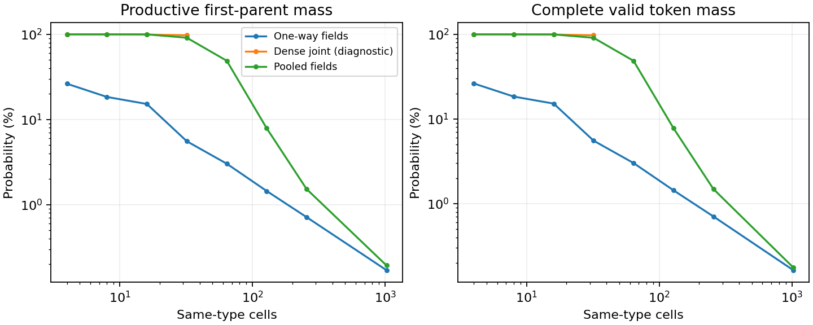

# 从空前缀发现首父

现有字段注意力已经编码了可跨首父比较的伙伴证据。在 4 个同类型 Cell 的未见接线上，对上一轮冻结的 C 直接汇总**未归一化**伙伴分数，正确首父概率便从 26.02% 升到 99.25%。此项是一次离线读出实验。进一步训练后，完整绑定概率在 32 Cell 上由单向基线的 5.55% 升至稠密联合诊断的 97.55%；不展开全部父对的伙伴摘要路径达到 90.98%。到 1,024 Cell，这个摘要已不能可靠区分有效首父。

## 训练与测量

从 `1137ad10` 的字段注意力 C 权重初始化，无额外恒等残差。三组使用相同的 Recipe、GNN、实际发布端口、完整 Cell Token CE、训练样本顺序及抽样目标。静态签名给出哪些列共享变量。训练在 384 个新原生环境进行，有 685 个经重放核验的不同状态 × 新增目标。4、8、16、32 各 96 个环境。课程每次增大最大尺寸，保留所有较小尺寸，各训练三遍，共 2,880 枚完整 Token 曝光/模型。3 个训练种子。初始 C 的上一轮训练另计。合成程序的目标窗口只有一个可选 Primitive 模板，模型必须从两个完整父域自由生成具名引用。结果不能外推到多规则模板发现。

测试沿用上轮按有序接线和 filler 留出的原生环境，训练值域与测试隔离。每组、每个起点先采样 32 枚完整 Token，再在独立 Rust 快照上原生签发，逐页核对实际新增原子操作。4,038 页、129,216 次请求。报告的完整概率对同一状态的所有已核验新增绑定求和；自由命中包含重复命中，召回@32 只计不同贡献。两个父概率分别衡量首父落在有效集合的概率和给定有效前缀的次父概率，跨实例汇总后两列均值不应直接相乘。[语料](corpus.json) · [各阶段训练](training.csv) · [逐布局与种子](snapshots.csv)

## 概率与执行边界

记 `a(i)` 为原有首父对数概率，`b(i,j)` 为次父原有行地址项加上可学习的跨字段双线性分数，取在最终行内 log-softmax 之前。稠密组定义 `e(i,j)=a(i)+b(i,j)`。首父分布是 `softmax_i(logsumexp_j e(i,j))`，选定后次父分布是 `softmax_j e(i,j)`。同一张能量表也可先边缘化去取次父，再条件化取首父；两种分解恢复相同联合分布。这是信息可用性的诊断，训练与离线核验均限定每角色最多 32 行。

在四 Cell 上，冻结原 C、此次单向 CE、此次联合 CE 的原始能量边缘化分别给正确首父 99.25%、99.96%、99.95%。如果先对每个首父的伙伴分数归一化，其行概率之和恒为 1，读出恢复首父先验，分别为 26.02%、26.30%、26.39%。上一轮模型已有用来判断可完成性的信号，原解码顺序把它留到了选定首父之后。[校准实测](calibration.csv) · [实现](../../first_parent.py)

正式路径在 GPU 上把每个发布字段的身份向量映射到四组软分配，每组有 128 个通道。每组从身份向量取 7 个坐标，以按符号模式初始化的可学习投影打分，对全部通道做 softmax。先沿右角色的**行轴**求和，再让每个左角色字段读取这些通道的占用量。各头的对数支持度经饱和变换，用静态接线的软注意力加权，修正首父先验。选出首父后沿用跨字段条件注意力读取实际伙伴。该路径是对伙伴证据的近似，不能保留每个伙伴的身份。两个方向都传递信息，正式路径也没有声称自己在精确求稠密联合分布。

CPU 只读取可见、角色类型匹配的具名行，打包全角色输入，并把网络选定的索引翻译成实际版本化引用。软通道投影、聚合、候选打分和抽样均为模型计算。无基于字段值的 CPU 分桶、相等 mask、语义预筛、自动去重或隐藏 join。摘要开销为线性遍历两个角色域，常数较大：四列、两角色各 1,024 行时需产生 4,194,304 个软通道 logits。首父阶段没有父对打分；选中后仍需每个生成槽对右角色逐行打分。模型没有实现增量缓存。实测根评分耗时含设备内构建与归约，在预装输入上独立计时；在线 EPS 另计 CPU 装包与全部设备传输。[根评分成本与正确/错误首父分差](root-cost.csv)

## 单共享变量与实际生成

| 同类型 Cell 数 | 单向完整概率 | 稠密联合完整概率（离线） | 摘要首父概率 | 摘要完整概率 | 摘要实际自由命中 | 摘要召回@32 |
|---:|---:|---:|---:|---:|---:|---:|
| 4 | 26.30% | 99.94% | 100.00%¹ | 99.96% | 99.93% | 100.00% |
| 8 | 18.41% | 99.80% | 100.00%¹ | 99.92% | 99.91% | 100.00% |
| 16 | 15.21% | 99.41% | 99.98% | 99.86% | 99.87% | 99.65% |
| 32 | 5.55% | 97.55% | 91.28% | 90.98% | 89.93% | 100.00% |
| 64 | 3.02% | — | 49.00% | 48.68% | 48.55% | 100.00% |
| 128 | 1.44% | — | 7.90% | 7.81% | 7.23% | 71.60% |
| 256 | 0.71% | — | 1.53% | 1.49% | 1.56% | 20.68% |
| 1,024 | 0.164% | — | 0.194% | 0.177% | 0.116% | 1.54% |

¹ 四舍五入。32 Cell 摘要自由命中按三个 seed 为 87.33%、90.45%、92.01%。三种未见字段位置对应的完整概率为 90.53%、96.44%、85.98%。固定物理总数 64、只调同类型域至 4/8/16/32/64 时，完整概率依次为 99.98%、99.93%、99.77%、91.90%、38.66%。未经学习的无关类型数与同类型干扰可由此分开。1,024 Cell 三 seed 的实测命中依次为 0.174%、0.174%、0%，单向模型平均为 0.231%。在该尺寸没有可复现的召回优势。[完整结果](equality.csv)



## 多共享变量与同一伙伴

原有双共享变量及单字段干扰集上，32 Cell 的完整概率为单向 7.4%、联合 97.9%、摘要 93.8%。但摘要的不同有效计算召回@32 只有 76.9%，联合为 100%。多个字段分别有支持，仍然可能找不到**同一个**可完成绑定的伙伴。

为独立核验这一点，另编译 12 个八 Cell 程序，每个有两种插入与地址顺序。在真实首父之外放入一个诱饵，诱饵的两个共享字段各有一个不同的伙伴，完整绑定只有真实首父那一组。原生 capture 核对唯一新增证明，自主抽样后再重放。稠密联合把 **99.58%** 的首父概率给真实首父，给诱饵 **0.41%**。摘要给真实首父 **51.74%**，给诱饵 **48.26%**。单向分别为 12.43% 和 11.90%。这是一个可定位的结构性损失：右角色行归约后，两项证据是否来自同一行的信息已丢失。[逐例干预](split-witness.csv) · [原生夹具](../../first_parent_probes.py)

## 算术 guard

单独使用两个父角色、两条相等链但仅一条通过跨父 i64 小于比较的原生任务。48 个训练程序、12 个留出程序（使用相同 guard 接线和新 filler）。固定已训练的摘要生成器每次从完整域自由生成两枚 Draft 候选；后续用已有地址 MLP 的副本预测下一枚完整具名 Token。直接组可选择两枚 Primitive，主动组在同一 Draft 中还可选择对任一候选发出 Recipe 指定的 `<` Computation Request。网络决定请求种类和实际引用，Runtime 只检查已点名的操作数。计算之后同一打分器读取真实 CCP 状态码再选 Primitive；不得由 CPU 决定保留哪个伙伴。每次取得新 Draft，同一窗口可持续生成，32 枚**实际付费请求**耗尽时结束。

训练先在各自真实窗口用冻结生成器取样，对这些具名选择执行原生计算和证明。离线标签由实际回执产生，未发现有效替代的 Draft 不作负例。监督仍为给定状态与 Draft 的完整 Token 交叉熵，等价槽位合并概率。生成器在此子实验冻结，优化的是在两枚自主提案上选择下一枚具名请求的条件似然。未观察状态中有可用探针时，Teacher 抽样约 2/3 计算请求、1/3 直接签发；该比例会影响主动请求频率。没有训练“值得询问”的收益函数。直接组只读 CCP 原有身份哈希和上下文，没有额外读取原始有序整数。结果适用于这一输入契约。

| 每次运行的均值 | 直接神经签发 | 主动请求 + 真实回执 | 同主动权重、屏蔽回执 |
|---|---:|---:|---:|
| 付费计算请求 / Primitive | 0 / 32 | 13.97 / 18.03 | 13.97 / 18.03 |
| 命中合法绑定的 Primitive（可重复） | 19.53 | 11.19 | 11.11 |
| 原生 guard 拒绝的 Primitive | 12.47 | 6.83 | 6.92 |
| 首次新增效果消耗的付费请求 | 2.06 | 3.56 | 3.56 |
| Coverage / EPT | 100% / 0.03125 | 100% / 0.03125 | 100% / 0.03125 |
| EPS | 4.53 | 6.26 | 6.21 |

每个程序只有一个有效目标，三组均达到参考终图。主动组平均有 0.72 次末尾已探测但因预算用尽而未签发后续 Primitive。主动组每次生成的 Draft 页更少，EPS 变化在屏蔽回执时依然存在。真实回执在该训练和预算下没有体现为更早的新增计算或更高 EPT。[原始计时、计算次数及回执](guards.csv) · [训练标签](guard-fit.csv) · [请求生成与归因](../../first_parent_guard.py)

## 正式独立执行

项目 Rust Cell Runtime 从程序初始状态启动 CCP v0.1，原固定退出策略。每个尺寸独立选三个留出程序，三组策略、三个种子、正反两次，共 432 次。每次 32 枚付费 Primitive；不引入高阶计算或额外查询。Coverage 在这些程序中是已新增的不同参考 Result 占比，每个有贡献的证明新增一个原子操作。满覆盖必须和参考完整终图 SHA 一致。EPS 包含 GNN 初始化、公开状态读取、神经推理、装包、通信、原生执行与进程退出；模型权重在计时前装入。各尺寸因子化随机实测、所有时间及图散列见原始表。

| 同类型 Cell 数 | Coverage 单向 → 摘要 | EPT 单向 → 摘要 | EPS 单向 → 摘要 |
|---:|---:|---:|---:|
| 8 | 100% → 94.44% | 0.0417 → 0.0382 | 37.99 → 33.96 |
| 16 | 77.78% → 94.44% | 0.0486 → 0.0590 | 43.53 → 52.77 |
| 32 | 62.96% → 100% | 0.0382 → 0.0625 | 31.56 → 53.07 |
| 64 | 18.52% → 100% | 0.0139 → 0.0625 | 9.90 → 48.43 |
| 128 | 0% → 68.52% | 0 → 0.0382 | 0 → 26.33 |
| 256 | 3.70% → 27.78% | 0.0035 → 0.0174 | 2.19 → 11.61 |
| 1,024 | 0% → 11.11% | 0 → 0.0035 | 0 → 1.36 |

独立执行表只使用 `eq10` 的三个值实例；全位置的冻结召回和终图试验覆盖的实例数不同。在 32 Cell，双方都有产出且终图相同的配对有 8/18 个，摘要/基线墙钟比中位数 1.010，配对比值样本标准差 0.206。此处 EPS 提升主要来自同预算做成更多计算，同终图加速尚无证据。64 Cell 及以上没有双方均有产出且终图相同的配对。1,024 Cell 每次激活要读取整个父域，预装输入上首父聚合计时约 0.77 ms；三个代表快照中，最佳有效首父和最佳无效首父的摘要分差均已为负。[独立执行](live.csv) · [均值](live-summary.csv) · [同终图配对](paired.csv)

另外在每个选定尺寸取一个程序，将相同权重转到单线程 CPU，使用同一个 Rust Runtime。32 Cell 上单向/摘要/原生精确搜索的 Coverage 分别为 66.67%/100%/100%，EPS 为 31.21/55.22/279.73。精确搜索为单列的符号参照，EPS 的分子取该夹具经核验的参考新增操作数，分母含启动原生进程和读出结果，付费神经 Token 不适用。其耗时与 GPU 策略管线的工作内容不同。这里没有开展 EggCC 迁移测试。[单线程与原生精确参照](cpu.csv)

## 复现与验收

使用上一轮实验的数据盘及构建环境。编译命令与路径配置见[前轮复现说明](../variable-binding/README.md)。从 `instruction_pointer` 目录运行：

```sh
export ARTIFACT_ROOT='/Volumes/Extreme SSD/eggfuse-experiments'
export CELL_DATA=/tmp/dfm-local/data
export CELL_REPLAY=/tmp/cost-audit-build/release/examples/cell_token_replay
export CELL_COMPILER=/tmp/cost-audit-build/release/eggfuse-cell-compiler
export PYTHON=/tmp/egg-txn-ml/bin/python
export PLOT_PYTHON=python3.8
sh first_parent_reproduce.sh
"$PYTHON" -m unittest test_first_parent test_binding_fields test_completion_curriculum test_next_cell_pretraining
```

实验盘 `first-parent/` 保留新原生程序、每起点及种子的数据、CPU/GPU 计时及训练权重；`variable-binding/` 提供已有独立测试夹具。默认复用已成功生成的夹具，设置 `FIRST_PARENT_OUT` 和 `RESULTS_DIR` 可写入全新结果目录。每种子保存三种主要模型和两种 guard 策略的权重。回归测试 12 项通过；README 的 Cargo compile/run/bench 和既有 sum-bits 语义验收通过。[复现脚本](../../first_parent_reproduce.sh) · [权重校验和](weights.csv)
