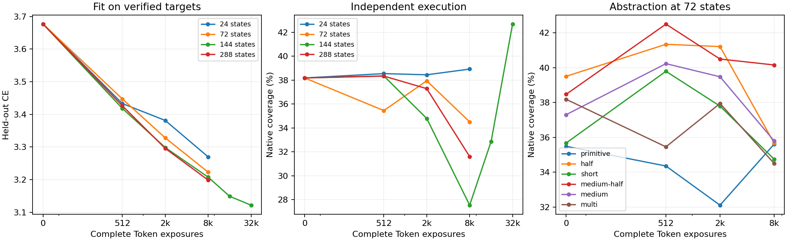

# Cell Foundation Model 的学习曲线与原生执行

本轮用同一套完整 Cell Token CE 分开测量三个问题：状态变化是否可见，更多曝光能否改善自由生成，以及 Higher 能否降低达到相同覆盖率的学习与执行成本。下文的自主执行均向 CCP v0.1 Rust Cell Runtime 签发具名请求。训练标签、概率探针及阈值分析单独记录。正式策略保留已发布的具名父域、静态类型构造约束、GNN、操作数与字段读取、Response KV、固定退出和页内同名 Token 不放回。

## 同一具名请求随窗口开关的概率

每个原生程序有两个消费规则、两个供给窗口。固定 Recipe、地址和目标，先用真实 Submit、Seal 和发布唤醒其中一条规则，在 Run 4 分叉验证该请求 accepted 且增加事实，再在 Run 6 验证同一请求 untriggered_rule、另一规则可以贡献新事实。分别交换两条规则，分出 Run 4 已签或未签两种历史。由此覆盖“从未签过也会失活”和“先成功、再被关闭”。每种程序族 12 个训练实例、6 个未见实例、2 个训练种子，表中每个阶段有 48 个条件观测。负回执只用于诊断。CE 的目标来自同快照原生分叉增加的事实；没有 inactive 惩罚。

| 512 步后，同一完整 Token 的平均概率 | Run 4 唤醒 | Run 6 失活 |
|---|---:|---:|
| 现行输入、同构规则 | 49.63% | 49.64% |
| 现行输入、一条规则增加算术操作 | 49.37% | 48.92% |
| 同构、离线补入客观 dirty 和 watermark | 99.22% | 0.01% |
| 同一离线权重，只保留 watermark 通路 | 49.62% | 49.63% |
| 异构、离线补入两项 | 98.75% | 0.09% |

同构规则的冻结 GNN 向量逐元素相同，现行模板概率始终各占 50%。训练提高了选中该具名父端口的概率，反而会在失活窗口也生成它。异构对照中结构码最大元素差为 0.6375，模板对回执向量有实测梯度，平均范数 0.0467，但这个梯度没有产生可靠的窗口区分。逐请求原生证据、模板和完整 Token 概率、梯度、移除回执的干预均可逐行检查。[证据](wake-evidence.csv) · [同 Token 配对](wake-pairs.csv) · [梯度](wake-gradients.csv) · [离线输入消融](observability.csv)

**路径。** 发布帧中 rules 含规则与水位；Instances.snapshot 调用 World.menu 时仅留下模板编号。dirty 可由原生 observer 读取，当前模板评分器没有相应输入。公开 run、epoch、accepted/update/retire 三项计数经过 log1p/8 进入全局 Query。真实逐请求 Response 编成可读 KV，已发布端口与版本进入实例 Value。回执本身不能作为可消费端口。梯度探针分别对模板 log P 和完整 Token log P 求导；dirty 与 watermark 的直接路径均未使用。全局数值梯度是在编码后的五个输入通道上测量，不能解释为原始整数可微。离线正对照将客观 dirty 与单调变换后的水位加进已有 Recipe 向量的两个维度，保留整个可构造候选域，网络自行分配概率。它说明普通 CE 在输入可区分时可以学会此任务。这里尚未测量向正式 EggCC 策略公开这些数值的端到端收益。普通 Wake 小任务的终图易达饱和，只作机制诊断。[快照与发布](../../cell_kv_runtime.py) · [模板读取](../../cell_kv_model.py) · [分叉与梯度](../../foundation_wake.py) · [正对照](../../foundation_observable.py)

## 容量、状态数和曝光量

训练程序含四个分支，每个入口值有两个真正有产出的分支，后继有不同的算术写入。单父和双父版本用同一批输入、后继规则和插入顺序，双父入口额外需要一个已发布的 Permit(x)。训练内部链深 3/5、每程序 2/5 个作业；留出深度 4/6、5/7 个作业。训练及留出的值、实例和模板主体深度分开。课程中的易例比例依次为 75%、50%、25%。标签来自训练程序原生轨迹，在相同快照上比较空分叉与签一枚完整 Token 的分叉；Higher 还须贡献事实并实际完成。监督覆盖已核验目标，未穷举所有合法绑定。每次更新抽 4 个状态，每个抽 4 个正向目标，梯度只来自完整 Token CE。评估前不提供任何目标或入口。

从上一轮已训练权重开始，扩大现有 GRU 读取门的内部宽度，保持 32 维 KV、Query 接口和 GNN 冻结方式。宽度 32/128/512 对应可训练参数 8,576/27,584/103,616，模型总参数分别为 32,874/51,882/127,914。宽门以原函数平铺加小扰动启动；另做门权重独立随机初始化的对照。此容量轴只检验读取与组合的容量，不能外推出更新整套 GNN 或百万参数模型的结果。每个设置使用训练种子 71、113，保留所有检查点。在 4 个留出程序上各用 2 个自由生成种子，16 条轨迹取均值。横轴是优化器完整 Token 曝光量，独立状态与实际见过的状态×目标另列。训练吞吐包含训练前向、反向和更新，原生样本生产及评估另计；单线程 CPU。



| 控制一个变量 | 留出完整 Token CE | 平均原生 Coverage |
|---|---|---|
| 固定 8,192 曝光、8,576 参数；24 / 72 / 144 / 288 个原生训练状态 | 3.270 / 3.223 / 3.208 / 3.199 | 38.9 / 34.5 / 27.5 / 31.6% |
| 固定 144 个状态、8,576 参数；曝光 0 / 512 / 2,048 / 8,192 / 16,384 / 32,768 | 3.677 / 3.418 / 3.298 / 3.208 / 3.149 / 3.122 | 38.2 / 38.3 / 34.8 / 27.5 / 32.9 / 42.7% |
| 固定 72 个状态、8,192 曝光；可训练参数 8,576 / 27,584 / 103,616 | 3.223 / 3.223 / 3.223 | 34.5 / 34.5 / 34.5% |

在 144 个状态、32,768 次曝光时，最宽门达到 43.1%，最窄门 42.7%，吞吐分别为 557 和 626 枚训练 Token/s。72 状态的随机初始化对照在三档宽度下分别达到 31.2%、32.2%、31.7%。冻结数据上的 CE 随曝光逐步降低，自主执行覆盖率中途明显下降；只看较早检查点会漏掉恢复，只看最后检查点又会漏掉训练风险。fit 是固定四个训练程序的均衡探针，held 是独立实例的状态均衡 CE。由于目录改变目标类别，各目录的 CE 绝对值不能直接用于判断抽象优劣。[全部学习曲线](learning.csv) · [逐种子记录与总参数](curves.csv) · [自主执行与终图](autonomous.csv)

## 抽象规模、接口与目录

下表固定 72 个训练状态、8,192 次曝光、8,576 个可训练参数。所有目录都保留全部 Primitive；短体有 2 步，中体留出时有 5 或 7 步。小目录只开放两个语义分支，随实例轮换，完整目录开放四个，多尺度开放短中两档。各组在完全相同的原生程序上自由执行，不同目录接受到的目标分布可以不同。计数中的“决策”为网络签出的完整 Cell 数，页内推理与实际付费是不同口径。

| Higher 目录 | 初始 Coverage | 训练后 Coverage | 决策数 | 付费请求 | EPT | EPS |
|---|---:|---:|---:|---:|---:|---:|
| 无，纯 Primitive | 35.5% | 35.6% | 77.8 | 77.8 | .325 | 344 |
| 2 个短体 | 39.5% | 35.7% | 81.9 | 84.4 | .312 | 348 |
| 4 个短体 | 35.7% | 34.8% | 79.4 | 81.8 | .302 | 332 |
| 2 个中体 | 38.5% | 40.2% | 68.9 | 81.6 | .361 | 430 |
| 4 个中体 | 37.3% | 35.8% | 67.4 | 78.4 | .334 | 367 |
| 8 个多尺度 | 38.2% | 34.5% | 69.5 | 77.4 | .311 | 361 |

**达到同一覆盖率。** 在离散训练检查点中，平均 Coverage 首次达到 40% 的有两短、两中和四中三组，均在第 32 步，512 枚曝光，平均见过 47 个状态。三组分别接触 180、180、185.5 个不同状态×目标，训练用时 0.55、0.53、0.53 秒。其余组在该组四个检查点均未达到 40%。起点不同、每组仅 16 条轨迹，部分轨迹在训练前就过线；逐轨迹首次过线与未过线都保留。[首次达到训练阈值](first-checkpoint.csv)

**运行中达到同一覆盖率。** 在最终权重下，从相同原生程序和随机种子独立重跑不同付费预算，核对每次真实签发的具名序列是原轨迹前缀，验证过线预算及其前一个预算。纯 Primitive 在 16 条中有 6 条能达到 40%；四个中体有 8 条，其中 6 条两组都达到。在这 6 条上，四中平均少 8.17 个神经签发，多付 4.00 个 CCP 请求。两中在 16 条中有 7 条过线，与 Primitive 同时过线的 6 条平均少 10.33 个签发、多付 1.83 个请求。共同过线只表示数量相当，事实身份和终图还要单独比较。最终检查点，四中和 Primitive 同事实集且同终图的仅 2/16，平均各省 10 个神经签发。该小子集不足以建立墙钟优势。每条未过线轨迹均以其完整消耗保留。[原生最小付费前缀](native-prefix.csv) · [逐次终图与事实差](matched.csv)

**外部接口。** 四中训练后的单父 / 双父 Coverage 分别约 49.6% / 22.0%，纯 Primitive 为 46.1% / 25.1%。额外独立引用显著拉低自主覆盖，拉长内部计算没有消除这个难点。这里的接口变化也改变了原生匹配义务。**目录竞争。** 同一冻结模型、同一状态，将同深度目录从两个增至四个，原有且核验有效的完整 Higher Token 总概率，短体从 23.0% 降到 13.5%，中体从 22.2% 降到 11.6%；所有已核验有效目标的总概率分别从 45.3% 到 43.7%、50.5% 到 50.0%。扩充候选能重新分配既有的概率，不能用更多模板选项直接推导更轻的学习任务。[接口](interface.csv) · [冻结目录探针](catalogue-probe.csv)

## 真实 EggCC 自主执行

采用两个互补对照。第一个固定 EggCC 的 Primitive 目录，只迁移不同训练档位的权重。第二个将 sum、dot 与训练 grammar 提供的既有 donor Bake 按静态签名链接到 fact、loopfact、sum-divisors。第二组按同一根取 2 步、5 步前缀，每个负载可链接 6 个共同根；多尺度目录有 12 个选项。只接受当前接续器能够表达的内部引用，结尾使用静态声明输出中最小的 op 作为待发布回执。离线链接没有使用被测程序的 Teacher tape 或试跑选择模板。正式生成由网络决定模板与实际入口。同一根目录的静态支持不保证运行中存在合法入口，完成条件也依赖真实端口发布。[目录与接续边界](../../foundation_egg_catalogue.py)

下表使用完整固定调度、每窗口两页共六份神经槽预算。每格按 **Coverage / EPT / EPS** 记。每种子保留两次实际计时以及独立运行的事实集、终图和计数。表中均值包括所有轨迹。

| EggCC | 纯 Primitive | 短 Higher | 中等 Higher | 多尺度 Higher |
|---|---|---|---|---|
| fact | 5.85% / .084 / 9.34 | 6.12% / .088 / 9.17 | 6.52% / .088 / 9.49 | 6.03% / .083 / 8.92 |
| loopfact | 8.23% / .084 / 8.29 | 7.78% / .081 / 7.95 | 7.69% / .077 / 7.82 | 7.51% / .079 / 8.11 |
| sum-divisors | 1.82% / .188 / 18.91 | 1.78% / .187 / 18.40 | 1.93% / .192 / 18.50 | 1.82% / .188 / 17.83 |

三个程序的 Higher 各签发 98、99、132 次，按唯一自主轨迹汇总，两次计时只计一次。**329 次入口签发，原生接受 0 次，内部付费步骤 0 次。** 以相同种子重跑并核对每条轨迹的事实、终图和全部计数后，逐请求归因得到 261 次 untriggered_rule、67 次完整 binding 失败、1 次 guard 失败。前 261 次原生检查在触发条件处就已返回，其父绑定是否合法仍未知。[逐组回执](higher-receipts.csv) 因而这些 Coverage 差异出自模板目录与策略改变后的普通请求轨迹，没有任何一次 Higher 内部接管可以解释它。18 个 Higher 与纯 Primitive 的同种子配对里，严格同终图的有 0 个。sum-divisors 的多尺度组与纯 Primitive 平均都覆盖 146 个事实，仍不能据此宣称同终图。高拒绝率也意味着这组运行没有检验已启动 Higher 的内部执行效率。[真实目录结果](egg-transfer.csv) · [同终图与事实集合](egg-transfer-matched.csv) · [逐种子及两次墙钟](egg-transfer-runs.csv)

使用统一 Primitive 部署目录时，初始权重与较长训练权重（144 状态、32,768 枚曝光）在完整调度下，fact 平均参考事实数为 72 → 71，loopfact 为 87 → 88，sum-divisors 为 144 → 151。三者的 EPT 分别为 .0910 → .0878、.0804 → .0797、.1855 → .1880；EPS 为 9.53 → 9.00、7.94 → 7.92、19.45 → 17.92。每条轨迹平均仍有约 1,200 次未触发请求。另有相同 96 请求付费上限的全组实验；表中 cap=0 表示完整固定调度。三个程序没有显示一致的 Coverage–EPT–EPS 增益。[迁移与付费预算](egg.csv) · [逐种子事实差及计时](egg-runs.csv)

## 计量、边界与复现

- Coverage 沿用现有原生参考合同。受控任务计算新增逻辑表行，EggCC 使用历史构造子对齐的参考事实集合并排除初始事实。EPT 用 Runtime 的 signed_external + signed_internal 有效原子计数除以实际付费请求数。EPS 分母是原生执行计时区间，含模型 prepare、页解码、通信、发布和内部接续。网络签出一枚 Higher 与运行时实际付费多少次分开计。计时不含离线编译、标签生产、终图后验对齐。单线程 PyTorch CPU，Apple arm64；独立作业共享机器，补跑分批完成，墙钟主要用于量级对照。受控四中仅有的两条同终图轨迹分别耗时 Primitive 的 1.065 和 0.998 倍。
- 统计单位为检查点、训练种子、程序及生成种子；重复计时不作为新增种子。共 160 个配置×种子×检查点记录，1,280 条受控完整自主轨迹，288 个付费阈值观察，三个真实 EggCC 的 96 付费与完整调度均有原始数据。样本规模与较低的真实 Coverage 均限制外推。在真实任务上，尚无证据说明增大 Higher 或扩大读出门能降低学习成本。
- B2/B3 审计采用项目的 AGENT-RULES.md。正式路径只依赖调度提供的规则菜单、公开类型域、网络签出的具名地址、已发布端口和真实 Request/Response。唯一性限定在单页内已经生成的完整具名 Token。内部步骤只从签出的 Higher 和原生发布的指定端口接续。所有方案保持原 Run/Seal、退役、版本、费用和退出语义。离线 observer、原生分叉、覆盖阈值及事后事实集合不参与正式选择。研究没有给调度器增加索引，也没有用 CPU 关闭未触发模板。
- 起点为研究分支的 3361519e。完整权重、原生快照、每次运行的事实与状态摘要在 ARTIFACT_ROOT/conditional-value/foundation-curves，版本库保留文本测量、图和 SHA-256 清单。历史输入为上一轮 constructible 下的 structured-71/113、既有可见回执权重、三个 EggCC program.json、region-owner-1126/menu.json 及 partner_index_reproduce.sh 声明的依赖。代码无需加载留出 Teacher 来进行 EggCC 在线生成。重跑须先具备这些研究资产。[原始产物清单](sha256.json) · [上轮输入与口径](../constructible/README.md)
- 在 instruction_pointer 目录运行以下命令。复用已完成的训练和原生数据即可重新导出；独立从头重跑请把本轮 foundation-curves 输出放在一个新的实验目录，保留同层历史输入。PyTorch 2.15.0，Python 3.14.3，绘图解释器另需 Matplotlib。

```sh
export ARTIFACT_ROOT='/Volumes/Extreme SSD/eggfuse-experiments'
export CELL_DATA=/tmp/dfm-local/data
export CELL_COMPILER=/tmp/cost-audit-build/release/eggfuse-cell-compiler
export CELL_REPLAY=/tmp/cost-audit-build/release/examples/cell_token_replay
export PYTHON=/tmp/egg-txn-ml/bin/python
export PLOT_PYTHON=/Users/mineralsteins/.cache/uv/archive-v0/aHBndDgQmeRzppD3/bin/python
sh foundation_curves_reproduce.sh

"$PYTHON" foundation_curve_results.py "$ARTIFACT_ROOT/conditional-value/foundation-curves" run-recall/foundation-curves
"$PLOT_PYTHON" foundation_curve_plot.py run-recall/foundation-curves
"$PYTHON" -m unittest test_foundation_curves test_constructible test_feedback_memory test_state_transition test_competition test_selected_cell test_interface_role test_operand_read test_value_read test_compatibility test_cell_kv test_token_embedding
```

验证通过 35 项相关回归。另用本地 Cargo 完成 README 的 compile、run、bench，保存的 sum-bits 最终状态合同检查为 pass。这个独立合同检查仅用于原有 CPU 路径的语义回归。研究结果来自本轮 CCP 原生执行。
