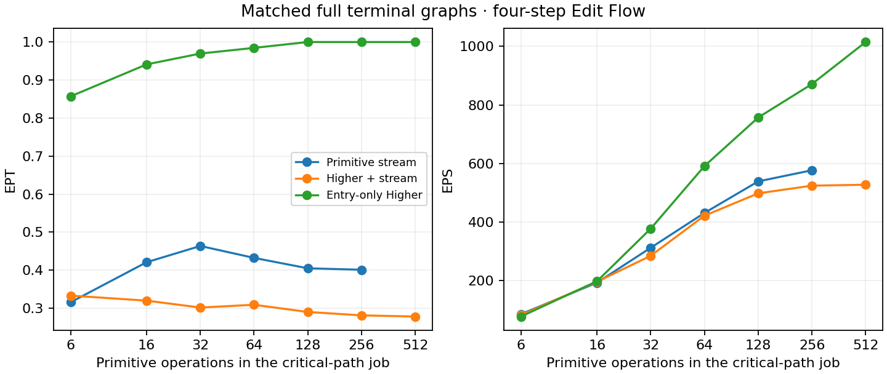
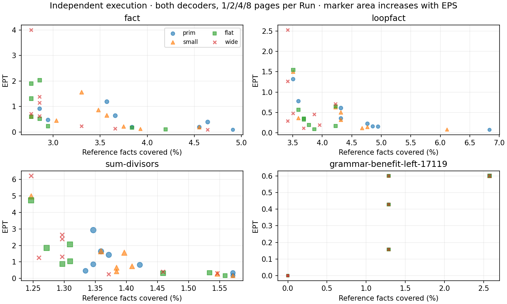

# Higher Cell scaling on native CCP v0.1

The frozen generator can name one external reference and activate a 512-operation program. Its value depends on the job's execution contract. In a single-entry critical-path job a four-step Edit Flow reached the full terminal graph with one neural token, one external binding and 512 real CCP requests. In the normal continuing stream, adding the same Higher reached 512 facts with 1,840 requests. The 512-step program completed in both cases. Across the held natural workloads the expanded catalog produced no verified completion of six or more steps in the measured frontiers.

## Matched terminal graphs

The controlled program computes earliest completion times in a project with positive task durations. Each result is published and checked. Chains model sequential tasks; the fork/join circuits run predecessor branches and take the maximum completion time at joins. All nodes are ancestors of the final task. Changing an initial release time changes the results. Each number below comes from independent native execution. The headline seed is 536. Wall/EPS figures use four alternating-order repetitions. The table gives effective operations per paid request and per second.

| Fork/join operations | Primitive stream, facts / requests | Higher + stream, facts / requests | Entry-only Higher, facts / requests | EPT, primitive / stream Higher / entry Higher | EPS, same order |
|---:|---:|---:|---:|---:|---:|
| 6 | 6 / 19 | 6 / 18 | 6 / 7 | .316 / .333 / .857 | 86 / 82 / 77 |
| 16 | 16 / 38 | 16 / 50 | 16 / 17 | .421 / .320 / .941 | 193 / 196 / 198 |
| 32 | 32 / 69 | 32 / 106 | 32 / 33 | .464 / .302 / .970 | 312 / 285 / 378 |
| 64 | 64 / 148 | 64 / 207 | 64 / 65 | .432 / .309 / .985 | 432 / 422 / 591 |
| 128 | 128 / 316 | 128 / 441 | 128 / 128 | .405 / .290 / 1.000 | 539 / 498 / 757 |
| 256 | 256 / 638 | 256 / 910 | 256 / 256 | .401 / .281 / 1.000 | 577 / 524 / 871 |
| 512 | 395 / 994 | 512 / 1,840 | 512 / 512 | .397 / .278 / 1.000 | 512 / 527 / 1,015 |

The open stream uses two generation pages per scheduled Run. The entry-only control permits exactly the same two pages at the initial Run and subsequently services only named, already requested computations through actual receipts. This is an explicitly single-job workload assumption. Both arms have access to the same entry and budget. The entry-only primitive control for 256 steps produced one fact, and its Higher counterpart completed all 256. Comparing the successful entry-only Higher with the continuing primitive stream measures the combined abstraction and dispatch effect. The experiment demonstrates a matched-graph advantage at 32–256 steps for this workload; it does not establish a crossover for independent general-purpose execution. At 512 the open Flow primitive arm missed facts, so its EPS is excluded from the matched comparison. The ordinary supervised editor did reach 512 with 1,028 paid requests; continuous Higher used 1,540, and entry-only Higher used 513. No method used a joint pointer or a newly trained network.



At 256 steps the continuing primitive stream made 847 external binding selections, 1,305 parent probes and 2,349 edit/address decisions. Continuous Higher used 867 selections, 1,349 probes and 2,373 decisions. It paid for 655 neural tokens plus 255 lowered suffix requests. The single-job Higher used one external binding, four probes and 12 decisions (eight edit calls and four address calls). Each suffix submitted its own paid primitive at its scheduled stage, then read the specified producer's returned port at its pinned version. The ordinary primitive path remains live in the general stream. No future primitive branch was closed merely because a template was proposed. [Native measurements](native-runs.jsonl)

There is a second scaling cost in the existing continuation interpreter. At each publication it revisits all remaining suffix wires to pin newly available references. For one completed fork/join program the profile counted 10,837 wire inspections at 128 steps, 43,605 at 256 and 174,421 at 512. The actual named reads immediately used to issue at 256 and 512 were 340 and 681. This profile counts iterations in the version-pinning loop; it does not equate them to DRAM reads. The GNN also stacks the prefix of hidden states for each step of its forward pass. The 256-step single-job run took a median 0.294 s (range 0.284–0.312) including shared weight load, Recipe/graph setup and the native driver. The source compiler took 3.461 s separately. With the same compiled job and cached GNN codes, measured setup and execution imply 3.755/0.510/0.185 s per job for 1/10/100 reuses. The last two figures are amortization estimates. The measured warm execution interval was 0.149 s. [Setup times and throughput](paired.csv)

## Recognition and the external interface

At each scheduled root the frozen decoder has a primitive option and, where available, one Higher option. Higher vectors come from the existing GraphBank and learned GNN over Recipe nodes, operation-to-slot edges and stage groups. The root-vector ablation substitutes only the root primitive representation for the Higher code, holding the menu, input data and native program fixed. The networks actually produce and bind tokens; no chooser receives the teacher result.

| Fork/join size | Runs completing Higher with full graph / 8 | With root vector / 8 | Full terminal graph, full / root vector |
|---:|---:|---:|---:|
| 6 | 7 | 4 | 8 / 5 |
| 16 | 7 | 4 | 8 / 5 |
| 32 | 8 | 4 | 8 / 5 |
| 64 | 8 | 4 | 8 / 5 |
| 128 | 8 | 4 | 8 / 5 |
| 256 | 8 | 4 | 8 / 4 |
| 512 | 8 | 4 | 8 / 4 |

Paired seed variation uses 1564–1571 on the same executable layout. These eight trials are distinct draws, not eight independent layouts. On the 256-step case the full code made eight autonomous completions, while the root-only code made four. The primitive-only-fit editor from the previous commit also completed the 256- and 512-step Higher in 4/4 seeds with the full code and 1/4 with the root code. The same 32-step layout completed for different input offsets. This tests deployment of new structures after freezing. The mixed editor had two-step Higher demonstrations; the primitive-fit editor had none in its edit training. Neither was fitted on these programs. Normalized signature comparisons with the supervised donors and the available historical 10,000-entry catalog are in the raw catalogs. The inherited GNN had Higher pretraining; its complete lifetime training corpus is not certified disjoint. The particular circuits and wired native interventions were generated after freezing the system. There is no claim of global novelty for the abstract family of chains or forks.

A more discriminating control varies exactly one producer op in otherwise identical long programs. The first primitive publishes two ports of the same type with different times. The decoder may consume either named port. Intervening offline at the same externally specified root, both programs complete all N operations under native CCP; the last output differs by exactly 37 for every N. At a fixed real entry the relative GNN vector distance falls from 0.01911 at 6 to 0.000448 at 256 and 0.000227 at 512. The absolute difference in the frozen primitive-versus-Higher branch probability falls from 0.000861 to under 0.000001. The full vector changes with wiring but the decision becomes almost insensitive to this particular semantically consequential edge. This test compares each choice against the same primitive alternative; it does not establish reliable ranking of two competing large templates. [Wire intervention, native final values and logits converted to probabilities](wiring.json)

With eight independent jobs sharing each physical input table, a 32-step template with one external reference completed 12 of 13 neural selections over the eight seeds (12 accepted roots). For two references, 0 of 12 selections bound; for four, 0 of 18 bound. There were 256 potentially derivable facts in each program. Each external role must refer to the same job, and that equality is checked by native verification only after the network names all inputs. At seed 536 the one-input full-flow arm covered 64 facts and the two- and four-input arms covered zero. This experiment holds the suffix size fixed and increases the number of independent inputs and equality obligations together. It isolates the practical boundary cost, not the effect of arity independent of selectivity.

## Recursion

The bounded compiler composes child programs pairwise, passing their external imports and exporting named results. It also lowers each controlled template bottom-up by a flat fold. Both lowerings must agree on the ordered primitive program, external slots and every wire. For natural programs the named linker handles external roles of the same type and cross-child references to different ops of the same producer. Native CCP v0.1 and the frozen GNN consume the expanded primitive graph; there is no nested invocation opcode, separate nested graph representation or separately paid child decision in this treatment. Flat and recursively linked programs yielded the same terminal hashes and paid counts at matched seeds. Recursive construction is feasible; this ABI gives the network the same object in both cases, so it supplies no independent hierarchical-generalization benefit. [Compiler](../../scaling_bake.py)

## Natural independent executions

The small-menu control uses the historical 0d3c4451 Bake. Holding its eligible root set fixed, the larger compiler extends static typed named outputs and allows earlier branches to provide inputs. The largest resulting program is 19 steps on EggCC. Widening the root interface to include multi-parent primitives yields 280 layouts per EggCC workload, reaching the cap of 256. Each rule is included at most once per layout; the cap is a compile limit. A typed program can fail a guard, be scheduled too late, or lack a conditional return. On the held grammar the three static rules cannot supply a distinct successor with all inputs available under this construction; the emitted menu is empty. The grammar comparison runs the native generator in all arms, but cannot test real macro use there.

| Default two pages, four-step Flow | Reference facts | Primitive | Small | Larger, same roots | Larger, expanded roots |
|---|---:|---:|---:|---:|---:|
| fact | 1,120 | 52 | 31 | 31 | 31 |
| loopfact | 1,112 | 48 | 48 | 41 | 43 |
| sum-divisors | 8,018 | 108 | 113 | 104 | 104 |
| held grammar | 233 | 0 | 0 | 0 | 0 |

For sum-divisors, same-root larger Bake used 231 requests and reached 104 facts; expanded-root Bake used 156 to reach 104. A count of 104 alone does not identify the same terminal state or establish real search elimination. At the two-page budget neither completed a Higher. Encoding the expanded menu alone cost about 0.48 s on this program. The best observed covered counts across both decoders and the measured 1/2/4/8-page settings were 55, 76, 126 and 6, respectively. No large Higher completion accounts for a gain. The eight-page completion-size diagnostic attributes the expanded-root completion on fact to a two-step layout. Small layouts occasionally completed at other budgets. The largest expanded-root template bound anywhere in the measured general runs had ten steps. A changed menu can change sparse branch choices even when no template completes; such changes receive no macro savings credit. The full table reports every budget point and a measured Pareto flag. Coverage-set hashes and strict terminal SHA are recorded separately. [Natural-workload frontier](natural-frontier.csv)



An offline audit followed the actual named, versioned parent references on the recorded teacher tapes. Across the 280 expanded-root programs, the deepest traced prefix was three steps on each EggCC program. The longest fully witnessed template had two steps. There were 9/7/111 complete witnessed occurrences on fact/loopfact/sum-divisors. A native takeover replay of a longest observed instance passed the schedule, final state, RHS, write, resume and event checks on each. These counts describe recorded paths under the existing next-scheduled-Run witness policy. Alternative proofs, later opportunities and other compiled programs may exist. No witness was used for live selection. [Per-template witness audit](natural-witness.json)

## Accounting, limitations and reproduction

This is exclusive Neural Execution through the actual native Rust verifier, with a separately marked offline wiring intervention and teacher audit. The CPU lowers only the named dependences of the selected static program. Live inputs comprise type-compatible physical addresses and published receipts. It does not find an equal-valued partner, construct a semantic candidate mask or prefilter joint freshness. The wider compiler uses static table interfaces and a fixed order to select possible producer slots at Bake time. All dynamic correctness decisions still pass native verification. There is no new model or change to CCP v0.1. Controlled semantics are independently checked against the max-plus recurrence at **every** output; held workload coverage is computed by the original Target matcher against native reference exports. All completed rollouts also pass the existing accepted-request replay/hash check. End-of-schedule does not certify a reference fixed point.

EPT charges all CCP requests, including duplicate, rejected and internal suffix requests. Its numerator is the unchanged native effective-op count. `facts_per_paid` uses distinct reference facts beyond initialization instead. It is an end-to-end ratio; attributing a particular new fact to an overlapping macro in the general stream would require an additional causal intervention. `generated_external_bindings` counts explicit external reference occurrences on finalized neural drafts; probes and lowered internal wire reads have their own counters. `decision_forwards` counts edit/address calls. In the profile series separate hooks count pointer GRU, value and age encoder calls as well. The natural timing sweep includes real native verification, scheduling, maintenance, neural sampling and memory updates. Clean timing blocks include model deserialization, per-program static encoder and catalog costs; previously collected diagnostic rows explicitly flag the shared load exclusion. Runtime-only execute_ns excludes the neural driver and must not be used as EPS time. Runtime setup is charged per job in the amortization estimates; original compilation of an existing EggCC program is an upstream sunk cost, unavailable here. Timing variation is min/median/max per paired block. Exact matches, censored opportunities and failed neural binding remain in the raw rows.

Run from the instruction_pointer directory with the project PyTorch environment. Use the 0d3c4451 program/data layout and native binaries, with ROOT containing the three EggCC directories, the grammar under recursive-agent, recursive-agent/multi.pt, structured-retrieval/field.pt and unified-scale/build/release/examples/cell_token_replay. ROOT/recursive-agent must be writable for controlled programs. The checkpoint manifest identifies the original shared weights, editor weights, GNN and parent actor. Restore the archived field weight under ROOT/structured-retrieval if needed; the matching multi.pt is in run-recall/cell-stream. The previous experiment documents the natural data preparation. The raw synthetic programs, queries and input values are deterministic from the checked-in source and manifests. [Frozen weights](weights.json) · [Program and runtime identities](inputs.json) · [Synthetic compilation measurements](programs.json)

```sh
export ROOT=/path/to/latent-flow/runtime-data
export COMPILER=/path/to/eggfuse-cell-compiler
export OUT=/path/to/writable/scratch
export ACCEPTANCE=/path/to/saved/sum-bits/exports
export PYTHON=/path/to/pytorch/bin/python
export PLOT_PYTHON=/path/to/python-with-matplotlib
./scaling_reproduce.sh
```

The script reproduces the main sweeps and checks. The archive also retains the initial budget timing runs, which can be repeated using the same page counts and `--label pages1`, `pages4` or `pages8`. Cargo cell-compile, cell-run and the five-repeat reference bench ran on sum-bits. The reviewed sum-bits [semantic contract](semantic.json) passed, along with the instruction-pointer unit tests. No fresh training was needed to test the frozen-weight hypothesis.
