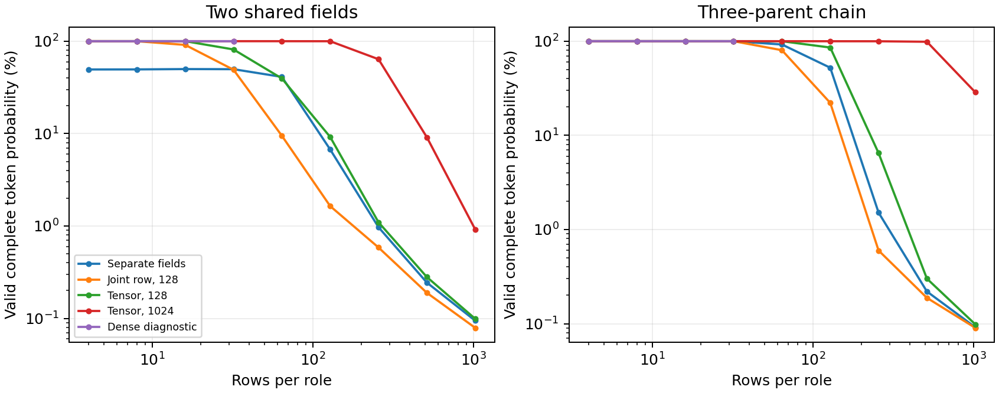

# 同一伙伴上的联合字段绑定

在训练规模之外，首父仍然受两个独立因素影响。把同一行的字段先组合再汇总，可以保留“这两个值是否曾在同一个伙伴出现”的信息。压缩后的不同伙伴仍会相互干扰。双共享变量任务在每个角色 256 行时取得 63.80% 的单次完整绑定概率，512 行时降至 9.13%，1,024 行时降至 0.92%。给定正确首父，最大规模下的次父概率仍为 99.93%。

## 原生对照与训练

所有环境由真实 .egg 编译为 Recipe 并由原生执行器跑出参考终图。每个环境在 probe Run 有一条规则和一个有效结果。双变量孪生环境中，把两个 Mid 行的一个字段互换，如将 (0,0),(1,1) 改为 (0,1),(1,0)。Left 行保持原样。离线逐列比对实际字段的多重集合，同时要求原生核验的唯一正确首父随互换改变。另有更严格的三变量奇偶对照，两个环境中任意两列的联合分布也相同。三父链要求 Mid 既能与 Left 绑定，又有能满足下一步的 Tail。

N 表示每个角色的行数。双父 N=512 对应 1,024 个候选 Cell，三父对应 1,536 个。扩容只增加同类型干扰行，检查了所有留出规模的正确具名绑定所读取的字段值保持不变。干扰数据使用保留的整数范围，保证没有意外增加的有效解。训练与留出采用不相交数值范围、不同的插入排列和变量名称，留出环境还反转了伙伴列次序。双变量、三变量和三父链的有序相邻接线签名均与训练集分离。单变量的三种留出接线中有一种也在训练出现。这些数字适用于此特定干扰分布及相邻角色的共享变量，范围不含任意规则图。

五组均从上一轮同种子的字段注意力模型开始。保持完整 Cell Token 交叉熵、现有条件父引用解码、固定退出策略和 CCP v0.1。任务中模板唯一，完整 Token 概率等于各具名父选择条件概率的乘积。三个种子为 9633、5003、1777。训练使用 192 个有原生见证的环境，课程为每角色 4、8、16、32 行。各阶段保留所有较小环境并遍历三次，每个模型累计 1,440 枚完整 Token 曝光。主留出集 312 个环境，额外 48 个非对称干扰环境、40 个三变量奇偶环境。宽度和三父反馈各有独立对照。

|组别|伙伴信息到达首父的方式|
|---|---|
|独立字段|沿用每列分别编码和汇总、再用字段角色注意力读取的基线。|
|同行联合编码|按 Recipe 对齐变量列，每行先用可训练参数混合身份特征，再映射到四个 128 通道的软码本。|
|张量积 128 / 1024|每行的各字段分别产生软特征，在行内作张量积，再跨伙伴行求和。四组特征；128 与 1024 均为每组的通道数。|
|稠密关系诊断|只在每角色最多 32 行时计算相邻角色的完整神经分数矩阵，沿链传递消息。该学习基线衡量直接关系打分能达到的水平。|

对双父，令 Φ(r) 为对齐字段软特征在伙伴 r 行内部的张量积。计算 Φ(l) 与 ΣᵣΦ(r) 的内积即可得到每个候选首父的支持度。乘积中的所有字段来自同一行，这使对角与非对角接线可区分。三父时从 Tail 向 Mid 回传支持度，并用所得权重汇总 Mid。最后对已经神经抽出的父引用做条件寻址。条件打分保留原先的字段注意力，所有正式组均避免构造 Left×Mid 或 Left×Mid×Tail 表。

CPU 根据公开类型、发布状态提供每个角色的所有可见行，读取编译出的变量槽接线。在线 GPU 对公开字段身份特征做编码、求和、打分和抽样。CPU 将抽中的具名引用提交给原生 CCP。精确字段值比对、金标、核验与稠密对照只在离线诊断使用。在线路径显式拒绝加载稠密组。正式路径仍读完整的各自角色域，页内每个已选首父仍需给下一角色的每一行打分；这种线性访问成本计入实测。

## 冻结状态下的完整自由生成

表内为随机具名地址重放中的单次采样命中概率，按种子及留出实例平均。主实验同时对每页 32 个自由抽样结果做原生提交，4,320 页共 138,240 枚请求。每页的新增有效操作与是否至少出现一次真实绑定逐项一致。

|双变量，每角色行数|独立字段|同行联合 128|张量积 128|张量积 1024|稠密诊断|
|---:|---:|---:|---:|---:|---:|
|4|49.41%|99.99%|≈100%|≈100%|99.93%|
|32|49.76%|49.08%|81.37%|≈100%|99.88%|
|64|41.08%|9.47%|39.52%|99.95%|—|
|256|0.97%|0.59%|1.10%|63.80%|—|
|512|0.24%|0.19%|0.28%|9.13%|—|
|1024|0.095%|0.079%|0.099%|0.920%|—|

每角色 32 行时，要求同一对孪生环境中两个完整绑定均排第一，独立字段组 0/18，同行联合组 6/18，张量积 128 组 12/18，张量积 1024 和稠密组均为 18/18。分母为 6 对环境 × 3 个训练种子。两个世界只交换伙伴内部接线，单看一侧命中可能掩盖模型在另一侧的错误。

|每角色行数，张量积 1024|单变量|双变量|三变量|三父链|
|---:|---:|---:|---:|---:|
|256|72.82%|63.80%|74.73%|99.78%|
|512|12.87%|9.13%|12.98%|98.59%|
|1024|1.25%|0.92%|0.72%|28.72%|

三变量奇偶对照在 N=32 的完整命中概率依次为 50.47%、56.34%、82.66%、99.99%、98.53%（上述五组顺序）。宽张量积到 N=256 仍有 73.08%，到 N=1024 为 1.33%。三父链的另一个干预只切断 Tail 对首父的反馈，条件寻址照常进行。N=32 的完整概率从 99.96% 降到 50.27%，N=256 从 99.78% 降到 37.89%，N=1024 从 28.72% 降到 1.05%。本任务的 Tail 提供了有效的鉴别信息。其他三父拓扑仍待验证。

## 分离信号丢失、干扰累加与归一化

以下使用相同双变量见证，独立改变 Left 或 Mid 域。核值是软特征的内积，“错误核总和”是在正确首父上对其他所有伙伴的核值求和。两列均不属于概率。

|首父数|伙伴数|正确核值|错误核总和|首父概率|给定首父后的次父概率|完整概率|平均首父排名|
|---:|---:|---:|---:|---:|---:|---:|---:|
|4|4|0.6993|0.0012|≈100%|≈100%|≈100%|1.00|
|4|1024|0.6993|1.1952|76.59%|99.93%|76.53%|1.22|
|1024|4|0.6993|0.0012|≈100%|≈100%|≈100%|1.00|
|1024|1024|0.6993|1.1952|0.92%|99.93%|0.92%|28.28|

单独扩大首父域并未造成显著失败。扩大伙伴域会产生压缩特征碰撞；两域同时扩大时，许多其他首父也获得高支持度，排序和归一化进一步压低正确首父概率。128 通道同样保留正确核值 0.7816，但错误核总和从 0.0040 增至 8.2281。已知首父时仍可准确寻址次父，说明主要损失发生在首父读取聚合结果时。逐程序、种子、首父先验和错误分区质量均保留在原始 CSV。

## 原生独立执行与地址顺序对照

正式主实验为 3,360 次 GPU + CCP v0.1 在线执行。每次按固定策略提交 32 枚完整 Token。每个环境只有一个可新增的参考操作。Coverage 为达到参考终图 SHA 的运行比例，EPT 为新增有效操作 / 付费请求，EPS 为各次有效操作 / 端到端秒数的均值。时间覆盖读取环境、在线状态更新、GPU 计算、抽样、打包、原生提交和取回终图。采用同种子同任务正反序配对，主实验不同环境复用抽样种子，补充实验按程序配对随机流。

|双变量 N|独立字段 Coverage / EPT / EPS|张量积 1024 Coverage / EPT / EPS|
|---:|---:|---:|
|64|100% / 0.03125 / 24.31|100% / 0.03125 / 23.94|
|256|58.33% / 0.01823 / 10.19|100% / 0.03125 / 17.45|
|512|33.33% / 0.01042 / 4.44|83.33% / 0.02604 / 11.33|
|1024|33.33% / 0.01042 / 3.16|58.33% / 0.01823 / 5.43|

在这四个规模、该次固定预算中，因子化均匀随机均未命中。N=256，双方都达到同一终图的 14/24 个配对中，宽张量积相对独立字段的墙钟比中位数 1.021，标准差 0.072；N=512 为 8/24、0.985、0.075。固定 32 个请求时，EPS 的提高主要来自同预算下有更多程序完成。独立的 1/4/16/32 请求扫描中，N=32 首次达到全部留出终图的测试预算为独立字段 16、宽张量积 1，对应 EPT 0.0625、1.0，EPS 24.82、24.89。原生启动和状态准备在该规模占据显著墙钟。

**规范地址顺序影响在线成绩。** 复核 N=1024 双变量时，在两个 filler 的在线子集中，正确首父有一半恰好是最近发布的端口；同样见证在打乱具名地址的重放中这一比例为零。在冻结宽模型上关闭继承的最近端口复制通路，在线上下文的正确首父概率从 18.74% 降为 0.96%，重放中从 0.96% 变为 0.97%。另做 432 次独立原生执行，三种规模、三个留出 filler、三个种子、正反序，逐程序配对抽样。N=1024 的宽模型 32 请求 Coverage 随复制通路关闭从 61.11% 降至 16.67%，独立字段从 44.44% 降至 5.56%。N=256 的宽模型关闭复制通路仍为 100%，N=512 仍为 83.33%。因此不能把规范顺序下的大规模 Coverage 全部归因给字段绑定。配对计时重复共享实例和种子，不能作为独立程序数量。

另有 360 次单线程 CPU 对照，包含精确符号执行。N=64 双变量双方均达终图，CPU 宽模型 EPS 20.10，精确执行 111.14。精确执行只用于对照。此处没有真实 EggCC 多规则选择、递归闭包或 Higher Cell 的成绩。

## 实际 GPU、内存和更新开销

Apple M3 Max，macOS 27.0.1，PyTorch 2.15.0。MPS 同步计时，每项预热后测 5 组、每组 4 次，报告中位数。每角色 1,024 行、双父、32 抽样槽位如下。行内先组合字段会产生实质开销。

|机制|全部伙伴消息 ms|条件寻址及解码 ms|整页前向 ms|单侧伙伴临时特征|伙伴摘要|
|---|---:|---:|---:|---:|---:|
|独立字段|0.937|8.219|9.088|8 MiB|8 KiB|
|张量积 128|0.702|8.275|8.801|2 MiB|2 KiB|
|张量积 1024|1.459|8.298|9.702|16 MiB|16 KiB|

宽组右侧摘要单次构建 0.555 ms，输入打包上传 3.536 ms。各组件独立计时，不应直接相加。正式推理每条相邻边构建两侧特征，伙伴摘要的通道数不随行数增长。之后每页每条边仍会计算 32 × N 个条件候选分数，N=1024 时为 32,768 次。该机制没有实现稀疏次父定位。

另以原生发布 1、8、32 个新 Mid 行干预，在 N=1024 上比较保存旧摘要后增量相加和重新汇总。宽组纯 GPU 增量分别 0.188、0.197、0.223 ms，含主机打包上传分别 0.445、0.445、0.491 ms；全量设备重建分别 0.558、0.544、0.537 ms。三次最大绝对误差不超过 7.16e-7。该测量限于追加、未加权的一侧摘要。正式独立执行的 EPS 使用实际全量重建；退役、修改和跨边重新加权的增量维护尚未经此实验验证。

## 复现与数据

原生回归与模型测试 15/15 通过。仓库 CPU compile、run、五次 bench 均正常；既有 sum-bits 导出的 choice_diagnosis 为 pass。该 CPU 检查独立于本轮神经结果。

在 instruction_pointer 目录使用同一台具备 Metal 的机器。ARTIFACT_ROOT 下需有上一轮 first-parent、variable-binding 及脚本列出的基线权重和归档。运行后会重建原生环境、训练权重、逐次抽样与计时 CSV 和下列汇总。

~~~sh
export ARTIFACT_ROOT='/Volumes/Extreme SSD/eggfuse-experiments'
export CELL_DATA=/tmp/dfm-local/data
export CELL_REPLAY=/tmp/cost-audit-build/release/examples/cell_token_replay
export CELL_COMPILER=/tmp/cost-audit-build/release/eggfuse-cell-compiler
export PYTHON=/tmp/egg-txn-ml/bin/python
export PLOT_PYTHON=python3
sh joint_partner_reproduce.sh
"$PYTHON" -m unittest test_joint_partner test_first_parent test_binding_fields test_completion_curriculum test_next_cell_pretraining
~~~

[课程 CE](fit.csv) · [冻结概率](snapshots.csv) · [逐种子](seeds.csv) · [孪生双侧命中](twins.csv) · [左右干扰干预](stress.csv) · [三变量奇偶与三父因果干预](challenge.csv) · [地址先验干预](context.csv) · [原生执行](online.csv) · [复制通路原生消融](copy-online.csv) · [预算扫描](budget.csv) · [同终图计时](same-graph.csv) · [CPU 与符号对照](cpu.csv) · [GPU 成本](components.csv) · [发布增量](updates.csv) · [15 个权重校验码](weights.csv)。逐次原始记录、原生程序、回放材料与权重保存在 ARTIFACT_ROOT/joint-partner。
