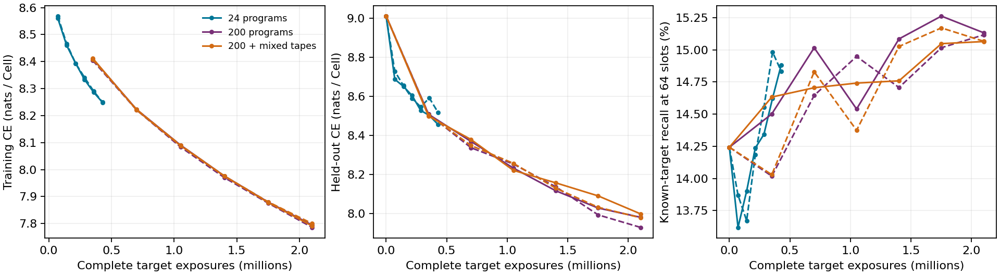

# 完整 Cell 的 Next Cell 预训练

在基线 `e730b717` 上，两个训练种子都降低了同系列结构留出集的完整 Cell 交叉熵。在这批留出程序的模型自主状态上，预训练后的策略超过因子化随机，但冻结初始策略发现的有效计算更多。在三个 EggCC 程序和一个留出 grammar 的连续执行中，主预训练组的 Coverage、EPT、EPS 均低于冻结策略和因子化随机。当前证据支持保留固定退出生产基线，高阶控制继续冻结。

## 语料如何形成

读取 818 个原生轨迹分片，按程序和去名称的生产消费拓扑隔离 200 个训练程序与 8 个同系列留出程序。基础图加上相同的动态调度构造提供发布、删除、merge、repair 和跨 Run 状态。另将三个受控程序的 Primitive 全轨迹和 Primitive/Higher 混合轨迹通过 CCP v0.1 实际签发并重放。两种表达均要求参考终图、有效操作数和内部付费数吻合。EggCC 与留出 grammar 的证据只在这次预训练完成后用于评估。隔离范围为本轮新增训练，继承的历史权重另有训练历史。

| 动态训练语料 | 实测 |
|---|---:|
| 纯自主轨迹中签发的完整 Token | 1,403,990 |
| 混合轨迹中神经策略签发的完整 Token | 481,522 |
| 混合轨迹中额外执行的辅助请求 | 102,165 |
| 原始决策窗口出现次数 | 18,504 |
| 按程序、物理发布及决策历史去重的状态 | 17,886 |
| 有可训练目标的独立状态 | 6,335 |
| 去重后得到训练的状态 × 经核验计算目标 | 350,296 |
| 同系列留出集的有监督状态 / 目标 | 135 / 7,433 |
| 额外混合语料 | 18 个纯 Primitive 目标，6 个混合轨迹目标，其中 3 个是完整 Higher |

同一状态 × 目标仅进入一轮训练一次。上述 350,296 个目标中，有 51,398 个具备自主签发证据，306,198 个具备直接遗漏证据，89,057 个有签发前 Teacher 分叉见证，2,200 个有最小替换见证，1,424 个有后继依赖见证。多个来源可能指向同一个目标。旧统计的 17,885 个状态按语义图统计，本次还区分物理发布历史。单输出 Recipe 可证明的相同效果可合并；缺少等价证明时沿用具名 Token 身份，因此 350,296 也不能解释为互不等价的语义效果数。[分来源计数与结构签名](inventory.json)

辅助 Shuffle 使用改变实际提交顺序后产生的原生 Response。仅作为训练起点的失败、重复、等待和未签发事件保留在来源账本中。训练程序从当前窗口的成功签发及原生分叉取得正向目标；有后继贡献的接受请求也可以入选。重建时逐位核对当时保存的 32 维 Query，核对生产源码及程序哈希，为细粒度证据核对分片哈希。330 个按来源分层抽取的目标在 24 个训练程序上再次从原前缀单独签发，330 个均被原生接受，均产生正的 origin 和正的边际操作数。其余目标沿用已核验的批次、原生绑定或后继依赖证据。[单独签发核验](first-request-audit.json)

## 目标及训练

目标是整枚 Cell 的交叉熵。模板和各具名父引用的条件概率相乘，整枚具名绑定经核验等价时先对其互斥生成概率求和再取对数。各不同目标获得相同的一次训练机会；Unknown 不产生失败损失。CE 的归一化仍会使缺少正样本的其他合法目标相对失去概率。直接遗漏证据占目标的 87.4%，Teacher 和离线审计并未穷尽所有上下文，这个监督分布会影响实际采样。

共用原有 Recipe、GNN、动态端口表示、条件父引用解码、冻结的 copy/projection 和 Metal 树寻址，只更新现有模板/父引用共用的 314,369 个分支打分参数。批量 Teacher Forcing 使用预编译路径和门概率，训练循环无需调用 Runtime。保留整个地址域的路径归一化。完整目标包括模板、所有具名引用及模板确定的内部接线。历史动态分片全在空 Draft、已收取前页回执的发布点生成；本轮对非空 Draft、未决局部引用及任意在途重排的能力没有测量。训练中没有多步编辑和 RL。

| 语料 | 每种子更新数 | 每种子目标曝光 | 末轮训练 CE | 末轮同系列留出 CE |
|---|---:|---:|---:|---:|
| 冻结初始 | 0 | 0 | — | 9.011 |
| 24 个程序 | 2,304 | 428,022 | 8.249–8.250 | 8.456–8.518 |
| 200 个程序 | 11,538 | 2,101,776 | 7.786–7.794 | 7.928–7.980 |
| 200 个程序加混合轨迹 | 11,574 | 2,101,920 | 7.791–7.800 | 7.977–7.997 |

每种子遍历六轮，每个程序内打乱目标，各轮打乱程序。曲线包含逐轮优化器曝光数、训练损失、留出损失及已知目标在 64 个独立槽内的预期召回。350,296 对 356,685 次近似配平曝光时，200 程序的留出 CE 为 8.508，24 程序为 8.502–8.591。六轮终值同时受语料规模与优化步数影响。[逐轮数据](learning.csv)

## 自由生成与语料迁移

在 8 个留出动态程序的 16 个真实自主状态上，每状态每种子直接生成 64 槽，并把自由生成的请求从该原生前缀独立签发。两个种子合计共 2,048 槽。冻结初始、200 程序混合轨迹、因子化随机分别命中 **368、327、294** 个不同已知有效计算（在各状态及抽样重复内去重后汇总）；原生有贡献请求分别为 369、327、295。混合组两个种子分别命中 160 和 167，随机为 142 和 152，初始为 196 和 172。[逐状态原生结果](family-free.csv)

另取四个开放工作负载的 16 个 Teacher 状态和 14 个自主状态。每个状态用两个训练种子、两次生成抽样；决定状态样本时不查看本轮权重。下表只汇总自主状态，每个预算在每状态分别使用。固定完整数 16 时三组均足额。原生根请求接受与实际新增分别核算。归档 Oracle 确认的贡献 owner 用于离线累计召回；未匹配参考的请求还可能产生合法的新事实。Higher 的跨 Run 后缀只计入下面的连续执行。

| 预算 / 指标 | 因子化随机 | 冻结初始 | 混合轨迹预训练 |
|---|---:|---:|---:|
| 256 槽，实际完整提案 / 14,336 槽 | 14,336 | 9,184 | 8,104 |
| 256 槽，原生接受 / 有贡献请求 | 238 / 236 | 148 / 146 | 73 / 72 |
| 256 槽，累计不同有效根计算 | 236 | 146 | 72 |
| 16 个完整 Token，累计不同有效根计算 | 52 | 50 | 30 |
| 16 个完整 Token，实际槽尝试 | 3,584 | 4,480 | 6,912 |

最高完整预算 64 允许最多 1,024 个槽。混合模型在自主状态有 5 次未凑足，在 Teacher 状态有 13 次未凑足；已记录截尾。物理槽足额和签发数量相等都不能消除正确绑定的概率差距。[两种预算及完整曲线](free-generation.csv)

在 109 个归档 Teacher 快照上，只对有有效 origin 的计算分解同一整枚概率，并边缘化原生核验过的等价地址。sum-divisors 的模板 NLL 从 5.01 升至 5.92，给定正确模板后的全部父绑定 NLL 从 11.25 升至 15.13；留出 grammar 的模板 NLL 从 0.90 降至 0.85，父绑定 NLL 却从 10.10 升至 12.27。两端样本的误差方向直接解释了为什么训练族 CE 不能用于判断 EggCC 的寻址能力。在相同完整 Token 预算下仍有明显差距，仅恢复出槽率也不足以解决问题。[联合概率分解](transfer-nll.csv)

## 原生独立执行

正式路径使用既有固定退出、每 Run 两页、每页最多 16 枚完整请求；允许神经采样重试并计入实际时间。参考和 Teacher 只在离线分叉及最终评分中使用。GPU 神经路径在当前规则词表和静态类型域上做原有地址树决策；公共预算上界沿用类型域大小。因子化随机从具有非空物理类型域的模板中均匀选择，再选择各槽的地址，这个对照可以少付空域探测成本。测量对象是 Rust CCP v0.1 的 Cell Runtime。EPT 继续使用有效原子操作 / 实际付费请求；EPS 包括原生初始化与神经推理等在线成本。下表每格依次为 Coverage（%）、EPT、冷启动 EPS。每种模型两个独立种子，主种子正反序复测。复测核对付费数、原子操作、事实身份和终图一致。

| 工作负载 | 因子化随机 | 冻结初始 | 混合轨迹预训练 |
|---|---|---|---|
| fact | 10.71 / .0238 / 118.4 | 9.87 / .0243 / 27.6 | 7.86 / .0203 / 17.3 |
| loopfact | 11.02 / .0220 / 103.3 | 10.84 / .0217 / 25.6 | 9.76 / .0200 / 16.6 |
| sum-divisors | 2.68 / .0462 / 215.7 | 2.42 / .0386 / 49.5 | 2.16 / .0366 / 34.1 |
| 留出 grammar | 12.02 / .4375 / 481.8 | 9.23 / .3359 / 226.4 | 5.79 / .2109 / 118.3 |

60 次运行均完整走完 Recipe 调度。主种子 fact 中，混合组比初始多得到 17 个独有事实，同时丢掉 38 个初始可达事实。不同终图的 EPS 在此只作各自端点的观测。历史高召回 Cell Stream 的四个 Coverage 依次为 99.02%、94.33%、39.12%、100%；它采用更大的完整生成预算，原始 EPT、EPS、付费数和终图单列。[全部实验组](formal.csv) · [逐次原生执行](native.csv) · [事实集合](facts.json) · [历史 Cell Stream](../fine-credit/historical-stream.csv)

## 冻结后新 Bake 的 Higher

冻结后为两个全新受控程序编译了 8 步线性与 10 步分叉 Higher，程序还有一个独立签发的末步。检查 normalized Bake key 与三个教学 Higher（3、5、7 步）无交集。网络看到当前窗口的可选 Primitive 和 Higher，自主选择并绑定具名入口。两个种子、两个程序合计，混合组在槽内选中 Higher 41 次、完整绑定 41 次、配额内返回 7 次、原生建立实例 4 次、内部完整执行 4 次。冻结初始也完成 4/4 个运行中的 Higher，纯动态 CE 仅完成 1/4。混合组和初始都支付 80 个请求，完成 40 个有效操作；纯动态 CE 支付 55 个，完成同样的 40 个操作。三个组全部覆盖参考事实。固定窗口内普通路径会重复提出内部计算，其中部分覆盖收益已在初始模型中存在。该试验只有一个独立入口，不能据此推断开放多父绑定的泛化，更不能归因于 CE 学出了此前不存在的 Higher 能力。单独启用槽追踪后按付费、终图、事实和回执验证计数未改变生成。[未见结构逐次执行](unseen.csv)

## 复现与证据

从本报告目录执行 `cd ../..` 进入 `instruction_pointer` 实验根目录。设置 `ARTIFACT_ROOT`、`CELL_DATA`、`CELL_REPLAY`、`CELL_COMPILER`、具备 PyTorch MPS 的 `PYTHON` 及有 matplotlib 的 `PLOT_PYTHON`。用新的 `PRETRAIN_OUT` 复跑。默认语料分片、源证据及权重目录在移动盘的 `eggfuse-experiments/next-cell-pretraining`；训练加载预编译路径时不再依赖 Runtime。原始细粒度反馈通过 SHA-256 及分片/事件定位保留。样本是可信本地 pickle。208 个训练与留出程序的数据包合计 153,522,664 字节。数据包和权重保存在实验盘，仓库包含逐种子结果、摘要、学习曲线及验证命令。[复现脚本](../../next_cell_reproduce.sh) · [权重校验和](weights.csv) · [语料构建](../../next_cell_corpus.py) · [训练入口](../../next_cell_train.py)

CPU 回归运行 README 的 `cargo cell-compile`、`cargo cell-run`、五次 `cargo cell-bench`。已有 sum-bits 导出通过 `choice_diagnosis.py` 的语义契约验收。此项回归独立于神经指标。
