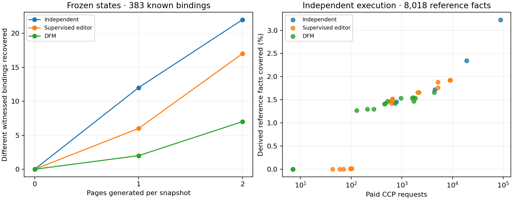

# Parallel generation of complete Cell Tokens

Starting from fca9a107, we trained two set generators and ran them through the standalone Rust Cell executor on native EggCC Recipe programs over CCP v0.1. Generating more complete marks in parallel recovered more reference facts than four draws could reach, but the trained DFM did not match the coverage of independent draws or the historical Cell Stream on any of the four workloads at the primary budget. No model capacity, Bake layout, native verifier, reward or CCP change was used.

## Independent execution

Each cell below gives the best observed coverage count across the **two-page-per-Run** grid for that method. This is a retrospective envelope, not a configuration selected on validation data. Seed 536 is shared across the new arms. The 144 configurations were each run twice. Each pair produced identical paid counts and final-state digests. Another six configurations tested an eight-page budget twice. All 300 executions reached the end of their native schedule. This stop condition does not certify saturation. A reuses the two historical CPU runs, with the same workload and fact contract. B uses the frozen independent mark decoder on the common expanded typed vocabulary; C and D learn set edits. Their physical pages and Recipe encoders are identical.

| Reference derived facts | A · historical stream | B · independent | C · supervised set | D · DFM set |
|---|---:|---:|---:|---:|
| fact / 1,120 | 1,109 | 139 | 74 | 69 |
| loopfact / 1,112 | 1,049 | 178 | 86 | 73 |
| sum-divisors / 8,018 | 3,137 | 259 | 154 | 133 |
| Held grammar / 233 | 233 | 35 | 24 | 25 |

[All executions and both timings](native.csv) · [Historical independent A](historical-stream.csv) · [Cumulative native request credit](curves.csv)

For sum-divisors the best coverage point of each new arm happens at 256 slots and one update. EPT is native signed effective operations divided by **all** billed requests including scalar evaluations and Higher suffixes. EPS uses the same numerator and includes model setup, GNN, transfers, editing, addressing, Python processing, state maintenance, CCP and native execution. Offline reference export and ledger checks are excluded. Wall entries give both measurements.

| sum-divisors | Coverage | Effective ops | Paid | EPT | EPS, median | Wall seconds |
|---|---:|---:|---:|---:|---:|---:|
| A | 39.12% | 4,331 | 3,396,005 | 0.00128 | 15.9 | 275.03 / 270.03 |
| B | 3.23% | 415 | 89,156 | 0.00465 | 9.4 | 44.13 / 44.00 |
| C | 1.92% | 266 | 9,083 | 0.02929 | 50.3 | 5.30 / 5.28 |
| D | 1.66% | 239 | 4,362 | 0.05479 | 62.3 | 3.80 / 3.87 |

C at 16 slots and two updates and D at 256 slots and one update each covered 133 reference facts. Only 111 were shared. Equal counts would give a misleading performance comparison here. EPS measures production speed at each point; the four rows do not establish a speedup at A's final graph. Two alternating measurements characterize timing variation for one trained seed, not variation across training seeds. Small configurations and grammar were run first; missing large configurations were filled in forward and reverse order. A's archived CPU timing is not a matched Metal timing.

## How much was a budget problem?

The pre-training audit grouped distinct witnessed complete primitive bindings by native Run, template and first named parent (including version). These are upper bounds with respect to the logged teacher bindings only. They do not bound alternative proofs or autonomous rollout. Previous stage substitutions in draft_stages.py tested the four-draw restrictions separately; the combined columns below are explicit counterfactual budget policies.

| Workload | Witnessed | Four rules only | Four first parents per rule only | Four tails per first parent only | All three caps | Four rules × four complete marks |
|---|---:|---:|---:|---:|---:|---:|
| fact | 1,668 | 1,229 | 1,203 | 1,649 | 838 | 785 |
| loopfact | 1,419 | 1,044 | 1,179 | 1,401 | 807 | 769 |
| sum-divisors | 17,341 | 12,640 | 7,177 | 16,795 | 4,310 | 3,599 |
| Held grammar | 136 | 136 | 56 | 131 | 52 | 32 |

In 109 sampled states, four frozen independent full-mark draws recovered 11 different witnessed bindings in total against a flat budget oracle of 381. At 256 draws the comparison was 159 versus 5,397. Of 27,904 draws at 256, 20,843 selected a template outside the witnessed primitive targets, 12,209 failed to complete a mark, and 2,838 repeated a complete mark in the same sample. These diagnostics overlap. A draw outside the witnessed set is not necessarily invalid. [Per-Run budgets](budgets.csv) · [Frozen independent draws](draws.csv)

## Set training and decoding

The shared GNN, actor and static Recipe catalog were frozen. Both models started at the same 1M decoder checkpoint. Training used 108 teacher or prior model states from sum, dot and the training fork grammar. Native replay checked every training tape's accepted requests and named identities. We formed 1,296 training pages with 18,341 witnessed target occurrences, 110,160 physical sites and 231,096 supervised sparse-address choices. C and D each took 640 AdamW updates on the same states, slot corruptions and minibatch seed. No additional target-program fine-tuning was performed. Only 10,461 of 110,160 training sites called for writing a complete mark. This imbalance and the small number of distinct training states limit the inference one can draw about the architecture. The contributing tapes directly supervise primitive proofs with visible parents. They provide little direct instruction about when to choose a scalar, a Higher, or a local dependency. This is not a zero-shot Higher benchmark. [Training data and losses](fit.json) · [Checkpoint hashes](checkpoints.json)

For each page we sample multiple different complete witnessed bindings from the same Run. The source is empty or perturbed with missing, repeated or changed-version marks. Its occupied slots are randomly placed. The coupling preserves identical complete marks, randomly breaks matching ties, then pairs remaining targets and vacancies. No loss is attached to an arbitrary teacher order. Credited alternative proofs may coexist; absent teacher labels do not certify that the remaining computational space has been explored. The training prefix uses verified accepted tape entries and their embeddings as an approximation of recent issue history.

Each aligned site has a uniform reveal time on [0,1]. At time t the source mark has been replaced by its target with probability t. C learns the endpoint edit by cross-entropy. D fits off-diagonal edit attempt rates p(edit | draft, S, t)/(1-t), with integrated-rate term and observed-jump log term. Complete written marks use the existing factorized template and address tree; the auxiliary sampled address-bit loss in D is weighted by 1/(1-t). The two minibatch losses are normalized separately. D samples a finite leap with reveal probability dt/(1-t), then samples the action and its structured mark. Equality-preserving substitutions, incompatible address draws and dependency-blocked edits can be null proposals. This is a discrete, fixed-physical-page random-reveal model with marked edits. It is not an implementation of an exact unconstrained continuous-time graph sampler.

Each site sees the occupied draft population, the slot embedding, the shared mean of draft embeddings, and its difference from that mean. Stable local UIDs survive packing; a dependent consumer prevents an invalid producer deletion. After each leap the next update reads the changed page. From an empty page at **one** step, sites still draw independently conditional on the same state. Sibling feedback requires at least a second update. Mean pooling can lose which distinct bindings were already proposed. Across pages, a decaying embedding tracks generated drafts and the actual CCP response updates the memory outcome separately. The native loop collects each ticket before generating the next page, so there are no concurrent outstanding tickets at that point. Only actual publication exposes a port. A selected but unpublished local dependency can resume later. The executor never credits such a wait as an effective operation.

Zero-parent, primitive proof, compiled Higher entry, and directly expressible scalar evaluation marks share one template-address tree. Scalar operands are named Recipe fields or literals; repeated fields from one role use one binding. Scalars requiring an unpublished local scalar operand are outside this measured vocabulary. Published proof ports and stable draft-local proof references support dependencies. The policy observes scalar completion status; it does not learn to consume arbitrary computed scalar contents in this experiment.

The physical representation can resume an unissued partial page. Independent execution starts each new page empty, then issues its surviving marks and carries the signed outcome forward. An empty page does not end the Run's page budget. In the 16-slot, two-update experiment, increasing the budget from two to eight pages raised D's sum-divisors coverage from 114 to 143 facts, and its cost from 734 to 3,032 paid requests. C rose from 133 to 153 facts and from 2,058 to 8,050 paid requests. These measured budgets are not a proof of exhaustive generation.

## Did the network learn to recover sets?

For the same 15 frozen teacher snapshots, we compared complete versioned bindings. We selected up to one state per target-size stratum per workload before scoring. A runs its historical neural prefix stream to completion on each selected state. B/C/D figures below are the highest observed cumulative intersection after two pages in their respective grids. These denominators are small and describe witnessed bindings, not total semantic validity.

| Known bindings | A | B | C | D |
|---|---:|---:|---:|---:|
| fact / 138 | 136 | 36 | 12 | 4 |
| loopfact / 98 | 94 | 35 | 32 | 11 |
| sum-divisors / 383 | 345 | 22 | 28 | 7 |
| Held grammar / 64 | 64 | 20 | 10 | 6 |

We separately supplied two copies of one known binding on each of those 15 snapshots. At eight updates, D retained exactly one copy in 7 states, removed both in 3 and retained at least two in 5. C retained exactly one in 3, removed both in 11 and retained at least two in 1. These are draft edits under an offline prompt, not verified reductions in billed duplicates. [Per-page cumulative frozen scores](frozen.csv) · [Stream on the same states](reference-frozen.csv) · [Twin perturbations](twins.csv)

## Where the work went

At sum-divisors, 256 slots and one update, the number of different directly generated proofs accepted per batched decoder pass was 0.158 for B, 0.049 for C and 0.034 for D. Counting only directly issued requests with positive native effective-operation credit gives 0.139, 0.042 and 0.028. The numerator counts an accepted Higher entry as its verified root proof. Higher completion has a separate counter. The numerator excludes host-resumed Higher suffixes, pure computations and repeats of an identical binding in the same Run. Signed effective operations and total paid requests in EPT include the whole executor. The CSV separates the batched decoder pass, site action forward and individual address-tree neural decision, which have different costs.

D's 4,362 paid requests at this point comprised 29 accepted proofs, 50 computed scalars, 21 duplicate rejections, 218 binding failures, 106 guard failures, 21 watermark failures and **3,917 untriggered rules**. Rule 574 with no parent was accepted once and rejected as untriggered 49 times among its direct requests. Repeated signed marks in the same Run numbered 910; native duplicate verdicts numbered 21. The latter only count requests reaching the verifier's duplicate verdict. C issued more complete proofs and also spent more on untriggered rules. There was no CPU deduplication. Failures to choose productive complete marks still dominate the independent result.

B/C/D reached maximum simultaneous edit job counts of 256/247/203 at this operating point. These are jobs, not hardware occupancy estimates. A mark runs in a 32-thread Metal threadgroup and its sparse address choices stay on device. Template and external parent addressing follow sampled tree branches. Typed membership, native opcode scheduling and fixed projection from an explicitly chosen owner are the host's responsibilities. No semantic field equality, multi-role freshness test, reference path or CPU proof search selects a partner. The previous high-recall A instead visits typed products with a neural prefix score and a single specified delta anchor; its partner roles remain visible. Its search cost and score are reported separately.

Parallelism has a real cost. The cheap job-compaction and dependency-application kernels are serial on the GPU. The mark kernels allocate two lanes of jobs per physical slot, and unused jobs return immediately. Multi-update local-reference generation still scans preceding draft slots and static output positions on device. It reached **479,216,304 local port checks** in one sum-divisors C configuration at 256 slots and two updates. This is distinct from traversing global parent combinations. D at 256 slots and one update paid 117,034 template reads and 166,316 total tree pivot visits. It had 744 page-boundary device readbacks and 869 native synchronizations. No address-tree level caused a CPU readback. All of this work contributes to wall time.

## Artifacts and validation

Raw native tapes, each final graph, actual response IDs, per-Run costs, checkpoints and offline probes are in the experiment directory `/Volumes/Extreme SSD/eggfuse-experiments/parallel-cell-1126`. Native tape hashes were replayed for effective-operation attribution. Curve points report final credit attributed to the issuing Run, which may differ from credit settled in that prefix in isolation. The aggregate data, graph hashes and both timing blocks are tracked here. Sources for rebuilding them are in the parent directory. [Reproduction command](reproduce.sh) · [Reviewed sum-bits acceptance](semantic.json)

The local Cargo compile, execution and single-repeat bench used the existing response-donor-0 fixture. The saved sum-bits semantic contract passed; it is an additional regression check. None of the new EggCC runs reached their exact reference endpoint. The results establish actual parallel native generation with sparse external addressing, but provide no evidence for replacing the high-recall generator.
