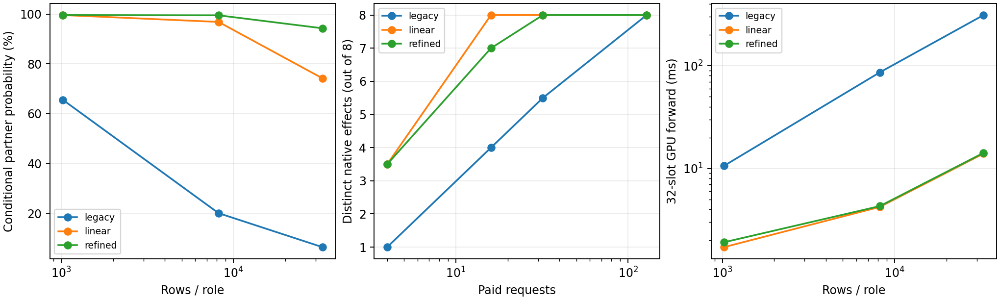

# 首父聚合与次父寻址共享同一个神经索引

冻结 63980584 的 mixed-sparse 权重。在上轮 12 个新 filler、每个 2 个互换世界、每侧 8,192 行的困难组中，每个错误伙伴都满足一个共享字段。关闭最近端口复制，正确首父平均概率仍为 98.98%。给定正确首父，旧条件解码器的正确次父概率为 20.07%；直接索引采样为 96.85%，用已有的非线性读出在 8 个抽样伙伴上重打分为 99.60%。这些概率由相同真实状态、三个已有种子给出。原生独立执行按 filler 配平权重种子，使用相同的物理地址置换和首父抽样流。

## 数学审计

实际的四个投影头分别将一行映射到两个相邻软坐标，权重是非负插值系数。设 t 为头，c 为该头的桶。对一对行，头内的稀疏内积为 kₜ(a,b)=Σ꜀qₜ꜀(a)vₜ꜀(b)。已有首父聚合得到 eₜ(a)=Σᵦwᵦkₜ(a,b)，其中 wᵦ 是孩子后继发回的非负支持度，叶节点为 1。四个头的平均 K(a,b)=Σₜkₜ(a,b)/4 是非负可分解核。

但**原有首父分数还包含非线性**。除首父先验外，它将四项 log(eₜ+10⁻⁵)−log(1+eₜ) 的和乘以已训练的正强度。把分数改成 log(ΣᵦwᵦK(a,b)+10⁻¹⁰) 并保留同一先验，每侧 8,192 行的正确首父概率从 98.98% 降至约 0.28%。原有首父分布不等于上述加性核的边缘分布。所有正式组保留原首父读出。

**直接采样。** 令通道 h=(t,c)，Mₕ=Σᵦwᵦvₕ(b)。先从 qₕ(a)Mₕ 的归一化分布选 h，再从 wᵦvₕ(b)/Mₕ 选 b。对 h 求和，得到 K(a,b)wᵦ/ΣⱼK(a,j)wⱼ。索引同时保存排序后的通道、累积权重和伙伴的物理行偏移；偏移只在这次发布的类型域内有效，最终通过该快照的表解析成真实 (owner, op, version)。根读取与伙伴抽样使用同一张设备索引。第二级采用区间内逆 CDF 抽样，支持相同坐标下任意数量的伙伴和非均匀权重。

正式采样器混入 1/256 的全类型域均匀探索；总支持度为零时全域均匀抽样。这样即使软坐标完全不相交，一个物理伙伴也保留正概率。报告的概率已包含探索。具名索引的逆 CDF 在三个规模上与直接稠密加性条件的总变差距离最大约 3.8×10⁻⁸（已核验首父、叶伙伴）。另有两个并行 batch 的非均匀权重测试、零质量、CDF 平台及真实地址反置测试。

|机制|次父决策|
|---|---|
|legacy|原独立字段条件解码器给每个同类型伙伴打分，权重冻结。|
|dense-nonlinear|将原首父的非线性函数逐一应用在同一行对的四个头上，再全域 softmax。只做离线诊断。另对已神经抽取的根进行了 32 槽稠密抽样与原生重放。|
|linear|按上述分解直接抽取一个伙伴，每槽读取一个具名偏移。|
|refined|以 K 为提议，从 8 个独立提议中按 K³ 接受第一个命中者，否则使用第 9 个独立线性提议。若 A=E[K³]，则探索前的精确分布为权重 1−(1−A)⁸ 的归一化 K⁴w 与权重 (1−A)⁸ 的线性分布的混合。|
|shared-score|抽 8 个有放回提议，对这些实际伙伴使用**同一冻结的四头非线性函数**，以 exp(分数)/K 为重要性权重重采样。后继权重在目标和提议中相消。这是稀疏有限样本近似；稠密非线性分布在 K=0 的位置还可有极小质量。|

两种复核的提议数都是本页的工作预算，不会永久删除未访问伙伴。CPU 仅提供所有已发布的类型相容行、版本和 Recipe 字段接线。排序、区间定位、采样及复核均在 GPU 上进行。实现比较的是可碰撞的神经特征坐标。原生执行器仅在实际签发后核验具体父引用。没有 CPU 字段等值筛选、隐式 Join、合法掩码或宿主去重。订阅同一 Recipe 的不同请求、同一行的多个具名结果仍分别计费和核验。

## 严格留出和规模

52 个原生环境。单一有效伙伴任务在 1,024、8,192 和 32,768 行分别使用 4、12、4 组未见 filler，每组两个互换世界。三个规模都关闭复制通路并固定已验证字段值，仅增加干扰行。多结果任务每个规模使用 2 组 filler、每组两种互换。唯一有效根有八个满足相同共享字段的伙伴，各自的第三字段产生**不同的原生结果**。参考执行、前缀重放和精确标签均与在线策略隔离。全程未更新权重；完整 Token CE、既有 Context Curriculum、CCP v0.1 及固定退出机制沿用上轮。新增收益来自寻址算法。

|单次给定正确首父的次父概率|1,024 行|8,192 行|32,768 行|
|---|---:|---:|---:|
|旧全域打分|65.54%|20.07%|6.45%|
|直接索引|99.61%|96.85%|74.25%|
|K⁴ 有界复核|99.61%|99.51%|94.32%|
|同一非线性读出稀疏复核|99.61%|99.60%|99.53%|
|同一非线性读出全域诊断|≈100%|≈100%|≈100%|
|正确首父概率（各正式组相同）|≈100%|98.98%|13.23%|

旧全域和直接索引报告可计算的条件概率。稀疏非线性复核每个状态及种子实际抽取 4,096 次；K⁴ 的闭式概率另用 1,024 次抽样交叉检查。完整 Token 概率逐世界计算条件概率的乘积再平均。8,192 行旧全域、直接、K⁴、稀疏非线性分别为 19.90%、95.85%、98.50%、98.58%；32,768 行分别为约 0.80%、8.92%、12.36%、13.16%。

与正确首父有正内积的错误伙伴数平均为 0、0.375、2.375。对 32,768 行另取四个世界，最高分的错误首父平均获得四个非空头的支持，但没有任何单个伙伴在这四个头都给它提供正支持。其最佳单个伙伴的平均核值为 0.200，正确首父最佳伙伴为 0.679。在这组规模下，次父条件寻址已很强，首父处的跨伙伴聚合重新成了主要瓶颈。

## 原生独立执行

Coverage 是相对原生参考结果的覆盖率，EPT 是新增有效操作/实际付费请求，EPS 是累计新增有效操作/累计端到端秒数。计入进程与环境初始化、全部公开状态读取、打包上传、索引构建、抽样、传输、核验与发布。每组比较最终图 SHA；部分覆盖另报告原生有效操作。不把 Monte Carlo 提议、离线稠密重放或碰撞次数计作有效操作。正式组记录所有带版本的采样提交，不消除重复请求。

8,192 行困难组，每个世界只签发一枚请求，旧模型再次得到 **5/24**（Coverage 20.83%、EPT 0.2083、EPS 0.392）。直接索引和两种稀疏复核均为 **24/24**（Coverage 100%、EPT 1；EPS 分别为 1.928、1.921、1.879）。24/24 指这组已执行的单次试验，不能当作模型总体命中率为 100%。32,768 行只有八个单请求世界，旧模型、直接索引、K⁴ 及稀疏非线性分别完成 0、1、2、2 个终图。

相同终图的对照也有收益。8,192 行、同样的 32 个付费请求，原模型、直接索引、K⁴ 在八次运行均达到完整图；EPT 同为 0.03125，EPS 分别为 1.659、1.921、1.921。这些是四个世界的正反序配对。非线性稀疏复核另与直接索引做配对，wall 和重复数见原始文件。单规则测量计入启动和公开 Memory 准备，因此设备前向时间改善的倍数大于端到端 EPS 改善的倍数。

**多伙伴累计覆盖。** 下表给出实际启动相同原生环境、增加预算后完成的不同原子操作数，满分 8。每个规模的各预算使用相同 filler 集，单取正反序的一次，避免将重复计时算成新样本。

|规模及机制|4 枚|16 枚|32 枚|128 枚|
|---|---:|---:|---:|---:|
|8,192，旧全域|2.75|5.75|7.00|8.00|
|8,192，直接索引|3.75|7.75|8.00|8.00|
|8,192，K⁴ 复核|3.50|7.25|8.00|8.00|
|32,768，旧全域|1.00|4.00|5.50|8.00|
|32,768，直接索引|3.50|8.00|8.00|8.00|
|32,768，K⁴ 复核|3.50|7.00|8.00|8.00|

另在同一条 128 枚生成轨迹的七个前缀上逐一做原生重放，每个前缀的有效操作数都等于已访问的不同合法伙伴数。8,192 行的两种索引采样在六条轨迹上都于 64 枚请求内找全了八个伙伴。较强复核主要帮助排除碰撞，不能保证总是更快找全多个合法伙伴。

## 实际访问、整页耗时及维护

Apple M3 Max，PyTorch 2.15.0，MPS。在同一快照上预热，各组件分别用 5 组 × 4 次同步计时取中位数。GPU 页前向包括本次首父计算、索引构建和 32 枚完整绑定抽样。单列的 pack 是从公开快照打包上传；完整原生 EPS 另包含此项和 Runtime 开销。

|每角色行数|CPU 打包上传|旧条件扫描，整页|直接索引，整页|K⁴ 复核，整页|同一非线性稀疏复核，整页|
|---:|---:|---:|---:|---:|---:|
|1,024|3.49 ms|10.63 ms|1.72 ms|1.91 ms|1.91 ms|
|8,192|16.35 ms|86.25 ms|4.22 ms|4.30 ms|4.20 ms|
|32,768|57.41 ms|311.59 ms|13.96 ms|14.19 ms|14.56 ms|

8,192 行的非线性稀疏复核把整页设备时间降低约 **20.5 倍**。同规模主实验中，直接索引与旧扫描同终图、同 32 个请求的墙钟比中位数为 **0.864**，八对的标准差 0.043。32,768 行时直接索引约为旧扫描的 **22.3 倍设备吞吐**，但首次构建公开 Memory、打包和 CPU 原生执行并未随之消失。

|32 槽的次父访问|旧全域，N=8,192|直接索引|K⁴ 复核|同一非线性稀疏复核|
|---|---:|---:|---:|---:|
|条件父对打分|262,144|0|256|256|
|从索引中读取伙伴偏移|0|32|288|256|
|最终解析具名伙伴引用|32|32|32|32|
|单次实测页接触的不同伙伴（含最终选中）|8,192|2|2|2|
|整页额外设备张量峰值|1,161.67 MiB|38.44 MiB|38.44 MiB|38.44 MiB|

重复抽到一个伙伴仍消耗提议、偏移读取及相应的复核。不同伙伴数取实测页，不能代替总工作量。32,768 行的同一实测页上四组分别访问 32,768、25、78、76 个不同伙伴。旧扫描产生 1,048,576 个父对分数，后三组的条件对打分数保持为 0、256、256。索引完整构建仍对伙伴的 4 头 × 2 个坐标排序；所有首父必须读取其通道支持。次父阶段每槽需要最多 16 个插入点定位，逆 CDF 的批处理实现还为每个提议在四个头定位，再读取选中的那个头的偏移。上述过程计入 GPU 时间，不能把只读 32 个伙伴偏移理解为整页只有 32 次内存访问。显存统计是每个 PyTorch dispatch 返回时观测到的设备张量峰值相对既有输入和权重的增量，不包括后端私有工作空间。

具名索引在 1,024、8,192、32,768 个伙伴上分别占 98,320、786,448、3,145,744 字节，其中偏移为 int32。正式执行在公开行集合、可用性和版本变化后重新构建，索引不会跨快照复用旧行号。三父链和分叉各有 6 个置换/权重试次，旧扫描、直接索引和 K⁴ 复核均在 32 个请求内达到对应完整原生终图。该回归覆盖有后继权重的路径。

**维护反例。** 从真实 Run 发布 1 或 32 行，再按实际具名行和版本校验索引。原特征投影在不同批大小上并行归约，最大坐标漂移 0.015625 个桶。在三个规模各追加 32 行时，均有一个头坐标跨过桶边界。因此不能直接宣称“原投影单行增量”和“原投影全量重算”逐位等价。独立对照对同一冻结系数使用固定的二叉加法顺序，六个发布对照中的行偏移和编码坐标均完全一致。32,768 行追加 32 行时，固定顺序的增量段构建 0.34 ms、含打包上传 0.61 ms、完整索引重建 3.01 ms；新段占 3,088 字节。这里只测追加段写入，没有把多段后续读取、退役维护或压实的潜在收益计入正式 EPS。

## 复现

在研究工作树 instruction_pointer 目录中使用上轮的 compiler、带 cell-token-ept 的原生 replay 示例、共享 Recipe/Memory 归档和三个冻结权重。所有正式实验使用 Rust 原生 CCP v0.1；稠密对照是离线原生重放。该 benchmark 仅涉及受控的一条待发现计算规则，未测 EggCC 多规则独立执行。

~~~sh
export ARTIFACT_ROOT='/Volumes/Extreme SSD/eggfuse-experiments'
export CELL_DATA=/tmp/dfm-local/data
export CELL_REPLAY=/tmp/cost-audit-build/release/examples/cell_token_replay
export CELL_COMPILER=/tmp/cost-audit-build/release/eggfuse-cell-compiler
export PYTHON=/tmp/egg-txn-ml/bin/python PLOT_PYTHON=python3
sh partner_index_reproduce.sh
"$PYTHON" -m unittest test_partner_index test_selective_partner test_joint_partner test_first_parent test_binding_fields test_completion_curriculum test_next_cell_pretraining
~~~

[冻结条件概率](frozen.csv) · [非线性稀疏复核抽样](shared-snapshot.csv) · [稠密重放与错误首父](dense.csv) · [原生终图与计费](online.csv) · [同一读出原生对照](shared-online.csv) · [预算曲线](multi-curve.csv) · [同一轨迹的原生前缀](prefixes.csv) · [树形回归](trees.csv) · [同终图配对](paired.csv) · [实际寻址与内存](cost.csv) · [发布维护](updates.csv)。逐次执行、原生程序、参考及实际终图 SHA 存于 ARTIFACT_ROOT/partner-index；沿用权重在 sibling selective-partner/weights 中。原始主试验统一以显式 n 表示规模，旧 harness 派生的辅助 size 曾将五位数截断，已修正目录名解析。23 项回归通过。最小 CPU compile、run、bench 正常，已有 sum-bits 导出的语义验收通过。
