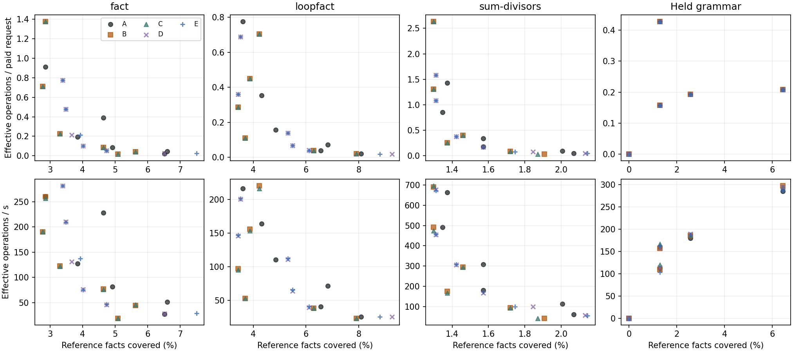

# Higher Cell 在开放计算区域中的接管

冻结 `c0c7230f` 的 GNN、四步 Edit Flow、父端口寻址权重及 CCP v0.1。实验使用实际 Rust Cell Runtime 的独立执行入口。训练轨迹提供了可迁移的多步接线。sum-divisors 中有一条**两个外部输入、八个原子步骤**的区域，留出轨迹见证了十次，强制实例化其中一次通过原生重放。开放执行中的主要损失发生得更早。32 页预算下，八步模板的根规则 56 出现在 12 个调度 Run 中，神经模板寻址一次也没有选中它。fact 上冻结模型自主绑定并完整执行了一个六步实例。随后从模型自己的签发记录逐个复原这 12 个决策前快照，离线原生精确检查给出 **0 个该根的合法绑定**。在这条独立轨迹上，即使把模板选择改对，也无法启动这个八步区域。

## 开放负载的五组独立执行

A 只生成 Primitive。B 使用上一轮的 wide 拓扑目录和原接续器。C 在相同目录上启用实例接管。D 使用冻结的训练轨迹目录和原接续器。E 对同一轨迹目录启用接管。各组共用稀疏模板和端口寻址、同一个空草稿四步编辑器、相同的物理地址域、页预算、原生调度及计费。可选模板的改变本身会改变寻址树。额外的 common-topo / common-trace 对照将根集合及动作顺序配平。所有开放组始终允许 Primitive 生成。

下表使用相同的 32 页预算及种子 536。每格依次为**参考派生事实数、EPT、EPS**。EPS 使用四次正反序独立执行的中位数。每个工作负载都运行至原生调度结束。事实数与原生有效操作数有不同的分子。

| 工作负载（参考事实） | A | B | C | D | E |
|---|---:|---:|---:|---:|---:|
| fact（1,120） | 73 / 0.0210 / 27.4 | 57 / 0.0180 / 19.1 | 57 / 0.0180 / 19.1 | 73 / 0.0232 / 28.0 | 84 / 0.0236 / 29.3 |
| loopfact（1,112） | 90 / 0.0208 / 25.4 | 88 / 0.0200 / 23.2 | 88 / 0.0200 / 23.3 | 103 / 0.0191 / 25.9 | 98 / 0.0192 / 25.3 |
| sum-divisors（8,018） | 166 / 0.0468 / 59.2 | 153 / 0.0322 / 41.3 | 150 / 0.0325 / 41.2 | 171 / 0.0435 / 55.5 | 172 / 0.0433 / 55.1 |
| grammar-benefit-left-17119（233） | 15 / 0.2083 / 292.4 | 15 / 0.2083 / 288.2 | 15 / 0.2083 / 294.3 | 15 / 0.2083 / 293.3 | 15 / 0.2083 / 290.4 |

fact 的 E 在这个预算点同时改善了三个指标。对照 A 自身在 16 页时已用较少请求覆盖 74 个事实。loopfact 在 32 页时 D 的事实数最高；引入接管后从 103 降到 98。sum-divisors 从 A 的 166 增至 E 的 172，所需付费请求从 5,958 增至 6,489。相同覆盖**数**也可能对应不同结果：A 的 4 页、8 页和 E 的 8 页均覆盖 126 个 sum-divisors 事实，E 的事实集合与这两个 A 均有差异。主扫描未找到 A 和 E 在三个 EggCC 程序上终图哈希相同的一对。数据支持局部前沿扩展，尚不足以宣称普遍的同终图加速。

归档含 572 次独立执行的结果及四页诊断组的 4,275 条逐 Run 记录，另有一次脚本化原生重叠挑战。主前沿覆盖每 Run 1、2、4、8、16、32 页；每点包含一正一反两次独立执行。四页另有种子 137 和 211，种子影响明显。以 loopfact 为例，这两个种子下 A/E 分别覆盖 49/56 和 53/47 个事实。32 页另有两组四次配对确认，其中 `clean32` 用于上表。范围和单次原始时间均已保留；两个时间重复不能估计跨程序显著性。历史更高召回的 Cell Stream 使用了不同的生成器和计算预算，本轮 A 对应 `c0c7230f` 的同权重 Primitive 对照。三组 EggCC 的绝对覆盖仍低。留出 grammar 没有链接到任一目录，在相同种子、页预算下五组终图与付费数一致。



[全预算和非支配点、失败、寻址及摊销数据](frontier.csv) · [同终图对照](same-graph.csv) · [每次原生执行](runs.jsonl) · [逐 Run 发布时间与累计签发](publications.jsonl)

## 有见证的区域从哪里来

只有 sum-bits、dot-product 和训练 grammar 可以进入区域挖掘。编译器沿每个真实请求的具名消费边扩展，外部引用必须属于根的确定有序输入。内部边必须来自先前实际签发的 owner 和原生契约声明的 op，消费版本、发布可读性及下一次合法调度通过已有 Tape 检查。候选保留可能分叉和汇合的已执行路径；可用相同具名导入递归拆分、链接回同一布局。七个程序逐步比较了递归重链接和原接线。前向扫描每个根只选择一条贪心拓展顺序，并保留可复用的前缀。相同布局至少需要两个训练实例。现有解码器每个根只有一个 Higher 动作，因此每根优先保留较长的、有重复见证的布局，再按训练频率择优。独立实例使用实际 guard 和原生 effect，每步保留发布边界。

模型轨迹的离线根检查仅审计各程序最长受证模板，在保存的每个已调度 Run 前缀上调用原生 `--audit-next-proofs`。同一工具回放 teacher 对照前缀时，根规则的非零绑定数与已接受 tape 一致，分别是 2、3、22。sum-divisors 的 12 个自主前缀合计仍有 185 个其他规则的合法绑定，说明检查并未把整个状态误判为空。精确枚举可选择其他等价具名父引用，原见证的具体接线另由接管重放核验。fact 和 loopfact 的根 501 在各自七个独立前缀中也均无合法绑定。这项审计不能外推为其他模板都缺少入口。[模型自己的前缀与正对照](own-prefix-oracle.json) · [用于复现的独立签发与调度记录](neural-prefixes.jsonl)

7,265 个 sum-bits 请求给出 49 个训练模板，6,704 个 dot-product 请求给出 34 个。训练 grammar 的 72 个请求没有产生符合该约束的模板。每个入选模板至少有一个实例通过原生接管反事实，比较终图、调度、写入、RHS、恢复与事件；重叠见证在不同重放中检查。冻结后只用现有 Recipe 结构链接器读取目标的静态规则；在每个 EggCC 程序上得到 57 个 Higher，旧 wide 为 280 个。57 个都没有出现在编辑器拟合签名列表中。历史开发已使用这些 EggCC 程序，这项实验测的是本轮**训练轨迹与模板构建隔离**。没有主张整个预训练系统对这些程序盲测。

| 留出任务 | 拓扑目录完整见证 | 轨迹目录完整见证 | 其中至少六步 | 原生验证最长实例（步数 / 外部槽） |
|---|---:|---:|---:|---|
| fact | 9 | 100 | 3 | 6 / 5 |
| loopfact | 7 | 91 | 5 | 6 / 5 |
| sum-divisors | 111 | 1,178 | 50 | 8 / 2 |
| 留出 grammar | 0 | 0 | 0 | 无 |

拓扑列取自相同输入、同一合法发布检查及同一 wide 目录的 `c0c7230f` 原始普查。见证计数允许不同实例重叠，不能据此累加节省量。sum-divisors 有 15 个带分叉和 4 个带汇合的模板获得完整见证，两类可以重叠。最长八步实例的原生强制重放属于离线语义验收。没有将其提交、回执或者根地址送给线上策略。贪心顺序、根的既有外部槽、首次调度时可见的输出和每根一个动作限制了可发现范围；这组数据没有给真实 EggCC 区域大小定出理论上限。

[训练目录](menu.json) · [逐模板训练见证、失败与耗时](donors.json) · [逐程序前缀见证及原生接管验收](transfer.json) · [逐组静态链接和编码成本](catalogs.json) · [同条件拓扑见证对照](../higher-scaling/natural-witness.json)

## 模板是否真正接管了区域

下表按主种子六个预算相加，每个预算只取一次，计数是多次独立执行的结果。分子为完整执行数，分母为原生接受的 Higher 根数。未完成实例仍计入分母、成本及终图。

| 负载 | B 拓扑原接续 | D 轨迹原接续 | E 轨迹实例接管 | E 复用实际回执的 Primitive 提案 |
|---|---:|---:|---:|---:|
| fact | 1/16 | 9/10 | 10/11 | 12 |
| loopfact | 0/16 | 15/17 | 13/16 | 25 |
| sum-divisors | 3/31 | 14/16 | 14/16 | 9 |

在相同旧接续器上，训练见证已把三个程序的根后完成从 4/63 提高到 38/43。E 在三个程序共完成 37/43。其余为一次后缀原生拒绝和五个调度结束时尚未完成的实例。E 总共提出 4,907 个 Higher 根，其中只有 43 个被接受。未签发的草稿不在这个分母中。根后完成与成功绑定根是相差很大的两个问题。

同根对照在每个 EggCC 任务使用相同的 56 个根、相同的 Primitive / Higher 动作序列和相同权重。8 页下，拓扑 / 轨迹的完整 Higher 数分别为 fact 0/1、loopfact 0/2、sum-divisors 1/3；相应的参考覆盖为 58/45、51/61、130/126。训练接线的收益在控制动作数后仍能体现在完成数上，覆盖率的方向随负载变化。

接管在网络指定模板和外部引用、原生接受根后建立。每个实例记录实际 owner 次序与首次发布版本。接续器只订阅这个实例下一步或更远步骤会读取的具名输出。依赖未发布则等待，发布且规则调度就绪才发 CCP 请求。暂时不可见的引用保持挂起；已经固定的版本被较新版本取代或原生拒绝时释放实例，普通生成一直可以尝试其他证明。终止时的等待不能计作完成。多个实例按原有顺序推进，每个实例每 Run 至多推进一步。

本 Run 中已经由 Higher 成功执行的后缀可供重叠实例复用。键包含规则和所有有序的 `(token,op,version)` 引用。仅实际返回的成功回执建立键，跨 Run 清空。带观察需求的普通请求继续原样发送。原生 verifier 会拒绝已签名的重复绑定；本机制只复用完全相同的具名执行，范围比 verifier 的值等价更窄。复用返回真实 owner 供后继定位，同时会改变策略收到的反馈，因此后续的提案、拒绝及终图都要重新实测。在正式主扫描中 E 省去了 46 次已生成的重复签发。无需再次寻址的单例物理叶快路径命中 **0** 次，两个 Higher 之间的后缀回执共享在该组也为 **0**。这 46 次不能计为少了 46 次搜索。循环仍需访问开放实例并处理真实发布。

脚本化原生挑战同时保持三个 Higher 活跃。两个实例复用同一条接受回执，各自完成后继；第三个实例被后缀 guard 拒绝，随后普通生成对该规则的再次尝试仍进入原生核验。同一 Run 的独立 Primitive 正常执行，终图与精确参考一致。这是接管语义验证，未计入神经成绩。单元测试另覆盖到期版本、延迟发布、跨调度恢复、失败清理和替代地址不可冒用。[原生挑战](overlap.json) · [测试](tests.log)

## 接续成本

旧接续器在每个 Run 遍历所有剩余接线，用当前可见表固定已经出现的版本。新接续器按模板一次收集每个生产步骤的导出 op，按实际接受的 owner 登记待发布地址。发布时只通知等待这个地址的实例，然后在执行时重读必需的具名操作数。临时等待表只登记实际实例，消费步骤和槽位始终保存在模板的静态接线里。计时覆盖 Python 驱动、真实 CCP 签发、收回 Rust 回执；Rust verifier 与 ABI 保持冻结。这一实验优化了实际原生执行路径的接续驱动。

| 分叉汇合规模 | 旧未来接线检查 | 新一次性接线读取 | 接续耗时，旧 / 新（ms） | 整体 EPS，旧 / 新 |
|---:|---:|---:|---:|---:|
| 64 | 2,709 | 85 | 5.82 / 5.47 | 1,760 / 1,873 |
| 128 | 10,837 | 170 | 11.64 / 10.92 | 2,124 / 2,205 |
| 256 | 43,605 | 341 | 24.19 / 21.56 | 2,259 / 2,304 |
| 512 | 174,421 | 682 | 68.48 / 42.95 | 1,907 / 2,259 |
| 1024 | 698,709 | 1,365 | 135.40 / 88.87 | 1,873 / 2,128 |
| 2048 | 2,794,837 | 2,730 | 359.22 / 173.57 | 1,607 / 1,857 |

2048 步还实际支付了 2,047 次注册读取、2,047 次发布探测、2,047 次固定版本和 2,729 次执行前操作数读取。旧路径的详细扫描计数在独立 profile 收集；计时取无计数钩子的两次换序运行。两个实现都真实签发 2,048 个 CCP 请求，达到相同终图并逐个核对独立的数值递推。EPS 提高约 15.5%，EPT 保持 1。64 步两组均付费 65 次。此处是单入口闭合对照；开放 EggCC 中始终运行普通生成器。[全部规模及时间范围](continuation.csv)

## 计费、边界与复现

Coverage 使用原有 Target 对初始化之后的不同参考事实计数。EPT 使用原生有效操作除以全部付费请求；内部每步、拒绝和重复实际发送均计费。EPS 包含神经生成、寻址、CCP、原生执行、Memory 更新和接续，遵循历史在线墙钟口径。逐次结果另给出加入设置、Bake、GNN 及权重装载的冷启动 EPS。前沿表提供按 1、10、100 次部署复用的 EPS 估算，含训练目录挖掘与验证的一次性耗时约 16.55 秒。真实时间范围、前向、外部槽、请求、重复、端口探测和模板探测均可查原始行。逐 Run 文件里的通用 visits 计数器不覆盖稀疏编辑器；此处寻址以 `port_probe`、`template_probe`、局部端口检查及神经调用分项计算。

在线模板和端口由既有网络按物理地址树采样，CPU 读取网络点名的引用、执行显式连线和核验。仅在模型已经选中一元 Primitive、草稿没有局部替代、该类型物理桶只有一个地址且恰好有本 Run 的完全同名成功回执时，可以复用该已确定的叶；保留后续编辑和随机流。没有对语义值、跨角色水位或未来证明做选择。精确捕获、训练接管复核和留出见证调查均在正式生成路径之外。每次独立运行后另用已接受请求作原生重放比较；sum-bits 保存的最终语义契约通过。Cargo 的 compile / run / 五次 bench 是 minimal CPU 验收，对本研究的神经 EPS 单独计量。[语义验收](semantic.json) · [上一轮冻结权重及哈希](../higher-scaling/weights.json)

在 instruction_pointer 目录运行。ROOT、编译器、权重、输入与 `c0c7230f` 的 Higher Scaling 复现环境相同。ROOT 还须带有训练用 recursive-agent/sum、dot、grammar-benefit-fork-17118 的原生 tape、memory、capture 及 program，各输入 SHA 在 transfer.json。使用新建的 OUT。先冻结训练目录再读评估文件。主扫描、共同根对照、额外种子、逐规模原生计时和语义回归分别保留。

```sh
export ROOT=/path/to/runtime-data OUT=/path/to/new/scratch
export COMPILER=/path/to/eggfuse-cell-compiler PYTHON=/path/to/pytorch/bin/python
export ACCEPTANCE=/path/to/saved/sum-bits/exports
./region_reproduce.sh
./region_extended.sh
"$PYTHON" -m unittest discover -p 'test_*.py' > "$OUT/tests.log" 2>&1
"$PYTHON" ../../../../benchmarks/marker-handoff/choice_diagnosis.py "$ACCEPTANCE" "$OUT/semantic.json"
"$PYTHON" region_report.py "$OUT" "$OUT/report"
python3 region_plot.py "$OUT/report"
```
