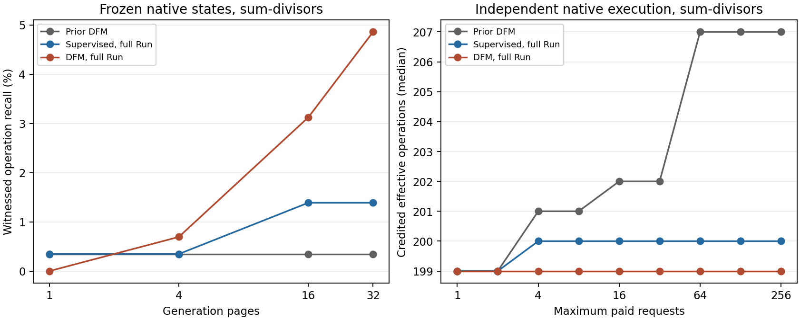

# 为什么 199 个有效操作之后没有后继

研究基线为 d5475dd0。原生 CCP v0.1、Recipe IR、可见域、已有 GNN/Actor 和百万参数解码器的结构沿用基线。独立执行属于 Neural Execution。已知请求数、规则、父引用、临时搁置队首及精确下一轮检查仅用于离线诊断。重新采集的高召回 Cell Stream 只提供训练轨迹。

## 逐页复现

按百万计划实验原有的 NumPy 采样顺序，3 份已训练权重在 sum-divisors 都精确复现了原终图 SHA、两份付费请求、一次接受、一次重复和 199 个有效原子操作。原生程序走到 schedule_end，共 208 个 Run；最后一个可解码 Run 是 207。每个可用 Run 有两页，每页仅尝试交付草稿队首。这个机制没有学习到的全局 Stop 指令。

1. 种子 243 的 Run 1 第一页签发零父的规则 375，实际回执为 accepted，归因 199 个操作。第二页生成两个 375，签发首个并收到 duplicate，留下一个未签发的 375。
2. 从 Run 2 起，队首 375 超出当前原生调度。首个以后两个 Run 的页上，模型分别尝试规则 573、580 和 284，未形成可发绑定。对模型自身 Run 1 后的真实状态做独立精确重放，Run 2 有一个具名合法请求，规则 574，父引用为空。第一处遗漏无需解决父地址。对原失败轨迹的 Run 3、4 独立检查还分别找到 36 和 39 个合法具名请求。
3. Run 5 模型实际生成了一枚 574，仍排在 375 后面。该 Token 没有送交原生执行器，因此不能推断此时签发一定会通过。种子 243 在 Run 1 之后做了 1,648 次编辑前向，四次尝试生成标记，一次形成完整标记。累计插入强度 3.211，已有草稿位置累计删除强度仅 0.0000947。这两项是按采样步长积分的预测强度。其他两个种子各自尝试 25、11 次，形成 1、2 个完整标记。三个种子各有 412 页都被未调度队首挡住，没有一份后续请求到达原生核验。
4. 保持权重和两页预算，在离线干预中只于 Run 2 把这一个已知队首移到一旁，种子 243 最终付费 74 次、接受 6 次、产生 210 个有效操作。85% 以上的新增付费请求未被接受。单独放宽到每 Run 八页，原队首策略付费 307 次、接受 10 次、产生 216 个有效操作。各自的后续自主状态及总 Run 数发生变化。这些数字能检验堵塞是否有因果作用，不能外推为部署时的神经收益。

直接原因是未签发草稿的队首长期占位、后续编辑很少移动它。调度预算、模板选择和父引用生成也约束恢复后的收益。历史两份签发的个例使用 NumPy 随机流；保持上一轮 GPU 随机流时，原权重能在其他轨迹上继续生成。两种随机流的结果分开记录。[逐页日志](pages.jsonl) · [原生干预](audit.json) · [模型实际状态的精确检查](fragment-labels.json)

## 原训练标签

逐个检查上一轮嵌套抽样中的 1,000,000 个窗口，并还原原生 Teacher 和反事实末 Run 的请求顺序。只有 4,675 个窗口与其某条已见证 Run 的末尾重合，995,325 个在所有适用见证的中途结束。旧训练把每个窗口单独当作编辑终点。当编辑桥采到该终点时，所有跳转目标均为零。按原抽样分布积分，每遍一百万次抽样，期望约 354,930 次落在这种中途窗口的零标签。此值是数学期望，训练没有逐样保存这个随机计数。

这个标签定义了当前草稿的终点，代码中没有将其直接写成“全局计算完成”。但旧目标也没有给出在同一起点之后、收到实际响应时应继续服务剩余计算的监督。下方的屏蔽对照单独检验这一点。保留所有窗口终点零标签的 DFM 在 sum-divisors 得到 111、101、104 个事实；仅删去不确定尾部的零插入监督后为 100、100、103。因而窗口截断是确定的目标语义问题，单独遮蔽标签没有恢复独立生成。

## 原生训练语料及预算

从 sum-bits、dot-product 和训练 grammar 的完整原生 Teacher 轨迹重放 7,265、6,704、72 份请求；用冻结的高召回 Cell Stream 对 sum-bits 和训练 grammar 重新独立执行，得到 2,228 和 72 份接受的请求。每条轨迹重放均要求所有保留请求通过、终图与对应原执行一致。高召回的 sum-bits 运行实际付费 547,230 次，其中 411,818 次重复、98,951 次绑定失败、34,233 次 guard 拒绝。被拒绝的原生响应和接受的教师请求分别记录。

每个 Run 采起始、首个成功后的状态、结尾及随机已执行前缀。输入只包含截至该前缀可见的原生发布与实际响应，未来请求只构造离线目标。沿用现有 ResponseMemory 对即时状态的编码，同一 Run 最近一个已签发 Cell 的身份和接受/拒绝状态进入表示；版本、退役和实际字段变化在原生发布时进入。训练没有把未来发布提前物化。Teacher sum-bits 和 dot-product 分别有 7,261、6,700 份请求读取更早 Run 的已签发父 Cell，实际观察到 1,648、3,314 次同一具名端口的版本变化及 1、8 个 repair 事件。merge/repair 通过现有原生状态变化体现；没有训练新的 repair 分类器。训练与正式测试按程序隔离。[训练数据及原生摘要](data.json)

已有草稿包括空计划、刚刚完成的请求、前一 Run 遗留的未调度请求。在额外的真实拒绝组中，采集同一 Run、同一接受前缀、同一原生错误类别的首个实际回执。只在其后确有已验证后继时为该负反馈构造监督，得到 840 个重复、161 个绑定失败、56 个 guard 失败上下文。已接受但归因零的计算仍保留，不能断定它对后续计算无用。

两种预算分别回答不同的问题：

- **两请求训练页**沿着真实已执行前缀学习下一页。名义页末如果仍有已知后续请求，或只是高召回生成器的见证已用完，DFM 末位置的零插入标签被屏蔽。只在 Teacher 走完本 Run 的记录后监督该 Run 的完成。等待、程序不动点和两页运行预算不混记。
- **完整剩余 Run**从同样的已执行前缀直接取所有后继，目标长度不设两请求限制，同时混入真实拒绝上下文。每个目标都是完整剩余计划，最长 278 份请求。长目标抽取端点和内部桥时间做速率训练，并抽取实际跳转进行地址监督，控制离线训练开销。程序的下一次发布仍通过实际 Response 进入下一次生成。这组没有把已知 Run 的其余计算裁掉。[完整后缀统计](full-data.json)

普通监督预测从当前草稿直接到目标的编辑数量和操作，沿用一轮生成。DFM 使用既有有序 Insert/Delete/Substitute 桥、条件 Beta 时间、时间加权 Poisson 速率训练和四步采样。两者使用相同数据、原模型尺寸、地址监督、初始权重和优化预算，每种设置 3 个种子，各 1,536 次更新，每次 256 个地址和 256 个编辑位置。解码仍是每 Run 两页，每页至多向 CCP 发送队首；四步 DFM 的额外前向全部计时。监督编辑的既有取整、argmax 语义被接入同一驻留设备路径。训练及 GPU 尺寸均未扩大。[训练损失与权重校验](fits.json)

## 冻结快照及独立执行口径

四个留出程序抽出 41 个分层快照，其中 sum-divisors 有 12 个。随机选实际执行前缀，保留 1–24 个已经原生核验且有正归因的后继作为参考。各组在同一真实状态比较。自由组在冻结状态继续编辑和交付草稿头，规则提示组只给正确规则，部分绑定组另给第一个具名父端口。正确数量组跳过长度及队首决策，直接尝试与剩余目标一样多的完整标记；另测正确数量叠加两种内容提示。对零父无端口可给；一父规则的唯一父会被提示直接给出。各组最多 32 页或 32 次直接尝试，实际尝试数和签发数都记录。数量组可能较早用完已知配额。

快照分子是生成的不同具名请求在原生见证中对应的有效操作数，单个见证只计一次。其他等价证明的收益未计入这一离线指标。正式独立执行另用原生 CCP 实际接受与最终事实集合计数，包含替代推导。各组正反序各跑一遍并核对终图、付费数和原生判定；不同组的终图与采样轨迹可以不同。实际付费预算曲线另采相同生成轨迹的每一份原生判定，按第 K 份付费请求截取，包括未通过的请求。对该前缀执行原生重放、Seal 并导出事实和有效操作；模型已经跑完时按实际用量结算。前缀审计不计入在线 EPS。[逐种子原生结果](pairs.csv) · [原生运行与阶段覆盖](runs.jsonl) · [冻结快照的六种提示](frozen-curves.csv) · [同付费预算曲线](paid-curves.csv)

## 独立执行结果

完整后缀训练增加了草稿产量，但绝大多数草稿没有被交付。sum-divisors 三个种子的 DFM 终止待签发分别为 246、316、328，实际只付费 2、3、3 次，原生有效操作分别为 199、199、201。普通监督组分别余下 1、6、8 枚，付费 105、86、88 次，产生 199、209、200 个有效操作。pending 全部按未完成处理。

| 完整后缀模型 | workload | 覆盖参考事实 | EPT | cold EPS |
|---|---|---:|---:|---:|
| 普通监督 | fact | 32 / 1,120 | 2.40 | 38.49 |
| DFM | fact | 31 / 1,120 | 36.00 | 10.10 |
| 普通监督 | loopfact | 40 / 1,112 | 3.18 | 29.82 |
| DFM | loopfact | 38 / 1,112 | 26.00 | 11.69 |
| 普通监督 | sum-divisors | 101 / 8,018 | 2.27 | 90.56 |
| DFM | sum-divisors | 100 / 8,018 | 67.00 | 18.40 |
| 普通监督 | 留出 grammar | 0 / 233 | 0 | 0 |
| DFM | 留出 grammar | 3 / 233 | .75 | 22.55 |

各指标分别取三个种子的中位数，EPS 先在同权重正反序计时内取中位数。sum-divisors 单个 seed 上的配对冷墙钟均值中位数，普通监督 2.31 秒，DFM 10.85 秒。两页相同的外部服务预算不保证内部工作量相同。重复计时中部分离线 CPU 诊断并行运行；微小墙钟差不宜归因于模型。三项 EggCC 的历史高召回事实为 1,109、1,049、3,137。原权重在本轮 GPU 随机流上复现上一轮三个种子 × 四个程序的终图和付费。sum-divisors 上其三种子中位数为 107 个事实、EPT 2.30、EPS 101.66。

短页普通监督只用接受轨迹时在 sum-divisors 达到 112 个事实、EPT 1.17、EPS 97.61；加入实际拒绝上下文后为 104、1.70、102.38。对应短页 DFM 两组均为 100 个事实、EPT 99.5。它们在第一个 Run 之后的归因操作中位数为零。更长的监督目标及真实拒绝样本都没有在本次预算下带来可靠的 DFM 持续生成增益。[独立执行配对](pairs.csv)

## 累计有效计算召回

sum-divisors 的 12 个冻结快照共含 81 份不同目标绑定、96 个归因操作；三训练种子在相同快照上重复，总分母为 243、288。表中为截至指定页数，按种子分别去重后加总的已找回见证操作。完整后缀 DFM 自主生成时到第 32 页找回 14/288，同时付出 31,337 次生成标记的尝试；普通监督为 4/288，付出 5,482 次。把这一局部结果与原生独立执行对照，才能看到 DFM 额外的搜索去了哪里。

| 完整后缀模型与提示 | 1 页 | 4 页 | 16 页 | 32 页 |
|---|---:|---:|---:|---:|
| 普通监督，自主 | 1 | 1 | 4 | 4 |
| DFM，自主 | 0 | 2 | 9 | 14 |
| DFM，仅正确数量 | 1 | 4 | 4 | 4 |
| DFM，正确 Rule，数量自主 | 13 | 16 | 21 | 22 |
| DFM，正确 Rule 和首父，数量自主 | 16 | 26 | 45 | 47 |
| 正确数量和 Rule，共用地址模型 | 4 | 14 | 14 | 14 |
| 正确数量、Rule 和首父，共用地址模型 | 9 | 29 | 41 | 41 |

直接给数量时，每个目标仅分配一次标记提案。第 32 页的 243 次尝试只命中 2 份具名绑定；再给正确 Rule 命中 8 份，再给首父命中 29 份。数量提示既消除了容量不足，也减少了反复尝试；单看数量组和自主组的差值不能解释成某一层的独立因果效应。内容提示的增益和较大的剩余缺口表明，模板与多父绑定仍值得分别看待。所有提示均未进入正式在线成绩。

在独立执行按实际付费请求截断后，1、8、32、128 份预算下的原生有效操作中位数，完整后缀 DFM 为 199、199、199、199；相同数据的普通监督为 199、200、200、200。短页普通监督为 199、200、209、212。没有花完预算的运行仍使用真实终图，没有补发请求。

## 复现

从 instruction_pointer 目录运行 `sh run-recall/run-continuation/reproduce.sh`。本机 DATA 是 /tmp/dfm-local/data，PREVIOUS 是移动盘 eggfuse-experiments/data-scale-1126，OUT 是同盘 run-continuation-1126。仓库记录权重摘要、实际执行结果和复现程序；训练张量、权重、原生轨迹与逐预算导出保存在 OUT。原生运行和离线诊断单列，EPS 使用原生署名有效操作除以包含在线准备、寻址、推理、通信、核验与发布的墙钟。正反序只能给出耗时范围，不足以推断小幅速度差异。[复现脚本](reproduce.sh)

124 项 Python 回归通过，包括规则边界标签及单步监督 GPU 编辑与既有 CPU 命令语义校验。既有 sum-bits 语义验收为 pass；另按 README 执行 standalone Cell CPU 的 compile、run、bench，五次中位数 21.48 ms。该回归与神经 EPS 分开计量。[原生语义验收](semantic.json)
