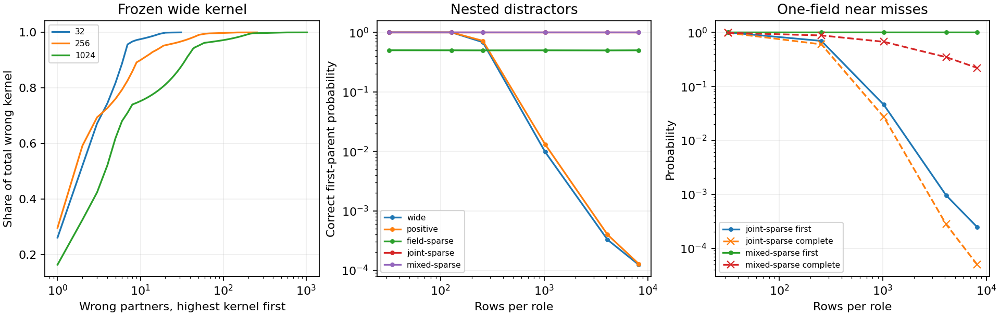

# 大规模伙伴域中的核干扰与首父发现

在随机具名地址上，先在同一行内混合共享字段，再将每行投影到四个稀疏神经特征，可以从数千个同类型伙伴中识别正确首父。困难例揭示了这个结论的边界。当每个干扰行都满足一个共享字段时，首父恢复后，完整 Token 的主要损失转移到了原有的条件次父解码器。

## 冻结权重的逐对诊断

使用 400dbe39 的宽张量积和三个训练种子。在每侧 32、128、256、1,024 行，两个留出 filler × 两个互换世界上计算全部父对。K 是四个非负同行核值的平均。每个世界的完整 K 矩阵和唯一正确行列坐标保存在原始目录 pair-distributions 中。诊断按每个世界独立算统计量，再取平均。

|每侧 1,024 行|正确核值|最大错误核值|正确减最大错误|累计错误核值|错误核值 P99|前八个错误占错误总量|
|---|---:|---:|---:|---:|---:|---:|
|固定正确首父，其余 1,023 个伙伴|0.6993|0.1772|0.5221|1.2283|0.00652|74.06%|
|该世界全部错误父对|0.6993|0.3535|0.3458|1,018.62|0.00660|0.25%|

一个正确首父上，大多数错误伙伴很弱，少数中等强度碰撞支配了错误质量。放眼整个首父域，类似碰撞分布在大量错误首父上。旧实现先在每个头内跨伙伴求和，再合并各头；这允许不同伙伴分别支持同一个首父的不同头。用同一权重、同一首父先验做干预后，先合并同一父对的四个头再锐化，排名发生改变。

|伙伴聚合|正确首父概率|平均首父排名|
|---|---:|---:|
|原始逐头求和|0.964%|29.33|
|每头独立四次方后求和|1.98%|25.50|
|同一伙伴合并各头后，求和|0.68%|47.08|
|同一伙伴合并各头后，平方求和|79.95%|1.00|
|同一伙伴合并各头后，四次方求和|≈100%|1.00|
|同一伙伴合并各头后，取最大值|85.38%|1.00|
|同一伙伴合并各头后，LogMeanExp，β=32|99.95%|1.00|

LogMeanExp 使用 log(mean(exp(βK)))/β，消除纯候选数引入的常量。所有标量聚合沿用同一四头读出尺度。丰富度、概率校准和排序需分开看，例如最大值与平方求和均使正确首父排第一，但其概率仍不同。这部分枚举只存在于离线审计脚本。

## 正式神经机制与训练

保持原有 GNN、模板接口、条件次父解码器、完整 Cell Token CE 和固定退出。单规则环境中模板确定，完整 CE 是每个具名父选择的条件交叉熵之和。延用 192 个真实置换地址的训练状态，课程 4→8→16→32，保留小样本，每个版本、每个种子再曝光 1,440 枚完整 Token。基线使用冻结的 400dbe39 宽模型；各变体只训练关系特征参数和一个已有的消息强度。新稀疏映射每组 4 × 22 个可学习投影系数，无额外预测头。三个种子为 9633、5003、1777。

|组别|行表示与聚合|
|---|---|
|wide|冻结宽张量积，四头，每头 1,024 个显式通道。|
|positive|相同宽度，对每行每头的非负特征逐点平方并重新归一化，再求和。这项线上可分解的变换有别于离线 K 的四次方。|
|field-sparse|每个共享字段分别投影，逐字段累积软支持度。|
|joint-sparse|同一行的多个字段交错提供投影位，经可学习加权产生连续坐标。|
|mixed-sparse|每个投影位先乘上来自所有对齐字段的 ±1 身份特征，再用可学习系数投影。改变任一字段就可能改变整个坐标。|

所有稀疏组对每个坐标只存储两个相邻基函数的索引和插值权重。GPU 将伙伴的非零坐标排序，对权重做前缀和。候选首父使用两次设备内二分定位读取各自基函数的总激活，因此相同特征的重复出现和跨 Stage 传来的权重都保留。查询返回激活总量，不返回伙伴引用。最后网络对抽中的首父及全部可见同类型次父做条件打分。每个首父始终进入最终 softmax。

**成本和责任边界。** 这是对学习特征坐标的 GPU 索引，具有量化碰撞和连续插值。CPU 仅提供原生发布的行、版本、身份特征及 Recipe 的静态字段接线，不比较实际字段、不查询合法伙伴、不筛选父对。整个排序、前缀和、索引读取和条件寻址均计费。稀疏表示使用 262,144 个逻辑间隔，只物化每头两个非零权重。有效码空间增大对结果至关重要；不能把效果解释成在同一分辨率下免费消除了干扰。宽模型、稀疏模型均未实现次父的次线性发现。

## 干扰与分辨率对照

N 是**每个角色的行数**。普通双父最大规模合计 16,384 行。每批固定原始合法行和字段值，只增添同类型干扰。独立扫描 (32,N)、(N,32)、(N,N)，对 N=32、128、256、1,024、4,096、8,192 逐点测量。稀疏变体使用完全相同的条目和抽样预算。下表为两侧一起扩容、关闭最近端口复制通路后的冻结首父概率。

|N|wide|positive|field-sparse|joint-sparse|mixed-sparse|
|---:|---:|---:|---:|---:|---:|
|32|≈100%|≈100%|50.09%|≈100%|≈100%|
|128|99.95%|≈100%|49.99%|≈100%|≈100%|
|256|68.42%|72.21%|49.86%|≈100%|≈100%|
|1,024|0.975%|1.308%|49.96%|≈100%|≈100%|
|4,096|0.033%|0.040%|49.80%|≈100%|≈100%|
|8,192|0.012%|0.013%|50.00%|≈100%|99.93%|

分别扩域时，冻结宽模型在 (8192,32)、(32,8192)、(8192,8192) 给正确首父的概率分别为 99.999%、3.21%、0.012%；mixed-sparse 分别为约 100%、约 100%、99.93%。仅令每个字段变稀疏，仍然不能区分互换后具有相同边缘分布的两个伙伴集合。

再作更严格的干预，让每个新增的同类型干扰行都与目标共享两个字段之一。原生核验每个快照仍只有一个新增的证明。N=1,024 时，joint-sparse 和 mixed-sparse 的完整 Token 概率分别为 2.72%、67.01%；N=8,192 时分别低于 0.01%、为 21.98%。此时 mixed-sparse 正确首父为 99.99%，而给定正确首父后，真正合法次父只能获得 21.99% 的概率。N=8,192 的困难环境中将 mixed-sparse 逻辑分辨率缩至 16,384 或 1,024，首父概率降至 0.32% 或 0.014%。这些都是冻结权重干预。

在既有宽模型上构造 mixed-sparse、保留初始化的投影系数，在全部配对的首父概率上与再训练后的输出逐项相同。三个种子的新增投影参数最大绝对改变量均低于 3e-23，原有消息强度也未改变。训练集小且容易，完整 CE 很快饱和。本轮观察到的主要收益来自表示和归纳偏置；这些实验没有证实额外的 1,440 次曝光教会了网络新的绑定算法。训练时和正式评估时，都无法从输入读取正确引用或逐对合法性。

## 具名地址、拓扑与验收口径

在项目 Rust Cell Runtime 的 online-ccp-v0.1 示例入口启用既有的初始具名地址置换；协议和签发语义保持原样。第一个种子的独立检查对线上全部公开的（owner、op、版本、字段身份）进行摘要，与原生置换重放逐项对应。之后的两个种子再更换原生地址种子。仅重排模型的数组行无法通过这项检查。离线捕获、参考终图和排序诊断不进入独立执行路径。复制开/关沿用同一真实状态和同一抽样流，分别报告。

消息沿静态 Recipe 父子边反向传播，支持三父链和首父分别连接两个下游角色的分叉。对不符合有根树假设的图显式报错。在每角色 4,096 行时，mixed-sparse 在链和分叉上的完整绑定概率分别为 91.56% 和 89.75%，原宽模型分别约 0.030% 和 0.023%。每个拓扑的模型使用相同权重。新分叉没有加入训练。

每个完整原生环境的 probe Run 只有一个参考有效操作。Coverage 为达到完整参考终图散列的运行占比，EPT 按原生新增有效操作 / 实际付费请求计，EPS 为累计有效操作 / 累计端到端墙钟。每次独立执行包括原生进程启动、全部输入读取、神经生成、寻址、传输、提交、发布和退出。权重已预载。计时在同一程序、置换、预算及种子上正反序配对；配对的两次时间重复不增加独立程序数量。程序仅含受控的单规则探测，以下结果不外推为 EggCC 多规则成绩。

关闭复制通路、每页 32 个请求时，普通干扰 N=1,024 的 wide 与 mixed-sparse 分别达到 50% / 0.01563 / 4.49 和 100% / 0.03125 / 9.10（Coverage / EPT / EPS）。在 N=8,192 的困难干扰上，wide 和 joint-sparse 均未达到参考终图，mixed-sparse 达到 100% / 0.03125 / 1.66。每格包含两个互换环境、三个策略种子及两种执行次序，共 12 次。逐组复制开关结果见 online 和 near-online；因子化随机在上述格均为零。1,188 次常规执行、336 次困难执行和独立 432 次预算扫描使用相同原生执行入口。

单个程序可能靠一页多次尝试达到完整终图。换一套置换和抽样流，N=8,192 困难例的 mixed-sparse 在 1、4、32 个付费请求下分别得到 33.3% / 0.3333 / 0.63、66.7% / 0.1667 / 1.25、100% / 0.03125 / 1.66。普通干扰在同一预算扫描中三个预算均达到 100% Coverage，对应 EPT 1、0.25、0.03125，EPS 1.89、1.85、1.64。真实端到端成本中还包括启动与读取全部公开 Memory。不能把一页成功当作一枚 Token 的成功率。

**补充留出。** 另生成 12 个新 filler，每个都有两个互换世界，分别使用普通及共享一半字段的困难干扰，每侧都是 8,192 行。每个世界均有唯一原生核验的有效计算。在困难世界中，关闭复制的 mixed-sparse 首父平均概率为 98.98%，按 filler 平均后范围为 90.00% 至 100%，完整 Token 平均 19.90%；开启复制的结果四舍五入后相同。其首父在 24 世界 × 3 种子上均排第一。普通世界上 mixed-sparse 的首父平均 93.90%，最弱 filler 仅 46.17%，完整 Token 平均 93.24%。普通世界的 joint-sparse 反而更高，首父 98.18%，完整 97.50%；在困难世界上 joint-sparse 的完整概率低于 0.01%。初始两组 filler 的近满分无法代表所有新实例。

对这 12 组新 filler 另做 96 次独立原生执行。每个程序只允许**一枚完整请求**，关闭最近端口复制；按 filler 配平三个训练种子和两组先后次序。普通干扰时 mixed-sparse 达到 23/24 个参考终图（Coverage 95.83%，EPT 0.9583，EPS 1.76），困难干扰为 5/24（20.83%，0.2083，0.389）。宽模型两组均为 0/24。这里的实际签发结果与冻结状态的完整 Token 概率相符，且避免了一页多次机会掩盖失败。

在 N=4,096，链中仅切断末端对首父的信息反馈，完整概率从 91.56% 降到 46.15%。分叉中两个下游角色都参与首父选择时为 89.75%，只保留其中一个分别为 45.81%、49.92%。固定三个已有共享变量、任意两列边缘分布均相同的奇偶留出环境，在 N=1,024 上 mixed-sparse 的完整概率为 99.96%。

## GPU 寻址、临时内存与发布更新

Apple M3 Max，PyTorch 2.15.0，MPS。分项计时为预热后 5 组、每组 4 次的同步中位数，各项独立计时。每侧 8,192 行时：

|32 槽 GPU 页|wide|mixed-sparse|
|---|---:|---:|
|右侧行编码|2.64 ms|0.81 ms|
|根据已编码行构建伙伴摘要或索引|1.76 ms|0.17 ms|
|首父读取已建摘要或索引|0.53 ms|0.17 ms|
|全套反向消息|7.69 ms|1.69 ms|
|条件寻址和解码|76.60 ms|82.67 ms|
|整页前向|83.98 ms|84.34 ms|
|单侧行特征张量|128 MiB|0.50 MiB|
|供首父读取的索引或摘要|16 KiB|约 512 KiB|
|消息阶段观察到的额外设备张量峰值|268.73 MiB|16.09 MiB|
|完整页观察到的额外设备张量峰值|1,161.45 MiB|1,161.45 MiB|

完整前向分别约 381 和 379 槽/秒，另有 15.37 ms 的主机打包及上传。内存在单独测量中从每个 PyTorch dispatch 返回时读取 MPS allocator，扣除既有输入与权重。该数值不含后端不对 PyTorch 暴露的工作缓冲。mixed-sparse 每侧构建 4 × 2 × N 个稀疏项，首父查询需要 4 × 4 × N 个设备内插入点定位（本例 131,072 次）。每页仍有 32 × N = 262,144 个条件次父分数。改进了首父的计算、内存和正确率，完整页吞吐与峰值仍由条件解码主导。

从原生 Run 的新增发布行构建独立的小索引也经过核验。N=8,192 的伙伴域、4 个待读首父，分别新增 1、8、32 行，比较合并读取新旧两段的神经支持度与全量重建。三个 mixed-sparse 对照的最大绝对误差均为 0。只增加一段能降低写入成本，但随后每次读取都需访问两段；所有实测含上传写入、双段读取及全量压实的数字保存在 updates.csv。正式 EPS 按每次实际重建计费。本次干预只涉及追加；多次发布堆积、删除和后继重加权仍会引入维护成本。

## 复现

在研究工作树根目录构建带原有计费的原生入口，再进入 instruction_pointer 目录运行。旧实验权重及数据目录沿用 400dbe39 的归档布局，默认输出至 ARTIFACT_ROOT/selective-partner。

~~~sh
CARGO_TARGET_DIR=/tmp/cost-audit-build cargo build --locked --release -p eggfuse-cell-runtime --features cell-token-ept --example cell_token_replay
cd benchmarks/pass3-cell-gpu/recurrent-generator/instruction_pointer
export ARTIFACT_ROOT='/Volumes/Extreme SSD/eggfuse-experiments'
export CELL_DATA=/tmp/dfm-local/data
export CELL_REPLAY=/tmp/cost-audit-build/release/examples/cell_token_replay
export CELL_COMPILER=/tmp/cost-audit-build/release/eggfuse-cell-compiler
export PYTHON=/tmp/egg-txn-ml/bin/python PLOT_PYTHON=python3
sh selective_reproduce.sh
"$PYTHON" -m unittest test_selective_partner test_joint_partner test_first_parent test_binding_fields test_completion_curriculum test_next_cell_pretraining
~~~

[冻结核值统计](kernel.csv) · [全对聚合诊断](oracle-aggregation.csv) · [独立扩域与复制开关](frozen.csv) · [分辨率与初始化](controls.csv) · [新 filler](unseen-fillers.csv) · [拓扑干预](topology.csv) · [正式执行](online.csv) · [困难执行](near-online.csv) · [新 filler 单请求原生结果](fresh-online.csv) · [预算扫描](budget.csv) · [同终图配对](same-graph.csv) · [GPU 分项](cost.csv) · [设备内存](mps-memory.csv) · [发布更新](updates.csv) · [课程 CE](fit.csv) · [权重哈希](weights.csv)。原始逐对分数、逐次执行、时间、训练权重和原生程序均保存在外盘输出目录。18 项回归通过；CPU compile、run、bench 和已保存 sum-bits 导出的语义验收通过。

