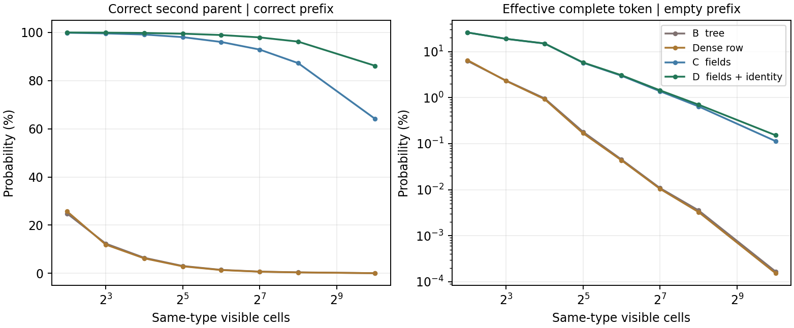

# Variable Binding 基础能力实验

在四个同类型 Cell、一条规则、一个有效绑定的完整原生环境中，给定正确首父后，独立字段表示将未见接线上的正确次父概率从 25.69% 提高到 99.80%。再加恒等残差达到 99.92%。从空前缀自行生成时，D 只有 26.35% 的请求命中有效绑定。条件绑定和自主发现首父表现出明显不同的学习结果。

## 训练与核验

以研究提交 `6de368ec` 的 Recipe、Cell GNN、Actor、动态 Memory 及地址打分器为起点。每个合成环境实际编译为原生程序，使用项目 Rust Cell CPU 的 capture/replay 和 CCP v0.1 在线执行。指标衡量项目原生执行器，不外推为上游 egglog 的吞吐。离线 capture 提供具名请求，replay 的实际原子贡献确定训练目标。自由生成的每页请求再进入原生执行；逐页核对新增有效操作数与不同贡献的交集。命中率允许重复命中，累计召回对同一贡献只计一次。

- 训练含 4,096 个独立 filler 实例，5 种接线，5,853 个经核验的状态 × 新增目标。205 个起点有已执行的 warm 前缀。每个 seed 对每个新环境抽一枚完整正例，训练中同一 filler 实例只曝光一次。另有有限 filler 重采样对照。各组 4,096 枚完整 Token 曝光、520 次更新，3 个 seed，共 18 份模型。旧 Actor、静态 GNN 和下一父 GRU 保持冻结；地址打分器及 C/D 的字段参数参与普通联合负对数似然训练。合成目标 Run 只有一条可选模板，模板概率为 1。
- 每个训练实例从不重叠的 i64 值域采样；对共享变量复用同一个值。规则变量改名、物理插入顺序与原生具名地址置换均发生在生成程序或原生重放阶段。正式测试的**有序父槽与字段位置**接线签名在训练中留出；部分签名在交换两个关系原子的语义下同构。所有测试 filler 与训练隔离。地址种子分离，同尺寸的有限排列空间仍可能偶合。各尺寸、地址置换和干预可共享同一个测试实例，不能视为彼此独立的数据。
- 完整 Token CE 沿实际父顺序求和，三个种子共用切分。同一状态的多个新增计算都有抽取机会。A 使用上轮语料的完整 Token 似然，包括已核验物理别名的概率和。另设有限 filler 组与旧架构共享这次的规模和布局分布，使更换训练语料的解释更清楚。有限曝光下 B 的结果不构成无限数据或无限训练的结论。
- 测试覆盖 4 至 1,024 个可见 Cell、未见字段位置、双共享变量、三父和四父、跨父算术 guard、可变版本与条件 merge。此外固定总规模改变同类型候选数，并在同一 16 行环境执行不同随机已完成子集。所有改变执行历史的程序都重新原生核验。未执行的 Higher、控制策略与 RL 不参与该实验。

[语料分布](corpus.csv) · [训练曲线](training.csv) · [训练权重校验和](weights.csv) · [各布局、各 seed 的累计召回](free.csv)

## 四 Cell 单共享变量

三种留出接线各 8 个值实例，每个实例两种真实地址与插入顺序，每组共 144 个 seed × 快照观测。所有组使用成对的抽样随机数。列“完整概率”对原生有效绑定的完整生成概率求和，“自由命中”统计实际签发 32 次的命中比例，“召回@32”按不同有效计算计数。

| 训练组 | 正确首父概率 | 给定正确首父的次父概率 | 次父 Top-1 | 完整概率 | 自由命中 | 召回@32 |
|---|---:|---:|---:|---:|---:|---:|
| 因子化均匀随机，解析期望 | 25.00% | 25.00% | 25.00%¹ | 6.25% | 6.25% | 87.32% |
| A 旧数据、旧树 | 26.53% | 26.09% | 26.39% | 6.55% | 6.84% | 83.33% |
| 有限 filler、旧树 | 27.09% | 26.43% | 29.17% | 6.67% | 6.60% | 77.08% |
| B 新 filler、旧树 | 25.56% | 24.81% | 25.00% | 6.25% | 6.71% | 89.58% |
| 新 filler、整行稠密 | 25.80% | 25.69% | 28.47% | 6.50% | 6.88% | 88.89% |
| C 新 filler、独立字段 | 26.02% | 99.80% | 100% | 25.97% | 26.45% | 100% |
| D 增加可学习恒等残差 | 25.94% | 99.92% | 100% | 25.92% | 26.35% | 100% |

¹ 均匀打破平分。随机的累计期望为 `1 − (15/16)^32`。实际 CCP 随机试验另见独立执行表。C 和 D 均达到四 Cell 条件绑定目标；本轮没有观察到恒等残差给这个任务的完整 Token 发现率带来额外优势。[原始聚合](equality.csv)

## 信息在哪一层丢失

旧实现对每列的 64 位哈希读取 32 个移位 bit，经列加权后合为单个行向量。第一父选中后，GRU 只读该行向量与当前角色。原生完整引用仍保留 owner、op、version。给列零改动 bit 47 可以得到逐位相同的旧行特征；这个构造性碰撞不等于训练集中每次错误都发生了碰撞。树节点的左右分支使用物理区间代表行。[原字段编码](../../actor.py) · [原地址树](../../address_scores.py) · [旧解码路径数值一致性检查](parity.json)

C/D 将每个已发布字段保留为独立的 64 个 ±1 通道。相同原生类型值沿用同一个 CCP 哈希，身份向量与 owner、列号分开。归属由具名行绑定保留，类型与角色还由 Recipe 表和列的位置、GNN 角色表示提供，原生版本与可见性沿用现有 Memory。具体 owner 或精确版本号没有拼入身份相似度；本试验也没有为每个名义 sort 学习一个独立向量。实际在线使用的是原有类型化 Value 的 **64 位哈希**，仍有理论哈希碰撞。只在离线文件中，附加原生 Int/Eq 值对照。Int 的 64-bit 字保存完整，使用可逆扰动后逐 bit 转为 FP32，覆盖相邻的大整数、符号边界与高位。此对照没有改变 CCP 或训练权重。[精度实测](precision.json)

C/D 从编译后的 Recipe interface 读取列的静态 slot 共享，作为字段对软注意力的偏置。已绑定父的各列按此注意力读出，与每个候选父的各列在 Metal 上做可学习的双线性打分；D 在同一打分中加入标量乘以恒等矩阵。静态接线已由编译器提供，模型学的是利用这些接线对实际值寻址。CPU 访问所有已发布的同角色物理行，按地址读取、装包；没有按跨行字段值筛选、输出相等位、执行 join 或关闭分支。相似度计算发生在一个父域上，未枚举父引用笛卡尔积。这是稠密诊断，其全域读取和搬运有成本。离线 gold、完成子集标签、raw 对照和概率统计不输入在线模型。[字段与接线](../../binding_packets.py) · [解码与训练](../../binding_model.py)

| 干预 | 实测结果 |
|---|---|
| 固定候选、角色及 owner，仅更改首父共享字段 | B 的旧 Query 向量变化范数 0.362，但新正确伙伴概率由 28.14% 变为 27.01%。D 从 0.021% 变为 99.95%。 |
| 同一变化只经 D 的字段路径传递 | 新伙伴概率 99.95%。只经旧整行路径传递为 0.018%。换无关字段为 0.019%。 |
| 相同行，替换规则的静态接线 | D 把概率移到新接线指定的伙伴，三个 seed 都超过 99.9%。测试时抹掉接线后，四 Cell 探针上的平均次父概率降至约 7.4%。 |
| 重新编译、置换物理句柄和插入顺序，按语义行重新对齐 | 次父分布总变差距离，B 为 0.04436、C 为 0.00038、D 为 0.00015。 |
| 同权重恢复物理代表行分支 | 单一留出接线、去掉 copy 的配对诊断中，D 的稠密/树目标概率在 4 行为 99.93%/58.95%，64 行为 99.28%/4.45%，1,024 行为 88.65%/0.47%。目标路径分别打分 4、12、20 个代表。此处没有重新训练树或计量专用稀疏内核。 |

干预保留原生上下文，张量路径替换本身只作因果诊断。去掉静态接线是在分布外消融；降幅不能全部解释为原 GNN 的训练缺陷。两种首父数据通道的结果表明，旧 Query 会随输入变化，但变化不足以把概率交给新的正确引用。[首父字段干预](query.csv) · [Recipe 与候选干预](causal.csv) · [地址置换](permutation.csv) · [接线开关](wire-controls.csv) · [稀疏对照](sparse.csv)

## 难度曲线与失败边界



- 1,024 个同类型 Cell 上，D 对未见单共享变量的次父 Top-1 仍是 100%，正确概率降至 86.11%，首父概率只有 0.177%，完整概率为 0.152%。固定总量 64 行、只保持一条合法组合，同类域从 4 增至 64 时，次父概率由 99.95% 变为 99.11%，完整概率由 25.91% 变为 1.59%。[干扰规模对照](density.csv)
- 双共享变量且有只匹配一列的干扰时，D 在 4 行的次父概率为 99.38%，1,024 行为 52.11%。四父链在 4 行的最后一父概率为 96.79%、完整概率 25.24%；1,024 行分别为 18.27%、0.015%。后续父概率按正确前缀条件化。模型需要同时保留更多约束时，单字段身份匹配的结果不能代表整个组合。[逐层结果](free.csv)
- 跨父数值 guard 夹具每次有两条相等关系成立的链，其中一条通过原生小于比较。D 的每 32 个自主请求平均有 7.65 个命中有效绑定，8.74 个被原生 guard 拒绝。正确首父已给定时次父概率 99.92%，该条件恰好排除了失败链。模型学会相等关系的证据不能推广为已学会数值比较。[原生 guard 回执](cross-guard.csv)
- 原生 custom merge 产生或省去条件中间端口的 16 个配对环境中，每个种子 D 在 64 次签发内分别获得全部 2 或 1 个实际新增操作。该夹具检验实际端口可消费性；不足以证明网络能预测未发布端口、任意版本推进或 repair。可变 Price 的别名只在离线同起点替换后状态散列及原子贡献一致时归为同一目标。[条件输出与核验](conditional.csv)
- 在 16 个同类型输入中固定四个真实绑定，随机选取 0、1、2、3 个结果先通过原生 warm 阶段发布。D 对**剩余新增目标**的完整概率依次为 25.58%、18.99%、12.33%、5.97%。每组四个新值实例、两种地址排列、三个种子。相等关系仍可读，剩余机会变少后，模型没有把足够概率从已完成的计算重新分配给仍需完成的计算。[各完成程度结果](free.csv)

## 与真实执行的距离

808 个测试快照、6 组、3 个种子、每页 32 个实际具名请求，共 465,408 次冻结快照自由签发。一次请求命中正确绑定仍可能在同页重复；新增原子操作按原生 EPT origin 计算。另有 120 次从初始状态进入真实 CCP v0.1 的独立小程序执行，五个尺寸各用一个 `eq10` 程序，固定 32 槽，在三个种子下交换模型测试顺序。每次都核对完成全部原子贡献时与原生参考终图的 SHA 是否一致。该单程序/尺寸实验的波动大；全体留出程序上的概率曲线更适合判断规模效应。[小程序逐次墙钟、EPS 和终图](synthetic-online.csv)

在 fact、loopfact、sum-divisors 各取最早八个存档 Run（Teacher、自主状态分别取样），905 条至少两父的有效记录中 48 条因模板不在域中或诊断列宽限制未测。对给定有效首父且两个角色有直接列接线的上下文，整行稠密到 D 的有效次父概率从 6.43% 增至 89.78%；没有直接接线的上下文从 9.85% 变为 10.74%。此处仅对存档原生核验过的目标求概率质量。[EggCC 冻结前缀](egg-prefix.csv)

再从初始状态运行三个完整程序。两组使用相同的冻结模板策略、固定退出与每个调度 Run 八槽，允许零父 Primitive；按选定规则逐父稠密生成。每个模型种子配同一生成随机流，各跑正反两种次序。下表为六次实测均值。模型权重预加载；从构造运行 Memory 到终态回执与进程退出的开销计入墙钟，包含 GNN、取数、打分、同步、签发和原生执行。离线参考图比对在计时外。EPS 为逐次有效原子操作/秒的均值。此处是有界 Primitive 自主生成对照，历史高召回 Cell Stream 的不同预算成绩不能直接代入比较。

| EggCC | Coverage 整行 → D | EPT 整行 → D | EPS 整行 → D | 付费请求均值 整行 → D |
|---|---:|---:|---:|---:|
| fact | 3.958% → 3.958% | 0.2162 → 0.2166 | 30.00 → 24.94 | 413.3 → 414.0 |
| loopfact | 4.436% → 4.526% | 0.1642 → 0.1626 | 24.33 → 19.77 | 400.3 → 416.0 |
| sum-divisors | 1.351% → 1.463% | 0.3734 → 0.3172 | 65.12 → 50.09 | 569.3 → 715.0 |

fact 三个种子逐对覆盖的参考事实集合均相同，完整图的散列仍可能不同；其余两例各自的事实集合也有差异。新增字段路径在当前实现中需要全父域装包与神经打分，sum-divisors 平均每次执行的候选父打分由 7,978 增至 11,810。这里没有观察到一致的端到端前沿改善，也没有证明提高首父命中后就能自动达到高召回闭包。[逐次执行、散列与计时](egg-independent.csv) · [实际事实集合](facts.json)

## 文献如何影响实验

学习符号程序绑定的研究追踪了注意力和残差流中对具体变量的读取。本轮据此加入了控制首父内容、接线路径和候选伙伴的干预，用概率是否转向新伙伴衡量特征是否真的被使用。[Wu 等，ICML 2025](https://proceedings.mlr.press/v267/wu25j.html)

抽象符号研究指出，面向符号重命名的泛化依赖输入表示和模型对身份关系的偏置。本轮把可学习相似度与显式保留恒等分量拆成 C/D；在此预算下，单独保留字段并使用静态接线已解释了四 Cell 上的大部分提升。[When Can Transformers Reason with Abstract Symbols?](https://arxiv.org/abs/2310.09753)

Role–filler binding 研究比较了有限与持续更换 filler 的训练以及动态记忆对未见 filler 的影响。本轮在原生环境中采用新 filler，并保留已选择父的逐字段记忆供后续父读取；没有移植论文的大型记忆网络。[Learning to Perform Role-Filler Binding with Schematic Knowledge](https://pmc.ncbi.nlm.nih.gov/articles/PMC8019313/)

## 复现

研究工作树根目录先构建 Rust 二进制，再进入 `benchmarks/pass3-cell-gpu/recurrent-generator/instruction_pointer`。依赖与上一轮相同，PyTorch 需支持 MPS，制图环境需可用 matplotlib。复用已有 Actor/GNN、initial checkpoint、上轮原生工作负载、冻结基准和旧语料。脚本默认缓存成功的原生夹具；独立复验请设置新的 `BINDING_OUT`、`RESULTS_DIR`。

```sh
cargo build --locked --release -p eggfuse-cell-runtime --features cell-token-ept --example cell_token_replay
cargo build --locked --release -p eggfuse-cell-compiler
cd benchmarks/pass3-cell-gpu/recurrent-generator/instruction_pointer
export ARTIFACT_ROOT='/Volumes/Extreme SSD/eggfuse-experiments'
export CELL_DATA=/tmp/dfm-local/data
export CELL_REPLAY=/tmp/cost-audit-build/release/examples/cell_token_replay
export CELL_COMPILER=/tmp/cost-audit-build/release/eggfuse-cell-compiler
export PYTHON=/tmp/egg-txn-ml/bin/python
export PLOT_PYTHON=python3.8
sh binding_reproduce.sh
"$PYTHON" -m unittest test_binding_fields test_completion_curriculum test_next_cell_pretraining
```

上面两个二进制路径对应本机 `CARGO_TARGET_DIR=/tmp/cost-audit-build`；使用默认构建目录时改指向仓库的 `target/release`。实验盘 `variable-binding/worlds` 含真实源码、IR、前缀、teacher tape、具名内存和每 seed 回执，`weights/<seed>` 含模型和学习曲线，`egg-online` 含逐次终图及回执。源码与精简可读结果入库，重型原始数据与权重保存在实验盘。核验已通过 9 项测试、README 的本地 Cargo compile/run/五次 bench 及既有 sum-bits 语义验收；后者只核验既有基准契约。[复现脚本](../../binding_reproduce.sh)
