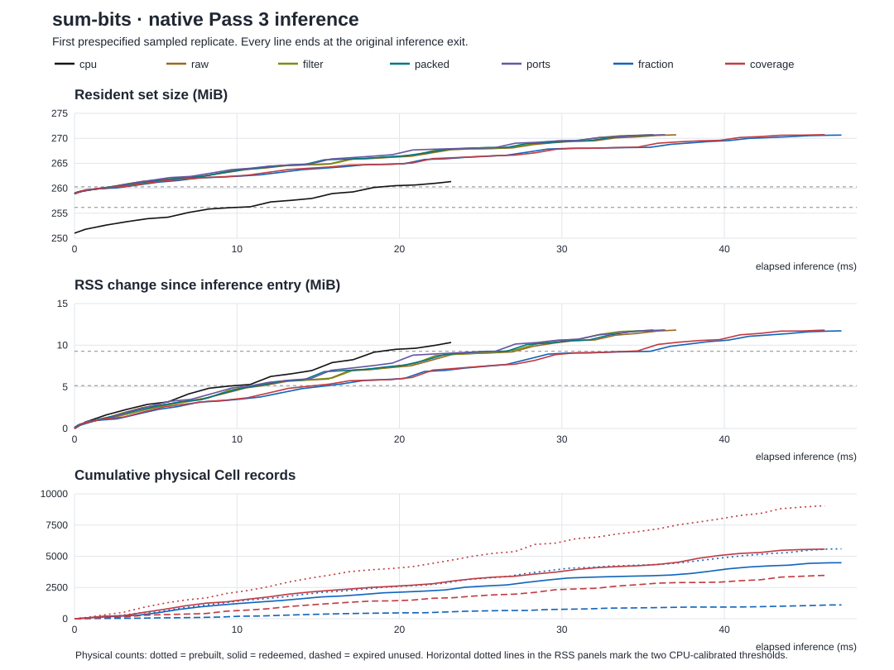
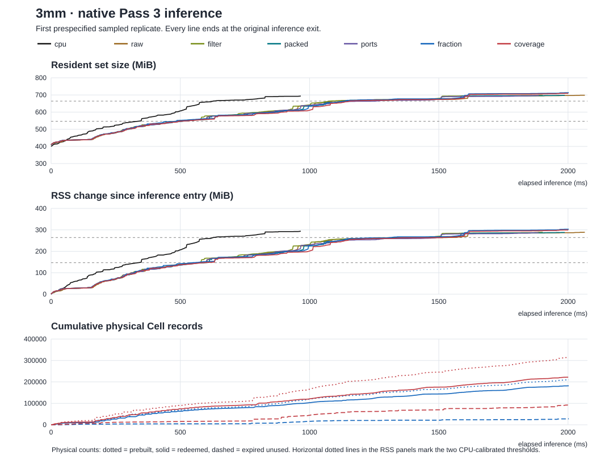

# How fast does the native inference process acquire resident memory?

This experiment measures macOS process RSS from the first instruction boundary immediately before `Executor::execute` until that call returns. The CPU reference is the default-feature EggFuse Cell CPU with the identical compiled program. The neural arms use one native research binary and the frozen model at seed 1703. The raw wave seals model proposals. Filter removes compiler-proved negatives. Packed changes the surviving queue representation. Ports additionally hands positive point references to the verifier. Fraction and coverage add a model-sized compatible private Cell pool to the ports arm.

**Measurement contract.** Each trial starts a fresh process with one request. Source parsing, graph initialization, optional model/index loading and request setup finish before the entry timestamp. Graph export, detailed source checks, result serialization and process teardown happen after the exit timestamp. An external observer reads `proc_pidinfo(PROC_PIDTASKINFO).pti_resident_size` at a nominal 1 ms interval. Both processes use the macOS uptime-raw clock. The target reads its own OS RSS at the two boundaries and publishes the clock, RSS, and three cumulative physical counts through one shared page. Trace storage stays in the observer. The sampled peak is the largest observed RSS, not lifetime maximum RSS; short excursions between samples may be missed. RSS includes allocator retention and all already-resident code and data. It does not count logical e-nodes.

Each workload first gets three independent vanilla calibration processes. Their median entry RSS and median peak growth determine two common absolute thresholds (entry plus 50% or 90% of that growth) and two growth thresholds (50% or 90% above each measured process's own entry). These thresholds were written before running the seven measured arms. Four order-rotated, fresh sampled/unsampled pairs per arm follow. A threshold already met at entry is left-censored; a threshold never observed is marked unreached. Crossing times are the first sampled time at or above the level. Sampling intervals and all four observations accompany the medians. Time to each process's own observed peak is also recorded separately.

Physical prebuilds are private Cell records accepted for reservation by the current Run. A redemption means that a verified fresh primary Cell published that actual backing during the original source commit. At the end of its Run, unclaimed backing expires. The observer reads these cumulative counters as the native stage allocates, redeems and expires records. A private grant alone grants no visible e-node, fact or union.

## Measured trajectories

On 3mm, the fraction head reached the common growth target of **264.11 MiB** earlier than its otherwise identical ports path in all four rounds, by 166–300 ms. At the first crossing it had already redeemed a median 130,660.5 prebuilt records. Coverage redeemed 175,531 at that same growth target, but reached it later than fraction. This associates an observed resident rise with actual source-authorized uses. The increase also includes indexes, allocator behavior and the rest of the executor. The median first crossing of this target was still 617.72 ms for the independent CPU.

On sum-bits, fraction reached the common **9.27 MiB** growth target 6.74–9.55 ms later than ports in all four rounds. Neural processes already held about 7.9 MiB more than the CPU before inference began. All 24 sampled neural processes therefore satisfied the absolute halfway threshold at entry. Treating these as zero-time predictions would credit memory loaded before the schedule ran.

The tables show medians over four measured fresh processes per arm. Times are in ms and memory in MiB. The absolute and growth crossing columns use the independent 90% calibration. An arm’s own time to peak uses its own sampled trace. Sampling overhead is the median individual sampled/unsampled wall-time ratio minus one. Negative estimates expose timing variation in the matched fresh-process design. The 50% and 90% definitions, every individual crossing window, and all observed censoring states are in [the numerical results](results.json).

### sum-bits

CPU-calibrated absolute levels were 256.16 / 260.28 MiB. Common growth levels were +5.15 / +9.27 MiB.

| Arm | Entry RSS | Peak RSS | Peak rise | Time to own peak | Absolute 90% | Growth 90% | Unsampled inference | Sampling overhead |
|---|---:|---:|---:|---:|---:|---:|---:|---:|
| cpu | 251.02 | 261.32 | 10.30 | 23.49 | 19.60 | 19.60 | 22.76 | +4.32% |
| raw | 258.88 | 270.17 | 11.30 | 37.12 | 2.89 | 28.52 | 34.77 | +7.51% |
| filter | 258.88 | 270.70 | 11.82 | 36.02 | 3.15 | 27.92 | 36.70 | +0.37% |
| packed | 258.88 | 270.62 | 11.75 | 37.61 | 2.98 | 27.90 | 36.15 | +4.04% |
| ports | 258.88 | 270.73 | 11.85 | 36.14 | 2.73 | 27.29 | 36.31 | +0.25% |
| fraction | 258.92 | 270.65 | 11.72 | 45.56 | 3.66 | 35.41 | 47.04 | -1.79% |
| coverage | 258.92 | 270.71 | 11.79 | 46.00 | 3.39 | 34.41 | 46.35 | -1.25% |



### 3mm

CPU-calibrated absolute levels were 546.66 / 664.04 MiB. Common growth levels were +146.73 / +264.11 MiB.

| Arm | Entry RSS | Peak RSS | Peak rise | Time to own peak | Absolute 90% | Growth 90% | Unsampled inference | Sampling overhead |
|---|---:|---:|---:|---:|---:|---:|---:|---:|
| cpu | 399.94 | 693.39 | 293.45 | 960.15 | 617.72 | 617.72 | 912.46 | +5.11% |
| raw | 409.81 | 698.43 | 288.61 | 2058.87 | 1102.53 | 1499.25 | 2033.20 | +1.34% |
| filter | 409.81 | 698.16 | 288.35 | 1909.46 | 1094.98 | 1440.05 | 1923.27 | -0.25% |
| packed | 409.81 | 697.88 | 288.07 | 1939.04 | 1113.05 | 1371.58 | 1956.90 | +0.21% |
| ports | 409.81 | 696.61 | 286.80 | 1896.44 | 1256.42 | 1497.22 | 1879.80 | +2.40% |
| fraction | 409.83 | 712.88 | 303.05 | 1996.82 | 1127.48 | 1314.86 | 1998.28 | -0.37% |
| coverage | 409.83 | 710.02 | 300.20 | 1992.95 | 1126.79 | 1414.37 | 1984.76 | +1.11% |



| Program | Forecast | Prebuilt | Physically redeemed | Expired unused | Redeemed at 90% growth, median |
|---|---|---:|---:|---:|---:|
| sum-bits | fraction | 5,589 | 4,485 | 1,104 | 3,481.0 |
| sum-bits | coverage | 9,036 | 5,570 | 3,466 | 4,233.0 |
| 3mm | fraction | 209,856 | 181,707 | 28,149 | 130,660.5 |
| 3mm | coverage | 315,037 | 222,051 | 92,986 | 175,531.0 |

All measured arms reached both growth targets on all four trials. No 90% absolute measurement was censored. The rows in each figure use the first prespecified sampled process with the three physical counters sampled on that same time axis. The archive retains full sample data at microsecond and KiB resolution. [Lossless curves, calibrations and rotation order](curves.json)

## Reproduce

```sh
d=benchmarks/pass3-cell-gpu/verified-wave-rss
python "$d/build.py" "$EXP/verified-wave-rss-build"
python "$d/measure.py" "$EXP" "$EXP/verified-wave-rss-build" "$EXP/verified-wave-rss-audit" --audit
python "$d/measure.py" "$EXP" "$EXP/verified-wave-rss-build" "$EXP/verified-wave-rss-curves"
python "$d/analyze.py" "$EXP/verified-wave-rss-curves" "$EXP/verified-wave-rss-audit" "$d"
python "$d/plot.py"
python "$d/verify.py"
```

The CPU and all neural arms execute all original Runs and reach the independent source graph digest on every timed process. Additional, untimed full audits compare each neural arm with the independent CPU's ordered RHS, effective writes, union and Spine events and original schedule. The filtered arms retain identical raw, commit-identity and physical digests among themselves. Compared with the raw arm, dropping impossible singletons renumbers subsequent issued serials. Winning original parent identities, nested and root Cell IDs, ordered RHS inputs, the source physical Cell sequence and final state remain aligned. [Full audit](audit.json)
