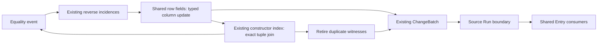

# Union digests with shared storage and Entry delivery

This page records `31979aff`. The [next iteration](UNIT.md) extends the admitted
fragment to scalar Unit-presence tables and selected Bake markers.

This iteration continues `codex/union-digest-matching` from `1ccda85a`. It removes
the first prototype's three parallel data structures: owned key packets,
argument-position subscriptions, and digest hash buckets. Constructor equality
matching now uses the graph's existing `RowFields`, reverse incidences and
constructor interning index. It delivers changes through the same `ChangeBatch`
that feeds shared Entry at the original source Run boundary.

This remains a **standalone Cell CPU experiment** on scalar, immutable
constructors. Union-find is retained. Functions, marker tables, containers,
deletion and subsumption remain unsupported. No neural/GPU backend, native
egglog runtime optimization, or new learned Bake catalog is introduced.

## Evidence and obligations

The preceding experiment found 8,448 changed argument positions and 8,192
congruence matches in each cold union fixture, while storing every constructor
key and its reverse incidences a second time. Even the no-union fixture paid
43% overhead in that session. This is concrete execution evidence for removing
duplicate state, rather than evidence that any future equality can be predicted.

At loading time, typed schemas identify each table's equality-valued columns,
including the result column. That small plan is reused across Runs. A scalar
column never participates merely because its numeric value resembles an ID.
This is preprocessing from existing compiler facts, not a new Bake training pass.

A scheduled transition can retain the same row allocation for constructor
lookup and Entry consumers. When an Entry packet still owns the preceding
snapshot, copy-on-write preserves it. The checked test verifies both pointer
sharing and the old snapshot's immutability. Consumer watermarks and legal Run
membership still decide when the updated row is observed.

For a constructor, equality of the complete operator and ordered key justifies
a result-union request and retirement of a duplicate witness. Retirement occurs
after the event's reverse incidences have migrated, before the next equality
event. Otherwise a retired witness could be reintroduced into the merged
subscription bucket. The queued result union remains live even if its producing
witness has retired; retirement is not counted as committing that union.

Function merge order and marker receipts require additional proofs. This work
does not extend the constructor proof to them or relax source scheduling.

## Event path



All affected fields are updated and old keys removed before probing changed
packets. Result-only changes wake consumers without rehashing a key. Full tuple
comparison remains mandatory even with a zero-bit hash. The canonical rows
stay in the constructor index, so the digest path no longer needs the ordinary
dirty-repair set or a final survivor resubscription pass.

Shared Entry's join scheduler itself is unchanged. This iteration shares its
row storage and delivery mechanism; it does not merge all source rules and
congruence rules into a new universal scheduler. Entry snapshots are refreshed
only after ordinary publication.

## Measurements

Apple M3 Max, Rust 1.94.0, standard release with
`sparse-cells,view-ports,storage-metrics`, no PGO or CPU/LTO overrides. Each case
uses 256 independent pairs and depth/fanout 32. Each lane has a separate warm-up
and seven fresh-process samples, alternating forward/reverse lane order. Audits
are separate. Inference excludes setup and export. Raw samples, setup times,
peak RSS, executable and artifact hashes are in [shared-results.json](shared-results.json).

| Fixture | First digest (`1ccda85a`) | Current mode off | Current digest | Digest vs mode off |
|---|---:|---:|---:|---:|
| chain | 35.187 ms | 20.497 ms | 20.273 ms | −1.1% |
| fanout | 31.353 ms | 22.514 ms | 18.031 ms | −19.9% |
| stable/no effective unions | 26.014 ms | 21.472 ms | 20.455 ms | −4.7% |
| warm-chain | 78.278 ms | 43.124 ms | 43.973 ms | +2.0% |
| warm-fanout | 78.136 ms | 43.959 ms | 40.897 ms | −7.0% |

The current digest takes 21–48% less inference time than the first digest in
these paired measurements. Compared with ordinary matching/repair, chains are
approximately at parity; the measured fanout improvement is larger. The small
chain/stable differences are not evidence of a general speedup. Warm-chain is
slightly slower. These are synthetic constructor results, not results on the
frozen application workloads.

The warm cases run `make → read → alias → read`. Thus shared Entry caches the
constructor rows before the union, and a later scheduled consumer must receive
their changed fields. They also create `Seen` constructors before aliasing, so
there is an additional congruence layer; do not compare their absolute times
directly with the three-Run cold cases.

| Fixture | Peak RSS: first digest | Mode off | Current digest |
|---|---:|---:|---:|
| chain | 58.17 MiB | 42.70 MiB | 42.70 MiB |
| fanout | 50.64 MiB | 44.61 MiB | 42.42 MiB |
| stable | 72.05 MiB | 65.41 MiB | 65.41 MiB |
| warm-chain | 80.14 MiB | 67.25 MiB | 66.92 MiB |
| warm-fanout | 84.80 MiB | 67.64 MiB | 67.72 MiB |

Cold union cases update 8,704 subscribed rows, including 256 result-only
updates. They commit 8,448 class merges and retire 8,192 duplicate rows. Only
256 shared field allocations need copying. Warm cases update 16,896 subscribed
rows and copy 8,448 shared field allocations. This is a remaining snapshot
cost, not hidden zero-copy execution. Shared Entry delivery counts agree with
the control in these audits.

`owned_key_packets`, `owned_argument_postings` and `owned_key_buckets` are now
structural zeroes: the corresponding containers no longer exist. The matcher
still owns typed column plans, a temporary duplicate set and counters, and
uses temporary rekey lists and copy-on-write rows. `publication_visits` now
counts row updates during equality events, not the first prototype's final
dirty-set visits. It excludes insertion and keeper notifications, so it must
not be treated as a total maintenance or publication count across versions.

## Validation

The existing native egglog and exhaustive fixed-point comparisons are retained:
per-Run graphs, rule bindings, semantic schedules, arbitrary initial renaming,
cycles, correlated tuples, repeated variables, late inserts, no-op unions and
forced hash collisions. Six deterministic streams check 768 incremental
operations against the independent full-scan oracle.

New tests verify that graph rows and shared Entry packets use the same field
allocation, that a union preserves cached old packets, and that repeated-variable
consumers wake only after publication. A defensive import test injects duplicate
keys and verifies that early retirement preserves pending transitive unions.
The frontend normally exports canonical input; this injected test is not an
ordinary-path input contract change.

All-feature workspace tests and default-runtime digest tests pass. The frozen
sum-bits and Raytrace ordinary paths are compared against `27f098a2` for final
rows/anchors, semantic schedule and graph counters; digest mode still rejects
their marker tables. See [shared-checks.json](shared-checks.json). These are not
per-Run native audits or digest timings for those applications.

## Reproduce

Use the build commands from the [first experiment](README.md#reproduce). The
same `--union-digest` flag selects this implementation. After saving an executable
built from `1ccda85a` with the same runtime features:

```sh
python3 benchmarks/union-digest/run.py --output out/digest-shared --previous-digest /absolute/path/to/v1 --repeat 7
python3 benchmarks/union-digest/run.py --output out/digest-warm --previous-digest /absolute/path/to/v1 --repeat 7 --shapes warm-chain warm-fanout
cargo test --release --locked --workspace --all-features
cargo test --release --locked -p eggfuse-cell-compiler --test union_digest
```

The old three-shape generator and the expanded generator produce the same cold
source programs. The results retain both generator executable hashes because
the warm cases were added after the cold run. No generated binary or graph
snapshot is tracked.
