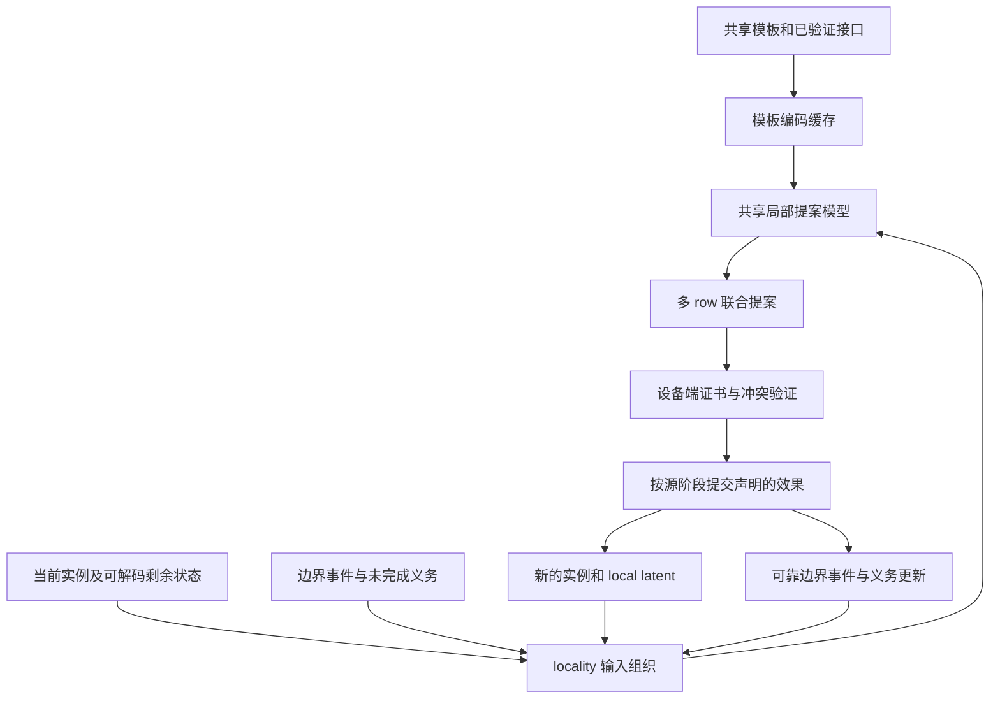

# E graph 多 token row 神经推理研究与实施规划

日期：2026-11-18（Asia/Shanghai）
性质：研究规划，不是已实现架构或性能承诺
依据：当前 Cell CPU / Bake 研究方向、已提交的独立神经原型、相关原始论文
适用范围：先验证有限语义子集，再逐步覆盖真实 eggcc Pass 3

审阅顺序：1—4 节看目标、证据与已有研究；5—14 节看表示和执行契约；15 节看完整例子；16—22 节看 Bake、训练、验证、数据和成本；23—26 节看落地顺序与退出条件。

## 1. 研究目标与必须先作出的判断

2026-11-18 优先级更新：用户明确当前关心的是“神经网络能否快速、多 row 生成互补 token”，不以压缩为目标。下述历史压缩分析保留为资源账本和可选观察，不再作为成功门槛，也不能阻塞神经生成实验。主验收改为同一图的联合生成正确性、跨 row 引用、完整有效覆盖，以及相对强神经串行基线的生成延迟／有效吞吐。

一行包含多个 token。模型可以一次并行生成多个 row 的 token，也可以进行每轮每行输出一个或多个 token 的多流生成。压缩率、载荷退役量和实例描述符数量不再代替该生成能力。

当前目标是让神经网络从同一图的状态联合生成多 row 的互补 token：各行输出应协同完成不同但相关的合法义务，建立正确的跨行引用，并能继续消费真实生成的状态。共享模板提供结构与语义接口；是否压缩存储不是当前验收条件。

主表示由共享 Cell 模板、实例绑定与剩余状态、多个相互协作的 local_latent，以及精确的边界和提交元数据构成。一轮模型可以产生多个互相引用的提案；这些提案可以创建实例、组合已有实例、完成后续成员、发布合法等价关系或迁移 ownership。

本规划不把“采用神经网络”作为不可撤销的前提。以下三种结果必须区分：

| 路线 | 网络实际承担的工作 | 可以作出的结论 |
| --- | --- | --- |
| P：学习型调度 | 对已知、已完成匹配的任务排序、分配 locality 和 rows | 调度策略有收益，不能称网络替代了推理 |
| E：神经辅助补全 | 提出模板、完整相关绑定和短证书，省去原来的搜索与接线 | 在覆盖范围内替代了特定推理工作 |
| H：直接 latent 状态转换 | 下一步直接消费生成的 latent，并能正确解码实例差异、补全与义务 | 证明了一种受约束的神经状态表示与执行方式 |

E 是优先探索的在线路线，P 是必须保留的对照，H 是受严格解码契约约束的研究方向。不能把 P 的结果写成 E，也不能把固定复制输入带来的保真写成 H 的学习能力。如果网络始终无法胜过同一 Cell 库上的确定性执行，保留编译器、共享表示和证书成果，停止将该网络纳入主执行路径。

## 2. 已有证据说明了什么

### 2.1 已验证的独立原型

现有实验位于 `benchmarks/rotary-proof-cell/`，没有接入完整 eggcc 神经执行引擎。

- `8d2a5fc1`：固定小例子的连续 latent、旋转引用、局部 union 与 ownership transfer。
- `14f1183e`：扩大结构接口，进行完整形状、union 位置和复合映射留出。
- `f7687c01`：结构保真通路和共享关系／指针头。
- `6531e507`：加入离线局部规则监督，使用额外冻结的新结构验收。

[结构留出报告](../benchmarks/rotary-proof-cell/structure/README.md)显示，平坦递归 MLP 的训练域回放可以全部正确，但完整形状和未见复合映射的通过率极低。在 union 留出组里，通过的 982/2048 都是不启用 union 的情况；启用的 1066 个实例没有正确完成等价更新。

[共享头报告](../benchmarks/rotary-proof-cell/shared/README.md)显示，加入结构复制和局部规则监督之后，三个预定种子均通过旧留出组与最终两个各 2048 样本的新形状验收组。但这个结果有明确边界：

1. latent 从 128 个浮点数扩大为 279 个，静态结构仍在每个实例中复制；它不是共享模板压缩。
2. 实例维护了 8×8 关系分数和 8×9 指针分数；它不是本规划希望采用的表示。
3. 所有样本都是独立的小轨迹，不是同一张图中相互影响的实例。
4. 256 项局部关系真值表和全部单步交换原语参与了训练；其拟合检查不是留出泛化证据。
5. 组合框架、阶段、固定证明宏和输入复制由程序提供，网络没有自行发现这些语义。

### 2.2 性能证据的地位

上一轮会话中记录的小型前向计时指出：在批大小 1、128、1024 下，共享头版本约为平坦模型耗时的 4.20、3.72、3.47 倍。计时包含三次 Run 前向与引用读取，不包含训练、输入上传或 CPU 审计。

这份原始计时文件位于当时的移动硬盘路径；编写本规划时该挂载点不可用。它没有成为已版本管理的正式基线。因此这些数值只作为已有负面观察，不作为后续加速比的分母。正式实验必须恢复或重新建立脚本、输入、环境与原始样本记录。

### 2.3 从这些实验保留的结论

可以保留连续消费生成状态、独立解码审计、干预检查、按结构留出以及局部规则监督的实验方法。不能继续沿用每实例稠密关系矩阵，也不能把固定小图的正确率外推为大图 union、实例接管、全局饱和或速度收益。

## 3. 研究假设与反证方式

| 假设 | 必须观察到什么 | 什么结果会反驳它 |
| --- | --- | --- |
| H1：真实负载具有推理局部性 | 多数匹配、接续和 union 后果可在少量边界内处理 | 关键 union 经常唤醒大部分区域，通信或等待支配运行 |
| H2：多行输出具有功能互补性 | 合法输出联合覆盖完整目标，跨行引用一致，重复工作不重复记收益 | 只是生成更多不同字符串／token，实际义务仍缺失 |
| H3：成块提案能减少匹配 | 同样结果下，精确候选访问、完整补查和重复接线下降 | 模型之前已经把答案算完，模型没有替代实际工作 |
| H4：神经策略比确定性策略有价值 | 同一候选接口和预算下，净耗时或净存储改善 | 只优于弱的全扫描基线，不能胜过编译规划或简单启发式 |
| H5：模板语义能支持跨上下文组合 | 未见接线、union 分布、阶段组合、locality 数量仍正确 | 仅记住模板 ID、固定 row 位置或固定工作负载 |
| H6：多 row 执行能带来有效并行 | 有效提交吞吐增加，冲突与重试不抵消收益 | 原始提案更多但提交更少，或边界串行段成为瓶颈 |

这些是假设，不是当前 eggcc 的实测结论。尤其不能从原始 AST 的局部性，直接推出 e-graph 的 union 和规则匹配同样局部。

## 4. 借鉴已有网络，但不把它们当作语义保证

[SCOFF](https://arxiv.org/abs/2006.16225)分离对象状态与共享更新机制，适合启发模板／实例分离。我们的模板是带证明接口的精确程序，不能直接等同于论文中的神经 schema。

[RIMs](https://arxiv.org/abs/1909.10893)研究多个循环模块的选择性更新与有限通信，适合启发 local_latent 的激活策略。原版的模块独立性不证明 e-graph 区域彼此独立，也不保证必要事件不丢失。

[Slot Attention](https://arxiv.org/abs/2006.15055)提供可交换槽位与输入分配机制，可作为行内 token／提案集合组织的对照。软分配不能直接承担精确 ownership 或事实身份。

[Pointer Graph Networks](https://arxiv.org/abs/2006.06380)学习动态指针，并研究并查集、link/cut tree。它提示我们将指针结构与隐状态分开，但其算法学习结果不是精确同余闭包或生产引擎加速的证明。

[Neural Interpreters](https://arxiv.org/abs/2110.06399)提供可动态组合的函数与路由结构，适合用作已有架构基线。[CLRS](https://proceedings.mlr.press/v162/velickovic22a.html)提供算法执行与泛化评估方法，适合参考数据划分和中间状态诊断。

[e-graph 的 rebuilding](https://arxiv.org/abs/2004.03082)仍是需要正面对比的确定性技术。批量、延迟维护本身并不属于神经网络的独有收益。

建议优先实现一个最小的 SCOFF 式共享控制器，加一个 RIMs 式选择性 locality 更新层；同时保留同接口的非学习策略。暂不叠加大规模 MoE、全图稠密 attention 或多套独立专家网络。

## 5. 状态模型与权威来源

将一次可审计状态记为：

\[
S_r=(\mathcal T,\mathcal I_r,\mathcal H_r,\mathcal B_r,\mathcal O_r,\mathcal C_r).
\]

| 符号 | 内容 | 不能被替代为什么 |
| --- | --- | --- |
| T | 共享模板、接口、阶段条件、证明宏 | 不能只剩一个不透明 embedding |
| I | 活实例身份、模板引用、精确边界绑定 | 不能只用 row 编号；须解析行内位置与生命周期 |
| H | 各 locality 的剩余状态与协调 latent | 不能未经解码就被当作事实 |
| B | 必要的共享边界、等价与引用解析状态 | 不能成为隐藏的第二份完整图 |
| O | 未完成入口、待发布结果、在途消息 | 不能因预算不足或模型沉默消失 |
| C | 已接受的证据和必要版本信息 | 不能用置信度代替来源证明 |

这不是要求新增六套相互重复的存储。实现中应尽可能复用已有模板目录、实例绑定、生命周期和变更发布设施；这张表只划分语义职责。每项逻辑信息必须有唯一权威来源，其缓存必须声明版本和失效条件。

明确采用“模板＋实例＋共享等价环境”的解释契约。若某条实验路线声称 latent 自包含全部图语义，则必须另行证明它不依赖 B 或其他隐式答案缓存，不能沿用这里的成功结果作自包含证明。

## 6. 不可降低的语义契约

### 6.1 合法性与信息保留

对纯构造器、正关系和 union 子集，已接受的信息必须单调保留。对 mutable function、覆盖写、删除或 subsume，不能直接套用集合包含公式，必须保留原事件语义与合法可见状态。

模型提案不等于事实，逻辑匹配不等于提交写入，已满足前提不等于 RHS 已执行。只有声明的操作已完成且证书、阶段和发布条件成立，才可登记完成。

### 6.2 连续状态消费

下一轮读取上一轮真实生成并接受的状态。测试时不得注入参考 latent、参考绑定、参考 union 分区或教师证明。训练是否使用 teacher forcing 必须逐项披露；最终评估必须闭环运行，并报告误差随轮数累积的情况。

### 6.3 相关绑定

一个 LHS 的多个端口必须组成同一份合法见证。不能让各端口独立预测后拼接成从未存在的匹配。重复变量、类型、顺序、标量条件、可见性和版本都属于见证契约。

### 6.4 阶段与顺序

原 ruleset、Run、saturate 边界及可观察效果顺序保持权威。神经轮次不等于源 Run。第一阶段验收使用冻结参考执行，对齐逐 Run RHS 输入、有效写入、Spine 接续与最终状态。

计算可以并行，发布顺序先保持参考顺序。若以后允许交换顺序，必须证明相应操作可交换，并将新的语义接受条件与原严格轨迹对齐结果分开报告。

### 6.5 身份与引用

逻辑实例身份、具名端口、当前 owner、二维序列坐标是不同层次；稳定布局中的完整 `(row,position)` 可以承担实例身份。物理槽复用需要 generation 或等价机制；旧引用不能因为 row 被覆盖而指向新对象。实际构造结果可能已经由另一个 Cell 拥有，不能假设“产生者实例＋操作编号”必然是规范结果地址。

### 6.6 顺序无关与逐位一致

数学上的集合等变性不自动带来浮点逐位一致。需要分开记录：输入排列不改变解码语义；重编号不改变语义；规范化后的状态字节一致；更强的语义等价输入得到相同字节。

用户要求的强契约不能被降格为近似相似或相同预测率。实施前必须定义支持的等价范围、规范身份、归约顺序、模型版本及硬件范围。带位置旋转的传输向量与不带坐标的规范状态要分开；如果要求的是原始 token 字节本身一致，就必须固定其规范布局。任意规则等价下的唯一规范 latent 目前没有解决，应单列为未完成条件。

### 6.7 饱和与完备性

模型没有输出、队列暂时为空、当前 top-k 没有候选，都不能证明饱和。必须有完整的入口覆盖、在途事件计数、待发布状态及可检查的完成条件。拒绝某个错误提案不允许同时删掉其原始义务。

## 7. Cell template token

模板库保存精确程序和证明接口；template token 是它们供模型使用的索引和特征入口。建议字段包括：模板内容哈希、类型化有序端口、阶段约束、已验证组合／repair 接口、读写足迹摘要、可复用的模型表示以及版本。

模板表示优先由共享编码器从模板 IR、接口和证明摘要生成，不能只用“模板 ID→独立训练向量”的查表结构。新 Bake 模板应在不为每个模板单独训练参数的情况下得到表示。模型参数升级后，缓存 embedding 的版本与重编码成本需要记录。

组合模板可以以 DAG 引用旧模板及接线映射，不必每次展开复制全部指令。对于高频 union 形状，可以共享一个主体和若干参数化解释或修复程序；不要为每个实例的完整 union 历史创建新的 whole-owner shape。

## 8. Cell instance token 与 local_latent

实例最少需要稳定身份、模板引用、精确边界绑定、owner／版本、阶段状态及可定位的剩余状态。它不应该复制模板内部所有构造器和接线。

local_latent 对应同一张图中一组相互关联的实例。建议将其组织为可按实例寻址的剩余状态，加区域级协调上下文。区域上下文不能成为另一份权威图；已提交事实必须能够从模板、实例差异与共享等价状态中明确解码。

必须分别实验两种 latent 用途：

- 语义 latent：保存模板尚未吸收的实例差异，需要精确解码和转移验证。
- 策略 latent：缓存负载、近期事件和未来组合偏好，可以近似，但不能成为合法事实的唯一来源。

如果一个例子的全部差异用模板变体 ID 和几个状态位就能表达，应直接把它设为非神经表示基线。只有 latent 提供了更好的压缩、接续或选择成本，才有继续使用的理由。

表示容量不能脱离信息量。任意 n 个对象的等价分区有随 n 增长的多种可能状态；不能承诺一个与问题规模无关的固定向量无损表示所有情况。边界和残差超过预算时，可以增加容量、拆分 locality 或不执行本次组合，但不能丢失信息。若设备内存或可靠队列容量耗尽，应报告资源不足或未完成；不能删除义务后宣布饱和，也不能静默转到 CPU 求解。

## 9. 多 token row 是二维序列布局

2026-11-18 用户澄清：一个 row 不是一个实例或一个提案槽，而是一条包含多个 Cell instance token 的并行序列。旧版将 row 数解释为提案数量，属于架构理解错误。当前定义以本节为准。

```text
row 0: [A] [B] [C] [...]
row 1: [D] [E] [F] [...]
row 2: [G] [H] [...] [...]
```

实例 token 的基本坐标为 `(row, position)`。引用内部成员时再带上模板中的端口 `port`。因此应区分：共享模板数、活实例 token 数、locality 数 K、并行序列行数 n、每行长度 L_r，以及每轮新提案数。n 是网络并行布局的超参数，不等于实例数，也不等于一次只生成 n 个 Cell。

图的状态可以组织为带 mask 的 `[n, L, d]`，或等价的分块／变长序列。每轮可对多个 row 中的多个 token 联合更新，也可以批量生成一段带地址的 token。locality 可以拥有一行或多行，但这个映射是需要评估的组织策略，不先固定为一对一。

行编码与行内位置编码是两个独立的旋转轴。一个可检查的候选为：

\[
\operatorname{RoPE}(h;r,t)=R_{row}(r)h_{row}\;\oplus\;R_{position}(t)h_{position}.
\]

内部端口可再使用独立端口子空间。这里的直和表示不同子空间的拼接，不是对同一子空间重复施加同频率旋转。后一种做法可能把 `(r,t)` 简化为 `r+t`，失去层级区分。具体维度与频率范围仍需实验，不沿用 279 维实例图方案。

模型利用分层位置与内容信息选择跨 row 目标；实际读取和证书绑定要能解析到精确的 `(row, position, port)`。在不复用位置的布局中，这组坐标可以直接作为稳定引用，不必额外强制分配无关的随机实例 ID。若允许位置回收，则还需要 epoch/generation；若允许移动，则需要已验证的地址转移，不能让旧引用自动指向新占据该位置的 token。

ownership transfer 应区分旧坐标与当前载荷位置。例如 `(1,12,p)` 转移到 `(4,3,mu(p))`，行和行内位置分别改基，端口使用共享模板投影。旧位置可以保留轻量转发信息或由精确目录解析；旧 latent 载荷不必永久驻留。旋转改基只有在目标和投影已经合法确定之后才是有效的引用更新，本身不证明 union 或 ownership 合法。

所有 rows 使用共享参数。训练必须区分 row 交换、行内重排、同时重写引用以及不改变逻辑图的物理布局变换。位置编码是寻址工具，不是等价证据；原始传输 token 的字节与规范语义状态仍按第 6.6 节分别验收，不能声称 RoPE 自动给出了逐位规范化。

提案仍需包含相关绑定、源版本、证书、接管范围、可见阶段和剩余义务，但提案数量是独立预算。未被本轮更新或输出的工作继续留在 O 中。空位置或未激活 row 都不是饱和证明。

## 10. 学习架构与执行分工

建议的前向过程为：



网络重点学习：选择可覆盖更多工作的模板、生成相关绑定、安排兼容的组合、分配 locality 预算，以及在边界上下文下预测有价值的接续。模板已决定的内部连线和已证明的作用，不再重新交给一个神经真值函数。

设备端验证只允许读取提案声明的见证、证明宏和必要的精确元数据，检查条件并提交明确声明的效果。如果它重新枚举全部 LHS、补齐遗漏的 RHS 或完成未声明的闭包，这些就是额外推理工作，必须单列；不能把它们隐藏为“验证”。

CPU 可以进行离线 Bake、训练标签生成和独立审计。推理期间 CPU 不能重建正确中间状态、回填匹配或静默完成失败提案。无效提案被拒绝后保留义务；预算内无法完成时报告未完成，而不是输出伪饱和结果。

## 11. locality 的发现与可靠通信

首先从真实执行轨迹构造推理依赖，而不是只根据 AST 或函数边界切图。需要采集完整相关绑定、实际 RHS 读取、有效 union、同余传播、外部消费者、阶段边界和接管记录。

可以把 Cell 实例作为点，将一次相关匹配、一组共同读取或一条 union 的影响集合视作多点依赖。初始分区使用非学习策略；学习型分区随后与相同资源预算下的启发式比较。

一次 locality 更新使用一致的边界版本。模型可以决定处理次序、预算和候选组合；可靠事件层保证必要变化不会因为 attention 低或 top-k 落选而丢失。暂未激活的区域保留状态和邮箱，不能以旧缓存作否定结论，也不能使全局饱和提前成立。

边界消息应区分：精确事实与等价事件、版本／失效信息、ownership 提交、待办迁移，以及可近似的策略摘要。前四类不能只传一个不可核验的加权平均向量。

局部接口需要满足一个可反驳的条件：若两个外部上下文对本区的全部已声明边界观察、阶段和未来输入事件流相同，本区的合法补全与外部可见效果应相同。只发现两个样本的输出相同不构成证明；隐式全局读取、未声明的标量依赖和高扇出等价类都可能给出反例。接口不足时应扩展边界或判为不能局部接管。

高频跨区交互可以触发合并提案；高负载或过大区域可以触发拆分提案。迁移的净收益必须扣除状态导出、边界重建、重定向、失效和在途消息处理。

## 12. union 的表示与处理路线

union 是主要研究瓶颈。记录两个端点相等很便宜；让共享表示体现其同余后果、让所有相关查询看到新意义、保持旧引用和未完成义务，才是困难所在。不能把 embedding 距离变小当作等价已经成立。

优先比较三条路线：

| 路线 | 表示方式 | 主要风险 |
| --- | --- | --- |
| U1：共享边界等价环境 | 保留必要的精确等价／规范引用；模板解释内部后果 | 等价目录、索引和订阅可能仍占大量状态 |
| U2：模板条件作用与稀疏残差 | 高频 union 作用编成共享宏；实例只记录变体和未覆盖差异 | 变体爆炸，残差逐渐膨胀成另一份图 |
| U3：可解码 latent union 操作 | 学习或构造能正确更新压缩状态的操作 | 无损解码、同余闭包与便宜查询尚未成立 |

U1 与 U2 是首轮应落实的语义基础，U3 以同接口作为受控研究分支。任何路线都不能退回每实例 N×N 的常驻关系矩阵，然后声称获得了 Cell 压缩。

对于已知模板，允许将“合并边界 a、b 后，内部哪些端口等价、哪些入口就绪”编成共享作用程序。但作用程序必须消费实际证据和绑定。未知 union、跨实例构造器碰撞或模板外消费者必须显式进入残差与边界处理，不能丢弃。

union 的幂等性、同一合法阶段内纯等价更新的顺序独立性、非单射构造器不允许反推参数相等，都是必要测试。尤其要测试 `F(a)=F(b)` 不能无条件推出 `a=b`。

查询和 rebuild 必须直接理解模板实例视图。若仍要恢复每个内部节点才能查询、hashcons 或修复索引，就没有完成表示转换。延迟物化只能作为有计数的兼容实验，不能作为主路线的压缩成果。

对于固定事实集上的纯等价子集，union 更新应满足：解码更新后的状态，与在原解码状态上加入该等式并完成合法同余闭包等价。这约束可见事实与剩余义务，不能只要求两个目标端口的数值接近。表示压缩或网络近似不能削弱这个条件。

跨实例 hashcons 也是硬要求：逻辑端口不同，不代表语义构造结果不同；模板中的某个结果可能返回既有的外部事实。需要保留实际返回引用和其有效性，不能把所有结果强行归新 Cell 所有。

## 13. 多 row 冲突与 ownership transfer

### 13.1 四种不同的重叠

共享读取不是冲突；两个提案生成同一个幂等事实可以去重；两个提案要求排他接管同一物理载荷才是 ownership 冲突；某些重叠提案可以进一步组合成一个合法的大模板。

读写与接管足迹应由模板、绑定和实际执行证据导出，不应只相信模型预测的足迹。否则模型可以通过漏报接管成员获得虚假的兼容性。

### 13.2 提交协议

第一版采用清楚的设备端快照与批次协议：

1. 在源 epoch 上生成提案，携带源实例版本和相关见证。
2. 检查每个提案的模板前提、类型、阶段与投影。
3. 检查批内依赖，证明最终要落到旧事实或本批已有根据的结论，禁止无根据的循环证明。
4. 对排他接管、冲突写入和重复发布作联合判定。
5. 按源效果顺序提交兼容提案，建立稳定目标身份。
6. 更新 owner、旧引用解析和待办路由；确认目标可解释旧接口后再退役源载荷。
7. 对未接受提案保留其义务、拒绝原因和重试状态。

这是一份拟议协议，不代表现有 GPU 后端已经支持跨 locality 原子提交。第一版宁可使用明确的批次屏障，也不要直接引入难以审计的细粒度无锁执行。

### 13.3 旧引用与阶段视图

引用使用完整的 `(row,position,port)` 或其稳定逻辑等价物；row 编号本身不够。旧布局到当前 owner 的转换必须有明确版本和投影。组合投影由模板库共享，实例只绑定源身份、目标身份和必要版本。转发表、路径压缩与回收成本必须计量。

指向未来成员的旧引用不能因重定向而提前成为可见事实。owner 改变不等于 union，union 也不强制迁移 owner。语义对象可以有多个只读视图，但排他物理载荷的负责者必须明确。

## 14. 跨 stage 补全与 integral 执行

对每个潜在成员，区分四种状态：尚缺前提、前提已满足、内部已完成但未公开、已在合法阶段发布。模板指令存在或 latent 预测了结果，都不足以进入“已完成”。

将未来 ruleset 提前执行，只在前提、效果和可见性契约允许的范围内成立。纯构造器和正等价是首批候选；可变读取、否定条件、覆盖写、外部副作用和阶段敏感选择需要独立证明。

不能把隐形节点提前加入当前阶段的匹配空间或等价查询，从而改变 primary ruleset 的行为。对待发布结果，应保留依赖与版本，区分仍有效的正证据、需要失效的负证据和可能变化的标量值。

神经一轮可以提出多个未来阶段的补全，但源阶段仍由原调度推进。比较 primary 饱和退出与完整 integral 饱和退出时，必须同时报告提前工作、无用工作、隐藏成员驻留、发布成本与实际分配曲线。提前达到 RSS 峰值本身不证明预测有效；还要证明提前分配的内容后来确实被合法使用，且没有制造额外常驻状态。

## 15. 完整状态推演

### 15.1 共享模板和初始 locality

模板库具有：

```text
T_chain(x,c)
    Run 1：f=F(x)
    Run 2：h=H(f,c)

T_finish(p,q,c)
    Run 3：若 p=q，生成 w=G(p)
    Run 4：若 Flag(c)，生成 t=K(p)
```

Run 2 结束前，A 在 L0，使用 `T_chain(a,c)`；B 在 L1，使用 `T_chain(b,c)`；C 也在 L1，使用 `T_finish(A.h,B.h,c)`。L2 中的 D 没有相关边界依赖。

A、B 共用同一程序。C 的边界引用跨 locality。实例中没有各自的 F/H 指令表，也没有全部端口之间的 E 矩阵。

### 15.2 跨 locality union

一条源规则在 Run 2 产生合法证据 `ρ: A.f=B.f`。两个端点分属 L0、L1。

可靠事件层定位相关接口，保留事件和 epoch。模型可以激活 L0、L1、安排处理顺序及预算；L2 可保持不变。预算只够激活其中一个时，另一个保持待办，不能消失。

依据共享模板和相同 c 的实际绑定，设备端可以验证组合证明：

```text
A.f=B.f
A.h=H(A.f,c)
B.h=H(B.f,c)
所以 A.h=B.h
```

这里不能推出 a=b。跨区消息传递精确端点、证据和必要版本，不传输一份展开的内部图，也不把几个等价事件平均成一个软向量当作证据。

### 15.3 合并成大 Cell

iterative Bake 提供共享模板 `T_pair(a,b,c)`，包含两个 chain 和 finish 的内部接线、条件作用与端口投影。网络提出：将 A、B、C 接管为位于 L0 的 M。

验证器检查源版本、共同参数 c、组合前提、已构造成员和排他接管。通过后，M 只绑定 a、b、c；A/B/C 中通往内部成员的连接变成共享程序中的边。

静态投影为：A.f→M.u，A.h→M.p，B.f→M.v，B.h→M.q，C.w→M.w，C.t→M.t。旧引用保留解析能力；源 payload 退役，但仍被引用的逻辑身份不能直接删除。

L0 的新状态纳入 M，L1 只移除 B、C 的所属剩余状态，不清空其他实例。相关事件、等待 Flag(c) 的入口及已经在途的消息一起迁移。模型生成的新 latent 必须能解码出旧信息和这些待办；若做不到，本次合并被拒绝。

这个示意中，原始参数绑定 A 两个、B 两个、C 三个，共七个；大模板边界只有 a、b、c 三个。四个引用的减少只是局部机会，不是净内存结论，因为还存在 redirect、证据和 latent 的成本。

### 15.4 后续 Run

在 Run 2，M 的状态是：u/v/p/q 已构造；u=v，因此 p=q；没有 a=b 的证据；w 就绪但尚未发布；t 等待 Flag(c)。

进入 Run 3，直接使用已经接好的补全段完成并公开 w，不恢复 C，不重新搜索 p=q。

进入 Run 4，若 Flag(c) 有合法证据，则补全 t；否则继续保留该义务。即便消息仍指向旧 C，也必须通过版本化路由到达 M。全局饱和要等待所有相关入口和边界事件完成。

### 15.5 在例子里网络真正做了什么

网络可以发现组合 A/B/C 的机会、选择 T_pair、给出相关绑定、决定迁往 L0，以及安排本轮其他兼容提案。已知模板的同余意义、阶段规定和旧端口投影由编译契约提供。

确定性策略同样能够完成这个例子。因此它是语义与接口测试，不是神经网络价值的证明。只有在更大的候选空间中，模型减少了净搜索或找到更有价值的覆盖，才构成在线收益。

## 16. iterative Bake 的训练和编译循环

每轮 Bake 消费上一轮目录的实际执行、接管、拒绝、边界通信和退役数据。候选来自共同出现的生产者／消费者、可组合证明和局部 union 作用，而不是任意拼接整个 owner 形状。

建议流程：

1. 从真实负载提取带版本的轨迹，并区分逻辑匹配、实际构造请求和已提交变化。
2. 按相关绑定和阶段契约归并等价接续，保持外部接口足以解释未来消费者。
3. 在单次轨迹上批量提出多个可组合候选，限制深度、边界宽度和证明复杂度。
4. 编译共享主体、接线 μ、端口生存期、union 作用及完成证明。
5. 对已被内部化、且不再被外部读者、Spine 或 repair 使用的槽执行真正删除。
6. 估计可退役的实例、索引和接续状态，扣除新增模板、redirect 与证书成本。
7. 选择净收益候选，形成新目录和模板 token 编码缓存。
8. 用新目录重放一轮代表性负载，再收集下一轮数据。

新大 Cell 必须有机会替换小 Cell 和中间状态，而不只是再增加一层 catalog。跨负载共享库可以通过训练负载合并轨迹学习，但测试负载的运行轨迹不得悄悄进入离线库。

如果测试时允许在线 Bake，必须作为单独的自适应实验，把观察、训练、编译、缓存失效和重新运行的成本纳入总时间。固定目录推理结果不能与在线适应结果混报。

## 17. 模型训练与梯度路径

### 17.1 训练对象

优化共享模板编码器、局部提案模型、相关绑定／指针头、locality 路由与批量协调参数。实例 latent 是前向状态，不是每来一个实例就需要单独优化的一组参数。模板 ID、物理 row 和数值 Eq ID 不能成为模型记忆数据集的捷径。

### 17.2 监督与目标

训练目标由合法提案、相关绑定、解码状态、证书、义务保留和实际工作成本构成。可表示为：

\[
L=\lambda_bL_{binding}+\lambda_sL_{state}+\lambda_pL_{proof}
+\lambda_oL_{obligation}+\lambda_cL_{conflict}+\lambda_wL_{work}.
\]

这些权重是待选择的实验配置，不预先宣称最优。必须分别报告每项损失、原始无效提案率和完整轨迹通过率，不能用平均交叉熵掩盖少量致命语义错误。

允许离线局部规则监督，但要明确它来自手工规则、编译器证明还是实际数据。局部真值表的训练拟合不再被当作新结构泛化结果。不能把已经完整匹配好的答案放进输入特征后，将模型重新读出答案记作节省匹配。

多个合法的批量覆盖可能都正确。监督应匹配等价的提案集合，而不是强迫某个正确实例出现在特定 row。成本信号应来自真实提交、退役和维护结果，不能仅由“Cell 更大”或“神经步数更少”代理。

### 17.3 离散操作

候选、模板、owner 与版本选择是离散操作。可研究软指针监督、直通估计或策略学习，但必须披露估计器和梯度停止位置。硬验证和精确发布不是神奇的可微层。

完整梯度可以穿过连续 latent 和共享网络展开；测试时仍必须使用模型生成的离散选择与前一步状态。不能用训练时的正确路由替代测试路由。

### 17.4 防止投机解

模型可能靠只处理简单样本、永远不 union、永远不转移、关闭所有 row 或拒绝所有提案获得表面安全。验收必须覆盖完整工作量，按真正启用 union、真正需要转移和真正跨边界的子集单独计数，并要求所有合法待办最终完成或明确报告未完成。

## 18. 解码、证明与在线验证预算

证书最少应能定位源模板与实例、完整绑定、实际前提证据、阶段与版本、产生的变化、旧端口投影和义务变更。模板内部的固定推导可以引用共享证明宏；实例只提供宏前提的见证。

验证分为三个层面：模板宏离线证明；实例提案的设备端检查；完整运行的 CPU 独立审计。CPU 审计可以展开证明和参考运行，但不得将结果回传推理路径。

哈希和摘要可以用于身份、缓存键和一致性检查，但不能单独证明一个推导合法。由模型生成的“像证明的标记”只有在对应宏和前提被验证后才有意义。

短证书是一个成本假设，不是已成立结论。必须测量验证读取的事实数、查询次数、证明 DAG 大小、绑定重建量与耗时。如果验证器重做了完整匹配或闭包，就不算便宜验证。若只验证合法性而没有验证遗漏义务，不能声称完整推理正确。

至少进行以下干预：屏蔽已退役载荷；清空上一轮真正生成的动态 latent；篡改证据端点、阶段、版本与投影；制造重复接管；在通信途中触发新 union；删除一个未完成义务；改变模型权重使某个头失效。正确系统必须拒绝错误提案、保持待办，并且不能由隐藏的精确路径自动恢复成功。

## 19. 数据集与留出设计

### 19.1 数据来源

最小语义夹具用于暴露具体错误，真实轨迹用于训练和评价实际分布。第一批真实负载建议使用 sum-bits 与 dot-product，优先读取已有导出；更大的 Pass 3 在前几道验收通过后再加入。Raytrace 用于后期高扇出和长依赖压力，不能把一次完整重跑作为每个设计调整的默认步骤。

每条轨迹必须标明来源 revision、原始未 marked 程序、编译配置、Bake 目录版本、source Run、匹配见证、实际构造返回引用、有效写入、union、Spine 接续和最终导出。原生 egglog 比较使用 eggcc 对应的原始源码，不让原生基线运行只适用于我们变换链的 marked 版本。

模型输入可以包含源程序和编译器静态信息，但不能包含测试轨迹中的未来答案。时间上尚未可知的真实观测不能伪装成“静态上下文”。

### 19.2 按多个轴留出

| 留出轴 | 必须隔离的内容 |
| --- | --- |
| 完整模板形状 | 去临时编号和认可的重命名差异后的完整接线 |
| 组合结构 | 子模板分别见过，但完整组合与内部接线未见 |
| union 位置与历史 | 端点角色组合、先后顺序、跨层后果、跨 locality 合并 |
| ownership 投影 | 原语见过，但组合后的完整投影未见 |
| 阶段 | 成员产生、可见性和消费阶段的组合 |
| locality 配置 | 分区、区域数量、边界扇出、有效 row 数 |
| 工作负载家族 | 同源程序变体不得同时作为训练与独立验收 |
| 规模 | 实例数、边界数、推导轮数、union 链长度 |

精确输入无重复只是最低条件。还要去掉注记、无意义 ID、重命名和已知等价模板后检查重复。局部原语训练全部覆盖是允许的，但报告必须说明任务是组合泛化，而不是从未见过的规则语义中推理。

### 19.3 开发集与最终验收集

任何已经查看失败并据此修改架构、损失或库选择的测试集，都降为开发诊断集。最终验收集在下一轮训练前冻结，记录生成器、种子、分组与内容哈希。固定最终 checkpoint 或仅使用训练／开发集选择 checkpoint，不能靠最终验收结果挑种子或追加训练。

至少保留多个预定初始化种子，报告全部结果。训练回放、同分布新配置、结构留出、规模外推、真实负载家族留出分别展示，不以一个合并成功率掩盖困难子集。

### 19.4 必需的反例

反例包括：相同模板但边界绑定不同；结果相等却输入不等价；跨区高扇出 union；外部构造器已存在；两个提案重复接管同一源；读取与接管正常共存；源版本变化；消息在迁移过程中到达；未来阶段成员被提前读取；负证据失效；某区域一直未被激活；模板组合后旧端口仍有外部读者；压缩后潜在消费者仍未完成。

## 20. 基线与消融矩阵

当前优先的神经生成对照是：(a) 同图多 row 联合生成；(b) 多 row 独立生成，保留相同初始输入但去掉行间生成状态交互；(c) 合理缓存输入编码与 KV 的逐 token 自回归；(d) 单 row 分块生成。比较时固定目标工作量、语义标准和资源条件，不能把每生成一个 token 都重复计算整个编码器的弱实现当作唯一串行基线。

“独立 row”不是独立测试样本；它们仍处理同一张图。模型在不同方案中的上下文可见范围、参数量与训练方式都要披露。确定性 GPU 仍是成本参照，但神经并行生成能力与对传统执行器的优势分开报告。

### 20.1 必须使用的基线

| 基线 | 作用 |
| --- | --- |
| D0：当前冻结的 Cell CPU 路径 | 端到端参考与源轨迹，不假设它等于原生 egglog |
| D1：同一共享 Cell 库的确定性 GPU 执行 | 判断神经网络是否有净收益的核心分母；目前尚需建设 |
| D2：D1 加非学习 locality／row 调度 | 排除“只要分区或批量执行就有同样收益” |
| P：学习调度，补全仍由 D1 求出 | 判断收益是否仅来自任务选择 |
| E：网络提出完整相关绑定与证书 | 判断是否真正替代动态匹配和接线 |
| H：连续 latent 状态转换 | 判断剩余状态能否被正确、紧凑且有效地表示 |
| 原生 egglog | 在同源程序、匹配语义和硬件条件下作外部系统对照 |

D1 必须具有真实活跃的 GPU 候选、查询、发布和 union 路径；不能用空 pass、仅加载模型或文件名证明已经接入。不同硬件的结果分表展示，不把 CPU 与 GPU 的设备差异全部归功于网络。

### 20.2 分组消融

按问题逐组比较，不立即做所有超参数的笛卡尔积：

1. 共享模板与实例内复制结构；统计总字节和必要查询成本。
2. 单一图级处理与多个 locality；固定总 latent／row／通信预算。
3. 静态划分、动态非学习划分、学习划分。
4. 串行提案、独立批量提案、具有批内协调的提案。
5. 无跨阶段接续、确定性接续、学习选择的接续。
6. 通用 union 路径、共享条件作用宏、少量高频专门化。
7. 无 primitive 监督、primitive 监督、轨迹监督及其组合。
8. 强制保留源载荷、验证后退役；确认收益来自真正释放。
9. 不使用 latent、仅策略 latent、可解码语义 latent。
10. 网络与同候选接口的简单排序／贪心选择器。

对“神经路径关闭但其他特征准备仍保留”的版本也要计时。若准备特征时已经完成了答案计算，这个对照往往会暴露问题。

### 20.3 完备性与回退的单独报告

严格神经补全实验不允许隐藏的精确路径补齐遗漏。它可以失败或未完成，但不能把参考答案回填后算通过。

工程上若研究公开的 GPU 精确补查混合路径，应作为单独配置，报告补查比例、补查时间和最终完成比例；仍不允许 CPU 静默回填。只有完全覆盖的编译闭包、完整枚举的查询域或另有完备证据的入口，才能声明已完成。CPU 审计在结束后发现遗漏，不会使在线路径自动变为完整。

## 21. 指标与成本账本

### 21.1 正确性

首要指标是完整轨迹通过／失败／不支持，不是平均位准确率。逐 Run 检查 RHS 输入、有效写入顺序、Spine 接续、等价关系、可见性、未完成义务、旧引用解析与最终图。对新语义子集，先扩展独立验证器，再跑性能。

将真正启用 union、真正发生跨 locality 传播、真正需要 transfer 的样本独立计数。一个没有做任何变化的样本通过，不能抵消一个必要 union 失败。

### 21.2 网络实际执行

记录模型版本、是否实际执行、前向次数、处理的 locality／rows、输出候选数、静态验证通过数、批内兼容数、实际提交数、拒绝原因及等待重试数量。

记录直接消费生成状态的证据：下一步输入的来源、教师中间状态使用数应为零、CPU 纠正数应为零。遮蔽旧载荷和破坏动态状态的干预结果必须与普通正确性结果一起保留。

### 21.3 工作减少

记录候选入口访问、完整键探测、残余匹配、绑定复制、Row 解码、构造请求、实际新增事实、有效 union、索引维护、repair 访问、跨区消息、重新验证和退休描述符数量。

构造请求减少不等于实际节点减少，逻辑匹配减少不等于有效写入减少。相同工作不能同时归功于共享入口、Spine 和神经选择。

### 21.4 内存与压缩

\[
M_{total}=M_{library}+M_{instances}+M_{latent}+M_{boundary}
+M_{indices}+M_{proofs}+M_{queues}+M_{scratch}.
\]

同时报告逻辑节点、物理记录、活实例、保留旧描述符、边界引用、redirect 链、证据和未完成入口。库开销与实例开销分开显示，但不能只展示扣除库后的数字。

此前希望达到约 20% 压缩的目标可以作为实验目标保留，但必须明确是物理记录、完整编码字节还是 RSS。记录减少 20% 而总字节增加，不能报告为整体压缩成功；也不能为了追求记录数而隐去推理退化。

分配曲线至少按 source Run、神经轮次和累计时间三个轴记录。报告峰值与积分驻留字节，以及提前创建后实际被使用、被取消、从未消费的成员比例。把成本搬到日志、Graph 绑定或 attention 临时张量，不算压缩。

### 21.5 时间与吞吐

报告：输入构建／上传、模板编码、路由、特征收集、网络前向、证书验证、冲突判定、提交、union／repair、通信等待、导出和完整 CLI。另列设备驻留的纯前向时间，不能用它替代端到端结果。

冷启动与稳态分开；首次编译、模型／库加载和缓存命中率明确记录。配对运行使用相同输入、编译产物、存储策略和硬件，交错执行顺序，预定重复次数，保留全部样本并给出波动或置信区间。

有效并行度以合法完成的工作衡量，不用原始候选数或占用率替代。至少记录有效提交／秒、每提交成本、冲突率、重试率、locality 等待比例和关键路径长度。

### 21.6 收益判定

神经路径必须满足：

\[
T_{features}+T_{network}+T_{verify}+T_{conflict}+T_{communication}
< T_{avoided\ matching/wiring/maintenance}.
\]

精确实例化与源语义要求的提交工作若两条路径都需要，不能算作网络省下的工作。训练和离线 Bake 另列成本，并给出需要多少次推理才能摊销；在线适应成本必须进入该次总时间。

此前讨论的两个负载各自推理阶段 2× 目标可作为长期目标保留，但必须重新冻结对应版本与分母，不能沿用不同历史配置的数字。首轮研究先回答“是否有稳健净收益”，再扩展加速目标。

## 22. 超参数与容量实验

下列范围只是初始候选，不是已验证默认值：

| 参数 | 初始候选 | 检验重点 |
| --- | --- | --- |
| 活跃 locality 预算 | 1、2、4、8 | 是否减少无效更新，是否增加边界等待 |
| 并行序列行数 n | 2、4、8、16 | 跨行引用、locality 通信和未见行数泛化 |
| 行内有效长度 L_r | 8、16、32、64 | 位置泛化、稳定引用、容量与空位成本 |
| 每轮提案数量 | 4、8、16、32 | 有效提交增长与冲突／验证开销；与 n 分开 |
| 可学习 latent 宽度 | 32、64、128 | 必要差异能否保留，不能仅看预测 loss |
| 模板候选 shortlist | 4、8、16 | 覆盖率和真实候选准备成本 |
| 边界通信预算 | 按事件数与字节设上限 | 只能延后，不能丢失必要事件 |
| 每轮局部更新深度 | 1、2、4 | 是否替代搜索，还是重复已知计算 |
| Bake 组合深度／边界宽度 | 有限、逐轮增加 | 库增长、长尾与物理退役收益 |

先固定表示和语义，再逐轴比较。有效实例数、locality 数和 row 数要能通过 mask／分块变化；需要用未训练过的数量验收，而不是每个规模重新训练一套模型。

FP32 作为最初数值参考。低精度、量化与混合精度必须单独验证所有离散选择和解码契约，不能为了速度放宽语义阈值。跨硬件逐位一致仍是独立条件。

## 23. 分阶段实施与退出条件

不预先承诺日历工期。每阶段通过明确交付物和门槛，避免架构、数据与性能同时变化。

| 阶段 | 主要交付 | 进入下一阶段的条件 |
| --- | --- | --- |
| P0：契约和轨迹盘点 | 语义支持清单、证据格式、已有数据清单、locality 指标 | 能区分匹配／提交、完整／未完成，数据可追溯 |
| P1：最小语义与寻址底座 | 模板／实例 ABI、二维引用、阶段视图和独立审计 | 能精确读取跨行输入、验证输出身份与阶段；不等待压缩优化 |
| P2：神经多 row 生成 | 同图多序列联合生成器及独立行、串行和分块对照 | 真正生成互补 token，跨行引用正确，完整结果延迟和有效吞吐可测 |
| P3：union 与接续协同 | 跨行 union、阶段接续、ownership 冲突与连续生成状态 | 必要信息与义务不丢失，CPU 不回填，验证不隐藏求解 |
| P4：结构与规模泛化 | 冻结的完整结构、union、映射、locality 和 n 留出 | 多个种子的完整闭环轨迹通过；失败类型公开 |
| P5：真实负载接入 | sum-bits、dot-product 的受支持入口与完整 GPU 执行范围 | 原始 Run/RHS/写入/Spine/终图验收，CPU 回填为零 |
| P6：规模与性能 | 更大 Pass 3、热点 union 与高扇出压力、配对性能矩阵 | 相对 D1/D2 有可重复净收益，所有状态成本计入 |
| P7：可选的迭代压缩观察 | 新模板替换旧实例与中间状态的曲线 | 非当前成功门槛，不以此推迟神经生成；若报告收益须核算全成本 |

以下情况必须停止当前路线并重新诊断：训练域都无法拟合却把失败解释成泛化；验证器实际上做了完整求解；完成率下降换来更低耗时；每次 union 都恢复整张实例图；所有实例结构被复制进 token；合并后旧实例不退役；测试轨迹被用于生成声称“预训练”的模板库；扩大 n 后主要增长的是冲突与通信。

停止某条神经路线不要求放弃 Cell。共享表示、精确接续、可靠边界和确定性 GPU 基线本身就是可保留的工程成果。

## 24. 工程组织与复现产物

沿用 Rust 编译链与 Cargo 入口的目标。离线模型训练可以使用独立 ML 环境，但生产编译／运行／bench 不应重新依赖 Python 编译器。所有新接口先在研究分支实现，不能把未验收 GPU 组件混入保持干净的 main，也不自动 merge。

建议的交付单元是接口而不是先固定目录结构：TemplateContract、InstanceView、ProposalBatch、BoundaryEvent、UnionEffect、TransferReceipt、ObligationLedger、IndependentAudit。实现前检查现有接口可否复用，避免为同一事实创建平行表示。

每次实验目录至少包含：源版本和差异、输入及目录哈希、支持语义、模型／训练配置、划分清单、训练曲线、原始推理记录、逐 Run 审计、反例、性能原始样本、内存账本与环境。相关源代码和文本结果进入 Git；权重、二进制轨迹、缓存与凭据不进入 Git。

以下是拟议的实验清单，不表示这些文件已经实现：

```text
manifest.json          来源、版本、支持范围和所有内容哈希
split.json             训练／开发／最终验收的隔离方式
library.json           共享程序、接口与证明宏
training.json          所有种子、固定预算和完整曲线
rollout-summary.json   提案、拒绝、提交与未完成数量
run-audit.json         RHS、有效写入、Spine、图与引用核验
performance.json       交错配对的原始计时
memory.json            库、实例、latent、边界、索引与峰值曲线
counterexamples.json   失败输入与最早分歧
```

自动推送 hook、远端发布和合并不属于研究验收。提交只是保存可审查的版本；是否发布或合并按用户明确授权处理。

## 25. 主要风险和必须保持开放的问题

| 风险 | 首先怎样发现 | 处理方向 |
| --- | --- | --- |
| eggcc 推理实际上不够局部 | 真实 union 影响范围和规则超边统计 | 采用更粗 locality，或放弃学习分区假设 |
| latent 不比状态位有价值 | 无 latent、离散状态和 learned latent 同预算对照 | 删除多余神经状态，不保留概念性开销 |
| union 表示变成隐藏的完整图 | 逐项统计 B、索引、证据与残差 | 重新定义模板解释和物化边界 |
| 模板／变体数量爆炸 | 按 Bake 轮次统计库字节、命中与净退役 | 共享主体、参数化作用、限制无收益长尾 |
| 跨区事件风暴 | 消息字节、唤醒区域数和等待时间 | 重新划分、合并影响、批量证明；不能漏事件 |
| 迁移成本大于收益 | 真实移除字节、redirect 寿命和重试成本 | 不执行该接管，保留原表示 |
| 证书验证并不便宜 | 验证内的搜索、读事实和重建计数 | 更强共享宏，或承认没有网络收益 |
| 学到编号或训练家族 | 重编号、重排、匿名模板和跨家族验收 | 修改输入表示与数据隔离 |
| 活跃度机制导致饥饿 | 待办年龄与永不激活的区域 | 可靠调度下限和预算公平性 |
| 正确性只来自回填 | 删除参考路径、干预生成状态 | 严格区分模型推导与精确补查 |
| 混合精度改变离散决策 | 相同输入逐阶段位比较 | 保持数值范围与确定性协议，不能改验收口径 |

必须继续研究的核心不是“给哪个模块再加一层 attention”，而是：共享模板怎样解释 union 后的成员；实例残差怎样保持可解码且紧凑；同图多 row 怎样生成可联合提交的结果；局部之间怎样可靠协作；以及这些机制是否确实比确定性执行更划算。

## 26. 当前工作的明确优先级

已实现的确定性模板视图与二维引用仅作为审计和读写底座，不能当作神经架构已经成立。停止以更高压缩率或更多载荷退役量作为下一轮主要工作。

第一优先级是建立同图、多行、多 token 的神经生成任务。输入和输出必须包含跨 row 依赖，不能把互不交互的批样本重命名为 rows。输出需要互补覆盖合法的 Cell 补全或推导义务；多个 row 重复给出同一答案不算多份收益。

第二优先级是用联合生成、独立行生成、逐 token 自回归和单行分块生成做对照。报告完整轨迹正确率、未覆盖义务、重复输出、引用错误、冲突、生成延迟和有效吞吐。输入编码、地址选择、验证与提交均计入；压缩仅作可选资源观察。

第三优先级是将 union、跨阶段接续和 ownership 作为真正会影响行间协作的任务条件，检查下一轮是否直接依赖生成状态。随后扩展到冻结的真实 eggcc 轨迹和完整执行；不能把受控生成任务的成功外推为全引擎完成。

当前目标保持为证明整套架构的可行性，验收重点遵循用户更新：神经网络快速生成可联合使用的多 row token。没有实际神经生成，或生成了很多 token 却没有完成正确目标，都不能算达标。
