# Cell 多行推理架构消融图册

[排版 PDF](Cell多行推理架构消融图册.pdf) · [Typst 源文件](Cell多行推理架构消融图册.typ) · [独立矢量图](figures/) · [绘图源码](draw.py)

基线提交 `68193237`，2026-11-20。阅读重点是同图多个 row 能否快速生成互补 token。每次 Run、一次神经发射和一个训练更新是三个不同的时间单位。实线表示数据流，紫色虚线表示训练监督，灰色空槽或 × 表示未启用或被屏蔽的通道。每个分面的小写字母和图下说明对应。


建议先用编译器端口角色做基线，检验跨规则共享和单 row 的绝对正确性；然后冻结权重展开到多行，测零样本覆盖损失；最后才比较监督、RL、动态启用行数与同步策略。图 01–02 已完成两叶 Bake 接口的单 row 对照；03 已比较四种多端口寻址，04 已测单行零更新展开，05 已比较监督与 RL 分工，06 已测行门控和物理跳算，07 已测全局屏障和局部就绪，08–13 给出已有机制的对照，14 已测两个局部状态与带版本的跨域回复，15 已测延迟 union 与构造器修复，16 已测双行接管与旧端口转发，17 已测原子与组合证明，18 已测 integral 退出和分配曲线，19 已测预算、停止证据和检查点恢复，图 20 单列静态可证明端口等价分区。图 21–22 记录输入契约和首次试跑，图 23–29 给出逐 Run 全对齐后的真实 Pass 3 结果。图 30–32 拆开冷启动、常驻推理与增量早筛。图 33–34 检查 GPU 生成见证 token 后 CPU 省掉的工作与设备交接成本。图 35 比较完整键直接点查、常驻端口父引用提案与同组 Metal 搜索。图 36–37 给出集合语义和已有块的工作量上限。

## 完整 Pass 3 的生成主体

图 23–37 的纯 GPU 基线由精确 Metal 搜索生成绑定，图 35、46 的小模型在指定规则和锚点后选择父行。图 56 首次在本图册的完整源调度里让两行神经策略直接读取自己的上轮生成 token，提出叶块实例。sum-bits 实际神经提交 58／59 个 RHS，独立于剩余精确补查统计；完全关闭补查时 Run 1 即分叉。图 50、61 放开回执和波数，图 60 给出组合端口在同一参考轨迹上的覆盖上限。图 62 已完成两种在线组合验真的冻结流对照，图 64–65 分别检验整段生成与一次覆盖认证。图 71 在 CPU＋Rust 上按源提交序号核到 99.83%–99.97% 的选择性归因。图 75 的有界配置关闭 RHS 补查，四程序双种子达到 100% RHS 和至少 99.71% 的新物理 Cell 直接构造。整轮仍慢于原生精确 Rust。

## 本轮架构取舍

同图多行执行时，直接训练目标宽度的集合监督比两个 RL 对照更稳定（图 04–05）。来源地址、等价判断和成员版本需要各自核验（图 03、14–17、20）。局部就绪与 integral 能把计算提前，验收要追踪结果是否按原槽发布（图 07、18）。声明饱和时仍须检查在途消息、待办和未发布的变化（图 19）。这些结论来自各自的配对原型；两个被冻结的 eggcc Pass 3 已接入独立 GPU 路径并测量完整 CLI；其他源程序与多 GPU 扩展需另测。

## 完整工作负载的消融（38–90）

**选父引用的成本。** 图 35 中，sum-bits／dot-product 的全部直接索引读取仅需 1.31／1.11 ms，常驻模型前向与交接需 85.93／84.26 ms。下一项实验让一个动作承担整个已证块，再问提案收益能否覆盖前向成本。

**定位与修复的分母。** 图 37 的反向通知省去约七成 repair 行检查。图 38 的共同修复选择让两个留出程序的逻辑通知再少约一成，但整轮都变慢。图 55 在同样的成员划分下测量跳过空目录字的收益。

**实例端口与网络输出。** sum-bits 初图的 129 条事实编码为 89 个实例，共用 46 种输入模板。模板 5 的两个成员共有五个字段位置、四个实例参数。两叶实验的固定 Pair 以及 Pass 3 运行中新建的动态行各有自己的布局。

| 建议顺序 | 图 | 核心问题 |
|---|---|---|
| 先测可省的工作 | 38–41 | 冻结真实 union 轨迹，先量理想分区的净上限，再决定哪些区域值得维护目录。 |
| 再固定执行契约 | 42–45、53 | 先用精确选择器跑通可变端口、组合成员与覆盖证书，再把模型前向和设备交接计入。 |
| 最后分解学习瓶颈 | 46–52 | 先划分程序家族并采集标签，再测输入歧义、库增长与容量；在同一证书接口上比较多行监督与 RL。 |
| 单列集合压力测试 | 54 | 共享同一成员的实例数、集合密度和容量分别扩展，保留两种长度合并语义。 |

### 共同验收口径

**待办与来源。** 待办记录绑定当前 Run、版本及来源。网络选待办、变体和无法静态推出的边界引用，下一轮直接消费生成的 latent。验证成功后关闭待办，过期、遗漏和弃权进入精确补查。

**真实负载与反例。** 八个新程序已按 4／2／2 家族划分并完成 10,376 个 Run 的有序核验，再加 sum-bits 和 dot-product 两个锚点。所有衍生标签和反事实对随程序家族划分。

**正确性门槛。** 按源 Run 核对有序 RHS、有效写入、Spine 来源及最终图。单列提案自身提供的绑定与补查找回的绑定；强制全弃权、强制错父、过期转交和漏一个同键父。

**净时间与工作覆盖。** 以同机交错的完整推理墙钟决定取舍，分列冷启动、常驻与峰值内存。对每种工作报告实际免掉量／同预算可免上限；去重重叠贡献，分列模型、验证、补查、通知和等待。跨类汇总须用训练集标定的边际时间，并用整轮墙钟复核。

## 对照索引

| 图 | 实验问题 | 状态 |
|---:|---|---|
| 01 | [指针头应当怎样读取 Cell 模板？](#a01) | 已测 · 两个留出族 |
| 02 | [一个指针头能否跨规则复用？](#a02) | 已测 · 两个留出族 |
| 03 | [跨 row 的地址需要几条旋转轴？](#a03) | 已测 · 多端口寻址 |
| 04 | [一个策略展开到多行，会损失多少覆盖？](#a04) | 已测 · 零更新展开 |
| 05 | [哪一种训练信号会让两行分工？](#a05) | 已测 · 两行适配 |
| 06 | [让模型决定本轮启用几行](#a06) | 已测 · 两行门控 |
| 07 | [哪些消费者确实需要等待？](#a07) | 已测 · 四个源 Run |
| 08 | [模板投影与训练期字段头各起什么作用？](#a08) | 已测配对 |
| 09 | [消费者能否辨认同字段、异父的 Pair？](#a09) | 已测干预 |
| 10 | [跨轮传递连续 latent 还是规范符号？](#a10) | 已测配对 |
| 11 | [有固定锚点时，程序替模型完成了多少分工？](#a11) | 已测任务边界 |
| 12 | [训练时约束总认领量，能消除重复吗？](#a12) | 已测配对 |
| 13 | [让下一位置读取历史，是否就会互补？](#a13) | 已测配对与干预 |
| 14 | [一份全图 latent，还是多份 local latent？](#a14) | 已测 · 两个 owner 的 GPU 原型 |
| 15 | [union 立即处理，还是在可见边界集中处理？](#a15) | 已测 · GPU 修复与读者边界 |
| 16 | [组合为大 Cell 后，旧端口怎样保持有效？](#a16) | 已测 · 双行提案与版本转发 |
| 17 | [逐步证明与 Bake 组合证书的成本](#a17) | 已测 · 两种 GPU 证书 |
| 18 | [提前在 Cell 内生成未来 Run 的成员](#a18) | 已测 · 三个 Run 的 GPU 可见性 |
| 19 | [有限预算下，谁决定继续、延后或停止？](#a19) | 已测 · GPU 关闭与分段恢复 |
| 20 | [Bake 已证明的 union 应怎样进入端口 GNN？](#a20) | 已测 · 两个留出族 |
| 21 | [初始图如何变成可读的 Cell？](#a21) | 已测 · 真实输入 |
| 22 | [实际 Pass 3 中两行生成了什么？](#a22) | 实跑 · 首版未对齐 |
| 23 | [union 和键目录分别在何时生效？](#a23) | 已测 · 两个完整 Pass 3 |
| 24 | [跨 Run 的匹配由谁完成？](#a24) | 已测 · 两个完整 Pass 3 |
| 25 | [原语使用什么设备表示？](#a25) | 已测 · 两个完整 Pass 3 |
| 26 | [绑定输入怎样迭代表？](#a26) | 已测 · 两个完整 Pass 3 |
| 27 | [批量化应放在 Run 内还是 Run 间？](#a27) | 已测 · 两个完整 Pass 3 |
| 28 | [并行分片之间如何存放绑定 token？](#a28) | 已测 · 两个完整 Pass 3 |
| 29 | [语义一致时，两行互补是否带来加速？](#a29) | 已测 · 两个完整 Pass 3 |
| 30 | [设备常驻以后还差多少？](#a30) | 已测 · 两个完整 Pass 3 |
| 31 | [匹配、提交与 repair 各占多久？](#a31) | 已测 · 两个完整 Pass 3 |
| 32 | [增量条件应当在哪一层检查？](#a32) | 已测 · 两个完整 Pass 3 |
| 33 | [GPU 给出见证引用，CPU 实际少做什么？](#a33) | 已测 · 两个完整 Pass 3 |
| 34 | [一次源 Run 可以合并多少次设备往返？](#a34) | 已测 · 两个完整 Pass 3 |
| 35 | [一个完整键，值得让网络选父行吗？](#a35) | 已测 · 两个完整 Pass 3 |
| 36 | [集合里的两个表达式 union 后，长度何时变成 1？](#a36) | 已测 · eggcc 内存回归与设备控制 |
| 37 | [已有块最多能跳过多少搜索和修复？](#a37) | 已测 · 两个完整 Pass 3 |
| 38 | [按共同修复选择模板，能否把 repair 收进 Cell？](#a38) | 已测 · 真实 Pass 3 订阅分组 |
| 39 | [读者多一层，扩大 Cell 还能省多少？](#a39) | 已测 · 物理成员嵌套对照 |
| 40 | [把反向订阅记到实例，能否少发通知？](#a40) | 已测 · 同一实际分组 |
| 41 | [哪些局部区域值得常驻反向目录？](#a41) | 已测 · 同预算区域选择 |
| 42 | [一次模型提案应承担几个规则步骤？](#a42) | 已测 · 原生 Pass 3 对照 |
| 43 | [生成可变端口实例，必须预测哪些引用？](#a43) | 已测 · 原生 Pass 3 对照 |
| 44 | [Pass 3 新建事实何时进入组合 Cell？](#a44) | 已测 · 原生 Pass 3 对照 |
| 45 | [一批短证书何时足以关闭整项待办？](#a45) | 已测 · 正例点查与桶覆盖 |
| 46 | [错父来自桶碰撞，还是模型容量不足？](#a46) | 已测 · 两种子与真实完整键 |
| 47 | [库越大，是否需要更多独立 embedding？](#a47) | 已测 · 冷组合与库增长 |
| 48 | [加模型参数与加真实家族，分别解决什么？](#a48) | 已测 · 容量与训练家族 |
| 49 | [哪些训练样本能教会模型识别 repair 边界？](#a49) | 已测 · 原生 Pass 3 对照 |
| 50 | [下一轮 latent 需要读到哪些验证结果？](#a50) | 已测 · 两波设备端提案 |
| 51 | [同一批待办应由谁分给多个 row？](#a51) | 已测 · 原生 Pass 3 对照 |
| 52 | [用净节省给多 row 分配信用，能否超过集合监督？](#a52) | 已测 · 原生 Pass 3 对照 |
| 53 | [同一张块证书在 CPU 还是 GPU 验证更划算？](#a53) | 已测 · 原生 Pass 3 对照 |
| 54 | [集合成员增多时，哪种 Cell 表示仍适合局部 repair？](#a54) | 已测 · 原生 Pass 3 对照 |
| 55 | [能否直接跳到含有订阅者的数据字？](#a55) | 已测 · 真实目录回放 |
| 56 | [多少个真实 RHS 来自上一轮 token 驱动的网络？](#a56) | 已测 · 神经提案与精确补查分别计账 |
| 57 | [屏蔽已经验真的地址，能替代多少学习？](#a57) | 已测 · 冻结策略与硬排除 |
| 58 | [只补空 LHS 初始化，能推到哪一个 Run？](#a58) | 已测 · 部分补查反事实 |
| 59 | [两波提案与验真之间要提交几次 GPU 工作？](#a59) | 已测 · 相同权重与回执 |
| 60 | [每 Run 两份证书，能覆盖多少不同 RHS？](#a60) | 已测 · 冻结轨迹最优解 |
| 61 | [在同一个源 Run 内，继续生成还有收益吗？](#a61) | 已测 · 真实 GPU 多波 |
| 62 | [验证回执何时应当返回给递归生成器？](#a62) | 已测 · 同一模型与冻结流 |
| 63 | [父证明失效，要退役哪些后继？](#a63) | 已测 · 两波与独立事实支持 |
| 64 | [神经网络能在第一个源 Run 之前结束生成吗？](#a64) | 已测 · 真实 Pass 3 |
| 65 | [哪些多 Run 推导能够在最后一遍验完？](#a65) | 已测 · 源调度封闭前缀 |
| 66 | [哪些整数应当由验证器精确补全？](#a66) | 已测 · 精确整数投影 |
| 67 | [同一个生成网络放在 CPU 还是 GPU？](#a67) | 已测 · 完整 Pass 3 与闭域前缀 |
| 68 | [权重与验证器应当分别放在哪个设备？](#a68) | 已测 · 完整源调度三组配对 |
| 69 | [什么时候值得让 GPU 等一个 CPU 整数回执？](#a69) | 已测 · 实际发布的事务回放 |
| 70 | [真实 Pass 3 的 98% 需要覆盖哪些源绑定？](#a70) | 已测 · 配对与归因 |
| 71 | [联合生成能否按真正的源提交超过 98%？](#a71) | 已测 · 配对与归因 |
| 72 | [怎样证明一个新物理 Cell 来自模型证书？](#a72) | 已测 · 配对与归因 |
| 73 | [保持证书不变，怎样减少指针生成开销？](#a73) | 已测 · 配对与归因 |
| 74 | [有相同语义的端口是否需要分别学习 Q 和 K？](#a74) | 已测 · 配对与归因 |
| 75 | [根 Cell 也确实使用了网络发出的配方吗？](#a75) | 已测 · 完整 Pass 3 与真实物理 ID |
| 76 | [父请求能跨几个 Run，能省多少工作？](#a76) | 已测 · 四负载双种子 |
| 77 | [学习过的端口投影能提前算多少？](#a77) | 已测 · 完整 Pass 3 |
| 78 | [RL 应当打开几个真实评分 worker？](#a78) | 已测 · 四负载双种子与两组大样本 |
| 79 | [哪一个源端口应该先签发？](#a79) | 已测 · 三负载原调度 |
| 80 | [旧的候选对该重新生成吗？](#a80) | 已测 · 完整运行与大样本 |
| 81 | [延迟凑批和共享答案，各自省了什么？](#a81) | 已测 · 三负载双种子 |
| 82 | [该奖励一次合并，还是它省掉的工作？](#a82) | 已测 · 四负载双种子 |
| 83 | [需要先合成 Cell 轨迹，才能学合并吗？](#a83) | 已测 · 完整与少样本对照 |
| 84 | [少一个 owner，会少几条活记录？](#a84) | 已测 · 原生存储对照 |
| 85 | [两个已有 owner 真能一步合并吗？](#a85) | 已测 · 原生物理存储 |
| 86 | [只选了一部分父端口，何时可以停？](#a86) | 已测 · 四个真实 Pass 3 |
| 87 | [为什么大图仍有几十万份失败提案？](#a87) | 已测 · 四负载完整源审计 |
| 88 | [从真实错父样本多学几位，划算吗？](#a88) | 已测 · 冻结模型迁移 |
| 89 | [冻结后的计划能跑对更大的 Pass 3 吗？](#a89) | 已测 · 3mm 与 Deriche |
| 90 | [预算已用完，这个 Run 真的完整吗？](#a90) | 已测 · Deriche 与边界用例 |

<a id="a01"></a>

## 图 01　指针头应当怎样读取 Cell 模板？

**已测 · 两个留出族。** 整族模板从训练库移除后，模型还能否根据端口的作用选择正确实例？这决定了 iterative Bake 生成一个新组合时，能否直接复用旧指针头。


a　模板 ID 查表，未见 ID 使用 unknown 向量。b　输入编译器产生的端口类型、方向、操作数位置与连接角色。c　沿带类型边传递消息后池化为整图向量。d　保留每个端口的消息传递向量。四支均给同一指针头提供端口位置与局部角色。

**固定条件。** 配对候选、row 数、头宽、预算。a/b 比较时固定输出接口，a 仅用 ID 作为模板级信息；c/d 共用 GNN 主干与角色特征，只改读出。报告参数量、冷编码与缓存命中成本。

**判据与读数。** 共享头下，448 张非空留出图的完整数（1703 / 1709）分别为：ID 4/1、角色 0/4、整图 GNN 8/1、逐端口 GNN 1/3。逐端口未稳定优于角色特征；两个家族不足以外推。

此次端口图只含读取、谓词、复制与跨步接线。板 20 单独检验可证明的、带生效阶段的模板局部等价类。　档案 S10 · M1。

<a id="a02"></a>

## 图 02　一个指针头能否跨规则复用？

**已测 · 两个留出族。** 当前 make 和 finish 各自有 left、right、active 参数。同行内复用已经发生，跨规则共享是另一个问题。


a　两个规则各训练指针头。b　用同一组指针参数读取两个规则的端口角色及实例记忆。保留角色输入，两原型均可区分有序操作数。

**固定条件。** 两支固定同一编译器角色编码、同一字段投影和训练期辅助头。固定其余网络，报告独立参数量；检查等参数量版本。先在新规则的少样本适配及老规则回放上配对。

**判据与读数。** 完整非空图分别为独立头 3/0、窄共享头 0/4（各 /448）；同独立头总参数数目的宽共享头为 2/3。4 个双头已见的模板上分别为 2/0 与 0/4（各 /256）。种子间方向不同。

两支从相同指针打分开始，宽共享头是参数量敏感性检查。实际执行的是已绑定的生产者 frame 到消费者端口的两步接口。　档案 S10。

<a id="a03"></a>

## 图 03　跨 row 的地址需要几条旋转轴？

**已测 · 多端口寻址。** 一个引用要指出同一张图的第几行、行内第几个 token。引用内部端口时，还要指出该模板的哪一个有序槽。


a　展平 token 位置 rL+t。b　行号与行内位置分轴。c　再给内部端口分配旋转轴。d　将完整 (r,t,p) 打包为 (rL+t)P+p 后用一轴旋转。四组都获得相同的连续端口内容特征。

**固定条件。** 相同 48 个旋转通道、内容头、初值与训练数据。Run 1 用学习的指针读取源，Run 2 按原始地址在生成前沿中寻找真实父槽。对同一逻辑图移动 Cell、重编各 Cell 内部端口并重新映射引用。

**判据与读数。** 换行数或行长、维持三个端口时，八份权重均 128/128。端口增至四个时两种子分别为 a 128/0、b 0/0、c 0/0、d 128/128。固定三实端口的事后检查还发现公共内容归一化依赖 stride。

重编端口后，离散引用能映回原图，连续 latent 仍有逐位差异。图 20 的冻结前沿中，packed 最高分并列时优先读已激活父，两种子均找对 780/780，完整图为 263／282（各 /384）。　档案 S13。

<a id="a04"></a>

## 图 04　一个策略展开到多行，会损失多少覆盖？

**已测 · 零更新展开。** 先在单行轨迹上学习规则与实际生成历史，再复制相同的策略参数。零样本展开能直接测到多行新增的协作难度。


a　1×8，顺序生成八个位置。b　2×4，每轮两行并发。c　4×2，每轮四行并发。每种布局每个 Run 都有八个可用输出位置。图中每个方块代表一个潜在输出。

**固定条件。** 固定两种子、8 个自由输出槽、输入、静态计划和训练后的权重。位置由共享坐标函数编码。另将相同的行内依赖串行执行作对照，并分别只改变 make 或 finish 的行数。

**判据与读数。** 768 张非空图的第二 Run 完整数（种子 1703 / 1709）为 1×8：175/312，2×4：47/0，4×2：2/0。中位延迟约 8.4→6.3→5.1 ms。只展开 finish 到四行已降至 2/0。

每行只消费本行上一个实际 token。4 行同轮跨行重复 208/732 次；串行执行相同依赖得到完全相同的离散结果。　档案 S14。

<a id="a05"></a>

## 图 05　哪一种训练信号会让两行分工？

**已测 · 两行适配。** 同一轮两行各自选择合法绑定，可能同时认领 (A0,B0)。在单行轨迹中没有这类同时争用的反馈。


a　从单 row 检查点复制，零更新。b　在两行上继续无序集合监督。c　两行共享轨迹级奖励，按唯一合法绑定、实际被消费的父及整图完成度计分。d　保持同一奖励，训练 critic 并估计固定另一行时改变本行动作的优势。

**固定条件。** 从同一单行检查点出发，b/c/d 各追加 1024 次更新、相同图集和 batch。c/d 的 actor、奖励、探索、critic 与初始化均配对，只改变扣除的基线。另做相同额外步数的单行监督。

**判据与读数。** 768 张非空图，零更新完成 45/1、两行集合监督 175/347、团队 RL 96/27、反事实 RL 99/0。两行监督的有效吞吐为 26.62/61.95 图/s。只追加单行监督再展开，两行完成 53/9。

种子依次为 1703/1709。反事实基线固定另一行实际动作，按本行动作完整分布边缘化；其效果依赖已学得的联合价值函数。　档案 S15 · M2。

<a id="a06"></a>

## 图 06　让模型决定本轮启用几行

**已测 · 两行门控。** 一张图只有一个就绪义务时，多启动三行可能增加开销；两个独立生产者均已就绪时，启用更多行可能缩短等待。


a　两个 row 各有四个位置，始终执行。b　同样的槽和时间预算，由门在每轮为每行决定开关。右图取自规则 143 留出图 4（1709），消费者四轮实际开放 1、1、0、0 行。

**固定条件。** 冻结图 05 的两行监督 actor；训练门时只改变是否扣计算价。相同开关分别用稠密打分后屏蔽、真实 SIMD 组提前返回执行。固定位置与等总预算交换掩码作控制。

**判据与读数。** 校准成本门完整图为 158/340（各 /768），与全开逐图一致；两种子实际跳过 0/4524 个行打分（各 /12288）。1709 主测 5.64→5.40 ms，紧邻重复 4.92→4.98 ms，未见稳定耗时优势。

1709 近同预算静态门仅 323 图。其消费者每轮最多开一行；这是依需求缩短工作，与多个 row 同轮互补应分别验收。　档案 S16。

<a id="a07"></a>

## 图 07　哪些消费者确实需要等待？

**已测 · 四个源 Run。** C 需要同键的 P0 和 P1，V 只读取 U。若 P1 迟到或始终缺失，V 能提前完成吗？谁决定结果何时公开？


a　屏障在 finish 计算并公开。b　精确局部调度在父齐时先保存私有 RHS 和见证，finish 只开放结果。c　网络按波提出候选；比较直接执行、精确检查和末端补算。

**固定条件。** 相同三波事实与公开边界。128 个反事实组各有早到、迟到、缺失开放和缺失封闭四张图。同键与等值异键分开审计。

**判据与读数。** 精确两版均通过 512/512。局部调度分三波提前完成 1,332、1,048、1,380 个 RHS。单图中位数从最简屏障 1.171 变为 1.210 ms。

网络直接决定就绪时，含键为 220／220，遮住键为 30／26（各 /512）。精确检查恢复全通过。四个公开边界逐一对照实际 Rust Cell CPU。　档案 S17。

<a id="a08"></a>

## 图 08　模板投影与训练期字段头各起什么作用？

**已测配对。** 相同的实例指针已经确定 key 和 value 的来源。把字段改成静态读取会消除值预测错误，但也改变了 latent 得到的训练信号。

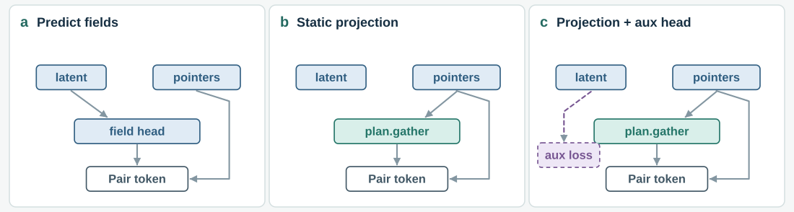

a　字段头从 latent 预测字段。b　GPU 按模型选择的实例指针 gather 编译器指明的列。c　推理仍走 b 的路线，仅在训练中为字段头增加辅助损失。三个模型都自己选择引用。

**固定条件。** 两个种子 1703/1709，每个种子三支共享配对初值、4,096 张两规则训练图与 2,000 步预算。碰撞验收合并左右面板，共 512 张非空图，910 项 Result 义务。

**判据与读数。** 第二 Run 完整图 a 为 49/41，b 为 39/37，c 为 65/67（依种子排序）。c 的遗漏为 550/579；相同条件下 MPS eager 两个 Run 中位数约 15.29/13.87 ms。完整覆盖仍然很低。

c 表明在此次碰撞分布上辅助监督值得保留。普通 IID 上该趋势没有在两个种子均复现。　档案 S1 · S2。

<a id="a09"></a>

## 图 09　消费者能否辨认同字段、异父的 Pair？

**已测干预。** 反事实样本中 A/B、字段、请求位置、tag 与干扰项都相同，只把请求从同字段的一个父改到另一个父。

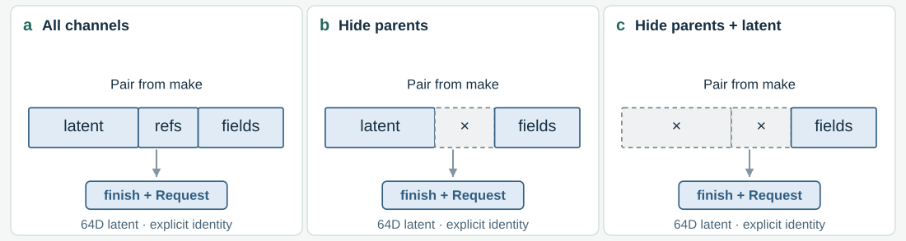

a　向 finish 提供完整 90 维 token。b　仅把两个显式父地址的符号通道置零。c　同时屏蔽 64 维 latent 与显式地址，保留激活和字段。三支都保留原始 Pair 供审计。

**固定条件。** 同一冻结模型、同一输入，只改变第二 Run 可见的通道，第一 Run 必须逐位不变。每个留出面板为 128 对反事实请求，256 图；不可把一对中的两图当独立拓扑。

**判据与读数。** 辅助头版本第二 Run 的完整非空图从 a 的 65/67 降到 b 的 4/1，c 为 0/3，分母均为 512。a 中变更请求在一对的两次均正确为 27/14 对，b 仅 1/0 对，分母为 256 对。

这是对既有权重的干预。隐状态与物理槽位仍可能携带身份；退化本身不能证明其他表示无法学习身份。　档案 S2。

<a id="a10"></a>

## 图 10　跨轮传递连续 latent 还是规范符号？

**已测配对。** 在固定锚点的路径组合任务里，将同一个学习算子反复作用于上轮实际输出，能否一直保持可解码和可接续？


a　直接反馈 64 个连续数。b　将模型自身预测的四个类别转为 40 维 one-hot，补零至 64 维。两支均预测父指针，训练采用 2–4 轮，验收连续展开 12 轮。

**固定条件。** 配对维数、数据、训练预算与种子。无教师中间状态；每轮从第一轮起累计核对绑定、字段、地址。双尾链与尾链入二环各有 256 个编号、布局、数值实例。

**判据与读数。** 12 轮全部正确：双尾链 a 为 3/0，而 b 为 256/256（每种子分母 256）。尾链入二环分别为 10/6 与 256/256。固定周期路径限制了外推范围。

本图的 64 维 typed 接口与两规则实验的 90 维混合 token 属于不同任务；完成长接续不能推出自由多行分工成功。　档案 S6。

<a id="a11"></a>

## 图 11　有固定锚点时，程序替模型完成了多少分工？

**已测任务边界。** 一锚点一产物时，程序已经指定谁开工。一个源实例有零个或多个匹配时，网络必须同时决定激活、绑定及整批覆盖。

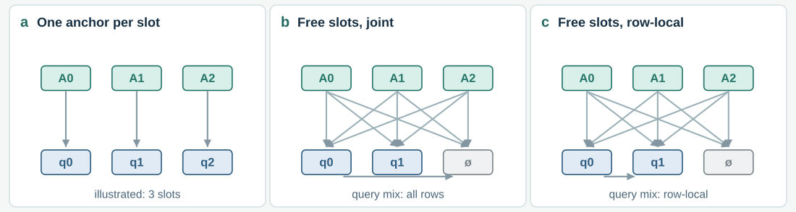

a　锚点指定每个输出槽。b　自由槽自行选 active/null 与两个指针，当前查询可以跨行交互。c　相同自由槽与整图源输入，只将当前查询交互限制在行内。b/c 均用无序目标训练。

**固定条件。** b/c 是同预算配对，只改查询通信掩码。历史 a/b 同时改变了每锚点义务数；隔离分配自由度应在同一可变匹配图上额外比较给定分配与自由分配，并披露教师分工。

**判据与读数。** 4×2 IID 完整图，b 为 63/55，c 为 84/115，分母各 256。c 的 1709 剔除空图后为 84/224；126 图只因遗漏或重复失败。源输入全可见，行内通信并不等于独立图计算。

此图的通信边连接当前轮查询；图 13 的边连接已生成历史。分别切断它们，可以定位协作使用的是哪种信息。　档案 S3 · S6。

<a id="a12"></a>

## 图 12　训练时约束总认领量，能消除重复吗？

**已测配对。** 仅按槽位监督，无序匹配可以学得局部正确但全局遗漏。给每个合法绑定加一个软认领量，可检查训练目标能解决多少问题。


a　匹配真实预测与离线目标，监督激活、两个指针和字段。b　在同一损失上增加软绑定覆盖与总激活数量误差。两者推理图完全相同。

**固定条件。** 四份原对照与四份新模型配对训练。固定初始化种子、数据、分类头、推理过程，保留所有最终权重。b 同时加入两个损失项，现有数据只能判断合并作用。

**判据与读数。** 4×2 IID 四个配对的完整数为 63→78、55→156、84→138、115→101。第一对遗漏 314→206，但重复 64→155。两个半激活槽的总权重可为一，硬解码却两者都为空。

软误差帮助诊断；验收取真实激活后的离散 token，并在非空留出集上复核。　档案 S4。

<a id="a13"></a>

## 图 13　让下一位置读取历史，是否就会互补？

**已测配对与干预。** 同一语义阶段内每轮每行发一个 token。后续查询可以读取先前发出的 90 维 token；同一轮内还看不到其他行的最终认领。


a　训练 blind 模型，把相同历史槽的载荷清零。b　另训 feedback 模型，读取所有行的实际生成历史。c　对 b 的已训权重做推理干预，只允许看同行历史。

**固定条件。** a/b 同初值同预算，GPU K/V 和历史槽数量相同。b/c 权重相同。将另训对照与推理屏蔽分别解读。源表在这些发射轮仍可读取。

**判据与读数。** 4×2 IID，a 为 94/80 完整图，b 为 34/43，c 为 35/44，均 /256。b 的首个种子对 928 项义务只激活 472 个输出；低重复率须连同漏报解释。

历史确实改变了后续 token。现有训练配方中，这条反馈路径未带来稳定的整图收益。　档案 S5。

<a id="a14"></a>

## 图 14　一份全图 latent，还是多份 local latent？

**已测 · 两个 owner 的 GPU 原型。** 第二个 Run 要判断某个跨区父能否读取。两个局部状态交换哪些信息后，才能做出与全图相同的选择？


a　两个状态槽均汇总整图 Pair。b　每个 owner 汇总本区 Pair，跨区回复带父引用与 16 维摘要。c　直接核对生效的本地端口证书和一条外部 union 的端点。

**固定条件。** 同一冻结神经生产者与四个请求槽；两种网络总协调状态各 32 维。改变跨区比例和热点，扣包、旧版、重发与仅清零远端摘要分别核对。

**判据与读数。** 384 张留出非空图，两个种子的全图版完成 382／370，局部版 378／360，清零远端摘要后 288／274。局部版完成全部 732 项同区义务。两版单图均约 6–7 ms。

短证书两种子均完成原面板 384/384。另在含额外同余的已见模板上完成 364/384，遗漏的 20 项均需构造器同余。通信在单 GPU 上模拟。　档案 S18。

<a id="a15"></a>

## 图 15　union 立即处理，还是在可见边界集中处理？

**已测 · GPU 修复与读者边界。** 同一批有序 union，只改变中途哪一步有读者。哪些修复能合并，哪次缓存的空结果必须重查？

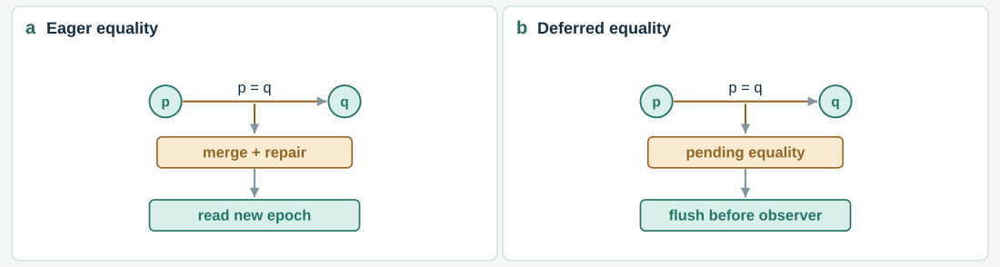

a　每条有效等价事件立即修复。b　保存待处理事件，在下一个等价读者之前统一修复。c　再把已经到达的事件合并为一次 Metal 调用。三者均核对 epoch 后读取原始父。

**固定条件。** 冻结神经生产者，初始构造器行编成条件合并指令。两个种子分别检查留出模板与含二次同余模板，每面板 384 图。旧空结果和忽略中间观察分别作为错误对照。

**判据与读数。** 含同余面板仅末尾有读者时，签名检查从 808 减到 424；每个事件后都读时同为 808。三种正确调度均恢复上图遗漏的 20 项读取。

忽略中间读者的版本最终仍可补齐全部图，但全过程仅 96/384 正确。单图端到端没有跨面板稳定加速。　档案 S19。

<a id="a16"></a>

## 图 16　组合为大 Cell 后，旧端口怎样保持有效？

**已测 · 双行提案与版本转发。** iterative Bake 可以把两个小模板组合。若外围消费者仍持有旧引用，新实例必须能解释旧引用指向的逻辑成员。


a　保留源实例。b　用带 generation 的头转发，旧物理槽复用。c　两行先联合选择不重叠的源对，再按相同行序验证提交。

**固定条件。** 冻结两种子的生产者。原 cursor 贯穿四次观察，分别在外部 union 之前或之后转移。用相同请求强制争用，另测忽略版本与双重接管。

**判据与读数。** 转发两种子均 384/384 图通过。独立两行有 164／144 次首轮冲突，一次重选即恢复；联合选择零冲突。两者均覆盖 1,104 个行内请求。

关闭占用检查后，规则输出仍全对，却有 164／144 张图发生双重接管。单图耗时没有一致收益。提交在单 GPU 上按行序执行。　档案 S20。

<a id="a17"></a>

## 图 17　逐步证明与 Bake 组合证书的成本

**已测 · 两种 GPU 证书。** 对神经网络选择的同一对 Pair 和 Request，一段跨阶段推导用多少字节传输、多少次检查才能发布？


a　传输原子等价指令，验证器重放每一步。b　传输已准入宏的索引，验证器核对有序端点和当前提交事件。两版均直接检查实际父、结果字段和观察 epoch。

**固定条件。** 同一冻结神经生产者与消费者、相同请求与有效写入顺序。独立核验错父、缺端口、旧 epoch，以及结论为真但使用了未发生事件的良构证书。

**判据与读数。** 留出图的证书总字节下降 2.4%／3.7%，完整图同为 83／73（各 /384）。两个种子端到端为 8.673→8.546、8.657→8.658 ms。

单独批量验证平均 7.5 步的规则 266 证明，设备服务区间 138→95 µs。原始神经提案多数只有一步。离线按有限边界状态枚举证明程序。　档案 S21。

<a id="a18"></a>

## 图 18　提前在 Cell 内生成未来 Run 的成员

**已测 · 三个 Run 的 GPU 可见性。** 在 A 阶段提前生成 B、C 的成员。等到原 Run 时，哪些记录能沿原槽发布，哪些会因 union 改变前提而退役？


a　成员只在原 Run 生成。b　允许私有接续，主规则饱和即退出。c　继续到整个 integral 规则集饱和。私有成员携带父代数，在原边界核对后开放。

**固定条件。** 相同神经生产者、union 时间线与观察者。54 个 Rust 源程序、486 次实际 Run；GPU 分配曲线在独立进程采集。另测只对已同类端口提前计算。

**判据与读数。** 每种子 384 张留出图全部正确。primary 原槽发布 2,868 项、退役 204 项；完整退出发布 4,248 项、退役 516 项。仅对已成立等价关系准入可复用 1,884 项，零退役。

16,384 图的页容量均止于 14 MiB，完整退出在 A 就已达到；进程 RSS 增量中位数未分出差异。单图复测没有稳定耗时优势。　档案 S22。

<a id="a19"></a>

## 图 19　有限预算下，谁决定继续、延后或停止？

**已测 · GPU 关闭与分段恢复。** 当前没有新增事实时，如何区分该 Run 已经饱和、还有消息在途以及本次预算已用完？

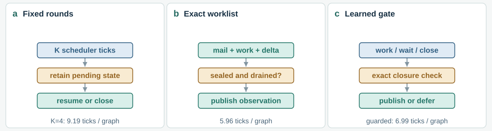

a　每 K 个 tick 检查一次，预算耗尽时保留状态。b　收件、同余和索引传播均已清空，且发送方封闭后立即开放观察。c　网络逐 tick 选择处理、等待或关闭，关闭提案可由同一精确条件复核。

**固定条件。** 同一冻结神经生产者与两个观察边界。分别延后有效 union、恒等消息、封闭通知。普通流训练延迟 3 ticks，测试罕见延迟 10 ticks，CPU 独立重放每次决策。

**判据与读数。** 384 张留出图中，8 ticks 时精确版完成 330，含账本学习门加检查为 252。至 48 ticks 均 384/384。直接采纳盲门时有 95 图假饱和，其中 45 图公开视图碰巧正确。

每个种子有 252 对盲门可见历史前缀完全相同，但一端可关闭、另一端尚有消息在途。旧执行器清除后从设备检查点按 4 ticks 恢复，观察与原始父一致。　档案 S23。

<a id="a20"></a>

## 图 20　Bake 已证明的 union 应怎样进入端口 GNN？

**已测 · 两个留出族。** 图 01 编码静态接线。若模板 T 能证明第 k 步完成后 p ≡ q，同时保留两个端口的来源，指针头能否用这一信息区分“语义同类”和“同一父实例”？

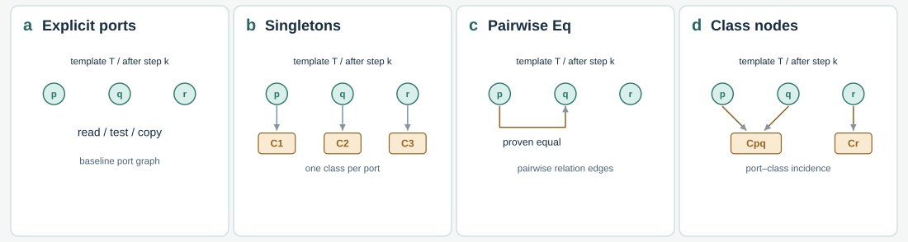

a　保留现有显式端口与等值检查。b　每个端口接自己的单例类节点，控制新增节点类型与消息路径。c　加入带生效点的、已证明的两两等价边。d　用同一份已证明分区，把 p、q 连到同一个模板局部类节点；原端口及有序身份仍保留。

**固定条件。** 固定逐端口 GNN、指针头、参数预算和源见证。c/d 提供相同等价信息；分开报消息轮数、有效传播距离、边数与缓存成本。编译时绑定证明、前提、sort、模板版本及最早可见步骤；外部实例后来发生的 union 另行处理。

**判据与读数。** 384 张非空图，a 完整 49/41，b 为 79/34，c 为 61/65，d 为 59/64。擦除生效证书后，c 降到 44/53，d 降到 34/44。两种子均未观察到类节点优于两两边。

10 个经原生重放的模板，384 图均已供齐所需父。同类换源时每臂至多 1/30 对能两端都选对；局部等价判定与来源选择必须分别验收。　档案 S11 · S12。

<a id="a21"></a>

## 图 21　初始图如何变成可读的 Cell？

**已测 · 真实输入。** 原图撤掉以后，读者能否恢复每条有序边，同时区分事实地址和等价类？

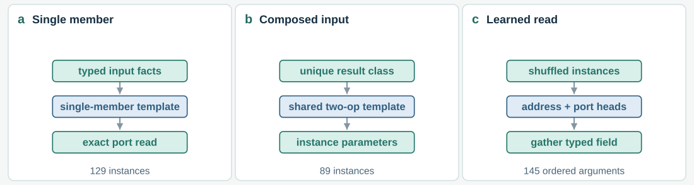

a　每条事实使用单成员模板。b　唯一的局部类边允许配对两个成员。c　从打乱的实例库中选择地址和端口，按所选槽读取。两种布局分别与精确读取配对。

**固定条件。** Rust 离线 Bake 两个原始程序。在相同冻结输入上检查算子、类型、列顺序、可见性，以及前三个 Run 的绑定和写入。

**判据与读数。** 两例的初始 129 行完全相同，双成员布局有 89 个实例，145 个有序参数全部正确。分别重编码初始化后的不同图，223 行／342 参数和 320 行／583 参数均完整恢复。

DUMMYCTX 和 InFunc 保留两个不同的成员地址，结果属于同一个 Assumption 类。历史父只能从已有见证恢复。　档案 S24。

<a id="a22"></a>

## 图 22　实际 Pass 3 中两行生成了什么？

**实跑 · 首版未对齐。** 在同一 Run 的冻结图上分别匹配不同的入口见证，能否保住原调度、有效写入和 Spine 接续？

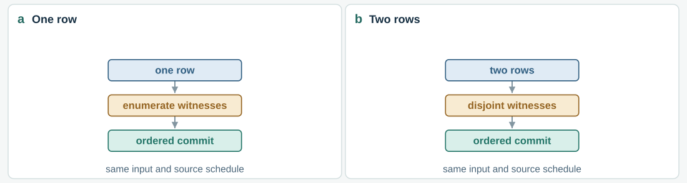

a　一个 row 枚举入口见证。b　两个 row 分担不相交的入口，各自在 GPU 生成绑定，再按有序输入提交。分工由调度策略确定。

**固定条件。** 同一设备镜像，CPU 只做离线准备和事后审计。终图固定原始锚点并比较全部类型化事实。接续与绑定分别计数。

**判据与读数。** sum-bits 两行生成 3,747＋3,518 个不同绑定；dot-product 为 3,565＋3,138。设备一行与两行的结果相同。对 CPU 终图分别多／少 2 行和 4 行。

首版在 Run 9／11 已缺 Spine。图 23–29 保留该失败对照，并给出完成逐 Run 修复后的正式验收与计时。　档案 S24。

<a id="a23"></a>

## 图 23　union 和键目录分别在何时生效？

**已测 · 两个完整 Pass 3。** 立即 union 或 Run 末 union，各配对现算键或已发布键。四臂共享相同匹配与有序 merge。

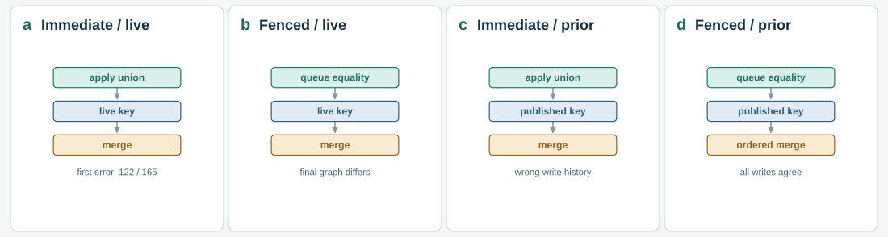

a　立即＋现算。b　读前集中＋现算。c　立即＋已发布。d　Run 末集中＋已发布。

**固定条件。** 真实两个 Pass 3 的 CPU 逐事件审计区分 RHS 写入、repair 写入、构造器出生与 union。

**判据与读数。** 立即模式首个写入数量差在 Run 122／165。只改时机不能保证终图；只改键目录，两例终图正确但中间写入仍错。两者都改才保住观察边界。

同一 Run 后面的 RHS 不得提前看到本轮排队的 union；发生碰撞时，以键目录的实际幸存者作为有序 merge 的旧值。　档案 S25。

<a id="a24"></a>

## 图 24　跨 Run 的匹配由谁完成？

**已测 · 两个完整 Pass 3。** 普通查询与 Spine 可以产生相同事实。怎样检验实际接续？

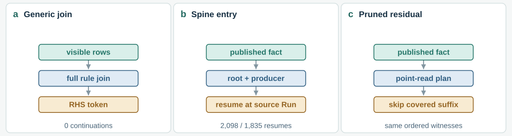

a　普通关系查询，无正接续。b　已发布见证携带根、生产者、深度，消费者按编译入口接续。c　同一入口接管后提早剪去残余分支。

**固定条件。** 原始 Run、设备事实、已发布键相同。检查每次接续的 RHS 序号、根、生产者、消费者和深度。

**判据与读数。** 两例各有 2,098／1,835 次实际接续；第一处是 Run 9／11，进入时最大深度 9／11。各 Run 的完整记录摘要均与源一致。

提前剪枝保持语义，单次耗时的方向依负载变化。完整绑定不能替代一次真实 Spine 接续。　档案 S25。

<a id="a25"></a>

## 图 25　原语使用什么设备表示？

**已测 · 两个完整 Pass 3。** 把数值送入浮点计算时，哪些条件能保证原来的 i64 语义？

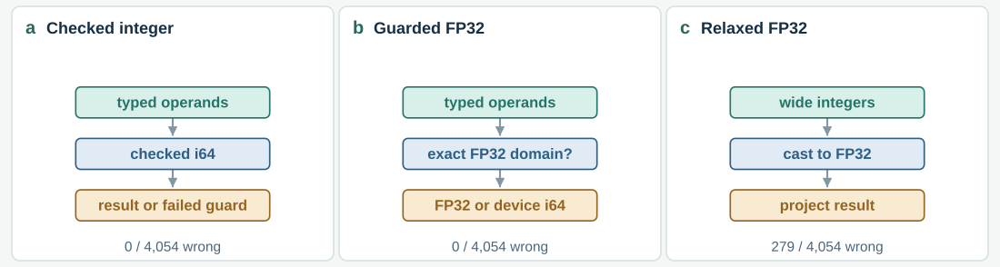

a　有检查的整数指令。b　值域与结果可精确表示时走 FP32，其余在设备上走整数。c　放宽值域，保留其错误输出作对照。

**固定条件。** 同一 Metal 例程用于真实 Pass 3 和边界测试。等价类身份比较始终使用整数地址。

**判据与读数。** 4,054 个边界用例中三臂的错误数为 0、0、279。受保护浮点实际处理 76,584／98,317 与 101,255／134,017 次调用。

三臂在这两个特定 Pass 3 上刚好给出相同结果。覆盖整数溢出、除余和浮点相邻整数的测试决定了哪些路径可以采用。　档案 S25。

<a id="a26"></a>

## 图 26　绑定输入怎样迭代表？

**已测 · 两个完整 Pass 3。** 当表键的全部列都已绑定，继续遍历其余行有多少成本？

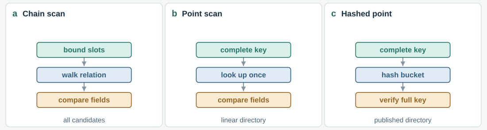

a　按入口链逐行读。b　完整键只查一次，底层仍查链表。c　按已发布完整键选哈希桶，再逐列复核碰撞。

**固定条件。** 两行各 32 个遍历分片，使用共同的 Run 快照、Spine 和共享输出区。只改变读取策略。

**判据与读数。** 一次整轮 GPU 推理，sum-bits 为 1.89／1.87／1.57 s；dot-product 为 3.58／3.67／3.42 s。三组有序输出均通过。

保留 hash 点查作为默认；键尚不完整的原子继续枚举，不能把候选数与所有哈希比较次数混为一个指标。　档案 S25。

<a id="a27"></a>

## 图 27　批量化应放在 Run 内还是 Run 间？

**已测 · 两个完整 Pass 3。** 多个源 Run 在同一 GPU 线程组推进，能否抵消规则之间的串行依赖？

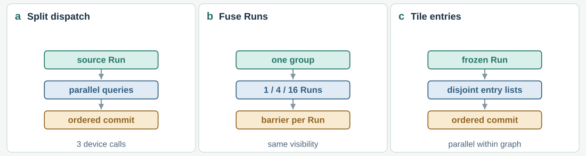

a　各 Run 分别提交控制、查询和有序提交。b　每个线程组最多推进 1／4／16 个 Run。c　保留源 Run，拆分单图内各入口的独立见证范围。

**固定条件。** 三种工作分配都由设备的源程序计数器与 epoch 控制；合并提交仍保留每个观察边界。

**判据与读数。** 低并行度下，合并 1→16 个 Run 为 26.12→25.78 s 和 34.80→34.55 s。单 Run 内每行 1→8 个遍历分片则为 11.29→2.94 s 和 14.62→4.72 s。

前一组压缩了 CPU 发射次数，也把更多工作限制在单线程组。后一组增加同一张图的入口并行度。　档案 S25。

<a id="a28"></a>

## 图 28　并行分片之间如何存放绑定 token？

**已测 · 两个完整 Pass 3。** 为更多分片预留独立 bank 会放大内存，是否可以按真正需要的字段与匹配数分配？

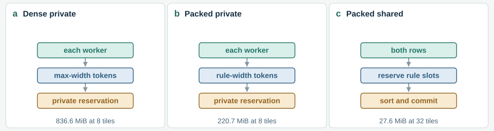

a　按最多槽位为每个分片预留。b　模板提供活跃绑定宽度，容量仍逐分片预留。c　两行在每个规则的共享区内原子预留，再有序提交。

**固定条件。** 相同输入和容量失败语义。比较槽宽、每分片容量 32／64／256 和规则共享区。重叠提案在提交前独立计数。

**判据与读数。** 每行 8 分片，按实际宽度可将 836.6 MiB 降至 220.7 MiB。每行 32 分片时，私有 256 槽为 882.6 MiB，共享区为 27.6 MiB。

这衡量实际 token 张量预留字节。共享区显式处理容量耗尽，不能静默丢弃尾部匹配。　档案 S25。

<a id="a29"></a>

## 图 29　语义一致时，两行互补是否带来加速？

**已测 · 两个完整 Pass 3。** 在同一张真实 Pass 3 图上，怎样区分额外遍历线程、行间互补与学习分工？

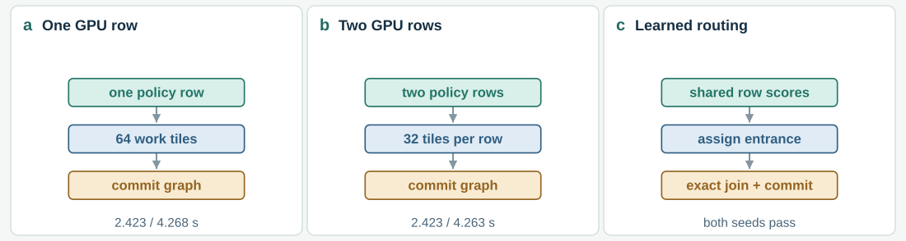

a　一个 row、64 分片。b　两个 row、各 32 分片。c　两个学习分数为入口分工，以同一精确匹配程序输出绑定。三版与 Rust Cell CPU 的完整 CLI 比较。

**固定条件。** 源 RHS、有效写入、Spine 及完整终图全对齐后才计时。每次新进程含载入、推理、导出和退出，一次预热、三次交错测量。

**判据与读数。** sum-bits 两行独占 3,369／3,868 项，共提 28 项。dot-product 独占 3,572／3,126，共提 6 项。两行 CLI 为 2.423／4.263 s，Cell CPU 为 0.126／0.126 s。

一行同预算为 2.423／4.268 s。学习种子 1703 为 2.665／4.533 s，1709 为 2.586／4.341 s；均通过语义验收。　档案 S25。

<a id="a30"></a>

## 图 30　设备常驻以后还差多少？

**已测 · 两个完整 Pass 3。** 把同一个 Pass 3 从新进程启动和从已注入设备状态启动，各需多久？

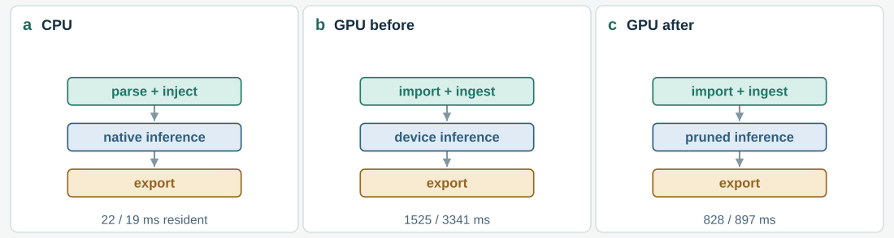

a　Rust Cell CPU。b　原 GPU 入口。c　提前过滤增量前缀。

**固定条件。** 冷启动每臂八次交错，含导出和退出。GPU 常驻在同一进程轮换六种顺序，每次恢复初始设备状态。

**判据与读数。** sum-bits 的冷 CLI 为 134／2,402／1,682 ms，常驻推理为 22.5／1,525／828 ms。dot-product 分别为 132／4,284／1,840 和 18.7／3,341／897 ms。

原版 GPU 启动并导入 Python 约 0.56 s。优化后常驻推理仍比 CPU 耗时约 37／48 倍。　档案 S26。

<a id="a31"></a>

## 图 31　匹配、提交与 repair 各占多久？

**已测 · 两个完整 Pass 3。** 分离生产内核中本来融合的操作，哪些阶段主导了延迟？

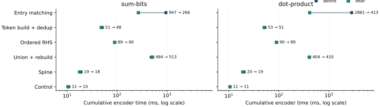

蓝点为原版，绿方块为表水位与增量前缀同时早筛。每点累计一份真实 Pass 3 的 Metal encoder 硬件时间戳。

**固定条件。** 具名诊断回放逐项对齐有序事件、物理行和类映射。无插桩的墙钟另测。横轴为对数刻度。

**判据与读数。** 原版入口占 sum-bits 的 59.2%、dot-product 的 83.2%。优化后入口降至 266／413 ms，repair 为 513／410 ms。

token 生成与去重合计约 50 ms；有序 RHS 约 90 ms。Spine 含搜索与发布见证安装，碰撞转发计入 repair。　档案 S26。

<a id="a32"></a>

## 图 32　增量条件应当在哪一层检查？

**已测 · 两个完整 Pass 3。** 若最后一个可能携带增量的原子也匹配到旧事实，可以提前结束多少搜索？

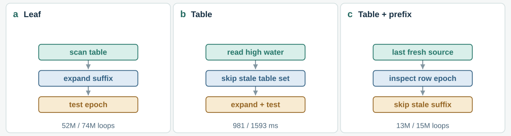

a　在叶子验证增量。b　按各表最近变化的 epoch 排除全旧规则。c　在最后一个可能提供增量的原子处剪枝。

**固定条件。** 各表维护保守上界，等于规则水位仍有资格。新事实可以来自非 pivot。两例逐 Run 对齐 RHS、有效写入、Spine 和终图。

**判据与读数。** 含回溯的残余 DFS 循环分别从 5,219 万降至 1,315 万、7,385 万降至 1,504 万。表水位共 1,604 字节。

额外维护每表 64 个分片水位仅再减少约 1% 遍历。默认保留表水位和前缀早筛。　档案 S26。

<a id="a33"></a>

## 图 33　GPU 给出见证引用，CPU 实际少做什么？

**已测 · 两个完整 Pass 3。** 在原 Cell CPU 中跳过可接管规则的匹配，保留有序提交，会减少哪些常驻入口状态？

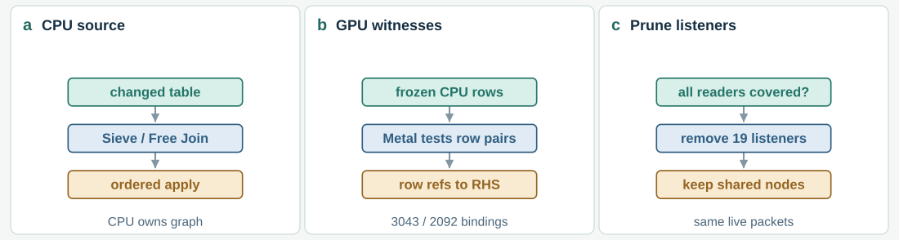

a　CPU 查找绑定并提交。b　GPU 从冻结的源 Run 关系行生成一组行引用，CPU 按模板投影到 RHS 并提交。c　从发布订阅中移除全部消费者均已被静态接管的入口节点。

**固定条件。** 两个关系原子以内且没有运行中 Spine 消费者时接管。带 primitive、更长查询和有活动 Spine 的规则仍在 CPU 匹配。GPU 出错直接中止。

**判据与读数。** GPU 提供 3,043／7,265 与 2,092／6,704 个实际 RHS 输入。CPU 残余候选由 8,769／8,022 降到 5,583／5,834，活入口包由 3,665／3,467 降到 3,444／3,320。

单独移除 19 个专属订阅后，两例的节点通知和活包数都没有进一步下降。共享入口的其他消费者、Spine 和 union 后的修复仍依赖 CPU。　档案 S27。

<a id="a34"></a>

## 图 34　一次源 Run 可以合并多少次设备往返？

**已测 · 两个完整 Pass 3。** 固定 token 和有序写入，分别比较进程间交接、共享 Metal 缓冲区与同 Run 批量生成。

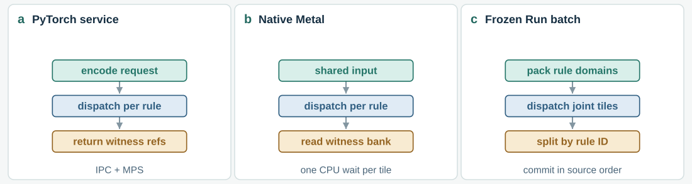

a　PyTorch 服务逐规则交换。b　同一 Metal 匹配内核在 Rust 进程内使用共享缓冲区。c　冻结一个 Run，将多条独立查询打成一批，CPU 仍逐规则有序提交。

**固定条件。** 十次轮换新进程，另一次预热。计时版关闭轨迹收集；每一组另跑完整有序验收。大批次按 65,536 个输入对分片。

**判据与读数。** 两例混合推理中位数分别为 1837.6／1164.7 ms（PyTorch）、407.4／245.0 ms（进程内单条）和 150.0／130.9 ms（按 Run 合批）。CPU 为 21.9／18.5 ms。

合批后设备发射 369／324 次，输入准备 29.8／24.6 ms，设备交接 95.5／84.8 ms。CPU 打包的关系行和设备检查的输入对数与单条模式相同。　档案 S27。

<a id="a35"></a>

## 图 35　一个完整键，值得让网络选父行吗？

**已测 · 两个完整 Pass 3。** 编译器证明每个锚点至多对应一个目标行。让网络从常驻端口选父，再验证和补查，能否比直接点查更快？

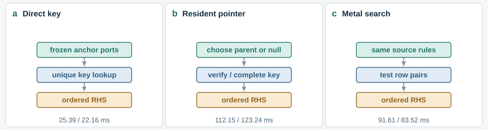

a　CPU 直接查完整键。b　共享端口模型选择一个父行或弃权，CPU 检查真实键、补查未解锚点。c　沿用精确 Metal 搜索。三个实验臂处理相同入口和 Spine 来源。

**固定条件。** 每例静态准入 64 条规则，八次交错新进程；逐 Run 对齐 RHS、有效写入、Spine、终图。训练仅用合成键集。

**判据与读数。** sum-bits 整轮推理分别为 25.39／112.15／91.61 ms；dot-product 为 22.16／123.24／83.52 ms。模型独立提供 680／889 与 563／952 个有效绑定。

两例分别出现 6,509／8,176 个错父引用。前向与交接约 86／84 ms，全部直接索引读取仅 1.31／1.11 ms。强制全部弃权后补查恢复所有绑定。　档案 S28。

<a id="a36"></a>

## 图 36　集合里的两个表达式 union 后，长度何时变成 1？

**已测 · eggcc 内存回归与设备控制。** 集合按当前等价类去重。设备怎样处理旧成员引用、集合键和已经发布的长度？

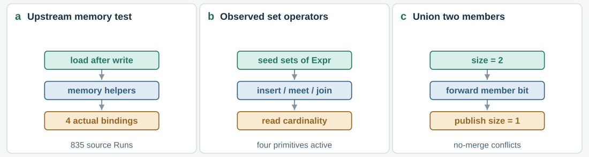

a　上游 load_after_write 的完整调度。b　给同一负载加集合观察表达式，原规则执行插入、交、并和长度。c　动态创建集合、中途 union，比较允许取最小值和禁止合并的长度字段。

**固定条件。** 所有集合值来自初图或设备计算。逐 Run 核对 RHS、有效写入、Spine 和终图，另从隔离目录运行。

**判据与读数。** 真实用例与增加观察的用例各 835 Run。后者集合维护约 40.11 µs，占常驻推理 41.17 ms 的 0.097%。动态例在 Run 2 写入 2，Run 3 合并成员，Run 4 向同一行写入 1。

时间为配对重复放大估计。原例的 memory-helpers 有 4 个绑定，但无集合值。原始 ExprSet-length 的 :no-merge 对同键 2→1 报错，两端一致。每次推理最多登记 63 个不同成员槽。　档案 S29。

<a id="a37"></a>

## 图 37　已有块最多能跳过多少搜索和修复？

**已测 · 两个完整 Pass 3。** 完美选择已有块，仍支付边界验证和外部通知时，哪些节省足以改变整轮速度？

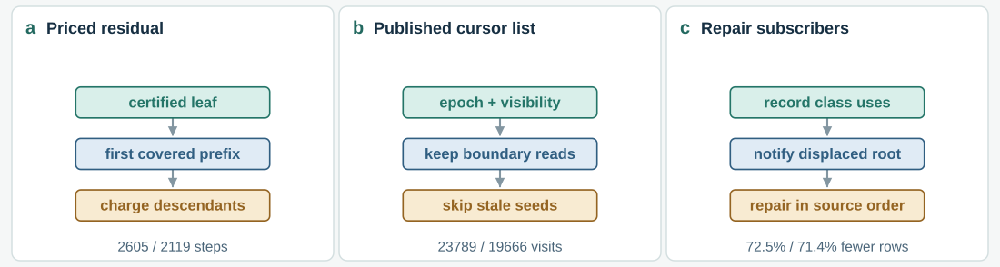

a　按最早有证书的入口为残余 DFS 计价。b　切换已有块，并维护已发布的锚点列表。c　为可修复构造器登记反向依赖，保留碰撞处理与顺序发布。

**固定条件。** sum-bits 使用 32 个现有叶块。dot-product 原生无块，跨负载只转移通过类型与规则校验的 30 个。每个剩余源 Run 均保留提交边界。

**判据与读数。** DFS 只少 2,605／2,119 步。通知后可少检查 284,230／224,346 个 repair 行（72.5%／71.4%），实际达到该条件上限。源内核发射减少 0 次。

六种交错顺序：基线 895.77／934.98 ms，块＋锚点列表 918.53／966.05 ms，再加反向通知 604.99／715.13 ms。反向目录约 32.4 MiB，未训练网络。　档案 S30。

<a id="a38"></a>

## 图 38　按共同修复选择模板，能否把 repair 收进 Cell？

**已测 · 真实 Pass 3 订阅分组。** 同一 union 改变 Get 的结果，也可能改变 Single 的键。哪种轨迹最能发现值得放进同一实例的成员？

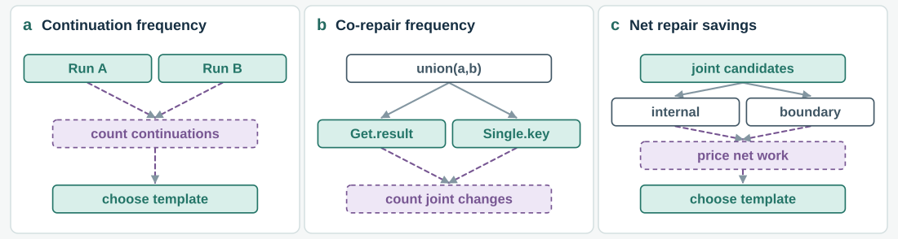

a　按跨 Run 接续支持数选块。b　按同一次 union 中共同受影响的端口次数选块。c　在同一候选并集中，按可省外部通知、键更新和碰撞探测的净时间选块。

**固定条件。** 四个独立训练家族选出八条带类型的边；相同深度与库预算。按整轮配对时间从四份非空候选库选成本最低者，再冻结并测两个开发、两个留出和两个锚点。

**判据与读数。** 留出 gemm-bias-relu 中，原逐行／接续／共同修复／成本选择发出 6,114／5,979／5,473／5,682 次通知，整轮为 1,973／2,003／2,004／2,007 ms。

stable-argmax 中共同修复少发 328 次通知，但整轮由 644.5 增至 662.6 ms。这里合并订阅并保留物理行，碰撞和外部键维护仍需执行。　档案 S30 / S31 / S32。

<a id="a39"></a>

## 图 39　读者多一层，扩大 Cell 还能省多少？

**已测 · 物理成员嵌套对照。** 执行 union(a,b) 后，Get 的结果、Single 的键和 ContextOf 的键都引用了被替换的代表元。将哪些读者一同纳入实例才合算？

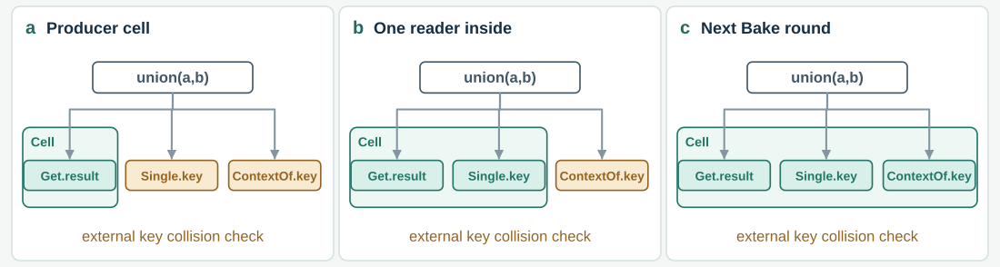

a　只切换生产者的结果槽变体。b　组合一个共同受影响的读者。c　把 b 当作下一轮的基本单元，再加入第二个读者。

**固定条件。** 对同一冻结库依次测生产者端口掩码、一个读者、两个读者。嵌套模式优先保留旧配对；可能成为下一生产者的行不占第二个读者位。另测无此限制的贪心模式。

**判据与读数。** gemm-bias-relu 保留原来的 402/402 对，通知依次为 6,114／5,657／5,524；整轮为 1,917／1,946／1,946 ms。贪心扩张只保留 321/402 对。

仅增加一个目录外读者的五 Run 反例中，双读者组的通知从 3 增到 4，键探测从 2 增到 4，两次碰撞均执行。stable-argmax 的 236 对首次配对也全部保留。　档案 S31 / S32。

<a id="a40"></a>

## 图 40　把反向订阅记到实例，能否少发通知？

**已测 · 同一实际分组。** 多个成员同时订阅同一代表元时，一次实例级通知能否承担原来的逐行唤醒？

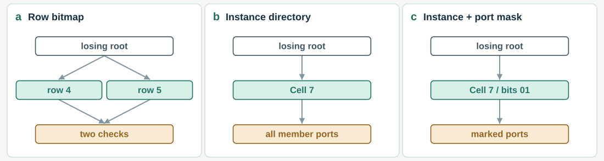

a　保留图 37 的根到行位图。b　根指向 Cell 实例，实例内按模板检测受影响端口。c　实例订阅再携带端口掩码，仅访问被标记的位置。

**固定条件。** 三臂固定相同冻结库和实际成员划分；核对实例数、读者数、整键探测、碰撞候选与胜者。十次交错常驻推理，计数另测。

**判据与读数。** gemm-bias-relu 逐行／实例／端口掩码耗时 1,967.7／1,971.0／2,012.9 ms。实例直接广播多访问 319 行，端口掩码消掉这些访问，仍有 674,008 次碰撞候选比较。

在原反向索引外，行／实例分组元数据预留 198,656 字节，端口掩码目录预留 8,751,104 字节。逻辑通知变少后，根目录仍访问同样多的数据字，引出图 55。　档案 S30 / S32。

<a id="a41"></a>

## 图 41　哪些局部区域值得常驻反向目录？

**已测 · 同预算区域选择。** 高扇出区域能回收登记成本，低频区域也要付费。区域选择需要学习吗？

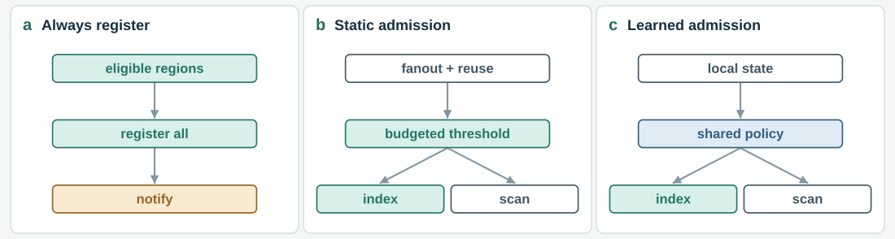

a　所有合格区域登记。b　在固定空间预算内按训练集标定的扇出和复用阈值登记。c　同预算下让共享策略选登记、保留或退出。

**固定条件。** 每区域 32 行、每 32 Run 决策，静态与共享岭回归策略最多保留 32 个区域。四个家族训练，两个开发、两个留出、两个锚点；另做离线最小成本流选择的实际设备回放。

**判据与读数。** 留出 gemm-bias-relu 中，完整／静态／学习目录为 2,008／2,966／3,010 ms。索引由 33.95 MB 缩至 4.25 MB。学习策略换入 160 次、退出 128 次；静态换入 32 次且无退出。

事后最优工作计价的回放为 3,007 ms，仍支付全部建表与通知成本。它对指定工作量价格最优；墙钟另测。两个留出家族上学习策略均未超过同预算静态阈值。　档案 S26 / S30 / S34。

<a id="a42"></a>

## 图 42　一次模型提案应承担几个规则步骤？

**已测 · 原生 Pass 3 对照。** 一次设备前向的成本能否由一个完整组合块内的多个合法操作摊薄？

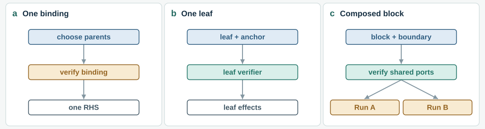

a　每次提一个规则绑定。b　每次提一个已证叶块。c　可提库中已证的跨 Run 组合及其边界引用；到原 Run 才发布各项效果。

**固定条件。** 使用同一冻结库、图快照、可见端口和训练轨迹，同一批义务在三种粒度下展开。直接点查和原调度继续作为执行参照。

**判据与读数。** sum-bits 原始／叶／组合的神经 RHS 为 58／59／80 和 54／56／76。单份证书真实完成两次不同提交 21／20 次。dot-product 的组合额外得到 14／9 次。

一个源 Run 两行，各发行一次。保持根选择、源顺序、有效写入与终图相同；净耗时仍高于精确 Rust 搜索。　档案 S50。

<a id="a43"></a>

## 图 43　生成可变端口实例，必须预测哪些引用？

**已测 · 原生 Pass 3 对照。** 模板 5 存四个实例参数，其中 Base 的结果可直接接给第二个成员。模型是否还需要输出这条内部连线？

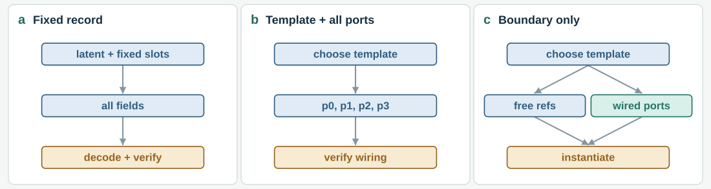

a　固定宽度输出全部字段及引用，超出预算的项计作未完成。b　先选模板，再输出每个逻辑端口的引用。c　同样先选模板，仅填编译器不能唯一确定的边界端口，其余静态投影。

**固定条件。** 同一批模板选择、有效实例、指针地址空间与精确验证器。逐项区分成员字段数、实例参数数和待预测数；按这三种宽度及冷模板分层。

**判据与读数。** sum-bits／1703，4 槽复制版由 91 条子 RHS 降为 82；dot-product 由 195 降为 169。6 槽／全逻辑引用／仅自由边界均恢复到 91／195。

固定值在端口可见后复制与在首 Run 前预测所有原始值分开。后者在这两例各只提交 1 条子 RHS。　档案 S51。

<a id="a44"></a>

## 图 44　Pass 3 新建事实何时进入组合 Cell？

**已测 · 原生 Pass 3 对照。** 初图可以绑定模板，RHS 新建事实目前写动态行。在运行中改变它们的所有权，收益出现在哪一步？

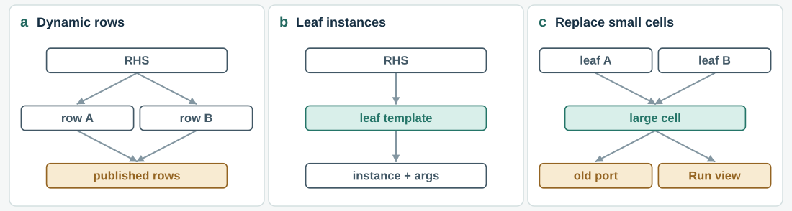

a　新事实写入动态行。b　命中叶模板时立即保存实例描述符和参数。c　在 b 上按已验证的组合替换小实例，在原 Run 只开放已有成员视图。

**固定条件。** 固定相同库与精确准入，先排除模型误差。转移后屏蔽旧载荷，保留带代数的旧端口转发。未覆盖形状走同一动态行路径。

**判据与读数。** 相同 920／951 个准入。sum-bits 的 owner 从 412 降至 354，Graph 从叶存储 2,002,295 B 降至组合 1,980,455 B；动态行占 1,858,067 B。

真实视图和来源 ID 逐 Run 核对。组合使父 owner 原地生长，避免分配独立子 owner；未把仍供外部引用的句柄算作已释放。　档案 S52。

<a id="a45"></a>

## 图 45　一批短证书何时足以关闭整项待办？

**已测 · 正例点查与桶覆盖。** 单条合法绑定容易核对，但另一个合法父可能仍在同一键桶里。如何知道没有遗漏？

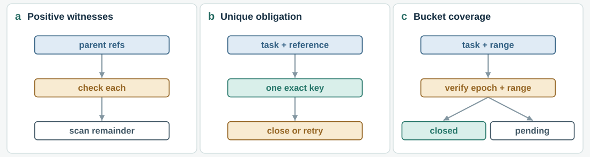

a　只验证每条正例的来源，随后精确扫描补齐覆盖。b　token 认领待办，由完整唯一键点查关闭该键。c　对非唯一键，以有版本的精确桶范围及其枚举见证关闭该段。

**固定条件。** 三臂都跑相同的唯一键与一对多面板。b 遇多值键同 a 补查；c 的剩余区间继续排队。全弃权、重复认领、漏一个同键父、union 后旧版本都作反例。

**判据与读数。** sum-bits 的范围页单独由精确枚举补入 16／30 个 RHS，网络自己的胜者仍为 106／112。dot-product 的额外枚举为 24／21。两负载两种子的整轮时间均增加。

同键父 174 与 208 分别支持 Run 98 的 RHS #379 与 #380。拿走 208，174 的正例仍成立，页覆盖验证拒绝关闭。　档案 S46。

<a id="a46"></a>

## 图 46　错父来自桶碰撞，还是模型容量不足？

**已测 · 两种子与真实完整键。** 当两个不同父在所有键列上落入相同桶时，现有指针头收到相同输入。应改变哪些特征？

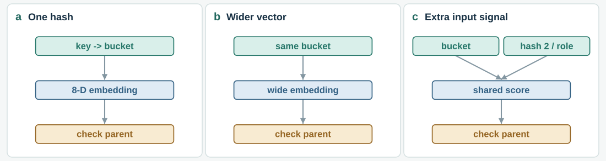

a　沿用 128 桶。b　保留相同桶身份，加宽共享向量。c　保持与 b 相近的参数和打分预算，加入独立散列或编译器来源端口角色；两种新特征分别测。

**固定条件。** 合成键训练 800 步，种子 1703／1709。单桶 8 维头为 1,025 参数；16 维单桶、双散列、来源角色各 2,049。四臂候选位置和查找义务一致，逐提案额外审计物理父。

**判据与读数。** sum-bits 两个种子，窄／宽单桶均供齐 680/889，双散列为 889/889。gemm-bias-relu 的同编码竞争义务由 44,197 降至 2,471，实际供齐 2,053/2,103。

第二路散列使用独立域前缀；角色取当前可解析的构造器来源，初始或已释放来源用未知值。sum-bits 种子 1703 双散列仍需约 102 ms，直接点查约 26 ms。　档案 S28 / S33。

<a id="a47"></a>

## 图 47　库越大，是否需要更多独立 embedding？

**已测 · 冷组合与库增长。** 迭代 Bake 加入未训练过的组合时，同一套权重能否立即对新模板打分？

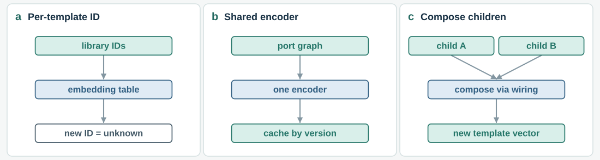

a　每模板一个可学 ID 向量，冷 ID 使用固定未知向量。b　所有模板共享结构编码器，缓存各自的端口向量。c　由左右子模板、接线和保留端口直接组合出大模板向量。

**固定条件。** 三臂读取同一候选库；分别在冻结的小、中、大库快照上交叉比较。训练中见过的叶块、未见组合及未见整族分别统计，策略主干和实例数固定。

**判据与读数。** 64 单元大库中，四程序两种子合计 ID／整图／组合编码有 30／31／31 个实际子 RHS，其中新单元 2／3／4 个。新 join 的编码缓存降低构建成本。

给对根的冷评分与真实根能到达的机会分开。新增成功均只有一个合法 join，不能证明能在多个新后继中选对。　档案 S48。

<a id="a48"></a>

## 图 48　加模型参数与加真实家族，分别解决什么？

**已测 · 容量与训练家族。** 在相同短证书任务上交叉改变模型规模与训练来源，定位欠拟合、数据覆盖不足和前向开销。

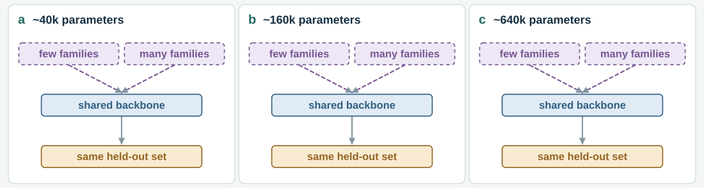

a–c　共享策略总参数拟设约 40k、160k、640k。每档都在少家族、多家族两套数据上训练，形成 3×2 矩阵；记录实际可训练参数及权重字节。

**固定条件。** 固定端口特征、库、输出格式与两个种子 1703/1709。主对照匹配更新数、图数和抽样预算，另报告训练算力。测试集与成本标定在实验前冻结。

**判据与读数。** 三档分别为 40,093、159,633、640,665 个参数。两个训练家族时 dot-product 三档两种子均贡献 173 个 RHS；四家族中档为 197／197，大档为 195／197。

固定每模型 400 次训练更新与 51,200 个候选样本。完整 Pass 3 常驻耗时、留出源程序和训练读数见 S44。　档案 S44。

<a id="a49"></a>

## 图 49　哪些训练样本能教会模型识别 repair 边界？

**已测 · 原生 Pass 3 对照。** 完全相同的模板与 union 位置，只多一个外部 Single 读者时，模型是否会留下正确的通知义务？

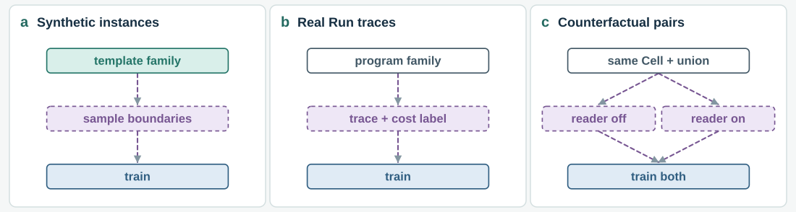

a　合成边界实例。b　由真实程序逐 Run 采集待办、候选、来源和净成本。c　在 b 的相同样本预算中替换一部分为配对反例，只改外部读者、同键父或另一行是否已认领。

**固定条件。** 先按程序家族拆分，再 Bake、截取 Run 窗口和重编号。反例两半同 split，整模板族另留出。8 个现有 Bril 家族按 4／2／2 分组，先采标签并独立复验。

**判据与读数。** GEMM／1703 留出边界，合成／真实／真实＋配对反例的原始漏判为 404／10／11（分母 3,138）。外部读者翻转的两端皆对 8／210／319（分母 844）。

Rust 在错误选择后保留真实通知与同键碰撞。简单的确定性结果端口检查已取得接近相同的总收益。　档案 S53。

<a id="a50"></a>

## 图 50　下一轮 latent 需要读到哪些验证结果？

**已测 · 两波设备端提案。** 每个 Run 里，两行各提案两次。第一波已经通过验真的地址，第二波还要再领一次吗？

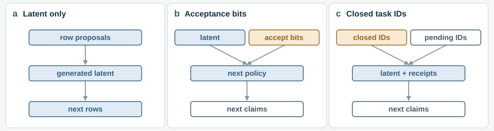

a　盲读上轮生成的 token。b　再读两行的验收位。c　再读任务地址和拒绝、过期、重复状态。同一个 c 权重另测屏蔽全部回执及互换两行回执的地址。

**固定条件。** 三个训练臂使用相同的四个训练家族、样本窗口、480 次更新和双种子。每 Run 四个提案槽，两波验真后仅做一次精确补查。各臂的 CPU 审计均在推理结束后执行。

**判据与读数。** sum-bits 的第二波实际 RHS（1703／1709）为盲读 32／1、验收位 35／49、任务回执 50／53。dot-product 分别为 25／1、27／37、38／39。索引、验证和补查均计入常驻墙钟。

即使第二波贡献增长，带回执的 sum-bits 仍仅供齐 4／5 个非空 Run，分母为 527。相同权重的屏蔽结果及四个程序的完整读数见 S36。　档案 S36。

<a id="a51"></a>

## 图 51　同一批待办应由谁分给多个 row？

**已测 · 原生 Pass 3 对照。** 固定相同可见输入和总输出槽，比较自由认领、静态分区与可转交的认领。

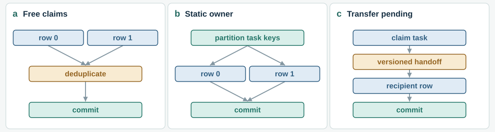

a　各行自由提案，提交前去重。b　按稳定待办键静态分区，每项有一行可选。c　同行先独占认领，边界允许转交未完项并携带旧来源和版本。

**固定条件。** 先用单行验证共同证书，再以 2×4 为主对照，1×8 与 4×2 做等槽预算复核。保持同一读视图、有序提交和资源预算；串行轨迹不提供 row 标签。

**判据与读数。** 2 行 × 4 波，sum-bits 的自由／静态所有者神经 RHS 为 80→325、76→355；dot-product 为 65→260、55→285。再允许转交，这四组净胜者不变。

sum-bits Run 98 两行都发出同一叶、地址与宏，只有一个根赢得 #413；Run 544 同一连接键上的两个不同父都能获胜。共享键不能替代来源地址。　档案 S54。

<a id="a52"></a>

## 图 52　用净节省给多 row 分配信用，能否超过集合监督？

**已测 · 原生 Pass 3 对照。** 在程序没有天然并行标签时，哪种信号能鼓励两行共同关闭昂贵待办？

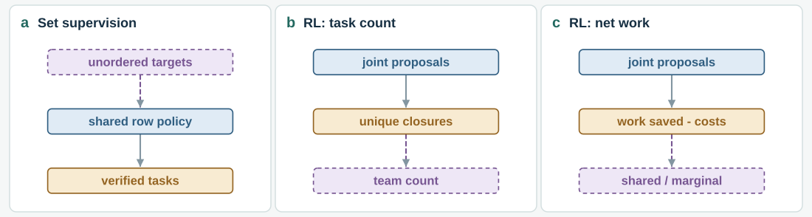

a　仅用无序集合监督。b　从同一监督检查点出发，用成功关闭的不同待办数给团队奖励。c　相同 RL 预算下，以真实净节省加权；同一项工作只计一次。

**固定条件。** 固定图 51 的分工机制、前向预算、优化步数及 rollout 数。另在加权臂内固定其他行动，比较有／无逐行反事实基线。成本只用训练 split 标定。

**判据与读数。** sum-bits／1709 的集合监督、团队、净工作加权及逐行反事实分获 453、456、399、404 个 RHS。dot-product／1709 为 424、426、339、348。

固定源轨迹和每行四槽，sum-bits／dot-product 的静态所有权参考上限是 576／475；原生策略实际最好为 456／426。成本模型只用训练家族标定。　档案 S55。

<a id="a53"></a>

## 图 53　同一张块证书在 CPU 还是 GPU 验证更划算？

**已测 · 原生 Pass 3 对照。** 在提案内容完全相同时，把短证书送到事实所有者核验，和维护设备增量视图分别要付多少成本？

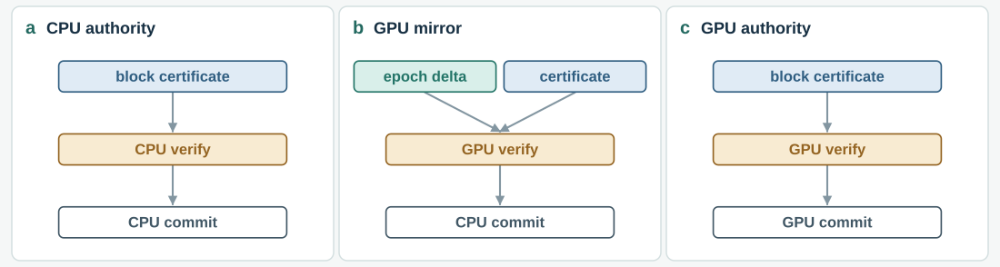

a　CPU 权威图按稳定引用验证并提交。b　CPU 发布逐 epoch 端口增量，GPU 批量验证，CPU 按原序提交。c　设备持有权威图，验证与提交均在 GPU。

**固定条件。** 先在隔离回放中喂入同一合法／错父／过期证书流，明确离线上限；再用同一冻结模型在线独立生成。记录行号重映射和跨设备传输，两轮数值分开。

**判据与读数。** sum-bits／1703 相同 89 条子 RHS。CPU＋Rust 25.84 ms，GPU＋Rust 27.71，GPU 验真＋CPU 提交 80.22，全 GPU 877.71。按待验订阅触发，同组 GPU 调用 171→2。

Rust 跟踪源端口、Metal 检验读入的版本并返回字段。四种放置比较的是相同的一组两层证书，整轮 98% 结果单列于联合见证实验。　档案 S56。

<a id="a54"></a>

## 图 54　集合成员增多时，哪种 Cell 表示仍适合局部 repair？

**已测 · 原生 Pass 3 对照。** 许多实例持有同一对刚合并的 Expr 时，集合存储与订阅粒度如何影响修复净收益？

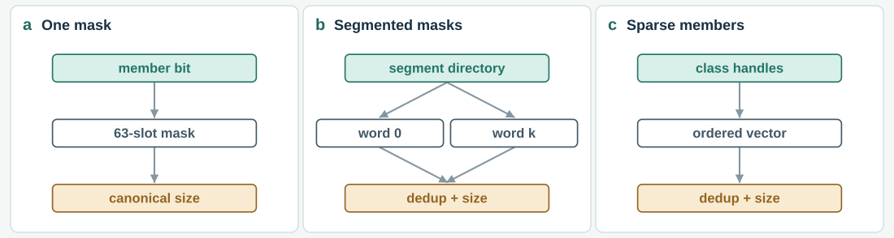

a　现行单掩码与成员转发。b　分段掩码与活跃段索引。c　稀疏有序成员向量。对通过同一容量条件的分支再分别测试逐行和实例订阅。

**固定条件。** 以真实 memory-helpers 调度为基线，另设显式观察输入与密度／成员数阶梯。63 槽以内做同支持域配对，64 槽及以上报告容量失败或成功，不混入速度均值。

**判据与读数。** 63 成员、128 读者的压力样本，单掩码从逐行订阅的 3.006 ms 降到共享订阅的 2.304 ms，两种仍需真正唤醒 130 行。

真实 memory-helpers 输入没有 ExprSet 操作，显式观察输入运行插入、交、并和长度。64＋超容量失败、稠密压力和真实程序分列。　档案 S57。

<a id="a55"></a>

## 图 55　能否直接跳到含有订阅者的数据字？

**已测 · 真实目录回放。** 图 40 中通知数下降，但逐 union 的目录数据字访问量不动。在保持订阅与行顺序时，跳过空字是否划算？

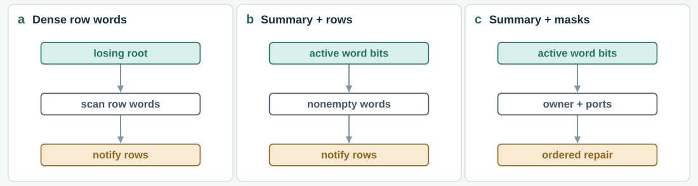

a　逐行订阅，顺序查看目录字。b　同一划分和逐行订阅，额外维护非空字摘要。c　保持该摘要，换成实例端口掩码；另有图 40 的同掩码稠密对照。

**固定条件。** 固定实例、碰撞顺序和通知。十次轮换；分记数据字、摘要检查、摘要更新、预留大小和整轮时间。

**判据与读数。** gemm-bias-relu 的逐行目录由 467,264 次数据字检查降到 4,522 次，整轮从 1,967.7 降到 1,937.6 ms。stable-argmax 由 138,237 降到 2,241 次，643.2 降到 632.5 ms。

摘要本身的读取和写回均计入时间。跳过的数据字和物理内存事务分别计量；这里只观察了前者。两种布局均通过完整 Run 审计。　档案 S32。

<a id="a56"></a>

## 图 56　多少个真实 RHS 来自上一轮 token 驱动的网络？

**已测 · 神经提案与精确补查分别计账。** 冻结同一组神经权重。屏蔽生成的 latent 会改变哪些提案？验证器关闭这些入口以后，精确搜索实际少做几步？

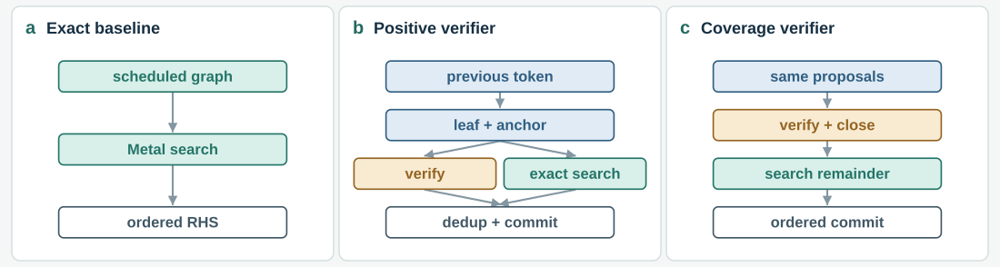

a　精确 Metal 搜索。b　两行网络读上一 Run 的 token，提出叶模板与锚点，逐项验真，保留原搜索。c　用相同提案精确关闭已验入口。b、c 分别屏蔽 latent，另作换行、弃权与关闭补查对照。

**固定条件。** 4 个家族训练，两个种子，2 行各 1 个提案槽；每个可用叶模板最多读取 8 个未经匹配筛选的类型相符行。在线无参考轨迹，审计逐个核实实际提交序号、源规则和父引用。

**判据与读数。** sum-bits 两种子神经提交 58／59 项，总 RHS 7,265。种子 1703 屏蔽 latent 改变 20 个提案，提交仍为 58 项；关闭入口省 59 步，验证用 99 步。常驻精确／联合为 863／976 ms。

关闭精确补查后，四个负载在 Run 1 均分叉，产生 0 个 RHS。全调度验收依赖精确补查。神经生成器完整覆盖 Pass 3 与端到端加速均未达成。　档案 S35。

<a id="a57"></a>

## 图 57　屏蔽已经验真的地址，能替代多少学习？

**已测 · 冻结策略与硬排除。** 图 50 的第二波更少重领同一地址。比较两种机制对最终提交量及耗时的独立贡献。

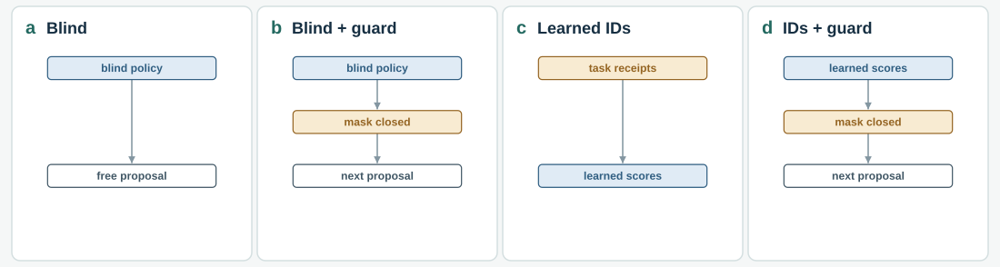

a　盲读权重自由选择。b　相同权重，第二波禁止再选第一波已关闭的地址。c　带回执的学习策略。d　同一回执权重再加确定性排除。

**固定条件。** 冻结模型，用同一 Run、叶块、物理来源三者标识义务。排除只对本 Run 第二波有效；拒绝、过期及同类不同来源继续可选。

**判据与读数。** sum-bits 盲读网络加确定性排除后，神经提交从 88／59 提高到 105／110（两个种子）。dot-product 从 72／46 提高到 85／83。带任务回执的模型分别为 106／112、85／86。

同一波的两行仍并行提案。该对照单独测量跨波协调，没有预设同行已能分工。　档案 S36。

<a id="a58"></a>

## 图 58　只补空 LHS 初始化，能推到哪一个 Run？

**已测 · 部分补查反事实。** 完全关闭精确补查后，图 56 的神经策略在第一个 Run 没生成 RHS。定位初始化之后的第一个缺口。

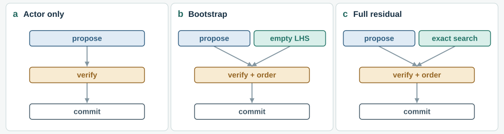

a　仅验真神经提案。b　额外允许精确引擎执行空 LHS 规则。c　允许完整精确补查。网络、输入和编译产物相同。

**固定条件。** 冻结图 50 的任务回执权重。保留真实源调度和原序发布。按有序 RHS、有效写入、Spine 和 Run 计数定位首次分叉。

**判据与读数。** 四个程序两种子都在纯模型时从 Run 1 分叉。只开放两条空 LHS 规则后，前两个 Run 对齐，Run 3 缺少规则 575 的绑定。该规则有两个 LHS 原子，且有入口被收录。

部分补查只开放编译器可判定的空 LHS；它能定位下一项障碍，不能为模型记入初始化绑定。　档案 S36。

<a id="a59"></a>

## 图 59　两波提案与验真之间要提交几次 GPU 工作？

**已测 · 相同权重与回执。** 相同的网络和验证器能否通过减少 Metal 提交缩短整轮，而不改变生成历史？

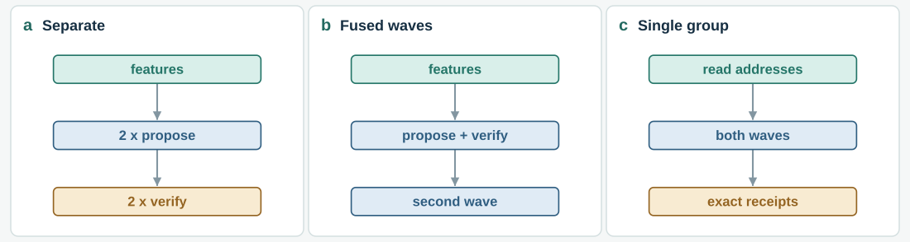

a　分开提交两波前向与验真。b　在一个线程组内完成两波，保留单独的候选特征核。c　同一线程组也负责特征构造。另测完整精确引擎。

**固定条件。** 冻结回执模型、两行两波、每个候选、边界检查、原序提交和精确补查。线程组内屏障保持上一波输出和回执可见。

**判据与读数。** sum-bits 种子 1703 的分开提交、合并两波、再并入特征分别为 1,072、1,029、1,073 ms，纯精确为 888 ms。dot-product 分别为 1,118、1,077、1,116、901 ms。

该实验固定生成质量，单独检验网络和精确验证器之间的数据交接成本。　档案 S36。

<a id="a60"></a>

## 图 60　每 Run 两份证书，能覆盖多少不同 RHS？

**已测 · 冻结轨迹最优解。** 固定起点地址与预算，让每份证书能引用父端口，解释多个源 Run 的结果。

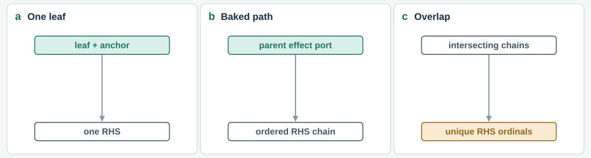

a　单叶只解释一个参考获胜绑定。b　从相同位置签发迭代 Bake 组合，后继沿指定效果端口进入，仍到原 Run 才公开。

**固定条件。** 搜索前保存实际发布序号，回溯唯一的父 RHS 与效果位置。整数规划对重叠链全局去重。

**判据与读数。** 单叶 → 组合，sum-bits 为 181 → 246、dot-product 为 161 → 207，两种留出程序分别为 154 → 222、117 → 166。

使用参考获胜轨迹和事后选择器，未计在线模型发现率与验证成本。　档案 S37。

<a id="a61"></a>

## 图 61　在同一个源 Run 内，继续生成还有收益吗？

**已测 · 真实 GPU 多波。** 让上一波的 token 和验证回执直接进入下一波，直到固定上限或两行同时弃权。

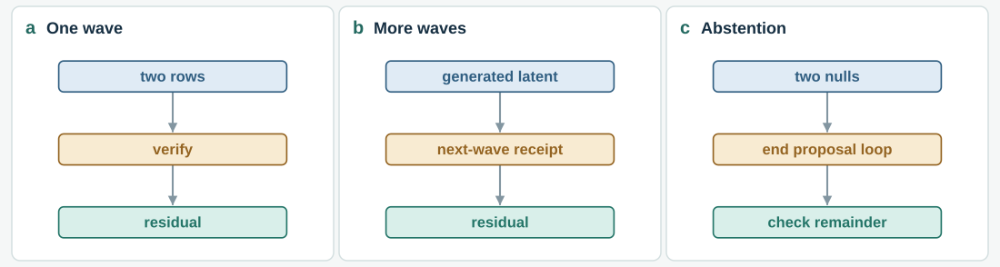

a　每 Run 1、2、4、8、16 波。b　上限 16，两行全弃权则停止前向。结束后才做精确补查。

**固定条件。** 同一两波训练模型、32 叶、8 候选、2 行。停止后保留最后生成的 token，固定上限内的空提交仍计时。

**判据与读数。** sum-bits 的神经提交（1703／1709）为 1 波 58／59、2 波 106／112、4 波 126／156、16 波 126／158。dot-product 的 16 波为 101／126。

双行全弃权时 sum-bits 仍遗漏 119／109 个窗口内参考获胜项。结束生成不能关闭这些义务。　档案 S37。

<a id="a62"></a>

## 图 62　验证回执何时应当返回给递归生成器？

**已测 · 同一模型与冻结流。** 把 Pair → Chain 已有的待验父引用接回真实 Pass 3，比逐波回执与依赖批验。

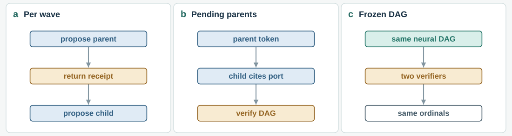

a　每波验真。b　后波子 Cell 引用待验父端口，按批拓扑验真。c　冻结同一份神经提案 DAG，交叉重放两种验证器。

**固定条件。** 相同权重、可组合模板、每 Run 总槽数、原调度及端口版本。模型能区分待验与已接受。

**判据与读数。** sum-bits 批验的子 RHS 为 25／26，逐波为 29／33；dot-product 为 17／16 与 18／18。四个程序两种子，固定同一生成流后的交叉重放均给出相同提交。

每波仍读当前图。图 64 将整批生成移至第一个源 Run 之前，图 65 检验有限闭域的一次验收。　档案 S38。

<a id="a63"></a>

## 图 63　父证明失效，要退役哪些后继？

**已测 · 两波与独立事实支持。** 在同一批待验神经提案中区分父拒绝、union 与代数过期的影响。

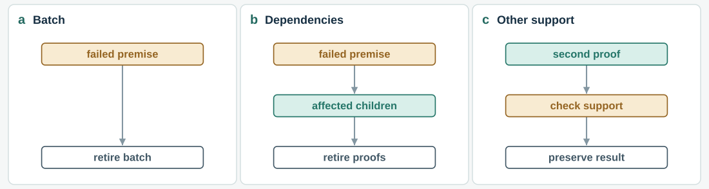

a　整批退役。b　沿实际依赖退役。c　若结论还有独立支持，保留受支持的结论及后继。

**固定条件。** 使用有共享祖先、替代证明与独立分支的批次。真实失效和注入反例分表。记录来源身份、当前类、原 Run 和版本。

**判据与读数。** 自然失效时，sum-bits 的整批退役保留 23／15 个子 RHS，按依赖退役保留 25／26。另按源 Run 边界核验独立构造器证明和 union 后同类异源的反例。

图 18 用编译器私有链验证过局部撤销，此处要求神经生成的、具有多重支持的 Pass 3 证明。　档案 S39。

<a id="a64"></a>

## 图 64　神经网络能在第一个源 Run 之前结束生成吗？

**已测 · 真实 Pass 3。** 每个子提案可以直接引用符号父端口。冻结整个提案流以后，再让源执行器处理实际发布。

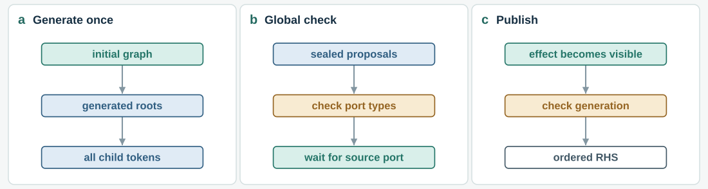

a　网络只读初图摘要、程序和已生成的根 latent。b　逐项补查。c　只接收单原子投影可证明的项。另测错误父和关闭精确补查。

**固定条件。** 所有静态空 LHS 根单列。网络选择二层森林的激活边，不能观察真实 Run 序列。固定流比较按发布事件订阅和反复枚举。

**判据与读数。** sum-bits 两种子的神经子提交为 91／92，dot-product 为 195／195。种子 1703 有 89／185 项分别由投影直接供齐，余下 2／10 项检查后缀。

整段生成已经成立。完整 Pass 3 的剩余义务仍由精确 GPU 引擎提供；关闭补查后在 Run 3 分叉。　档案 S40。

<a id="a65"></a>

## 图 65　哪些多 Run 推导能够在最后一遍验完？

**已测 · 源调度封闭前缀。** 初始构造器域若能由编译器证明封闭，验证器可以将所有源层的义务一次发给设备。


a　只验已发出的父引用。b　同一批再检查每个域成员都被覆盖。c　屏蔽上一波父 token；另删去一个没有后继的叶。

**固定条件。** 模型自己选择父引用和激活，固定 24 波，期间无回执。编译器投影身份并精确计算深度和整数属性。

**判据与读数。** 两个种子、四个程序都通过。sum-bits 的一个验真 dispatch 覆盖前 8 个 Run 和 10 个 RHS；dot-product 覆盖前 10 个 Run 和 14 个 RHS。

末端叶消失时其余 token 均可合法，覆盖检查报告遗漏。后续出现的新构造器键需要新的闭域证明。　档案 S41。

<a id="a66"></a>

## 图 66　哪些整数应当由验证器精确补全？

**已测 · 精确整数投影。** 结构见证固定后，候选大小与原提交边界处的可见大小分别由算术和源合并确定。


a　要求神经头提出整数。b　只提结构与端口，验证器按编译程序求值。另检查后继引用 candidate 及 visible 的差别。

**固定条件。** 相同源规则与合法见证；单列真实发生的冲突与注入的反例。记录合法 RHS、有效写入、公开值及原序验证。

**判据与读数。** sum-bits 规则 154 有 55 次 RHS、33 次写入、22 次无效改写。模型选出的锚点实际赢 5 条。Run 110 的 #906 得到候选 2，旧值 1，仍可见 1。

实测的已接管小整数上，学习数值头没有猜错；浮点精度反例单列。关键边界是可见版本和完整整数语义。　档案 S42。

<a id="a67"></a>

## 图 67　同一个生成网络放在 CPU 还是 GPU？

**已测 · 完整 Pass 3 与闭域前缀。** 小网络的单图前向和完整 Pass 3 墙钟可能由不同开销决定。比较整段一次生成与每 Run 都读图的两种接口。


a　CPU 单线程及多线程生成。b　MPS 生成。c　相同权重的融合 Metal 前向。验证器固定，另在闭域前缀单测 CPU 完整控制。

**固定条件。** 冻结权重、两个种子和输入，先核对离散激活、父引用、实际 RHS 与终图。计入整批上传，逐 Run 模式还要计设备回读。

**判据与读数。** sum-bits／1703，整批前向 CPU-1 136 µs，PyTorch MPS 405 µs。交给同一 GPU 验证器后为 569／466 µs。逐 Run 回读时，完整 CPU 前向路径 1,926 ms，设备常驻 Metal 为 995 ms。

闭域的 9／13 个 token 可以让前向和终验都留在 CPU。相同 24 波时只需 0.85–0.87 ms，MPS 为 5.24–5.34 ms。融合 GPU 的配对对照见 S43。　档案 S43。

<a id="a68"></a>

## 图 68　权重与验证器应当分别放在哪个设备？

**已测 · 完整源调度三组配对。** 同一份证书有三个部署候选。检验跨设备读回何时能由 Rust 本地验证和发布的收益抵消。


a　CPU PyTorch＋Rust。b　GPU PyTorch＋Rust。c　GPU PyTorch＋Metal。三臂使用相同权重、证书字段和已编译类型。

**固定条件。** 分别比较封闭前缀的终验和完整 Pass 3；相同输入字节、实际神经提交、残余搜索与不同的图实现必须分别报告。

**判据与读数。** sum-bits／1703 的完整常驻时间为 25.36、26.57、887.83 ms，dot-product 为 20.68、22.14、940.77 ms。三臂分别赢得同一组 91、195 个神经子 RHS。

两种子全部核对具体源 RHS 序号。换 Rust 与 Metal 同时改变了残余搜索、rebuild 和提交实现，整轮时间不能用来推断单独验真快了多少。　档案 S45 / S47。

<a id="a69"></a>

## 图 69　什么时候值得让 GPU 等一个 CPU 整数回执？

**已测 · 实际发布的事务回放。** 把精确整数比较编译为只读端口请求。当某个 guard 决定后续选项时，对比立即回执和延迟求值。


a　按生产者与端口先选一支。b　保留符号分支，末端统一求值。c　对动态端口逐项请求。d　同一 epoch 的动态端口合成一次请求。

**固定条件。** 冻结真实的源输出端口、i64 域、阈值、地址和版本。字面量先折叠。区分全部源发布、已由神经网络提交的父，以及回放后的合法分支。

**判据与读数。** sum-bits 的 446 次发布中 220 次可静态决定，226 次需要动态值。与盲选相比更正 42 次；末端统一求值、按 epoch 往返、逐项往返分别为 0.23、16.62、87.29 ms。

等量控制下，固定各 epoch 两种动作的配额后，八组学习策略均未增加非空完整覆盖。当前神经来源子集的静态长度无需询问。完整 Pass 3 的逐项交互收益尚未证实。　档案 S45 / S49。

<a id="a70"></a>

## 图 70　真实 Pass 3 的 98% 需要覆盖哪些源绑定？

**已测 · 配对与归因。** 每个源 Run 中的不同有序提交单计一次。比较单叶、完整键闭包和独立多父见证的可表达范围。


a　有限叶库与窗口。b　任意零／单独立行，再做完整键点查。c　允许选择两个或更多父行。

**固定条件。** 在相同源轨迹上，用最短路径求正向函数依赖闭包的最少独立见证，实际提交按其规则加权。

**判据与读数。** sum-bits 的目标为 7,120，零／单见证最多供 2,677，至少 4,443 项需多父；dot-product 分别为 6,570、2,899 和 3,671。

此图是给定接口下的工作量与预算界。实际模型能否取得这些绑定，由图 71 独立验证。　档案 S58。

<a id="a71"></a>

## 图 71　联合生成能否按真正的源提交超过 98%？

**已测 · 配对与归因。** 单见证网络与多父指针在同一 CPU 执行器内工作。按最终去重后的真实 RHS 序号接受归因。


a　训练集选择的高召回阈值，允许单见证补查。b　有编译下界的阈值，关闭所有残余。c　空提案、错编码和未训练投影作控制。

**固定条件。** 四个实际 Pass 3、两个种子。对各个源 Run 检查 RHS、有效写入、Spine、union 及完整终图；每个提交最多属于一个提供者。

**判据与读数。** 选择性模型在四程序两种子供齐 99.83–99.97%。无补查配置在八组全部供齐。sum-bits／1703 的严格配置只发出 48,529／70,366 个单见证候选。

有证明的单见证阈值保证可能合法的候选不丢；100% 是执行归因。真实源 Run 仍提供图观测，网络没有自行决定整个源调度。　档案 S59 / S60。

<a id="a72"></a>

## 图 72　怎样证明一个新物理 Cell 来自模型证书？

**已测 · 配对与归因。** 同一 RHS 可以触发额外的合并构造。按实际新建的 Cell ID 去重，区分父模板与独立命名的子模板。


a　按 RHS 归属统计期间全部物理分配。b　核对父规则命名的实际模板。c　为合并子构造发行单独的模板与 old/new 端口证书。

**固定条件。** 子证书须在源修改前作决定，并实际供给 allocator。记录其父提交序号、两个版本、模板、物理 ID，区分复用和新建。

**判据与读数。** dot-product／1703 只计父模板时为 5,536／5,682；另一次高召回合并头直接分配 128 个不同子对象，升至 5,664／5,682。错模板及交换 old/new 均为零个新子对象。

父规则模板对应关系与真正给分配器提供模板的根配方分开核对；图 75 要求根与子两条路径都实际驱动分配。　档案 S59 / S61。

<a id="a73"></a>

## 图 73　保持证书不变，怎样减少指针生成开销？

**已测 · 配对与归因。** 相同的地址和权重可因桶目录、版本缓存和特征复用而产生不同的搜索成本。


a　遍历签名目录。b　只探测占用的相容桶，按表版本缓存名单。c　连续保存已发元组，只携带后续读取的槽。另按真实相同输入共享单见证评分。

**固定条件。** 规范源地址、每批候选哈希、实际获胜序号和完整终图必须一致。计入建立索引、无效化、评分与验证。

**判据与读数。** 多见证 sum-bits 从 105.1 降至 57.2 ms，dot-product 从 115.0 降至 56.7 ms。保持全部分数位一致的单见证静态特征缓存，使联合严格配置中位再降 8.55%。

两组实验有各自的配对计时，不能叠加为一个端到端倍数。原生精确搜索仍更快。　档案 S62 / S63。

<a id="a74"></a>

## 图 74　有相同语义的端口是否需要分别学习 Q 和 K？

**已测 · 配对与归因。** 改变权重共享方式，考察等值端口检索里的学习贡献。


a　不共享的三视图、半径 2。b　相同训练权重取平均作共享编码，半径 0。c　固定取签名位；另测不共享权重直接将半径降至 0。

**固定条件。** 同一完整 CPU＋Rust 执行与封存契约。固定代码对照的多父胜者单列为确定性。

**判据与读数。** sum-bits／1703 原始、单视图共享、固定取位、精确搜索分别为 78.7、70.7、69.3、24.3 ms。共享编码下所有等值端口都会进同一桶。

固定代码也能检索到合法的相等端口，须用选择、碰撞和端到端衡量额外参数的价值。　档案 S64。

<a id="a75"></a>

## 图 75　根 Cell 也确实使用了网络发出的配方吗？

**已测 · 完整 Pass 3 与真实物理 ID。** 在验证前封存模板、独立来源和输入槽投影，让验证后的根配方直接驱动物理构造。


a　保持源分配路径。b　解码并消费根配方及合并子配方。c　屏蔽配方、换错模板或端口；另禁止默认根分配。

**固定条件。** 使用同一学习模型、真实源调度、模板库和 CPU 图。每个新物理 ID 与实际调用分配器的内部配方序号逐项对应；已有对象复用不计。

**判据与读数。** 无 RHS 补查、双种子均为：sum-bits 5,867／5,868，dot-product 5,666／5,682，GEMM 12,866／12,869，stable-argmax 6,841／6,841。所有源 RHS 均有唯一获胜提案。

两类默认分配同时禁止时，只有 stable-argmax 完整结束。新配方可审计但有开销：sum-bits／1703 同组 81.24→94.74 ms。　档案 S65。

<a id="a76"></a>

## 图 76　父请求能跨几个 Run，能省多少工作？

**已测 · 四负载双种子。** SubTuple 的长度由真实父端口决定。能否复用同一份模板，在源消费者的 Run 进入不同子块？


a　普通 Rust 在原 Run 分派。b　首轮只 Bake 138 的效果 5。c　第二轮纳入三个实际向该入口供值的父接口，同一模板可递归接续。

**固定条件。** 四个独立训练程序选模板。冻结库、权重、签发预算和源调度，检查有序 RHS、有效写入、Spine、union、最终图及实际新 Cell。

**判据与读数。** 首轮→第二轮的子 RHS 分别为 sum-bits 14→90、dot-product 15→44、GEMM 63→194、stable-argmax 30→95。最长实际链分别为 5、6、10、7 步。

sum-bits 普通分派与递归高阶模板，种子 1703 为 104.64→105.83 ms，1709 为 103.34→100.39 ms。两个种子的耗时方向不同。　档案 S66。

<a id="a77"></a>

## 图 77　学习过的端口投影能提前算多少？

**已测 · 完整 Pass 3。** 每个视图只读 16 个二值特征。离线计算所有输入的 Q/K 签名后，线上还剩多少成本？


a　逐端口执行训练后的投影。b　查询共享权重表，再生成候选。c　零半径下按拼接签名直接取桶，精确验证所有发出的父元组。

**固定条件。** 同一家族内固定权重、特征、选择阈值和父来源。CPU 分配器与 vanilla 相同；逐项对齐原始提案、获胜父、实际分配和源调度。

**判据与读数。** 种子 1703，原投影→表与桶。sum-bits 68.6→58.3 ms；dot-product 66.7→55.7 ms；Jacobi 574.8→481.8 ms；共轭梯度 2868.8→2445.7 ms。

每份权重的共享表占 262,216 字节。以上为常驻完整推理，同组 vanilla 分别为 21.5、18.7、111.7、369.2 ms。　档案 S67。

<a id="a78"></a>

## 图 78　RL 应当打开几个真实评分 worker？

**已测 · 四负载双种子与两组大样本。** 多行共同处理同一条规则的候选地址。共享相同输入的分数以后，更多 worker 是否还能节省整轮时间？


a　固定单行，等价输入复用分数。b　固定 2、4 或 8 个 worker，分配互斥地址区间。c　策略梯度训练的控制器选择行数与评分方式。

**固定条件。** 同一源规则、模型阈值、前一隐状态和地址顺序。执行后合并各行发出的 token，再更新一次状态。记录实际 worker 参与、父来源、物理 Cell 与逐 Run 结果。

**判据与读数。** sum-bits／1703 的 1、2、4、8 worker 为 85.1、106.3、124.4、160.1 ms。四负载双种子全覆盖模式下，120 参数 RL 比原版快 9.4%，静态单行共享快 9.6%。

控制器扩到 456 参数未显示额外收益。此结论只覆盖一条规则内的评分分工，其他规则间并行和跨图吞吐须分别测量。　档案 S68。

<a id="a79"></a>

## 图 79　哪一个源端口应该先签发？

**已测 · 三负载原调度。** 当一个且仅一个关系有新行时，允许它充当神经入口，检验额外选择一个父是否能减少最终需验真的元组。


a　冻结原指针计划。b　从唯一新关系进入，保持独立父数。c　在固定的额外父预算内可以改用原先位于点查后缀的关系。

**固定条件。** 同一绑定阈值、单视图签名、源水位与分配器。多个原子可供新增量时走原计划。第一组共用计划但不切换的额外对照要求原始发行哈希相等。

**判据与读数。** 种子 1703，允许多选一个父后，sum-bits 的密封提案 22,707→19,342，dot-product 为 22,840→21,851，Jacobi 为 274,827→245,700。

同组完整 ms 分别为 56.17→52.65、54.75→53.26、483.46→476.22。三个负载均逐 Run 对齐，仍慢于精确 Rust。　档案 S69。

<a id="a80"></a>

## 图 80　旧的候选对该重新生成吗？

**已测 · 完整运行与大样本。** 保存已发元组、维护签名列和阻止必定过期的提案，这三种方式分别节约哪些工作？


a　按源版本缓存整批候选。b　在正确方向连接新行与旧行，按原顺序签发。c　由后缀的最大可见 epoch 排除缺少新支持的父对。

**固定条件。** 真实表变更触发快照维护。哈希碰撞不能作为存在证明。原始元组可因安全剪枝减少，保留的获胜父、子、实际新 Cell 与源端点逐项一致。

**判据与读数。** 种子 1703，packed 基线→增量与水位筛选，Jacobi 464.80→400.85 ms，共轭梯度 2315.81→1922.96 ms。对应 vanilla 为 110.78 和 360.52 ms。

sum-bits 的整批元组缓存只在 3,180 次非空规则调用中命中 104 次。共轭梯度保留 131,371 个源 RHS 和 97,026／97,139 个直接由模型配方分配的新 Cell。　档案 S70。

<a id="a81"></a>

## 图 81　延迟凑批和共享答案，各自省了什么？

**已测 · 三负载双种子。** 一批 Cell 已经各自选定父端口。对同一源视图的查表和整数计算，是立即回答、复用上个答案，还是等待同伴一起计算？


a　即时求值。b　每八份封存提案共用缓存，各实例就绪即执行。c　使用相同缓存，将八份提案按同一指令逐层求值，再按原序交回各自的 RHS。

**固定条件。** CPU 策略、权重、发行预算、父引用和原 Run 固定。两个共享版本必须对每条源指令得到相同的操作数、成功或失败结果、真实行票据和版本。以未经修改的 vanilla 单列墙钟。

**判据与读数。** Jacobi／1703，批宽 8 少解码父行 188,118 次、少查表 31,645 次、少算标量 16,859 次。即时／流式共享／延迟八条为 313.56／317.54／315.86 ms；vanilla 为 112.60 ms。

sum-bits 两个种子的延迟八条为 38.94／39.49 ms，即时为 38.98／38.60 ms。各实例继续在原提交点执行 min、union 和有效写入。　档案 S71。

<a id="a82"></a>

## 图 82　该奖励一次合并，还是它省掉的工作？

**已测 · 四负载双种子。** 在同一真实父发布处，让九参数门控选择逐叶验证或编译组合。所有合法子 RHS 仍在原 Run 执行。


a　仅用后续子 RHS 归属做监督。b　额外奖励提出合并，或只奖励真正赢得的子 RHS。c　按省去的入口、重复检查和独立票据计价，分别扣局部或完整索引维护。

**固定条件。** 冻结父模型、模板库、预算和验证器。四个训练程序之外的 4 个工作负载 × 2 种子，一共给出 1,944 次机会。原始 RHS、有效写入、Spine、union、物理 ID 与最终图逐项一致。

**判据与读数。** 真实预训练下，基础监督选 721 次、兑现 427 次；奖励提出选 1,764 次、兑现 844 次；奖励兑现选 1,740 次、兑现 834 次。只扣局部成本会选全部 1,944 次。

原全表重建实现中，完整维护成本使门控在实测输入上全拒绝，但索引仍刷新。合并信用与入口遍历、物理记录退役、整轮耗时各自记录。　档案 S72。

<a id="a83"></a>

## 图 83　需要先合成 Cell 轨迹，才能学合并吗？

**已测 · 完整与少样本对照。** 固定优化器和更新次数，只替换预训练样本。两组随后收到完全相同的真实执行反馈。


a　直接从父发布票据学习。b　在小型解释器中生成带版本的父发布、重复认领、地址替换及后续消费，再用真实样本更新。c　在真实 Rust Pass 3 对比逐实例决策与端到端结果。

**固定条件。** 真实组用 689 个发布，其中 295 个后来赢得子 RHS。合成预训练 80 次更新，随后两组均用真实数据更新 120 次。额外将真样本缩至 96 个发布、41 个获胜。

**判据与读数。** 奖励真实子 RHS、奖励局部工作、扣完整维护成本三组，两种预训练在 8／8 个负载–种子配对上选择完全相同。96 样本对照中，兑现奖励和完整成本奖励也在 4／4 对上相同。

689 个发布只有 52 个不同输入向量，其中 21 种同时出现获胜与未获胜。即使记住全部向量，也至少错分 181 次。这里测试的是已知模板家族的门控。　档案 S72。

<a id="a84"></a>

## 图 84　少一个 owner，会少几条活记录？

**已测 · 原生存储对照。** 已存在的实例接纳新成员时，目标可以是少建一个 owner、退役确实无外部读者的旧视图，或减少含库开销的净字节。


a　按少用的 owner 选模板。b　用源轨迹核实旧视图退役，再给候选信用。c　连同外部句柄、实例头和库一起计费，也允许保留空库。

**固定条件。** 四族提供训练证据，固定库预算和测试准入。旧原生精确执行器负责本组绑定；本页的物理节省归因于存储动作，神经签发贡献为零。

**判据与读数。** dot-product 的两个奖励都少 52 个 owner，但只有退役奖励再消除 9 个旧视图。stable-argmax 中前者少 100 个 owner、额外退役 0；后者少 63 个 owner、额外退役 6。

计入库与运行时状态后，上述配对的实测内存均增加。按训练净字节选会拒绝 12 个候选。吸收新生子成员与合并两个已各有 owner 的实例须分别验收。　档案 S73。

<a id="a85"></a>

## 图 85　两个已有 owner 真能一步合并吗？

**已测 · 原生物理存储。** 在真实源图的副本上先分配两个独立 owner，让两者经历一个 Run 后再原子转交。以完整引用、代次、读者和后续修复为条件。


a　保留两份已分配的 owner。b　在已验证覆盖双方的全部成员后转交到一份。c　漏掉一个仍活跃的成员或破坏代次，检查转移会被拒绝。

**固定条件。** 保持相同逻辑成员、外部可读句柄和原程序调度。区分自然布局中能直接执行的动作与受控分配后可执行的动作。记录分配期间峰值及之后的 union。

**判据与读数。** dot-product 的两个旧 owner 含 2＋1 个成员，真实退役 1 个，净释放 124 B；stable-argmax 净释放 96 B。两者的临时峰值都增加 304 B。另一个原生小图也从 2→1，内存却净增 224 B。

dot-product 的自然布局有 278,811 次组件访问横跨两个 owner，完整覆盖两边全部成员的次数为零。这组物理样本由受控干预取得，模型信用为零。　档案 S74。

<a id="a86"></a>

## 图 86　只选了一部分父端口，何时可以停？

**已测 · 四个真实 Pass 3。** 让编译器列出剩余关系能从已选端口确定的列。用学习签名检查必要条件，在发行完整元组前终止没有后继的前缀。


a　按原顺序全部签发。b　用一列或两列签名排除没有相容键的关系。c　加入每个签名下的最大可见 epoch，排除整条推导都不可能足够新的前缀。

**固定条件。** 同一权重、单视图、零半径，完全相同的源输入与有序写入。签名目录只提供缺失或陈旧证据，所有获胜父地址仍由模型先签发、后验真。

**判据与读数。** Jacobi 的完整提案 122,523→84,705，整轮 220.15→184.92 ms；共轭梯度 765,670→531,346，928.47→746.91 ms。同组原生为 106.34 和 338.67 ms。

共轭梯度只开存在性是 857.60 ms，只开新鲜度是 803.59 ms。所有端点、获胜父子和真实新 Cell 身份都对齐。　档案 S75。

<a id="a87"></a>

## 图 87　为什么大图仍有几十万份失败提案？

**已测 · 四负载完整源审计。** 在原验证器记录第一个失败字段，分开统计字面量、同原子重复槽和跨父相等。再用第二个输入视图检验主因。


a　用原十比特签名提案。b　在选父时检查已知字面量和重复槽的学习签名。c　把同一组冻结权重应用于第二种带盐输入，用联合签名选择父。

**固定条件。** 源真值、完整独立父元组、原始提交顺序和新 Cell 分配全部核对。额外视图仅增加计算，权重数量保持不变。各运行使用种子 1703。

**判据与读数。** 共轭梯度的 531,346 个完整元组中，353,391 个首先败在跨父相等；第二视图把这种失败降到 196 个。不开局部筛时，原／双视图 769.00／683.79 ms，同组 vanilla 为 345.10 ms。

三视图叠加局部检查后，126,855 个封存元组均通过父检查，最后获胜的多父 RHS 仍为 57,695。剩余后缀和原 Run 的去重继续执行。　档案 S76。

<a id="a88"></a>

## 图 88　从真实错父样本多学几位，划算吗？

**已测 · 冻结模型迁移。** 让额外的学习投影区分已经被原生验证拒绝的父值，同等训练次数下比较均匀合成负例和实际失败对。


a　随机或仅用均匀负例训练两位。b　用源程序失败对与合成对共同训练两／四／八位。c　使用第二输入盐直接复用原十位权重。

**固定条件。** 四个训练家族提供 4,056 个失败事件、258 个不同值对。共享 Q/K，真相等始终可通过。原图、验证器、提案预算与原调度由独立 CPU 执行复核。

**判据与读数。** 两位投影在训练失败事件中残留的碰撞为随机 1,069、合成训练 500、加入真实负例 92。共轭梯度的 32／64／128 个新增参数分别产生 179,337／140,017／127,968 份提案。

在同一完整负载上，源负例两／四／八位推理为 724.62／696.54／708.26 ms；复用原十位为 700.61 ms。训练集碰撞最少的头没有取得最快墙钟。　档案 S77。

<a id="a89"></a>

## 图 89　冻结后的计划能跑对更大的 Pass 3 吗？

**已测 · 3mm 与 Deriche。** 按源文件大小预先选两个未参与训练、调参的 eggcc 负载，分别核验默认 CPU、旧生成配置和被冻结的学习端口计划。


a　原始精确 Rust 执行器。b　原单视图神经生成基线。c　双视图、双列必要条件与有界的索引维护，后续每个签发仍用原源语义验证。

**固定条件。** 先比较逐 Run RHS、有效写入、Spine、union 和终图，并按成功证书核验真实新 Cell。发现分叉的组单列，速度比较只用源结果正确的两臂。

**判据与读数。** 3mm 的 294,917 个 RHS 全对齐，神经两臂 5.09→2.19 s，原始 CPU 0.94 s。Deriche 的冻结方案对齐 635,818 个 RHS，3.91 s，原始 CPU 1.60 s。

Deriche 旧基线在 Run 819 漏了 3,120 个合法绑定，不能列入加速比。冻结方案中两个负载直接分配 229,311／229,880 和 450,414／452,913 个新 Cell。　档案 S78。

<a id="a90"></a>

## 图 90　预算已用完，这个 Run 真的完整吗？

**已测 · Deriche 与边界用例。** Deriche 的 Run 819 中，五次独立选父的规则 249 截断后漏了 3,120 个合法 RHS。用最后一个候选和仍有分支的两个真实用例区分阈值与未完成工作。


a　有限预算若留下未探分支，返回 Run、规则和未完成原因。b　在原顺序完整生成。c　把完整提案分成有限大小的页，全数封存后由原验证器消费。

**固定条件。** 保留编译器签发的源程序、神经端口和有序提交。分小页与单页须逐项复现全部原始地址和版本；独立默认 CPU 核对每 Run、最终图和实际分配身份。

**判据与读数。** Deriche 完整旧配置／每页最多 8,192 组／冻结双视图分别为 15.05／14.70／3.93 s，原生为 1.60 s。三种正确神经执行都得到 635,818 个源 RHS。

旧配置的最大页有 7,192,696 个元组。三次独立新进程测得峰值 RSS 分别为 4,253／2,341／879 MiB，vanilla 为 886 MiB。　档案 S79。

## 现有配对数据


横轴是通过数，两个种子均以 512 张碰撞图为分母。应同时检查整图正确、合法引用、重复和遗漏。运行时报告等正确性下的延迟和每秒正确非空图；数据按源码家族、模板接线和随机种子冻结。完整实验登记与反证条件见 PDF 倒数第二页。

## 证据与图源

- S1　[PyTorch 实现与计时](../../benchmarks/multi-row-generation/torch_crossrun/README.md)
- S2　[真实两规则与掩码统计](../../benchmarks/multi-row-generation/crossrun/results/metrics.tsv)
- S3　[无锚点集合生成](../../benchmarks/multi-row-generation/allocation/README.md)
- S4　[软覆盖监督](../../benchmarks/multi-row-generation/coverage/README.md)
- S5　[分轮历史干预](../../benchmarks/multi-row-generation/streaming/README.md)
- S6　[12 轮连续与符号接口](../../benchmarks/multi-row-generation/typed/README.md)
- S7　[确定性 Cell 机制](../../benchmarks/multi-row-cell/README.md)
- S8　[额外 eggcc 工作负载和家族拆分](../../benchmarks/eggcc-diversity/manifest.json)
- S9　[长期架构与源语义契约](../MULTI_ROW_EGRAPH_NEURAL_PLAN.zh.md)
- S10　[单 row 的头共享与 Bake 编码实测](../../benchmarks/multi-row-generation/port_ablation/README.md)
- S11　[模板局部等价类的证据与冻结协议](template-eclass.md)
- S12　[图 20 四臂两种子实测](../../benchmarks/multi-row-generation/eclass_ablation/README.md)
- S13　[跨 row/位置/端口寻址及真实前沿迁移](../../benchmarks/multi-row-generation/address_ablation/README.md)
- S14　[图 04 单 row 零训练展开与消费者诊断](../../benchmarks/multi-row-generation/width_ablation/README.md)
- S15　[图 05 两行监督、团队奖励与反事实信用](../../benchmarks/multi-row-generation/credit_ablation/README.md)
- S16　[图 06 实际 GPU 行门控与执行计数](../../benchmarks/multi-row-generation/gate_ablation/README.md)
- S17　[图 07 精确与学习型就绪调度、逐 Run 审计](../../benchmarks/multi-row-generation/readiness_ablation/README.md)
- S18　[图 14 全图状态、局部状态与边界证书](../../benchmarks/multi-row-generation/locality_ablation/README.md)
- S19　[图 15 延迟 union、同余修复和空结果失效](../../benchmarks/multi-row-generation/union_ablation/README.md)
- S20　[图 16 双行组合、旧 cursor 与 generation](../../benchmarks/multi-row-generation/ownership_ablation/README.md)
- S21　[图 17 原子证明与组合宏的验证成本](../../benchmarks/multi-row-generation/proof_ablation/README.md)
- S22　[图 18 私有成员原槽发布与退出条件](../../benchmarks/multi-row-generation/integral_ablation/README.md)
- S23　[图 19 精确停止、学习门与检查点恢复](../../benchmarks/multi-row-generation/stopping_ablation/README.md)
- S24　[真实 Pass 3 输入编码与多行集成](../../benchmarks/pass3-cell-gpu/README.md)
- S25　[图 23–29 完整 Pass 3 的语义验收、遍历、行间分工与 CLI](../../benchmarks/pass3-cell-gpu/ACCEPTANCE.md)
- S26　[图 30–32 冷启动、常驻与阶段归因](../../benchmarks/pass3-cell-gpu/profile/README.md)
- S27　[图 33–34 GPU 见证、CPU 提交与同 Run 合批](../../benchmarks/pass3-cell-gpu/hybrid/README.md)
- S28　[图 35 完整唯一键、常驻端口与错父补查](../../benchmarks/pass3-cell-gpu/unique-parent/README.md)
- S29　[图 36 集合和局部 union](../../benchmarks/pass3-cell-gpu/set-memory/README.md)
- S30　[图 37 块选择工作量上限与通知](../../benchmarks/pass3-cell-gpu/block-ceiling/README.md)
- S31　[真实程序与 union 前观察](../../benchmarks/pass3-cell-gpu/co-repair/CORPUS.md)
- S32　[图 38–40、55 的选择、嵌套和通知目录消融](../../benchmarks/pass3-cell-gpu/co-repair/README.md)
- S33　[图 46 父引用碰撞与容量对照](../../benchmarks/pass3-cell-gpu/key-signals/README.md)
- S34　[图 41 固定空间的区域位置与迁移](../../benchmarks/pass3-cell-gpu/region-admission/README.md)
- S35　[图 56 递归提案、验真、补查与因果屏蔽](../../benchmarks/pass3-cell-gpu/recurrent-generator/README.md)
- S36　[递归生成器的验证回执、跨波排除与启动边界](../../benchmarks/pass3-cell-gpu/recurrent-generator/receipts/README.md)
- S37　[可组合证明、生成波与待验父的对照](../../benchmarks/pass3-cell-gpu/recurrent-generator/receipts/composable-proposals.md)
- S38　[待验父端口与交叉重放](../../benchmarks/pass3-cell-gpu/recurrent-generator/pending/README.md)
- S39　[真实失效与多重支持](../../benchmarks/pass3-cell-gpu/proof-retirement/README.md)
- S40　[整段神经生成](../../benchmarks/pass3-cell-gpu/whole-pass-generation/README.md)
- S41　[一次检查封闭饱和前缀](../../benchmarks/pass3-cell-gpu/coverage-certificate/README.md)
- S42　[结构见证与精确整数投影](../../benchmarks/pass3-cell-gpu/numeric-projection/README.md)
- S43　[神经策略在 CPU 和 GPU 的放置](../../benchmarks/pass3-cell-gpu/neural-device/README.md)
- S44　[容量与训练来源](../../benchmarks/pass3-cell-gpu/neural-capacity/README.md)
- S45　[三组部署与整数事务](../../benchmarks/pass3-cell-gpu/verifier-placement/README.md)
- S46　[单项见证与完整桶的覆盖证书](../../benchmarks/pass3-cell-gpu/bucket-coverage/README.md)
- S47　[完整 Rust 与 Metal 验证器放置](../../benchmarks/pass3-cell-gpu/native-forest/README.md)
- S48　[冷模板的共享端口与零更新增长](../../benchmarks/pass3-cell-gpu/cold-templates/README.md)
- S49　[CPU 整数回执是否改变下一项神经选择](../../benchmarks/pass3-cell-gpu/interactive-policy/README.md)
- S50　[单动作的绑定、叶和组合](../../benchmarks/pass3-cell-gpu/action-granularity/README.md)
- S51　[变长端口证书](../../benchmarks/pass3-cell-gpu/variable-certificates/README.md)
- S52　[在线成员存储与切换](../../benchmarks/pass3-cell-gpu/online-storage/README.md)
- S53　[修复训练与反例](../../benchmarks/pass3-cell-gpu/repair-training/README.md)
- S54　[八槽预算下的多行所有权](../../benchmarks/pass3-cell-gpu/row-admission/README.md)
- S55　[集合监督与工作奖励](../../benchmarks/pass3-cell-gpu/row-reward/README.md)
- S56　[CPU 权威图与 GPU 增量验证](../../benchmarks/pass3-cell-gpu/verifier-deltas/README.md)
- S57　[真实集合存储与容量阶梯](../../benchmarks/pass3-cell-gpu/set-representations/README.md)
- S58　[完整源分母与独立见证](../../benchmarks/pass3-cell-gpu/coverage-target/README.md)
- S59　[同一执行器的联合归因](../../benchmarks/pass3-cell-gpu/joint-witness/README.md)
- S60　[首个精确检查前的多父批次](../../benchmarks/pass3-cell-gpu/ordinary-witness/README.md)
- S61　[明确驱动物理分配的子端口](../../benchmarks/pass3-cell-gpu/joint-merge/README.md)
- S62　[稀疏缓存与压紧候选](../../benchmarks/pass3-cell-gpu/ordinary-shortlist/README.md)
- S63　[有版本的特征复用](../../benchmarks/pass3-cell-gpu/joint-score-sharing/README.md)
- S64　[共享学习编码与固定签名](../../benchmarks/pass3-cell-gpu/tied-query-keys/README.md)
- S65　[二进制根配方实际驱动分配的归因](../../benchmarks/pass3-cell-gpu/joint-root-cells/README.md)
- S66　[请求驱动的高阶模板与两轮 Bake](../../benchmarks/pass3-cell-gpu/higher-order-bake/README.md)
- S67　[有限输入域上的精确学习投影](../../benchmarks/pass3-cell-gpu/baked-port-codes/README.md)
- S68　[真实 CPU 行数与策略梯度](../../benchmarks/pass3-cell-gpu/adaptive-row-policy/README.md)
- S69　[源水位选择编译入口](../../benchmarks/pass3-cell-gpu/fresh-entrances/README.md)
- S70　[增量多父签名与过期剪枝](../../benchmarks/pass3-cell-gpu/incremental-neural-index/README.md)
- S71　[计算请求小批与等容量流式对照](../../benchmarks/pass3-cell-gpu/request-transactions/README.md)
- S72　[合并门控奖励与合成预训练](../../benchmarks/pass3-cell-gpu/merge-reward/README.md)
- S73　[原生存储的 owner、旧视图和实测字节](../../benchmarks/pass3-cell-gpu/physical-composition-reward/README.md)
- S74　[两个已存 owner 的真实转移与代次反例](../../benchmarks/pass3-cell-gpu/existing-owner-transfer/README.md)
- S75　[学习端口签名的前缀可行性](../../benchmarks/pass3-cell-gpu/learned-prefix-feasibility/README.md)
- S76　[封存元组的错误归因与多视图](../../benchmarks/pass3-cell-gpu/learned-atom-constraints/README.md)
- S77　[训练负例和额外二进制端口容量](../../benchmarks/pass3-cell-gpu/collision-trained-ports/README.md)
- S78　[冻结程序在两个更大负载上的源核对](../../benchmarks/pass3-cell-gpu/prefix-transfer/README.md)
- S79　[Deriche 完整枚举、显式预算与分页](../../benchmarks/pass3-cell-gpu/complete-generation/README.md)
- M1　[Gilmer 等，ICML 2017，消息传递神经网络](https://proceedings.mlr.press/v70/gilmer17a.html)
- M2　[Foerster 等，AAAI 2018，反事实多智能体信用分配](https://arxiv.org/abs/1705.08926)

## 重新生成

在本目录运行以下命令。SVG 保留可编辑文本及矢量连线；Typst 排版和 Markdown 使用同一份 `plates.json`。参考渲染使用 macOS 的 Hiragino Sans GB 与 Songti SC。

```sh
python3 draw.py
python3 build_readme.py
python3 verify_evidence.py
typst compile Cell多行推理架构消融图册.typ
```
