# Cell 多行推理架构消融图册

[排版 PDF](Cell多行推理架构消融图册.pdf) · [Typst 源文件](Cell多行推理架构消融图册.typ) · [独立矢量图](figures/) · [绘图源码](draw.py)

基线提交 `68193237`，2026-11-19。阅读重点是同图多个 row 能否快速生成互补 token。每次 Run、一次神经发射和一个训练更新是三个不同的时间单位。实线表示数据流，紫色虚线表示训练监督，灰色空槽或 × 表示未启用或被屏蔽的通道。每个分面的小写字母和图下说明对应。


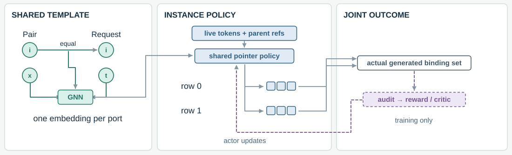

建议先用编译器端口角色做基线，检验跨规则共享和单 row 的绝对正确性；然后冻结权重展开到多行，测零样本覆盖损失；最后才比较监督、RL、动态启用行数与同步策略。图 01–02 已完成两叶 Bake 接口的单 row 对照；03 已比较四种多端口寻址，04 已测单行零更新展开，05–07 追踪学习分工与就绪，08–13 给出已有机制的对照，14–19 定义扩展语义，图 20 单列静态可证明端口等价分区。

## 对照索引

| 图 | 实验问题 | 状态 |
|---:|---|---|
| 01 | [指针头应当怎样读取 Cell 模板？](#a01) | 已测 · 两个留出族 |
| 02 | [一个指针头能否跨规则复用？](#a02) | 已测 · 两个留出族 |
| 03 | [跨 row 的地址需要几条旋转轴？](#a03) | 已测 · 多端口寻址 |
| 04 | [一个策略展开到多行，会损失多少覆盖？](#a04) | 已测 · 零更新展开 |
| 05 | [哪一种训练信号会让两行分工？](#a05) | 待验证 |
| 06 | [让模型决定本轮启用几行](#a06) | 待验证 |
| 07 | [哪些消费者确实需要等待？](#a07) | 待验证 |
| 08 | [模板投影与训练期字段头各起什么作用？](#a08) | 已测配对 |
| 09 | [消费者能否辨认同字段、异父的 Pair？](#a09) | 已测干预 |
| 10 | [跨轮传递连续 latent 还是规范符号？](#a10) | 已测配对 |
| 11 | [有固定锚点时，程序替模型完成了多少分工？](#a11) | 已测任务边界 |
| 12 | [训练时约束总认领量，能消除重复吗？](#a12) | 已测配对 |
| 13 | [让下一位置读取历史，是否就会互补？](#a13) | 已测配对与干预 |
| 14 | [一份全图 latent，还是多份 local latent？](#a14) | 待验证 |
| 15 | [union 立即处理，还是在可见边界集中处理？](#a15) | 待验证 · 神经端 |
| 16 | [组合为大 Cell 后，旧端口怎样保持有效？](#a16) | 待验证 · 神经端 |
| 17 | [逐步证明与 Bake 组合证书的成本](#a17) | 待验证 |
| 18 | [提前在 Cell 内生成未来 Run 的成员](#a18) | 待验证 · 神经端 |
| 19 | [有限预算下，谁决定继续、延后或停止？](#a19) | 待验证 |
| 20 | [Bake 已证明的 union 应怎样进入端口 GNN？](#a20) | 已测 · 两个留出族 |

<a id="a01"></a>

## 图 01　指针头应当怎样读取 Cell 模板？

**已测 · 两个留出族。** 整族模板从训练库移除后，模型还能否根据端口的作用选择正确实例？这决定了 iterative Bake 生成一个新组合时，能否直接复用旧指针头。

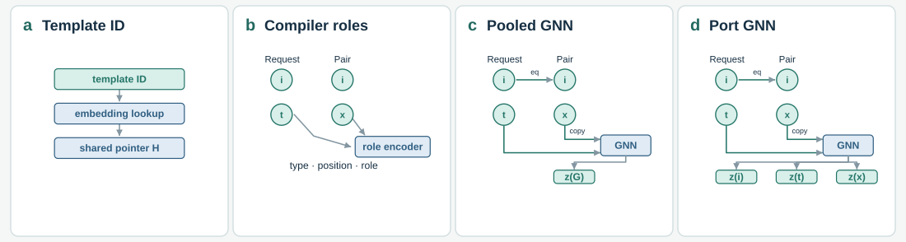

a　模板 ID 查表，未见 ID 使用 unknown 向量。b　输入编译器产生的端口类型、方向、操作数位置与连接角色。c　沿带类型边传递消息后池化为整图向量。d　保留每个端口的消息传递向量。四支均给同一指针头提供端口位置与局部角色。

**固定条件。** 配对候选、row 数、头宽、预算。a/b 比较时固定输出接口，a 仅用 ID 作为模板级信息；c/d 共用 GNN 主干与角色特征，只改读出。报告参数量、冷编码与缓存命中成本。

**判据与读数。** 共享头下，448 张非空留出图的完整数（1703 / 1709）分别为：ID 4/1、角色 0/4、整图 GNN 8/1、逐端口 GNN 1/3。逐端口未稳定优于角色特征；两个家族不足以外推。

此次端口图只含读取、谓词、复制与跨步接线。板 20 单独检验可证明的、带生效阶段的模板局部等价类。　档案 S10 · M1。

<a id="a02"></a>

## 图 02　一个指针头能否跨规则复用？

**已测 · 两个留出族。** 当前 make 和 finish 各自有 left、right、active 参数。同行内复用已经发生，跨规则共享是另一个问题。

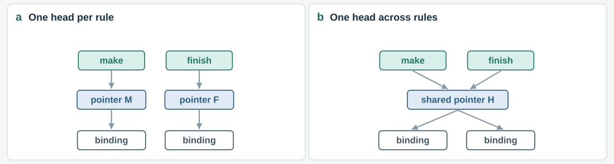

a　两个规则各训练指针头。b　用同一组指针参数读取两个规则的端口角色及实例记忆。保留角色输入，两原型均可区分有序操作数。

**固定条件。** 两支固定同一编译器角色编码、同一字段投影和训练期辅助头。固定其余网络，报告独立参数量；检查等参数量版本。先在新规则的少样本适配及老规则回放上配对。

**判据与读数。** 完整非空图分别为独立头 3/0、窄共享头 0/4（各 /448）；同独立头总参数数目的宽共享头为 2/3。4 个双头已见的模板上分别为 2/0 与 0/4（各 /256）。种子间方向不同。

两支从相同指针打分开始，宽共享头是参数量敏感性检查。实际执行的是已绑定的生产者 frame 到消费者端口的两步接口。　档案 S10。

<a id="a03"></a>

## 图 03　跨 row 的地址需要几条旋转轴？

**已测 · 多端口寻址。** 一个引用要指出同一张图的第几行、行内第几个 token。引用内部端口时，还要指出该模板的哪一个有序槽。

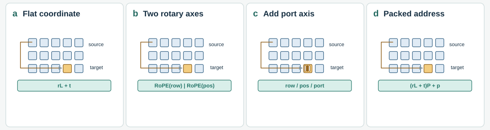

a　展平 token 位置 rL+t。b　行号与行内位置分轴。c　再给内部端口分配旋转轴。d　将完整 (r,t,p) 打包为 (rL+t)P+p 后用一轴旋转。四组都获得相同的连续端口内容特征。

**固定条件。** 相同 48 个旋转通道、内容头、初值与训练数据。Run 1 用学习的指针读取源，Run 2 按原始地址在生成前沿中寻找真实父槽。对同一逻辑图移动 Cell、重编各 Cell 内部端口并重新映射引用。

**判据与读数。** 换行数或行长、维持三个端口时，八份权重均 128/128。端口增至四个时两种子分别为 a 128/0、b 0/0、c 0/0、d 128/128。固定三实端口的事后检查还发现公共内容归一化依赖 stride。

同一图重编内部端口后，离散引用可全部映回原图，连续 latent 仍非逐位规范。图 20 的冻结前沿还显示，同地址活／失活副本需要额外区分。　档案 S13。

<a id="a04"></a>

## 图 04　一个策略展开到多行，会损失多少覆盖？

**已测 · 零更新展开。** 先在单行轨迹上学习规则与实际生成历史，再复制相同的策略参数。零样本展开能直接测到多行新增的协作难度。

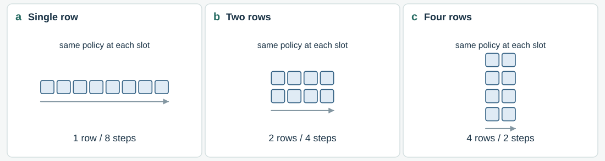

a　1×8，顺序生成八个位置。b　2×4，每轮两行并发。c　4×2，每轮四行并发。每种布局每个 Run 都有八个可用输出位置。图中每个方块代表一个潜在输出。

**固定条件。** 固定两种子、8 个自由输出槽、输入、静态计划和训练后的权重。位置由共享坐标函数编码。另将相同的行内依赖串行执行作对照，并分别只改变 make 或 finish 的行数。

**判据与读数。** 768 张非空图的第二 Run 完整数（种子 1703 / 1709）为 1×8：175/312，2×4：47/0，4×2：2/0。中位延迟约 8.4→6.3→5.1 ms。只展开 finish 到四行已降至 2/0。

每行只消费本行上一个实际 token。4 行同轮跨行重复 208/732 次；串行执行相同依赖得到完全相同的离散结果。　档案 S14。

<a id="a05"></a>

## 图 05　哪一种训练信号会让两行分工？

**待验证。** 同一轮两行各自选择合法绑定，可能同时认领 (A0,B0)。在单行轨迹中没有这类同时争用的反馈。

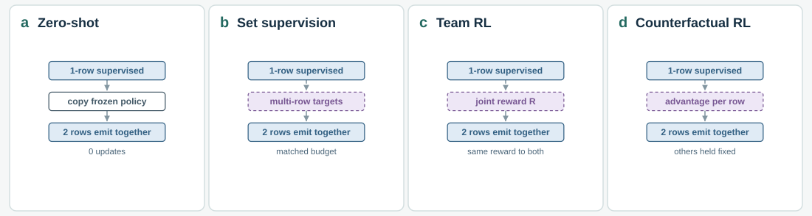

a　从单 row 检查点复制，零更新。b　在两行上继续无序集合监督。c　两行共享轨迹级奖励，按唯一合法绑定、实际被消费的父及整图完成度计分。d　保持同一奖励，训练 critic 并估计固定另一行时改变本行动作的优势。

**固定条件。** b/c/d 同初值、图集和环境步数，训练算力另报。保持探索和空槽选项。c/d 的奖励、轨迹预算与 actor 结构相同，仅改变优势估计。推理阶段直接读取模型生成的绑定。

**判据与读数。** 对 c/d 重点看非空图完整率、重复、遗漏和按正确图计的吞吐。用全空、重复输出、无关合法输出检测奖励漏洞。若 RL 优势只来自更长训练，不能归因于信用分配。

d 借鉴 COMA 的反事实基线，actor 仍共享。通用的多智能体研究没有直接验证 EggFuse 上的可行性。　档案 S3 · M2。

<a id="a06"></a>

## 图 06　让模型决定本轮启用几行

**待验证。** 一张图只有一个就绪义务时，多启动三行可能增加开销；两个独立生产者均已就绪时，启用更多行可能缩短等待。


a　固定上限 R，所有 R 行始终参与计算。b　同一策略增加启用门，在每轮选择活跃行；图中空心格表示该行本轮未启用。总容量和最大时限保持相同。

**固定条件。** 先完成图 04 的固定宽度验收。两支使用同一轨迹奖励与训练预算；分别报告只做 dense mask 和真正跳过未激活行计算的实现成本。

**判据与读数。** 按就绪义务数分桶，观察活跃行数、未完成义务、冲突与正确非空图/秒。一次输出空槽不表示饱和。若正确率下降或宿主调度吞掉节省，维持固定宽度。

b 的活跃行数随时间可变。门控状态和行地址需分开保存，以免旧引用随行复用而改义。　档案 S1 · S9。

<a id="a07"></a>

## 图 07　哪些消费者确实需要等待？

**待验证。** 串行日志里的 P0、P1、C 顺序不足以说明 P1 必须等待 P0。设 C 需要两个父；另一条 V 只需要 U。

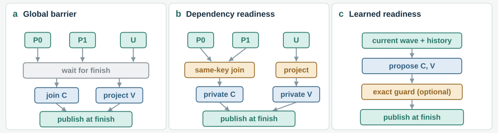

a　全体生产者经过轮次屏障，再开放两个消费者。b　用依赖与阶段可见性维护就绪条件；当 U 就绪时 V 可以前进，C 仍等待第二个父。此处是扩展测试图。

**固定条件。** 从同一源调度出发。对照图成对只改变一个父是否已经发布，保留未完成义务。编译器提供确有依据的依赖底线；若增加学习型就绪预测，单独与精确就绪基线比较。

**判据与读数。** 逐 Run 核对 RHS、发布和最终图，观察过早消费、永久等待、无关 row 空转及同步时间。训练示例要同时含必须等和可独立推进的执行。

现有两规则实验中 finish 读取 Pair 和 Request。这里的“两父＋无关消费者”图用于识别同步能力，尚未实测。　档案 S1 · S9。

<a id="a08"></a>

## 图 08　模板投影与训练期字段头各起什么作用？

**已测配对。** 相同的实例指针已经确定 key 和 value 的来源。把字段改成静态读取会消除值预测错误，但也改变了 latent 得到的训练信号。


a　字段头从 latent 预测字段。b　GPU 按模型选择的实例指针 gather 编译器指明的列。c　推理仍走 b 的路线，仅在训练中为字段头增加辅助损失。三个模型都自己选择引用。

**固定条件。** 两个种子 1703/1709，每个种子三支共享配对初值、4,096 张两规则训练图与 2,000 步预算。碰撞验收合并左右面板，共 512 张非空图，910 项 Result 义务。

**判据与读数。** 第二 Run 完整图 a 为 49/41，b 为 39/37，c 为 65/67（依种子排序）。c 的遗漏为 550/579；相同条件下 MPS eager 两个 Run 中位数约 15.29/13.87 ms。完整覆盖仍然很低。

c 表明在此次碰撞分布上辅助监督值得保留。普通 IID 上该趋势没有在两个种子均复现。　档案 S1 · S2。

<a id="a09"></a>

## 图 09　消费者能否辨认同字段、异父的 Pair？

**已测干预。** 反事实样本中 A/B、字段、请求位置、tag 与干扰项都相同，只把请求从同字段的一个父改到另一个父。


a　向 finish 提供完整 90 维 token。b　仅把两个显式父地址的符号通道置零。c　同时屏蔽 64 维 latent 与显式地址，保留激活和字段。三支都保留原始 Pair 供审计。

**固定条件。** 同一冻结模型、同一输入，只改变第二 Run 可见的通道，第一 Run 必须逐位不变。每个留出面板为 128 对反事实请求，256 图；不可把一对中的两图当独立拓扑。

**判据与读数。** 辅助头版本第二 Run 的完整非空图从 a 的 65/67 降到 b 的 4/1，c 为 0/3，分母均为 512。a 中变更请求在一对的两次均正确为 27/14 对，b 仅 1/0 对，分母为 256 对。

这是对既有权重的干预。隐状态与物理槽位仍可能携带身份；退化本身不能证明其他表示无法学习身份。　档案 S2。

<a id="a10"></a>

## 图 10　跨轮传递连续 latent 还是规范符号？

**已测配对。** 在固定锚点的路径组合任务里，将同一个学习算子反复作用于上轮实际输出，能否一直保持可解码和可接续？


a　直接反馈 64 个连续数。b　将模型自身预测的四个类别转为 40 维 one-hot，补零至 64 维。两支均预测父指针，训练采用 2–4 轮，验收连续展开 12 轮。

**固定条件。** 配对维数、数据、训练预算与种子。无教师中间状态；每轮从第一轮起累计核对绑定、字段、地址。双尾链与尾链入二环各有 256 个编号、布局、数值实例。

**判据与读数。** 12 轮全部正确：双尾链 a 为 3/0，而 b 为 256/256（每种子分母 256）。尾链入二环分别为 10/6 与 256/256。固定周期路径限制了外推范围。

本图的 64 维 typed 接口与两规则实验的 90 维混合 token 属于不同任务；完成长接续不能推出自由多行分工成功。　档案 S6。

<a id="a11"></a>

## 图 11　有固定锚点时，程序替模型完成了多少分工？

**已测任务边界。** 一锚点一产物时，程序已经指定谁开工。一个源实例有零个或多个匹配时，网络必须同时决定激活、绑定及整批覆盖。


a　锚点指定每个输出槽。b　自由槽自行选 active/null 与两个指针，当前查询可以跨行交互。c　相同自由槽与整图源输入，只将当前查询交互限制在行内。b/c 均用无序目标训练。

**固定条件。** b/c 是同预算配对，只改查询通信掩码。历史 a/b 同时改变了每锚点义务数；隔离分配自由度应在同一可变匹配图上额外比较给定分配与自由分配，并披露教师分工。

**判据与读数。** 4×2 IID 完整图，b 为 63/55，c 为 84/115，分母各 256。c 的 1709 剔除空图后为 84/224；126 图只因遗漏或重复失败。源输入全可见，行内通信并不等于独立图计算。

此图的通信边连接当前轮查询；图 13 的边连接已生成历史。分别切断它们，可以定位协作使用的是哪种信息。　档案 S3 · S6。

<a id="a12"></a>

## 图 12　训练时约束总认领量，能消除重复吗？

**已测配对。** 仅按槽位监督，无序匹配可以学得局部正确但全局遗漏。给每个合法绑定加一个软认领量，可检查训练目标能解决多少问题。

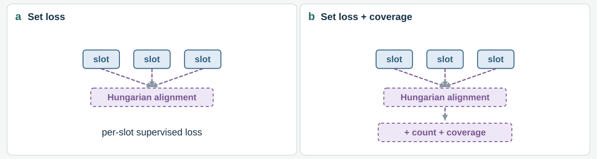

a　匹配真实预测与离线目标，监督激活、两个指针和字段。b　在同一损失上增加软绑定覆盖与总激活数量误差。两者推理图完全相同。

**固定条件。** 四份原对照与四份新模型配对训练。固定初始化种子、数据、分类头、推理过程，保留所有最终权重。b 同时加入两个损失项，现有数据只能判断合并作用。

**判据与读数。** 4×2 IID 四个配对的完整数为 63→78、55→156、84→138、115→101。第一对遗漏 314→206，但重复 64→155。两个半激活槽的总权重可为一，硬解码却两者都为空。

软误差帮助诊断；验收取真实激活后的离散 token，并在非空留出集上复核。　档案 S4。

<a id="a13"></a>

## 图 13　让下一位置读取历史，是否就会互补？

**已测配对与干预。** 同一语义阶段内每轮每行发一个 token。后续查询可以读取先前发出的 90 维 token；同一轮内还看不到其他行的最终认领。


a　训练 blind 模型，把相同历史槽的载荷清零。b　另训 feedback 模型，读取所有行的实际生成历史。c　对 b 的已训权重做推理干预，只允许看同行历史。

**固定条件。** a/b 同初值同预算，GPU K/V 和历史槽数量相同。b/c 权重相同。将另训对照与推理屏蔽分别解读。源表在这些发射轮仍可读取。

**判据与读数。** 4×2 IID，a 为 94/80 完整图，b 为 34/43，c 为 35/44，均 /256。b 的首个种子对 928 项义务只激活 472 个输出；低重复率须连同漏报解释。

历史确实改变了后续 token。现有训练配方中，这条反馈路径未带来稳定的整图收益。　档案 S5。

<a id="a14"></a>

## 图 14　一份全图 latent，还是多份 local latent？

**待验证。** 如果大部分匹配局部可完成，分区可以减少一次推理要记住的状态。跨区读写和 union 可能抵消收益。

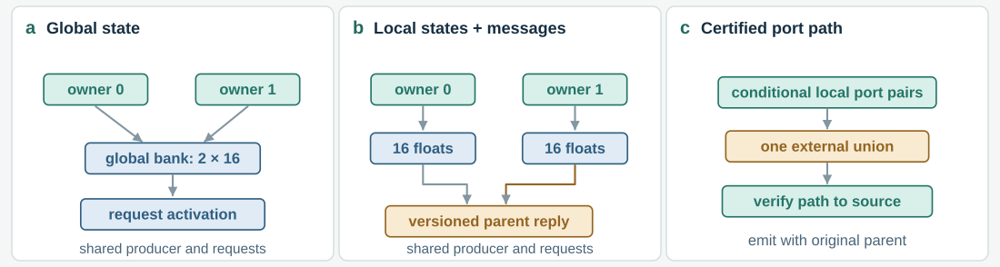

a　实例更新都读一份共享 latent。b　每个 locality 保存自己的状态，通过带父引用、版本和阶段的消息传递边界变化。两支共享相同模板库与外部接口。

**固定条件。** 固定总 latent 宽度预算、合法动作、原始 Run 和可见信息；按跨域边比例、fan-out 与 union 分层。记录消息延迟、丢失、重发和热点。

**判据与读数。** 逐 Run 对齐 RHS、有效写入、Spine 与最终图。报告本地完成比例、跨区失效率、端到端延迟。若 b 只通过低跨域样本，应限制准入范围。

row 是并行发射序列；locality 是状态和依赖的分区。可让多个 row 服务同一 locality，实验时分开调节两者。　档案 S9。

<a id="a15"></a>

## 图 15　union 立即处理，还是在可见边界集中处理？

**待验证 · 神经端。** 一个别名变化可能让旧的否定证据失效，也可能唤醒远处消费者。延后处理只有在所有可观察结果仍对齐时才有意义。


a　收到合法等价见证后应用 union，按需 rebuild。b　把等价见证加入待处理集合，在依赖等价状态的读者之前合并并修复，记录 epoch。

**固定条件。** 给两支相同的 union 请求、顺序要求和观察点，显式加入必须马上观察等价关系的反例。旧边界记录保留至所有读取者完成。

**判据与读数。** 检查每个观察点的等价闭包、负证据、最终图和漏唤醒数；比较 stall、每批 union、索引维护与正确吞吐。一次非法早读或晚读就否决该调度。

图中 p 和 q 是逻辑端口。等价成立不自动转移实例所有权。这里评估神经执行中的两条路径。　档案 S9。

<a id="a16"></a>

## 图 16　组合为大 Cell 后，旧端口怎样保持有效？

**待验证 · 神经端。** iterative Bake 可以把两个小模板组合。若外围消费者仍持有旧引用，新实例必须能解释旧引用指向的逻辑成员。


a　组合后保留源实例和旧端口供读取。b　转移所有权，并用带 generation 的端口映射转发旧引用。两支产出相同的组合成员。

**固定条件。** 加入两行抢同一源实例、旧 cursor 仍活、union 发生于转移之前或之后三类样本。按同一 Run 调度执行，测量版本失效和拒绝重试。

**判据与读数。** 检查旧端口可解码、无双重接管、未完成义务可达和精确有效写入。报告正确完整图吞吐及冲突成本；实例存储量仅作为资源指标。

此前确定性原型验证过给定提案的部分契约；学习型 row 自主生成并发转移的收益仍待验证。　档案 S7 · S9。

<a id="a17"></a>

## 图 17　逐步证明与 Bake 组合证书的成本

**待验证。** 网络提交两个父引用后，验证器是否只需检查一个已证明模板的边界就能接受一段跨阶段补全？

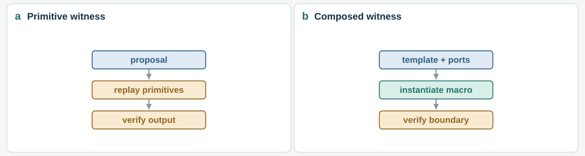

a　为实例发出原子规则见证，检查每一步。b　共享已证明的组合宏，实例只发模板与有序端口绑定，验证器核对前提、epoch 和输出。

**固定条件。** 两支验证同一推导和同一观察点，离线证明成本摊销另列。注入错父、过期等价证据、未知模板和缺失端口。严禁验证器搜索缺失见证后替模型填空。

**判据与读数。** 记录证书字节、检查数、拒绝率、漏接受数、验证时间与整轮净耗时。合法性与覆盖分开：每个证书都合法也可能漏掉一个义务。

若检查仍需重做完整匹配，则组合证书没有节省这部分工作。　档案 S9。

<a id="a18"></a>

## 图 18　提前在 Cell 内生成未来 Run 的成员

**待验证 · 神经端。** 在 primary 规则 a 的 Run 内预生成未来规则 b 的成员，何时退出和发布，才符合原调度？


a　按原阶段生成与发布。b　预生成受支持成员，primary 达到固定点就退出。c　同样使用延迟可见性，等待整个 integral 规则集达到固定点。

**固定条件。** 冻结原 Run 时间线和可见读取者。提前产生的私有成员携带有效性条件，直到原边界才允许消费。必须覆盖 union 导致未来前提失效的情况。

**判据与读数。** 逐 Run 对齐发布与支持证据，计实际被合法消费的预生成成员、无效预生成、分配曲线及整轮耗时。更早达到同一 RSS 峰值本身不能证明预测有效。

图中 private B 表示有阶段标签的内部成员；b/c 的差异仅为旧阶段的退出条件。　档案 S9。

<a id="a19"></a>

## 图 19　有限预算下，谁决定继续、延后或停止？

**待验证。** 神经策略可以学习在资源有限时先处理哪些义务。要区分本轮预算用完、义务暂缓和源 ruleset 已经饱和。


a　固定 K 轮后返回并携带待办。b　精确追踪待办、在途消息及可见 delta，达到闭包后停止。c　学习型门控根据状态选择继续或延后，声明饱和须另外满足精确检查。

**固定条件。** 同一初始图、同一源语义；比较等计算预算与等正确性两条曲线。构造稀有延迟到达的事实、空输出后又能唤醒规则的反例。

**判据与读数。** 报告残留义务、假饱和、推导轮数与非空完整图/秒。若 c 隐藏了未完成义务或跳过必须观察的 Run，停止准入。

γ 或 learned gate 可以学习调度决策；在编码契约里，未完成与已证明闭包必须解码为不同状态。　档案 S9。

<a id="a20"></a>

## 图 20　Bake 已证明的 union 应怎样进入端口 GNN？

**已测 · 两个留出族。** 图 01 编码静态接线。若模板 T 能证明第 k 步完成后 p ≡ q，同时保留两个端口的来源，指针头能否用这一信息区分“语义同类”和“同一父实例”？


a　保留现有显式端口与等值检查。b　每个端口接自己的单例类节点，控制新增节点类型与消息路径。c　加入带生效点的、已证明的两两等价边。d　用同一份已证明分区，把 p、q 连到同一个模板局部类节点；原端口及有序身份仍保留。

**固定条件。** 固定逐端口 GNN、指针头、参数预算和源见证。c/d 提供相同等价信息；分开报消息轮数、有效传播距离、边数与缓存成本。编译时绑定证明、前提、sort、模板版本及最早可见步骤；外部实例后来发生的 union 另行处理。

**判据与读数。** 384 张非空图，a 完整 49/41，b 为 79/34，c 为 61/65，d 为 59/64。擦除生效证书后，c 降到 44/53，d 降到 34/44。两种子均未观察到类节点优于两两边。

10 个经原生重放的模板，384 图均已供齐所需父。同类换源时每臂至多 1/30 对能两端都选对；局部等价判定与来源选择必须分别验收。　档案 S11 · S12。

## 现有配对数据

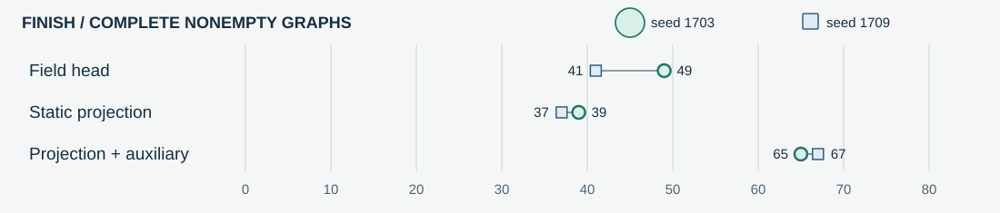

横轴是通过数，两个种子均以 512 张碰撞图为分母。应同时检查整图正确、合法引用、重复和遗漏。运行时报告等正确性下的延迟和每秒正确非空图；数据按源码家族、模板接线和随机种子冻结。完整实验登记与反证条件见 PDF 倒数第二页。

## 证据与图源

- S1　[PyTorch 实现与计时](../../benchmarks/multi-row-generation/torch_crossrun/README.md)
- S2　[真实两规则与掩码统计](../../benchmarks/multi-row-generation/crossrun/results/metrics.tsv)
- S3　[无锚点集合生成](../../benchmarks/multi-row-generation/allocation/README.md)
- S4　[软覆盖监督](../../benchmarks/multi-row-generation/coverage/README.md)
- S5　[分轮历史干预](../../benchmarks/multi-row-generation/streaming/README.md)
- S6　[12 轮连续与符号接口](../../benchmarks/multi-row-generation/typed/README.md)
- S7　[确定性 Cell 机制](../../benchmarks/multi-row-cell/README.md)
- S8　[额外 eggcc 工作负载和家族拆分](../../benchmarks/eggcc-diversity/manifest.json)
- S9　[长期架构与源语义契约](../MULTI_ROW_EGRAPH_NEURAL_PLAN.zh.md)
- S10　[单 row 的头共享与 Bake 编码实测](../../benchmarks/multi-row-generation/port_ablation/README.md)
- S11　[模板局部等价类的证据与冻结协议](template-eclass.md)
- S12　[图 20 四臂两种子实测](../../benchmarks/multi-row-generation/eclass_ablation/README.md)
- S13　[跨 row/位置/端口寻址及真实前沿迁移](../../benchmarks/multi-row-generation/address_ablation/README.md)
- S14　[图 04 单 row 零训练展开与消费者诊断](../../benchmarks/multi-row-generation/width_ablation/README.md)
- M1　[Gilmer 等，ICML 2017，消息传递神经网络](https://proceedings.mlr.press/v70/gilmer17a.html)
- M2　[Foerster 等，AAAI 2018，反事实多智能体信用分配](https://arxiv.org/abs/1705.08926)

## 重新生成

在本目录运行以下命令。SVG 保留可编辑文本及矢量连线；Typst 排版和 Markdown 使用同一份 `plates.json`。参考渲染使用 macOS 的 Hiragino Sans GB 与 Songti SC。

```sh
python3 draw.py
python3 build_readme.py
typst compile Cell多行推理架构消融图册.typ
```
