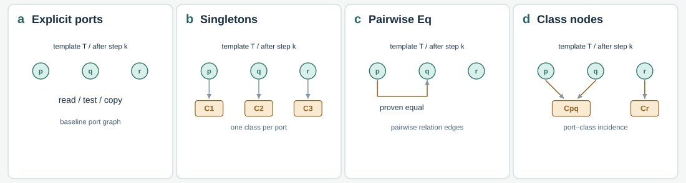

# 图 20：把可证明的模板端口等价分区交给 GNN

**状态为待验证。** 当前 01–02 的同一图里，端口进入 equality 节点表示需要检查的条件。Bake 的 Cell e-graph 还能记录 Cell 表达式同类；要给具体端口增加成员边，必须再给出从模板、端口到等价证明及生效位置的映射。

| 臂 | 额外可见信息 | 单独回答的问题 |
|---|---|---|
| a 显式端口 | 现有有向读、谓词、复制、发布接线 | 图 01 中逐端口 GNN 的基线 |
| b 单例类节点 | 每个端口拥有一个私有节点，均无非平凡别名 | 加入新类型和路径本身的作用 |
| c 等价端口对 | 将已证明的同类端口编码为等价关系边 | 已证别名相对 a 是否帮助选择 |
| d 类成员图 | 保留端口，在有效阶段将它们连到同一局部类节点 | 在等价信息相同的 c/d 之间比较消息传递与开销 |

成员关系这部分是二分图。其余图仍含有序操作、端口、检查和发布边。类标签取模板内匿名标号，不把分配顺序或 runtime Eq ID 当特征。训练时随机重命名类并同步重映射；输出须能还原原始父引用，允许同类的不同父承担不同的来源义务。

**准入。** 每条非平凡合并需要模板/版本、两个同 sort 的端口、证明来源、必要前提、最早合法读取的步骤。仅在有效条件下激活 membership。Bake 中两个表达式落在同一 e-class、候选 frame 碰巧相等、尚待匹配的等值谓词，均不足以单独发出无条件端口证明。外部实例临时合并走独立运行时输入通路，不能写成这个模板所有实例的共同事实。

**配对。** 使用同一份单 row 轨迹、同一逐端口 GNN、同一头和辅助监督；同样本／种子比较 a、b、c、d。c/d 用完全相同的已证分区。直接边是一跳、通过类节点通常两跳，分别控制参数、有效邻域及传播步数，计入冷编码、缓存后的端到端时间与边数。保留整族结构留出，核对训练与测试均实际含可辨别的非单例分区。

**验收。** 单列 union 前、union 后、始终未合并、外部跨实例后来合并四类输入。记录非法提前同类、错误跨实例传播、丢失父来源、正确父已供齐时的错父、非空整图完成、重复和遗漏。CPU 只做事后审计。若当前材料不足，应补带明确 union 证书的真实 Bake 工作负载，另用受控正/负例调试验证器，再把结果分开报告。

**当前材料。** 本轮重建的 sum-bits 与 Raytrace 的 `bake/cell-egraph.json` 各报告 38 个表达式类、51 个 registered compositions 与 0 个 `certified_unions`。这是这两份 Bake 摘要的计数；它不说明 eggcc 所有运行都无 union，也不等价于已经验证了端口别名。图 01–02 实际导出的节点类型与关系见下方源码，尚无类成员边或带阶段的 union 证书。图 20 尚无模型得分。[当前提取器](../../benchmarks/multi-row-generation/port_ablation/corpus/export.py) · [Bake 自身的报告语义](../../src/native_cell_egraph.rs)
